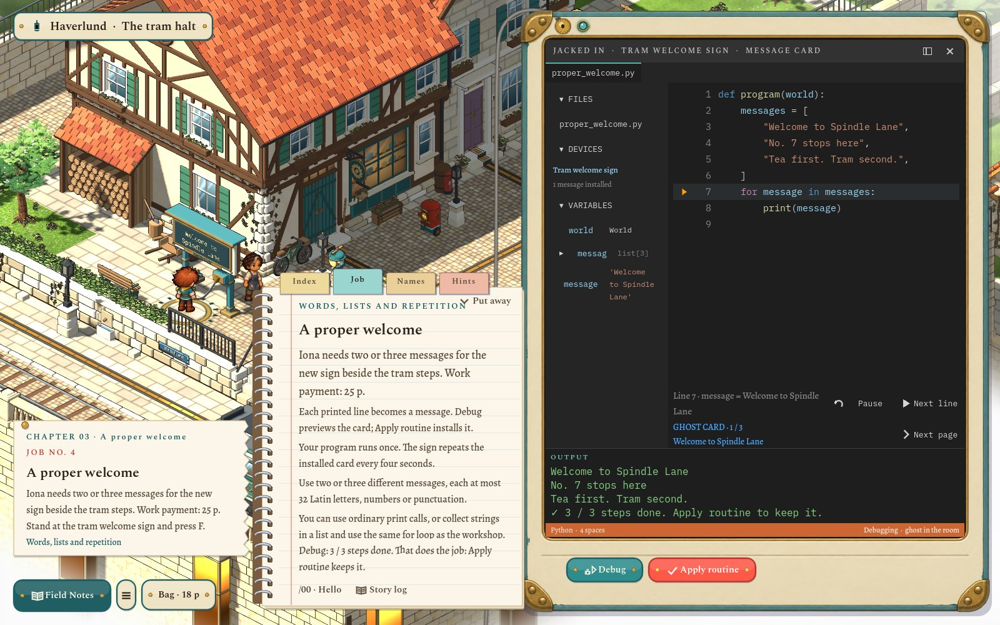
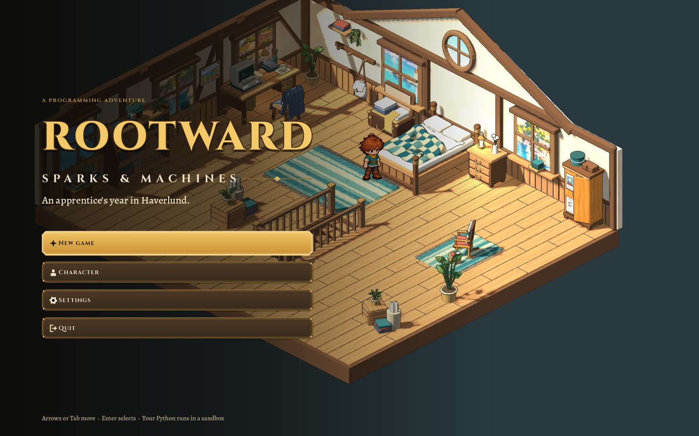
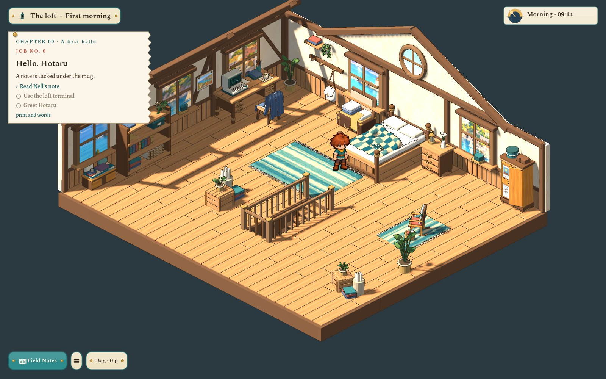
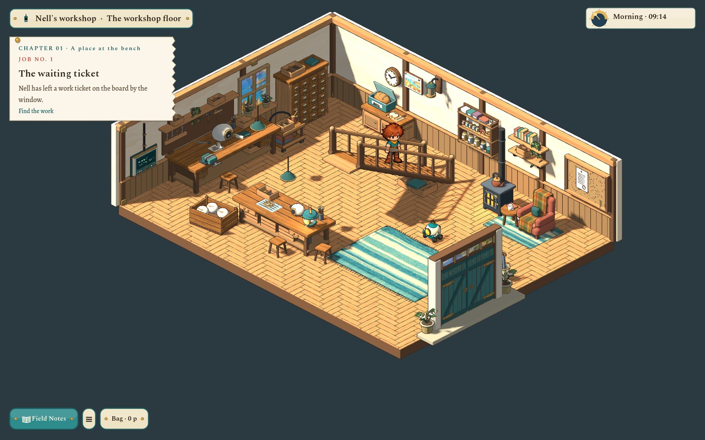
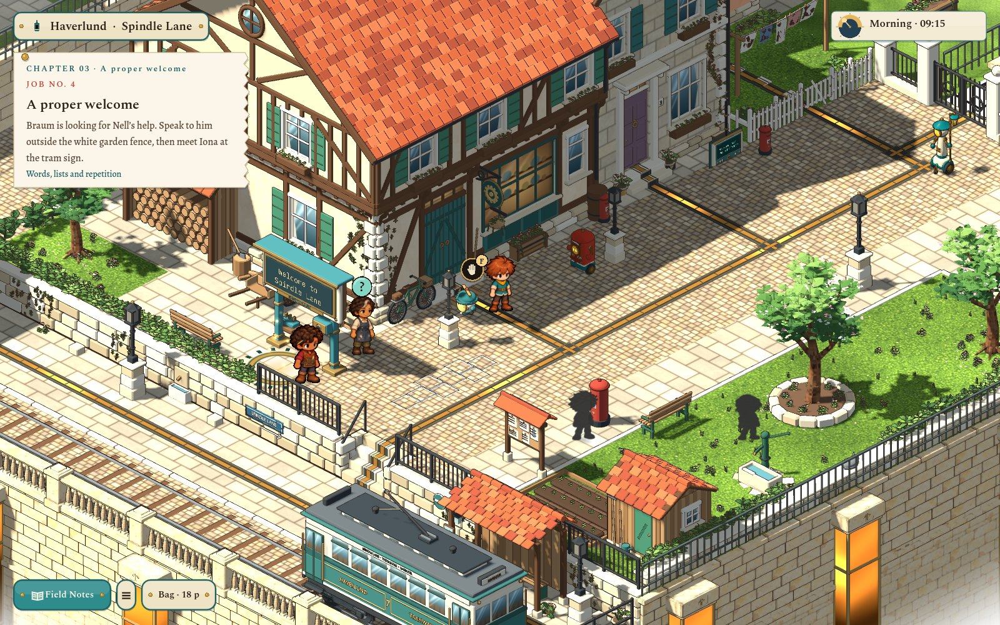
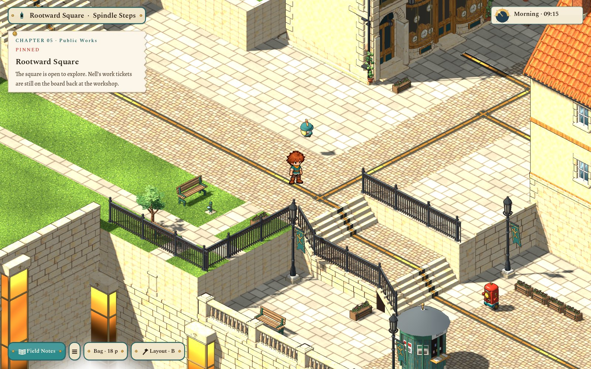
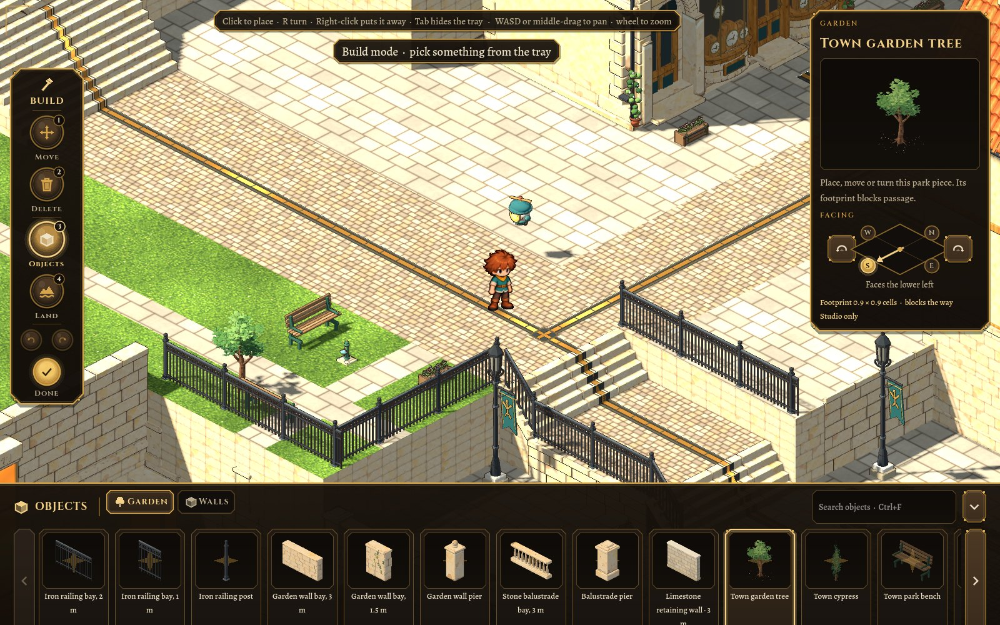

# Rootward Voxel

**Write real Python to wake the quiet machines of a harbour town.**

*Sparks & Machines* is a young lodger's year above an automaton workshop in Haverlund, a mid-century harbour town
whose lamps, signs and robots are waiting for someone to write their routines. Every program you write runs as real
Python, in a sandbox, and what it computes is what happens in the world. Version 0.1.0, for Windows and Linux.


*Chapter 03, "A proper welcome": a `for` loop over three messages, stepped line by line. Debug previews the sign;
Apply installs it and pays 25 p.*

## Install and play

### Windows

1. From the [latest release](https://github.com/TylerFreemont0712/Rootward-Voxel/releases/latest), download
   **`Rootward-Voxel-Setup-<version>.exe`** (under *Assets*, not "Source code").
2. Run it. Windows may say *"Windows protected your PC"* because the installer is not code-signed: click
   **More info**, then **Run anyway**.
3. Choose where to install (the default needs no administrator), keep or untick the shortcuts, and click
   **Install**. Setup downloads the game (about 630 MB) with a progress bar, checks every file, and tests that Python
   runs on your computer.
4. Click **Play Rootward Voxel**. Afterwards it is in the Start menu (and on the desktop if you kept that shortcut).

### Linux

1. From the [latest release](https://github.com/TylerFreemont0712/Rootward-Voxel/releases/latest), download
   **`rootward-voxel-setup-<version>-linux.tar.gz`**.
2. Unpack it and run the installer:
   ```sh
   tar -xzf rootward-voxel-setup-*-linux.tar.gz
   ./rootward-voxel-setup
   ```
3. Install as above. Rootward Voxel then appears in your applications menu (with an *Uninstall* action) and, if you
   kept it, on the desktop.

**Updating, repairing, uninstalling:** run the setup again (it is also in the game's folder). It finds the installed
game and offers **Update** (only what changed is downloaded), **Repair** and **Uninstall**; on Windows uninstalling
also works from *Settings → Apps*. Saves are never touched: they live in `%APPDATA%\RootwardVoxelLab` on Windows and
`~/.local/share/RootwardVoxelLab` on Linux.

**Without an internet connection:** put the installer and the release's other files for your system
(`rootward-voxel-manifest.json`, `rootward-voxel-<v>.pck` and the two `…-<system>-….zip` files) in one folder, and run
the installer from there.

**Nothing else is needed:** no Godot, no Python. The game carries its own engine and its own Python, compiled to
WebAssembly: your programs cannot touch your files or the network.

## The game

| | |
|---|---|
|  |  |
|  |  |
|  |  |

Start beside the bed, read Nell's note under the mug, then use the desk terminal to open **Field Notes /00 · Hello,
Hotaru**. A line of Python (`print("Hello, Hotaru!")`) runs through the real sandbox, and Hotaru, Nell's old robot,
wakes. From there:

1. **The workshop morning:** read the waiting ticket, light the stair lantern with a method call, then bring three
   fittings on with a `for` loop. The tablet Nell leaves on your bed jacks into each room's wall screen.
2. **Spindle Lane and the tram halt:** the street outside, with townspeople on their own routes, Pip on his postal
   rounds and a tram about every ninety seconds.
3. **Rootward Square:** the hub, high over a harbour hidden in white mist, with shops you can enter (Morning Loaf, The
   Pantry, Finch & Thread, Pendulum & Pin), City Hall, the bank and the Rootwell at its centre.
4. **A proper welcome:** write messages for the tram sign with `print`, collect them in a list and loop.
5. **After the light** and **Public Works:** the shared city clock, dusk and dawn relays, `if` / `else`, and jobs
   that rearrange the square's furniture with code. Street fixtures and robot rounds are programmable from the
   service screens.

| Key | Does |
|---|---|
| **WASD / arrows** | Walk one cell at a time (hold to repeat). Click a cell to travel there. |
| **F** | Talk to, inspect or use what the speech bubble or hand over it shows. |
| **E** | Open or close Field Notes: the code page for the thing beside you. |
| **I** | Bag: carried tools, stock, purse, bank balance and recent receipts. |
| **M** / **J** | Map / the job book. |
| **B** | Layout studio, where the square allows it: paint paths, place park pieces, move and turn them, undo and redo. |
| **Esc** | Leave a text field, close the notes, then open the pause menu. |

The story, chapters and the Python API: [docs/concept/v0.7](docs/concept/v0.7/README.md),
[v0.8](docs/concept/v0.8/README.md), [docs/PROGRAMMING.md](docs/PROGRAMMING.md) and the
[handoff](docs/PROJECT_HANDOFF.md).

## Working on it

Godot 4.7.2 with typed GDScript, developed on Linux; Windows x64 is supported for playing and testing from source.

```sh
git clone --single-branch -b release https://github.com/TylerFreemont0712/Rootward-Voxel.git   # a few MB
cd Rootward-Voxel
scripts/setup.sh           # the Python sandbox and the game's pictures and models (about 800 MB, once)
scripts/play.sh            # play from source (Godot 4.7.2 as `godot` on the PATH, or GODOT_BIN)
scripts/test.sh            # the quick tests, ~20 s; `flow`, `full`, `smoke` add more
scripts/build.sh           # Windows and Linux builds and both installers, into build/release/
```

On Windows: `powershell -NoProfile -ExecutionPolicy Bypass -File .\scripts\setup.ps1`, then `play.ps1` and
`test.ps1` ([docs/DESKTOP.md](docs/DESKTOP.md)). `scripts/setup.sh --dev` also fetches the art sources (Blender
masters, source paintings, concept boards), needed only to rebuild art.

Pictures and models are not in git, which keeps the clone small: [media.lock](media.lock) pins every file by its
SHA-256, and `scripts/fetch-media.sh` brings them from the repository's releases. How the packs, builds, the
installer and publishing work: [docs/RELEASES.md](docs/RELEASES.md).

| Folder | Holds |
|---|---|
| `content/` | Area documents (`areas/<id>.json`, `.quests.json`), the journey story and chapters, the level catalog, builder shelf and development checkpoints. |
| `core/` | Pure rules over plain data: area parsing, walkability and commands, quests, build rules and ledger, city clock, lamp and robot programs. No nodes, no files. |
| `app/` | Game flow (`game.gd`), the session, saves, settings, the self-test and the dev tools. |
| `scenes/`, `art/` | The 3D view (`scenes/world_view.gd`), per-room story stages, and builders for materials, mechanisms and sprites. |
| `ui/` | The paper-and-enamel interface: `kit/`, `hud/`, `story/`, `notebook/`, `code/`, `build/`, `screens/`, `dev/` ([UI guide](pipeline/UI.md)). |
| `sandbox/` | The pinned Wasmtime / CPython WASI runner and the Python `world` harness. |
| `assets/` | What the game loads (from the media packs). `art/source/` holds sources and editable Blender masters (dev packs). |
| `pipeline/` | Catalogs, playbooks, importers and dated reviews. |
| `installer/` | Rootward Voxel Setup, its own small Godot project. |
| `scripts/`, `tools/`, `test/` | Every command; capture and review helpers; the tests and their [manifest](test/manifest.json). |

Names follow [docs/NAMING.md](docs/NAMING.md). How the project is worked on, for people and coding agents:
[AGENTS.md](AGENTS.md).

### Tests

```sh
scripts/test.sh            # quick tier: rules, documents, art contracts, guards. Run after every edit (~20 s)
scripts/test.sh flow       # + the real game scene driven headless (~1 min)
scripts/test.sh full       # + the audit of every runtime model
scripts/test.sh smoke      # does the game boot and does every room load? (~20 s)
scripts/test.sh square lane   # any tests whose id contains these words
```

Tests run in parallel from [test/manifest.json](test/manifest.json) ([test/README.md](test/README.md)). Seven tests
compare art-source pixels; without the dev packs they are listed as skipped.

### Art

```sh
scripts/art.sh                        # accepted character, icon, portrait and ground sources -> runtime art
scripts/world-art.sh build <asset>    # a saved Blender master -> checked runtime GLB
scripts/pack-media.sh --write         # then pack what changed, commit media.lock, and --publish
scripts/readme-shots.sh               # retake this README's screenshots from the real game
```

The approved boy, camera and painted style are fixed baselines ([characters](pipeline/CHARACTERS.md),
[world assets](pipeline/WORLD_ASSETS.md), [Blender](pipeline/BLENDER.md), [materials](pipeline/MATERIALS.md)).

## Credits and licence

[CREDITS.md](CREDITS.md) lists the engine, the sandbox and the fonts the game is built on; each build carries their
licences. Rootward Voxel's code is under the [Apache License 2.0](LICENSE).
