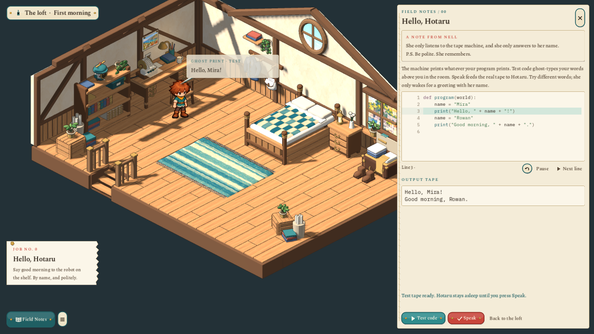
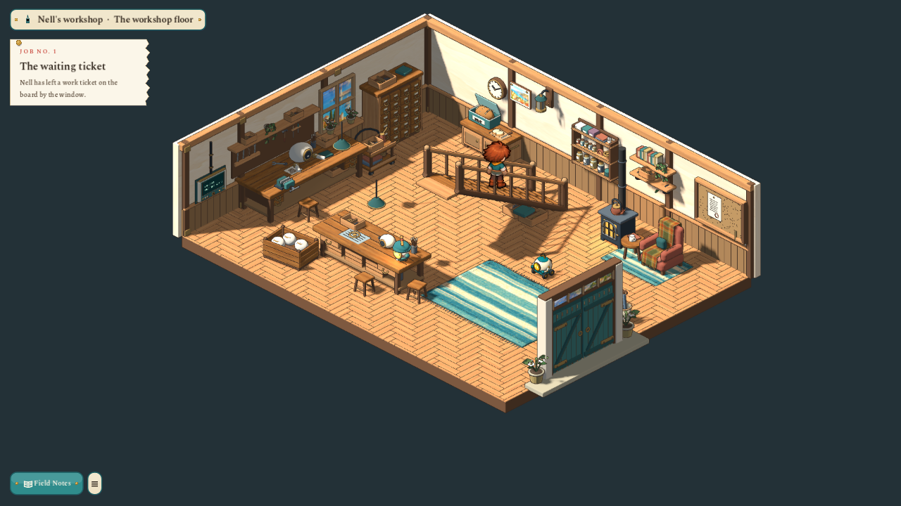
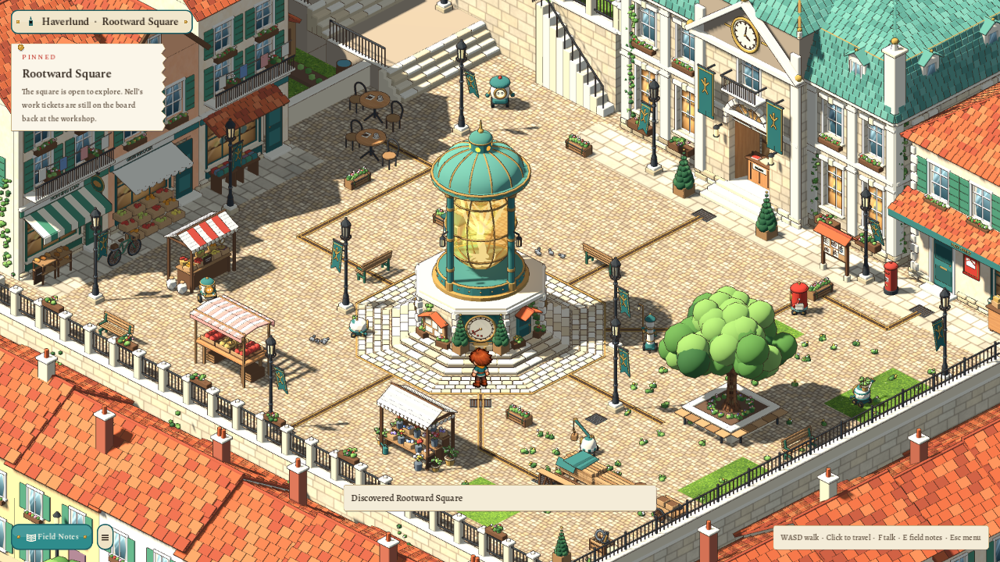

# Rootward Voxel

A standalone Godot game about learning to program by changing a fantasy world with real Python. **Sparks & Machines** is its one journey: a young lodger's year above an automaton workshop in Haverlund, a mid-century harbour town whose quiet machines are waiting for someone to write their routines. The world is textured 3D geometry; the player is the approved painted boy with directional walking animations.

Kindle Hollow and Village Morning, the two earlier campaigns, were removed on 2026-11-05 with their areas, lessons, models, tests and manuals. Their engine rules (houses, trees, terrain and water tools) survive only where the build tools and their tests still use them, over the small fixtures in `test/fixtures/`. [What was removed](docs/PURGE_2026-11-05.md).


*The loft. Field Notes /00 runs real Python: **Test code** ghost-types the output above the traveller, and **Speak** sends it to Hotaru.*


*Nell's workshop floor, with the first job pinned by the window.*


*Rootward Square, the town hub, with the Rootwell at its centre.*

## Run

```sh
scripts/setup-runtime.sh     # once, on a new Linux x86_64 checkout: the pinned Python/WASI runtime
scripts/play.sh
```

Godot 4.7.2. The title opens over the loft: **New game** goes straight to naming your traveller, **Continue** resumes the one save, and **Character**, **Settings**, **Asset Showcase (Dev)** and **Quit** sit below. Existing save and application filenames are unchanged. Windows x64 has `scripts/setup-runtime.ps1`, `play.ps1` and `test.ps1` (see [docs/DESKTOP.md](docs/DESKTOP.md)). `python3 scripts/install-desktop.py` adds a Linux menu and desktop entry. The launcher asks for NVIDIA offload on hybrid laptops; `scripts/play.sh --gpu default` keeps the system adapter.

| Key | Does |
|---|---|
| **WASD / arrows** | Walk one cell at a time (hold to repeat). Click a cell to travel there. |
| **F** | Talk to, inspect or use what the speech bubble or hand over it shows. |
| **E** | Open or close Field Notes: the code page for the thing beside you. |
| **I** | Bag: carried tools, stock, purse, bank balance and recent receipts. |
| **M** / **J** | Map / the job book. |
| **B** | Layout studio, where the square allows it: paint paths, place park pieces, move and turn them, undo and redo. |
| **F8** | Dev mode (development builds): jump to chapter starts and ends, clock phases, supply presets. Uses its own save. |
| **Esc** | Leave a text field, close the notes, then open the pause menu. |

## The journey

Start beside the bed, read Nell's note under the mug, then use the desk terminal to open **Field Notes /00 · Hello, Hotaru**. A message block or a line of Python (`print("Hello, Hotaru!")`) runs through the real sandbox, and Hotaru, Nell's old robot, wakes. From there:

1. **The workshop morning:** read the waiting ticket, light the stair lantern with a method call, then bring three fittings on with a `for` loop. The tablet Nell leaves on your bed jacks into the wall screen to give you that room's code.
2. **Spindle Lane and the tram halt:** the street outside, with townspeople on their own routes, Pip on his postal rounds and a tram about every ninety seconds.
3. **Rootward Square:** the hub, over a harbour that is kept deliberately out of sight under white mist, with shops you can enter (Morning Loaf, The Pantry, Finch & Thread, Pendulum & Pin), City Hall, the bank and the Rootwell at its centre.
4. **A proper welcome:** write two or three messages for the tram sign with `print`, collect them in a list and loop; Apply installs them and pays 25 p.
5. **After the light:** the shared city clock, dusk and dawn relays and `if` / `else` on the existing slate. Street fixtures and robot rounds are programmable from the service screens; the Rootwell needle shares the city's pressure.

The full story, chapters and API are described in [docs/concept/v0.7](docs/concept/v0.7/README.md) and [v0.8](docs/concept/v0.8/README.md), [docs/PROGRAMMING.md](docs/PROGRAMMING.md) and the [handoff](docs/PROJECT_HANDOFF.md).

## Where things live

| Folder | Holds |
|---|---|
| `content/` | Area documents (`areas/<id>.json`, `.quests.json`), the journey story and chapters, the level catalog, builder shelf and development checkpoints. |
| `core/` | Pure rules over plain data: area parsing, walkability and commands, quests, build rules and ledger, city clock, lamp and robot programs. No nodes, no files. |
| `app/` | Game flow (`game.gd`), the session, saves, settings and the dev tools. |
| `scenes/`, `art/` | The 3D view, room stages and builders for materials, mechanisms and sprites. |
| `ui/` | The paper-and-enamel interface and its screens ([UI guide](pipeline/UI.md)). |
| `sandbox/` | The pinned Wasmtime / CPython WASI runner and the Python `world` harness. |
| `pipeline/` | Catalogs, playbooks, importers and dated reviews. `art/source/` holds sources and editable Blender masters; `assets/` holds what the game loads. |
| `test/` | Automated checks, their [manifest](test/manifest.json) and `fixtures/`. |

## Tests

```sh
scripts/test.sh            # quick tier: rules, documents, art contracts, guards. Run after every edit (~20 s)
scripts/test.sh flow       # + the real game scene driven headless (~1 min)
scripts/test.sh full       # + the audit of every runtime model
scripts/test.sh smoke      # does the game boot and does every room load? (~20 s)
scripts/test.sh square lane   # any tests whose id contains these words
scripts/test.sh --list     # every test, its tier and cost
```

Tests run in parallel from [test/manifest.json](test/manifest.json), print one line each and exit non-zero on any failure or script error. See [test/README.md](test/README.md). Reviews of a changed view are made at the actual camera scale with `tools/area_shot.gd` (one area, any focus and zoom) and `tools/square_layout_review.gd` (the layout studio in a window).

## Art and assets

Playing needs no Blender, ComfyUI, AI service or network. Optional tools enter at documented source boundaries:

```sh
scripts/art.sh                        # accepted character, icon, portrait and ground sources -> runtime art
scripts/world-art.sh build <asset>    # a saved Blender master -> checked runtime GLB
scripts/asset-requests.sh list        # the queue behind the dev menu's Request update / Request new / Delete
```

The approved boy, camera and painted style are fixed baselines ([characters](pipeline/CHARACTERS.md), [world assets](pipeline/WORLD_ASSETS.md), [Blender](pipeline/BLENDER.md), [materials](pipeline/MATERIALS.md)). Edit an adopted model's own `model.blend`, or start a new version directory; never regenerate adopted source.

This project keeps its own identity and save directory, `RootwardVoxelLab`. The WASI runner is a pinned boundary (`sandbox/PROVENANCE.json`) and does not load scenes or saves from the main Rootward game.
