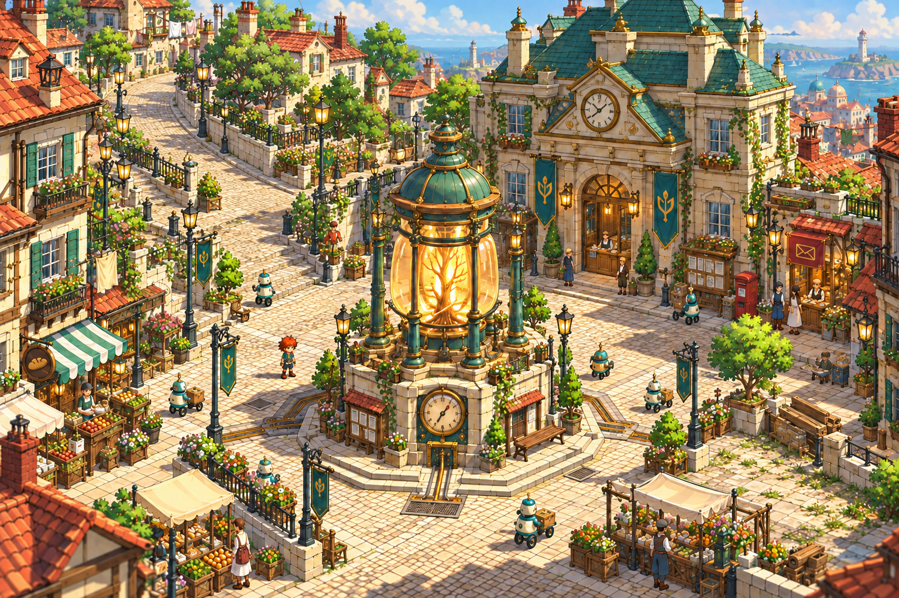

# E — Guildhall Square

**Latest combined concept, 2026-10-29.** The user prefers D’s general square and C’s upper guild hall, while finding C’s extensive verticality impractical. This image combines those features into a mainly flat civic square with more breathing space and varied background buildings. It is a concept reference. The playable square was rebuilt from it on 2026-10-29 ([review](../../../../../pipeline/reviews/2026-10-29-guildhall-square.md), [source pack](../v2/README.md)).

- D’s large amber root-power beacon remains the central meeting point, with a clear circuit around it.
- C’s cream guild hall, clock pediment, copper roof, banners and arched public counter sit on the square’s main grade. Short doorstep treads replace the raised civic terrace.
- The uphill approach continues beyond the upper-left edge. The hilltop and Nell’s workshop are off-screen, as clarified by the user.
- Attached merchant houses, a post office, a smaller service frontage and a low harbour overlook break up the background.
- Shops and movable market furniture sit at the perimeter. The right-side apron, modest verge and stored materials leave a natural place for future building and world changes.

Generated with the built-in `image_gen.imagegen` tool at 1536×1024. D is the composition/power reference; C supplies the guild hall only; the approved original workshop exterior supplies style and continuity. The original output and its three references are preserved. The current revision uses that original combined concept as its single edit target, removes the visible workshop and lets the uphill street continue out of frame; the rest of the square is retained. Both outputs were copied intact.

[Latest edit prompt](offscreen-hill-prompt.json) · [Latest provenance and hashes](offscreen-hill-provenance.json)

Previous version: [original combined concept](E-guildhall-square.png), [original prompt and reference roles](prompt.json), [original provenance](provenance.json). [Initial A–D concepts](../v2-city-concepts/README.md) are preserved.

When translating this direction to a map, keep the major doors on one walkable grade, a clear guild entrance, usable space around the beacon and a flexible side apron. The tall beacon still needs an actual-camera occlusion review. Money, quest hand-ins, new construction rules and the guild interior remain future gameplay work.
