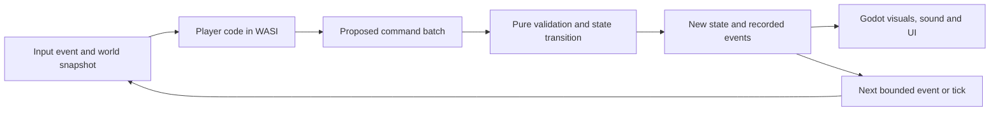

# v0.6 — Programmable voxel-inspired world prototype

Status: working standalone prototype, updated 2026-10-24; production gates remain open. The current [art/movement pipeline](../../../pipeline/README.md) and [working API](../../PROGRAMMING.md) supersede provisional choices where noted below. This spec now describes the standalone project in `Voxel-Rootward/`. Its small clearing and sandbox run are the first working slice; later stages remain gated on review. **Update 2026-10-23:** the playable level is now Kindle Hollow, a 64×48 valley with a title screen, HUD, summonable code notebook, quests and saves; see the [README](../../../README.md), [area guide](../../../pipeline/AREAS.md), [interface guide](../../../pipeline/UI.md) and [review](../../../pipeline/reviews/2026-10-23-kindle-hollow-and-notebook.md). Sections below describing a single 16×12 clearing are the original prototype slice.

The preferred visual direction is [the voxel-inspired concept](../../../reference/voxel-isometric.png): a fantasy world made from coherent, chunky 3D forms, viewed through a fixed orthographic camera. This standalone Godot project tests that direction without a main-menu link or production-game dependency.

**Implemented update, 2026-10-24:** Kindle Hollow version 2 is 96×80 cells with 21 buildings, five village residents, separate saved house instances, a forest/mist boundary and richer animated water. The boy remains the player; Mira is an NPC. The shared character template, original lesson coordinates and all five quests are retained. See [Village](../../../pipeline/VILLAGE.md) and the [review](../../../pipeline/reviews/2026-10-23-village-expansion.md). Earlier size and resident exclusions below describe the historical first slice.

**Builder update, 2026-10-24:** fifty new, individually authored Blender objects are wired into Furniture, Workshop, Market, Garden and Village & Magic. The builder has 95 entries including 82 props. Sixteen new objects expose saved Boolean `active` state through nearby F actions and `world.prop(id).set_active(bool)`, following discovery and the existing preview/Apply/Undo contract. See the [library index](../../../pipeline/BUILDER_LIBRARY.md) and [review](../../../pipeline/reviews/2026-10-24-builder-library.md). Room furniture editing, inventory, crafting and mechanism scheduling remain separate features.

**Dialogue update, 2026-10-24:** all five residents now use classic single-speaker visual novel conversations with new high-definition portraits at the smaller, raised scale, response topics, typewriter/advance/history/auto/skip/hide/settings controls, saved read flags and optional code representations. The code panel opens only on request; examples use the existing notebook and bounded WASI/preview/Apply contract. See [Dialogue](../../../pipeline/DIALOGUE.md).

The accompanying [art and AI research](05-voxel-art-and-ai-research.md) explains how code assistants can make actual geometry, how ComfyUI fits, and which models are worth testing. The [three-direction comparison](README.md) and original prompts remain alongside this project.

## 1. What must survive, and what can change

The user's two requirements are:

1. The player has substantial control over the world through real programming.
2. The world has a slightly fantasy theme.

The original exploration allowed camera, art, character proportions, village, progression, quests, battle modes, curriculum, UI and terminology to change. **The later user decision now requires preserving the approved painted adventurer's face, proportions, clothing and style while improving animation.** Existing production features remain available while the experiment is separate. Preserving old content is a possible benefit, not a condition for the prototype to succeed.

**Experience hypothesis:** exploration reveals systems the player can understand, inspect and reprogram. Programs produce useful, visible changes: connecting mechanisms, assembling a crossing, directing a helper, routing signals, or changing an object's behavior. Quests give these experiments a purpose. The fantasy comes from the world and its inhabitants; the code executes rather than merely selecting a scripted outcome.

An attractive diorama alone does not validate this hypothesis. A new area should eventually be assembled from existing parts and behaviors, with new rules added only when the area introduces a genuinely new primitive.

## 2. Initial technical decisions

These are starting hypotheses to test, not permanent commitments.

| Area | Proposed first choice | Reason and decision boundary |
|---|---|---|
| Engine | Installed Godot 4.7.2, typed GDScript | Existing engine knowledge, desktop workflow and sandbox integration reduce experiment cost. Keep the engine version fixed during the proof. |
| World | Actual modular 3D with a voxel-inspired appearance | Separate parts support assembly, rotation, animation and coherent lighting. Individual decorative cubes do not need to be game objects. |
| Camera | Fixed orthographic, diagonal azimuth; test roughly 30–35° elevation | Establish composition, readable depth and predictable picking before introducing camera rotation. Exact mathematical isometry is optional. |
| Characters | Preserve the approved whole-body painted sprite in four screen-diagonal views | Selected v9 has eight approved walk poses, mirrored SW/NW, neutral breathing idle and front-facing blinks every 6–7 idle seconds. Native cutout remains visually rejected and inactive. |
| Terrain | Finite grid with one walkable ground plane; visible banks, roofs and raised forms | Establish useful construction without immediately solving stacked floors, arbitrary digging or fluid simulation. |
| Player programs | Python first, through the existing WASI runner boundary | Prove one complete programming loop. Keep the protocol language-neutral; JavaScript parity is a later explicit decision. |
| Simulation | Pure state transitions, logical ticks and bounded events | Gameplay outcomes can be tested and replayed independently of rendering and animation. |
| Assets | Procedural tests → adopted editable Blender source → audited GLB | Implemented for cottage/workshop, mill shell and static land. Tree reference exists; varied trees/mechanisms remain procedural. Never regenerate over adopted source. |
| AI assistance | Claude Code or Codex writes generators and game code; images guide art | Judge each contribution by the files and playable results it produces. No runtime AI service is required. |

Godot's [orthographic camera](https://docs.godotengine.org/en/stable/classes/class_camera3d.html) supplies the projection. [Sprites in 3D](https://docs.godotengine.org/en/stable/classes/class_spritebase3d.html) support the proposed character test. Neither feature makes the simulation programmable by itself.

### Modular world versus voxel terrain

Start with a modular world. A door, bridge deck, wheel, roof, beam and lamp are identifiable parts. The player can meaningfully manipulate those parts through code even when the underlying mesh contains no editable voxel volume.

Add a true voxel terrain experiment only if play demonstrates that arbitrary excavation, filling volumes, or rewriting material cells is central to the experience. That would introduce chunk storage, surface meshing, collision updates, navigation changes and persistent terrain edits. It is a separate architectural choice. [Godot Voxel](https://github.com/Zylann/godot_voxel) is a relevant specialist project to evaluate at that point; compatibility with the chosen engine build must be verified before adoption.

## 3. Keep the experiment separate

Planning, research and source images live in `docs/concept/v0.6/`. This standalone project has its own resource root:

```text
Voxel-Rootward/                          # standalone Godot project root
  project.godot                           # separate application, its own identity and saves
  app/ core/ scenes/ ui/                  # app flow, pure rules, presentation
  sandbox/                                # copied WASI runner, Python harness and local runtime
  test/                                   # core and app checks
  scripts/                                # play, test and screenshot entry points
  docs/concept/v0.6/                      # original analysis, prompts and all three concept images
  reference/voxel-isometric.png           # selected visual target for the prototype
  AGENTS.md                               # shared, tool-neutral instructions for AI coding agents
```

The prototype needs a distinct application identity and explicit user-data directory; this project uses `RootwardVoxelLab`. Save format, save path, sandbox job directories, screenshots and logs must belong to that application. It must not fall back to Rootward's profiles or `ROOTWARD_SAVES` behavior.

Its launch script targets the project root. Existing `scripts/play.sh`, production autoloads, `game/project.godot` and desktop launchers remain outside the experiment. The project has its own cache/runtime ignore rules; do not accumulate generated intermediates beside the selected evidence.

This project lives in its own folder, which keeps its project settings, saves, tests and art independent from the main game. Selected runner code and the concept art were copied with their provenance recorded.

### Reuse the execution boundary, not the entire application

The useful initial subset is:

- `sandbox.gd` (Rootward source: `game/sandbox/sandbox.gd`), `sandbox_job.gd` (Rootward source: `game/sandbox/sandbox_job.gd`), `sandbox_result.gd` (Rootward source: `game/sandbox/sandbox_result.gd`).
- `Python launcher` (Rootward source: `game/sandbox/launch/launch.py`) and, if needed later, `JavaScript launcher` (Rootward source: `game/sandbox/launch/launch.js`).
- The installed Wasmtime/interpreter runtime, supplied read-only through the existing `ROOTWARD_SANDBOX_RUNTIME` override.

Vendor a small, documented snapshot into the prototype, recording its source revision and file hashes. Preserve resource paths expected by the runner and carry over relevant runner checks. A documented duplicate is acceptable for this short experiment; extract a shared package only after both projects actually need it.

The `background runner` (Rootward source: `game/sandbox/background.gd`) offers a threading pattern but includes scene-tree polling and shutdown handling. Adapt those responsibilities explicitly. The old task, thing and parts harnesses are examples to learn from, not a generic new world engine. The current C++ route runs precompiled modules; it is not an arbitrary C++ source runner.

Production's fetch, test and parse-check scripts hardcode `game/`, and the fetch script also builds current C++ cards. Write small prototype entry points rather than repointing production scripts.

## 4. The authoritative world model

Use four layers with one clear direction of authority:



The renderer can preview, interpolate and explain outcomes. It cannot decide that a bridge is passable or an objective is complete. Those properties belong to the world state and rules.

### Coordinates and identities

- Logical cells are integer `[x, y, z]`: east, north, height. Initial traversal uses `z = 0`. A stream bed can be visually lower while a bridge crosses on that walkable plane.
- One logical cell starts as one Godot world unit. Map logical coordinates to Godot's Y-up space in one adapter, conceptually `Vector3(x, z, -y)`. Screen coordinates never enter player programs or saves.
- Give regions, entities, prefab kinds, ports and programs stable string IDs. Save those IDs and data, not NodePaths, mesh names or instance IDs.
- Separate footprint/occupancy from visible bounds. Roof overhang does not become an invisible wall. Moving a deck must change both logical traversal and its presentation through one accepted transition.
- A future second walkable height requires explicit support, clearance, transitions and pathfinding rules. A tall mesh does not establish them.

### Entity components

The prototype should need only a small catalog: transform, occupancy, declared state fields, program capability, compatible signal ports, and optional traversal surface. Visual prefab references sit alongside those components, outside the rule definitions.

For example, a lamp has an addressable `enabled` field and an input port; a gate has a hinge visual plus a logical open/blocked state; a bridge deck has a grid footprint and support requirements. Components are data with explicit rules, not arbitrary engine properties exposed to player code.

### Programming protocol, version 1

Every run receives a bounded JSON-compatible snapshot containing:

| Request field | Purpose |
|---|---|
| `protocol_version`, `world_revision`, `logical_tick` | Identify the contract and the exact state being read. |
| `program_id`, `entity_id`, `event` | Identify what is running and why. |
| `run_id`, `program_revision`, `session_generation` | Identify the active request, source version and current session generation; invalidate stale asynchronous work. |
| `world` | Visible/accessible cells, entities and declared fields, in stable order. |
| `capabilities`, `budget` | Define the region, kinds, fields and amount of work this program can affect. |
| `memory`, `seed` | Explicit persistent program data and reproducible offered random input. |

The response contains `commands`, proposed `memory`, and bounded diagnostic/trace records. Runtime errors, malformed responses and rejected commands become readable results without changing the committed world.

The initial vocabulary should be small but composable:

| Operation | Required meaning |
|---|---|
| Inspect/query | Read the supplied snapshot through ordinary code; no hidden live engine reads. |
| Set declared field | Set an allowed component field on an allowed entity, with type/range validation. |
| Place/remove part | Change a permitted prefab inside the granted region, with occupancy, support and material rules. |
| Move/rotate part | Apply a discrete transform within the granted scope; validate dependencies and occupied cells. |
| Connect/disconnect | Join named compatible ports with bounded fan-out. |
| Emit signal | Send a typed event through an allowed connection or target. |

Implement these progressively. The first mechanism does not need every operation. Movement of people/helpers and repeated programs need explicit per-tick semantics; scene animation is not the clock.

A purely illustrative response shape is:

```json
{
  "protocol_version": 1,
  "basis_revision": 12,
  "run_id": "run-27",
  "program_revision": 3,
  "session_generation": 2,
  "commands": [
    {"op": "set_field", "entity_id": "lamp-west", "field": "enabled", "value": true}
  ],
  "memory": {"activations": 1},
  "trace": [{"line": 4, "message": "Enabled the west lamp"}]
}
```

This is a proposed protocol example, not an implemented API or a player's puzzle solution. Naming and schemas must be finalized and tested in stage 2.

### Validation, preview and commit

1. Run player code against a specific snapshot off the render thread.
2. Check the response schema, capability scope, types, work budget and command ordering.
3. Apply the proposed batch to a copy of world state. Validate occupancy, support and connection constraints in that declared sequence. Reject the entire batch if any step fails.
4. Produce the candidate state, events and a visible diff. Memory updates belong to the same transaction.
5. Preview that candidate. Apply commits **that same validated proposal** only if its basis world revision, program revision, session generation and active run identity still match. Never rerun the source to obtain a potentially different cast.
6. Source edits, undo, reset and load invalidate pending work and previews. Increment a monotonic session generation on those operations; undo restores gameplay data without restoring that counter. Explain a stale preview and require a fresh proposal. A restored world revision alone must never make an old result valid again.
7. Record accepted commands, input revision/snapshot identity, source hash, seed and diagnostics. Replay uses recorded accepted batches.

Guarantee deterministic host rules and replay. Do not promise that arbitrary Python or JavaScript source becomes deterministic merely by seeding a helper or pinning Python's hash seed.

### Scheduling and recovery

Start with explicit Run/Step and event-driven execution. Add bounded logical ticks only when the mechanism needs automation. Do not launch an interpreter for every object on every rendered frame.

Use a defined stable processing order, event-depth/work limits, and a stop/pause control. As provisional limits, test 64 commands per proposal and 32 event evaluations per manual step, with visible exhaustion errors. Measure runner latency before selecting automatic tick frequency; these numbers are design defaults, not measured capacity.

Reset restores the clearing. Undo restores a previous committed state, programs and memory together. Save/reload preserves programs, memory, world state, catalog/schema versions and event ordering. A failed run must not consume materials or advance an objective.

## 5. First playable slice: the Rune Mill clearing

The name and setting are disposable. Its purpose is to prove that programming, construction and fantasy belong together.

The initial proposal was roughly 24 × 24 cells. The selected working slice is **16 × 12 cells**, with a stream, houses/workshop, three lamps, a gate and a repairable bridge. Other villagers/residents are excluded by the later art direction. Keep the initial materials catalog tiny: ground/bank, stone support, timber beam/deck, wall/roof pieces, tree, lamp and gate. A single character and a handful of animations are enough.

The playable loop is: explore → inspect a problem → edit code → run and inspect its proposed changes → apply → travel/use the changed world → discover another useful interaction.

| Situation | Capability it proves | Acceptance evidence |
|---|---|---|
| A lamp responds to code | Real execution changes a declared physical-world property. | Different valid programs produce distinguishable outcomes; a syntax error leaves the lamp unchanged. |
| A broken crossing can be assembled | Code can inspect cells and place permitted parts. | At least two valid constructions work; traversal follows occupied/support state, not a separate quest flag. |
| The mill sends a signal to another object | Programs and mechanisms compose. | A recorded event changes another mechanism; an invalid connection or cycle stops with an explanation. |

Introduce them in that order. Do not create all the village content before the first interaction is convincing. A temporary inspect/run panel is sufficient before the complete editor.

Quests should observe world facts, such as a reachable crossing or a working connection, rather than one exact source string. Provide a reset and an optional inspection of the relevant cells/ports so the player can understand failures. The initial quest does not require continuous physical water simulation.

## 6. Art and presentation contract

Follow [the art research](05-voxel-art-and-ai-research.md) for production methods. For the first coherent kit:

- Use chunky silhouettes, warm wood and cream stone, restrained violet roofs, amber magic, and readable foliage masses. Treat these as a starting palette drawn from the selected concept; exact old palette constraints are not binding.
- Use a consistent modeling increment, initially 1/8 cell, with larger shapes doing most of the work. Avoid adding one engine node per decorative voxel.
- Keep physically independent parts separate: gate leaf/post, lamp body/light, wheel/axle, bridge deck/support. A moving part needs its pivot at the hinge or axle.
- Declare units, footprint, pivot, orientation, material roles, sockets, state variants and collision purpose in each asset record. A mesh is accepted only after it works in Godot at the actual camera distance.
- Start with shared flat or palette materials and restrained shading. Avoid baked directional shadows that fight the runtime lighting. Test simple contact shadows rather than relying on an offline path-traced render.
- Keep source generators and editable source files; export GLB into runtime assets. Godot's [3D import documentation](https://docs.godotengine.org/en/stable/tutorials/assets_pipeline/importing_3d_scenes/available_formats.html) supports this handoff.

Use GridMap/MeshLibrary for repeated static mesh tiles if useful, and independent PackedScene instances for interactive mechanisms and multi-part objects. GridMap exports a constrained mesh/collision/navigation structure; it does not preserve arbitrary gameplay child nodes. See [Godot's GridMap guide](https://docs.godotengine.org/en/stable/tutorials/3d/using_gridmaps.html).

Batch repeated decorative geometry only when measurements justify it. [MultiMesh](https://docs.godotengine.org/en/stable/classes/class_multimesh.html) provides instancing, with visibility managed for the collection. Logical entity IDs and selection must remain independent of any batching scheme.

### Character and camera checks

Test the sprite from all needed travel directions, behind trees, beside a raised bank, under an overhang and while crossing the bridge. Compare feet placement, alpha edges, shadow/contact treatment and visual scale. Sprite transparency and billboard shadows need an actual in-engine check; the [SpriteBase3D documentation](https://docs.godotengine.org/en/stable/classes/class_spritebase3d.html) describes those constraints.

Selection uses a 3D ray/picking adapter and logical entity IDs, including a way to reach obscured targets. Inspect labels, roof hiding/fading and a compact compass must make the world understandable at the default camera. Program coordinates must be visible when the player is working with them. Decide manual movement's screen-relative versus world-relative mapping through a small play test; do not silently inherit current 2D arrow assumptions.

## 7. Build stages and gates

Each stage produces a runnable artifact or review packet. A failed gate is a reason to revise the small experiment. It does not justify migrating production in the hope that the problem will disappear.

### Stage 0 — Lock the experiment's question

**Deliver:** a one-page play brief derived from section 5, a tiny entity/catalog list, provisional controls, and an explicit list of deferred features.

**Gate:** the player can name what they will program and how a successful program changes a usable world property. Confirm the clearing demonstrates the intended game, rather than merely a different camera.

**Defer:** full village conversion, old mode recreation, procedural continents, arbitrary digging, free camera rotation, stacked-floor navigation and an entire custom editor. These remain available choices after the slice provides evidence.

### Stage 1 — Prove isolation and real execution

**Deliver:** the separate blank Godot project, prototype launch/check commands, isolated storage, pinned runner subset and one simple Python run.

**Gate:** valid code returns a result; syntax error, infinite loop, excess memory and excess output produce bounded failures while the window stays responsive. Quitting cleans up jobs. Existing Rootward launch/settings/saves remain unchanged. The prototype can be launched directly without first opening production.

**Evidence:** launch instructions, runner results, source provenance and the actual resolved save/job paths. No new diffusion models are needed.

### Stage 2 — Prove the world contract without art

**Deliver:** versioned request/response schemas, entity catalog, small state, pure reducer, capability checks, transaction preview, undo and recorded replay. Start with set-field and place/remove, then add commands needed by the clearing.

**Gate:** valid actions change state; wrong types, unknown IDs, out-of-scope writes, overlaps, missing support and excessive work reject with no partial state or memory changes. Undo restores the prior state. A replay reconstructs the same state. A stale proposal is rejected after a world change, source edit, undo, reset or load, including when an earlier world revision reappears.

**Evidence:** meaningful core/runner tests and one readable before/after state trace. This gate proves the new game contract; engine property mutation is not an acceptable shortcut.

### Stage 3 — Prove a playable 3D graybox

**Deliver:** fixed orthographic view, one character, grid movement, picking/inspection, a blocked stream crossing, a movable/assembled bridge and a gate. Temporary developer controls may exercise the validated commands before the player editor is complete.

**Gate:** walking, occupancy and selection agree with state; the accepted bridge makes the crossing traversable; an invalid bridge cannot be walked across. Important targets remain discoverable behind scenery. The player understands which direction grid coordinates refer to.

**Evidence:** in-engine captures of the same area before/after a change, plus a short movement/selection recording. Stop to revise camera/control issues before producing the complete art kit.

### Stage 4 — Prove repeatable art production

**Deliver:** one coherent cottage, tree, lamp, gate and bridge kit using the asset contract. The procedural Blender kit can satisfy this stage independently. Test image-to-3D only if it addresses a useful unmet art need and the local dependencies are available; see the optional experiment in the research document. Test the preferred sprite character against the simple 3D stand-in.

**Gate:** exported parts preserve scale, orientation, pivot, materials and separation. The kit assembles cleanly in Godot. Rebuilding one asset from its source works. Compare total time including cleanup, not just generation time.

An unavailable or impractical LoRA/image-to-3D workflow does not fail this gate or delay the programming slice.

**Evidence:** source files/generators, catalog records, accepted runtime models, one model inspection and one gameplay-scale capture. Keep selected outputs and regeneration metadata; discard rejected large intermediates after recording the outcome.

### Stage 5 — Complete the programming loop

**Deliver:** code editing, inspectable input, Run, Preview, Apply, Step, Stop, Reset/Undo, readable diagnostics, and the three clearing interactions. Add the bounded scheduler and connections only as needed.

**Gate:** the player edits real Python, sees the exact proposed changes and commits them. At least two valid approaches solve the construction task. Runtime errors, rejected commands and event exhaustion point to the relevant source/action and leave the world usable. Preview and apply agree even with asynchronous execution.

**Evidence:** a short playthrough including a failed attempt and a successful revision, the accepted command log, and targeted tests for preview/commit and event cycles. No prerecorded outcome may substitute for a code run.

### Stage 6 — Prove reuse, persistence and area authoring

**Deliver:** save/reload of world/programs/memory, schema/catalog version checks, objective facts and a second tiny area assembled from the kit. Give the second area a different use of an existing behavior, not another large bespoke system.

**Gate:** saved state and programs survive a restart; an incompatible save fails clearly without overwriting it. A new area, instance and objective can be added through data/catalog composition without changing the renderer or writing a special quest controller. One program/assembly can be reused in another place with explicit scope/parameters.

**Evidence:** reload comparison and a record of what creating the second area actually required. This is the checkpoint for the user's goal of easier future areas and quests.

### Stage 7 — Evaluate the direction

**Deliver:** a compact evidence report: play observations, scene complexity, asset cleanup effort, runner timings, frame-time measurements and remaining restrictions. Measure the actual laptop with ComfyUI/Blender not competing for GPU memory.

**Provisional performance gates:** aim for 60 fps at 1920 × 1080 on the laptop; record median and 95th-percentile frame times across exploration and command application, including stalls. Measure Run-to-preview latency separately for small and larger programs. Use a representative stress scene with about four times the slice's interactive entities and repeated scenery; report actual counts, renderer and settings. These are targets to evaluate, not benchmark results.

**Gameplay gate:** a fresh player can inspect a mechanism, make a failed attempt, understand the failure, and reach a useful result without developer intervention. A second valid approach works. The world remains readable with the code panel open at 1280 × 720 and 1920 × 1080. A failure suggests specific revisions to test, not an invented passing result.

**Decision:** continue an independent reboot, prepare a controlled production migration, revise the experiment, or stop. Decide from play and authoring evidence as well as appearance. No calendar estimate is reliable until the first runnable stages reveal the costs.

### Stage 8 — Integrate only the proven result

This stage is a later project, specified after stage 7. Choose one destination rather than indefinitely maintaining two full implementations.

**If migrating into Rootward:**

1. Pin the successful prototype and preserve a runnable production checkpoint.
2. Extract the proven protocol/reducer/catalog and sandbox boundary with their contract tests. Inventory every production dependency before moving files.
3. Introduce the 3D view behind a separate launch mode/scene. Connect it to the new world contract, not to pixel-based Studio picking.
4. Convert one tiny authored area through a versioned converter; classify fields as mapped, manually rebuilt or intentionally dropped. Do not mass-convert PNG assets into supposedly editable geometry.
5. Decide which progress/program data has an exact mapping. Keep old saves readable in the old mode and export/import only defined fields into a new save version. Do not silently mutate existing profiles.
6. Rebuild the necessary authoring and quest flows for that one area, then repeat gameplay, persistence and performance gates.
7. Expand content only after that vertical slice succeeds. Retire old runtime/content only when the replacement scope and retained player progress are explicit.

**If continuing as a new game:** keep its own saves, world model and content. Import selected text, programming exercises, audio or art only where they fit. Share the runner as a deliberate versioned package if both games still need it. A reboot does not owe every former feature a recreation.

**If stopping:** retain the compact spec, selected visuals, key source and findings in v0.6; remove generated caches and redundant experimental assets. Production continues independently.

## 8. What should carry forward from today's code

| Current component | Disposition | Reason |
|---|---|---|
| Sandbox runner and language launchers | Reuse a pinned subset; test in isolation. | Small boundary with useful resource controls and real execution. |
| Pure state/rules discipline | Keep as a design principle. | Separates gameplay from camera, art and animation. |
| Task, quest and dialogue content | Evaluate individually after the slice. | Useful material, but old request shapes and teaching progression need not define the new game. |
| `TownThings` (Rootward source: `game/core/overworld/town_things.gd`) | Replace the world-programming contract. | Existing hooks permit own declared fields/named flags and explicitly exclude position/other-object changes. |
| `OverworldMap` (Rootward source: `game/core/overworld/overworld_map.gd`) and movement rules | Reference; do not inherit coordinate assumptions. | Current ground/walk arrays, footprints and four facings describe a 2D map. |
| `Boots runner` (Rootward source: `game/sandbox/overworld/boots_run.gd`) | Reconsider execution/cache strategy. | Its per-cell/key movement table is not a general dynamic-world scheduler. |
| `Studio picking` (Rootward source: `game/scenes/studio/studio_pick.gd`) | Rebuild as a presentation adapter. | Current screen-pixel division and alpha picking do not describe 3D selection. |
| `OverworldStore` (Rootward source: `game/app/overworld_store.gd`) | Keep out of the experiment. | Production profiles and legacy save migration are inappropriate defaults for the lab. |
| Current world PNGs | References or temporary test art. | They have no recoverable topology, independent parts or back faces. |
| `Blender world generator` (Rootward source: `pipeline/world/blender_world.py`) | Reference primitive/modeling ideas; author a new unsheared kit. | The current generator deliberately shears blockouts for the old oblique sprite projection. |

## 9. Implementation handoff checklist

Use the stage gates before expanding this working concept. The first playable slice implements the isolated shell, core contract, 3D graybox and programming loop; persistence and production integration remain future decisions.

- [ ] Stage 0: clearing brief and scope accepted.
- [ ] Stage 1: independent project/storage and real execution proven.
- [ ] Stage 2: portable state/command contract and replay proven.
- [ ] Stage 3: movement, selection and changed traversal proven in 3D.
- [ ] Stage 4: a small repeatable art kit proven in-engine.
- [ ] Stage 5: real programming, feedback and connected mechanisms playable.
- [ ] Stage 6: saves and data-driven second-area authoring proven.
- [ ] Stage 7: play, production effort and measured performance reviewed; destination chosen.
- [ ] Stage 8: the chosen integration/reboot plan implemented separately.

The initial runnable slice is now present. Review the clearing and the [art brief](../../../reference/README.md) before expanding it. The unchecked gates include work beyond this slice; the current state below records what is actually implemented.


## 10. Current standalone implementation — 2026-10-23

This standalone Godot project contains the working 16×12 Rune Mill clearing, real bounded Python/WASI, inspect/edit/preview/apply/undo/reset, integer grid steps with smooth interpolation, held-key repeat and click routing. Source text persists under its own RootwardVoxelLab identity; world state/memory reset on restart. It does not edit or depend on the main Rootward game.

### Selected character and movement

The approved painted adventurer remains the design authority. The user-approved v9 selection follows camera-projected motion: D/+x→SE, S/−y→SW, W/+y→NE, A/−x→NW. SW mirrors each corrected SE cell and NW mirrors each NE cell, preserving frame order. Eight painted poses play at 240/13 FPS for a two-cell cycle of two thirteen-tick steps at 60 Hz. Integer registration preserves source pixels; turns and held steps retain phase. Stops select the ninth, neutral pose immediately. Actor art does not determine traversal.

Neutral idle has a subtle 3.6-second breath anchored at the feet. SE/SW use a 120 ms closed-eye blink every 6–7 idle seconds; SW's blink is an exact horizontal mirror. NE/NW only breathe. Starting to walk clears idle effects. Shared frame skins now use one template for layout, timing, anchor, scale and idle, with appearance swaps preserving playback state. The approved adventurer stays the default; a second tint demonstrates reuse. Rejected bone/cutout and superseded interpolation tools are archived outside the active pipeline. Modular clothes and held-item layers remain future features. See [the character pipeline](../../../pipeline/CHARACTERS.md) and [main-project handoff](../../PROJECT_HANDOFF.md).

### Human-editable world pipeline

The selected cottage/workshop, mill shell and static land load GLBs exported from versioned `.blend` sources. The cottage, mill-house, clearing-ground and tree references all passed unedited Godot→Blender→Godot geometry/UV/normal/material/texture comparison. Varied procedural tree crowns remain selected; the tree `.blend` is an editable reference. Water and moving/stateful mechanisms remain engine-controlled.

Normal editing is open existing `.blend` → visually edit/save → `scripts/world-art.sh build <id>` → Godot review. The build audits a candidate, checks the source was not changed during export and promotes the checked GLB/manifest. Seed/init refuse existing sources. Adopted Blender source is authoritative; old makers are reference/initialization only. Follow [the Blender guide](../../../pipeline/BLENDER.md), [world assets](../../../pipeline/WORLD_ASSETS.md) and [areas](../../../pipeline/AREAS.md). Mesh changes do not automatically change logical footprints or capabilities.

### Actual scope and remaining gates

The [building refresh](../../../pipeline/BUILDINGS.md) is implemented: consistent painted roof scales, legible/refined entrances, polished lampposts, a river-connected rotating quest wheel with a solid fixed axle, and two builder/room-integrated shop buildings. The village has 23 buildings and 97 builder entries; crafting/trading and new shop quests remain separate work.

The fifteen-picture [detail material library](../../../pipeline/MATERIALS.md) is implemented in both runtime texture styles. The builder supports saved per-part finishes on 88 models and four floor paints; house interiors have six saved material controls and four distinct template palettes. Undo/redo and Continue preserve these appearance edits without changing collision or source artwork. Indoor furniture layout editing remains separate work.

Five village residents are selected, and 82 props are available through the outdoor studio builder. The fifty new library pieces share the village palette and explicit catalog footprints. The concept image remains the art target. The game uses supplied runtime art without Blender, ComfyUI, AI services or network access; optional tools are authoring stages only.

The user has accepted the current size, scale and presentation as the main-project baseline. Read [the handoff](../../PROJECT_HANDOFF.md) for current pipelines and future feature work. Shared frame skins, outdoor building/painting, shared area loading, saved house interiors, five resident identities and world/build persistence are implemented. Full area authoring, indoor furniture editing, connected mechanism scheduling and release measurements remain separate work. Earlier proposals above are historical design stages rather than already implemented features.
