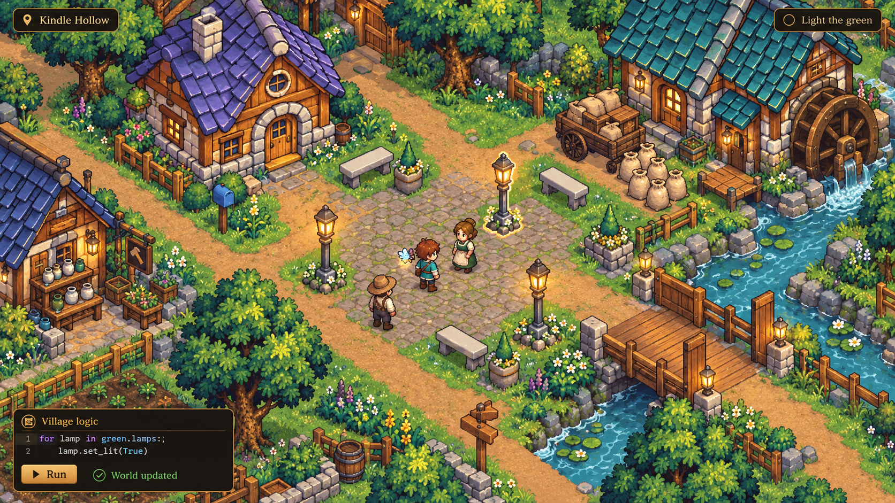
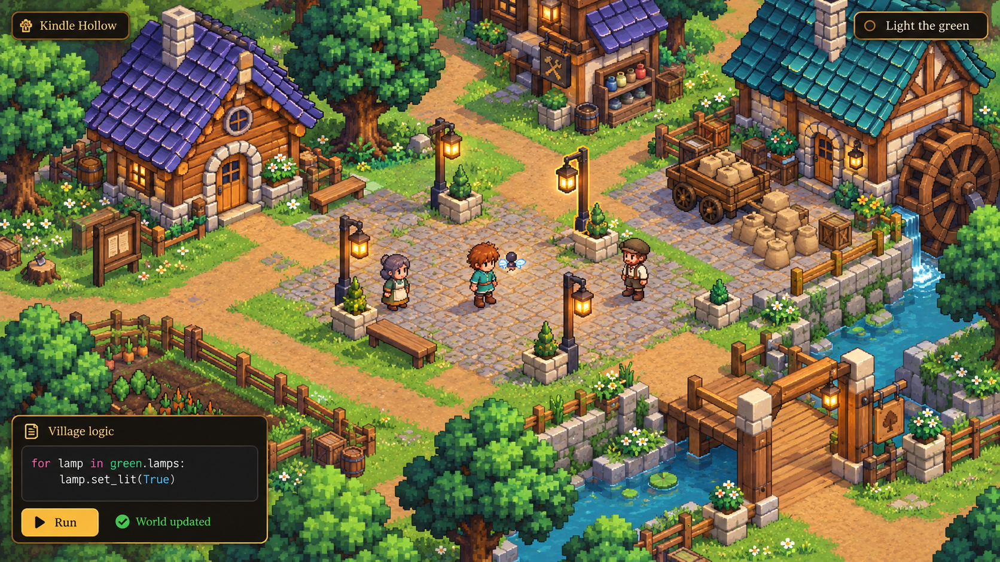
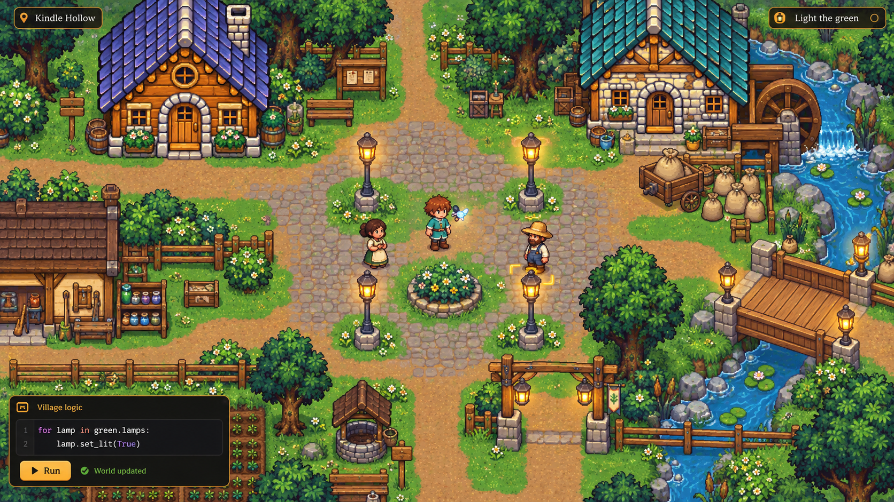

# v0.6 — A world shaped by code

The preferred direction for the next experiment is **voxel-inspired isometric 3D**, with substantial player control through programming and a slightly fantasy theme. The prototype now lives as the standalone Godot project at the root of Voxel-Rootward; it opens directly without changing the main game menu or project settings.

- [Step-by-step prototype spec and acceptance gates](04-voxel-world-prototype-spec.md): isolation, world/programming architecture, first playable slice, asset contract and eventual integration options.
- [Village Morning first slice](06-village-morning-first-slice.md): a second selectable concept, bespoke starting home and movement programming with guided blocks or Python; further village work is deferred.
- [Voxel art, Claude/ChatGPT and ComfyUI research](05-voxel-art-and-ai-research.md): how AI-made voxel demonstrations become reusable geometry, the recommended Blender workflow, local model inventory, optional LoRAs and image-to-3D tests.

**Can the AI voxel art seen in videos be used for games?** Yes, when the output is real geometry or code that builds it. Blender scripts, Three.js scenes and voxel files can provide usable source; a rendered picture provides visual reference. Game assets still need useful parts, pivots, collision and integration with the world rules. The research explains those handoffs. The runnable standalone concept now uses real Python/WASI, held/click grid movement, painted diagonal sprite views and Blender-authored house/land GLBs. See [the current pipeline](../../../pipeline/README.md) and [latest review](../../../pipeline/reviews/2026-10-23-painted-and-blender.md). The layered character experiment was visually rejected; preserving the original painted character takes priority over customization. Complete gait/idle art and larger content/editor stages remain open.

## Original visual comparison

2026-10-22. Earlier art-direction comparison, grounded in the current Kindle Hollow implementation. These are three ChatGPT ImageGen concepts, not screenshots of implemented v0.6 features. The small code panel shows an illustrative future API. The newer proposal above develops option 2; the comparison below records the original assessment.

**My recommendation:** for the game you describe—programming structures, mechanisms and the environment itself—I lean toward a fixed orthographic 3D world with a voxel-inspired modular style and cleaner sprite characters. That makes sense if manipulating those physical parts becomes a central activity. If the main activity remains writing functions whose results change an authored village, the polished current 2D direction delivers more of the benefit for less disruption.

The images use the same village brief, cottage materials, player, brook, mill, lamps and programming interaction. They are comparable art studies, not an exact reconstruction of the same map. The second deliberately keeps illustrated characters in a chunkier environment; voxel style does not require cubic people.

**1. Isometric 2D, retaining the current fantasy character**

Diamond-oriented streets, two visible building faces, textured sprite art and cleaner characters. This keeps the illustrated identity while changing how the village occupies the screen.

**2. Voxel-inspired isometric environment, with clean sprite characters**

Chunkier foliage, construction and banks, with the same warm wood, cream stone, violet roofs and readable people. The implementation assessed below is actual modular 3D under a fixed camera. A flat image that merely looks voxel-like would not provide the same transformation benefits.

**3. Future target for the current orthogonal 2D style**

Horizontal and vertical streets, broad front facades, coherent materials, recessed windows, thicker eaves, grounded props and simpler character silhouettes. This demonstrates how far the current view could progress without changing its projection.

**Three separate choices**

Isometric describes a view. Voxel describes an appearance or a way of storing a volume. Neither determines how much the player can program.

| Choice | What it actually means | What it does not automatically provide |
|---|---|---|
| Isometric 2D | A logical grid projected into diamond-shaped screen space, with sprite art. | Editable geometry, true stacked floors or arbitrary object rotation. |
| Voxel-inspired modular 3D | Buildings, terrain pieces and mechanisms assembled from reusable 3D components with a blocky visual language. | A world where every cube can be mined or rewritten. |
| Editable voxel simulation | A volume of addressable blocks, with persistent edits and updates to visible surfaces and collision. | Good lessons, clear controls, efficient updates or understandable construction rules. |

Most code-driven gates, bridges, machines, growing structures and assembly puzzles can use modular 3D without requiring a full voxel simulation. Godot provides mesh-grid construction through [GridMap and MeshLibrary](https://docs.godotengine.org/en/stable/tutorials/3d/using_gridmaps.html). That is a useful building tool, rather than a complete design for digging, terrain editing or world simulation.

**Merits, demerits and fit**

| Direction | Main merits | Main demerits | Fit with the current implementation |
|---|---|---|---|
| Isometric 2D | Stronger sense of volume; visible building sides; attractive village composition; preserves expressive illustrated sprites and a 2D production model. A flat logical grid can remain. | Substantial new world art, projection and picking work. Broad buildings and roofs complicate occlusion. Mechanisms still need separate parts, frames or authored states. The camera change alone adds little ability to reshape the world. | Significant presentation/editor migration, while retaining most pure rules and learning systems. |
| Voxel-inspired modular 3D | Reusable parts can turn, extend, assemble, change materials and share coherent lighting. Changes to bridges, machines and structures can be shown directly. New views need fewer separately painted versions of the same object. | Largest initial world/editor and asset-pipeline change. Requires a cohesive model/material kit, readable selection, character integration and camera visibility rules. Height, physics and free camera rotation would each add further work. Blocky art can become visually noisy if every detail is a tiny cube. | Strongest candidate for structural programming, with useful rule/content reuse but a substantially new world presentation. |
| Evolved current 2D | Greatest reuse of the current game, Studio and recent art pass. Clear beginner correspondence between x/y, arrow keys and screen movement. Effort can go into teaching, animation and consistency. Maintains the existing visual identity. | Flattened assets constrain new viewpoints and convincing transformations. Unique building changes and moving mechanisms may multiply the art states needed. Vertical construction is harder to explain visually. | Smallest architectural disruption. Richer world manipulation remains possible through modular 2D parts and explicit rules. |

Godot supports diamond isometric tiles and Y sorting, so the engine is capable of option 1. The existing world would still need adaptation because its renderer is custom, rather than a ready-made isometric TileMapLayer scene. See [Godot's isometric TileSet documentation](https://docs.godotengine.org/en/stable/classes/class_tileset.html#enum-tileset-tileshape).

Option 2 can preserve the expressive character style. Godot supports both an [orthographic Camera3D](https://docs.godotengine.org/en/stable/classes/class_camera3d.html#enum-camera3d-projectiontype) and [2D sprites displayed in 3D, including billboarding](https://docs.godotengine.org/en/stable/classes/class_spritebase3d.html). My recommendation is a design inference from those capabilities and the current code, not a claim that a hybrid renderer is already built.

**What the present implementation changes about this decision**

A large part of the useful game is already independent of the camera. Sandbox execution, tasks, hints, dialogue, translation, quests and much of the saved learning progress are candidates for reuse. They still need integration checks; changing the renderer does not establish compatibility by itself.

The map and its presentation have concrete assumptions:

- `OverworldMap` (Rootward source: `game/core/overworld/overworld_map.gd`) stores two-dimensional cells, rectangular map extents, ground rows, footprints, collision, doors and four facings. Keeping a single logical ground plane would preserve much of this model in either isometric view. Adding stacked walkable surfaces would require more than a coordinate conversion.
- `Walker.feet` (Rootward source: `game/scenes/overworld/walker.gd`) calculates screen positions directly from cell x and y multiplied by the tile size. Its movement animation interpolates between those positions. A new projection needs a shared conversion for actors and world objects.
- `TownMapView` (Rootward source: `game/scenes/overworld/town_map_view.gd`) uses separate ground/underfoot layers and sorts standing objects by screen y. Large overlapping isometric objects need careful anchors and sometimes split art or different occlusion treatment.
- `GroundLayer` (Rootward source: `game/scenes/overworld/ground_layer.gd`) bakes square-grid terrain and dual-grid transitions into image chunks. Its existing atlas and repaint path are not automatically an isometric ground renderer.
- `StudioPick` (Rootward source: `game/scenes/studio/studio_pick.gd`) converts world-pixel positions into cells by dividing by the tile size. Selection, placement, terrain brushes, handles, overlays, boundary snapping and camera bounds all need to agree with a new view.
- `StudioBoundary` (Rootward source: `game/core/studio/studio_boundary.gd`) holds useful logical wall/gate rules, but parts of its interaction geometry operate directly in current world pixels. Preserve those logical rules while adapting how the player points at them.

The important cost is therefore larger than new house art. Studio must remain the same world the player walks through, with reliable selection and editing. Its data, undo and publishing principles are reusable; its spatial interface needs substantial work in both new views.

**What really makes the world programmable**

The current implementation already reacts to code-driven progress. `MapWorld` (Rootward source: `game/core/overworld/map_world.gd`) evaluates conditions, hides or shows objects, changes lamp groups, and updates the relevant collision and door state while keeping object identities stable. This is a strong foundation for all three directions.

However, `TownThings` (Rootward source: `game/core/overworld/town_things.gd`) currently restricts a program to its declared fields, speech and named flags. Its contract explicitly excludes changing positions or arbitrary other objects. A new camera would leave that restriction in place.

If the intended learning activity includes moving, creating, rotating or connecting objects, it needs a deliberate world-command model: stable object identities, permitted operations, checked values, persistent results, and consistent changes to appearance and collision. Sandbox results should describe those changes; the game applies them through its rules. The renderer then shows the outcome.

| Example activity | Current-style or isometric 2D | Modular 3D |
|---|---|---|
| Correct a function; light lamps or fill a jar shelf | Already suits conditional states and sprite changes. | Equally suitable; little inherent programming advantage. |
| Open a gate or turn a millwheel | Separate moving sprite parts or animation frames work well. | Transform a hinge or wheel directly, with shared lighting. |
| Build a bridge of a computed length | Feasible with repeatable 2D segments and explicit collision rules. | Repeat actual bridge components; side faces and shadows follow their geometry. |
| Rebuild walls, route machinery or change terrain height | Requires an authored component kit and explicit spatial rules. | Geometry expresses the changes more naturally, but navigation, commands and saves still need those rules. |

The gain from option 2 grows with the number of meaningful transformations the player performs. It is smaller when the world mostly switches between a few authored before/after states.

**Characters, art production and learning clarity**

Cleaner characters are achievable in every direction. Consistent proportions, fewer tiny details, readable silhouettes, reliable foot anchors and deliberate animation would improve the current scene independently of the environment choice.

The approved building camera (Rootward source: `Concept/v0.35/building-architecture/BUILDING_ART_SPEC.md`) intentionally hides the side wall. True isometric buildings expose a second facade. Much of the current building work can remain a palette/material/style reference, but should not be counted as finished isometric art.

There is also a useful limit to the existing Blender head start. `blender_world.py` (Rootward source: `pipeline/world/blender_world.py`) shears blockouts to fake the current oblique view before rendering them into PNGs. Those blockouts provide dimensions and some source geometry; they are not a complete library of production-ready 3D buildings.

With a fixed 3D camera, sprite people remain viable, but their angle, lighting, shadows and overlap with roofs must fit the environment. Camera rotation would increase the burden of directional art or motivate fully modelled characters. Keeping one camera avoids taking on that choice immediately. A true voxel volume would also introduce surface/collision rebuilding and persistence costs that the concept image cannot measure.

There is a teaching tradeoff too. `BootsRules` (Rootward source: `game/core/overworld/boots_rules.gd`) currently accepts one cardinal cell step and rejects diagonal or longer moves. Under isometric projection, the same logical step appears diagonal on screen. That can work, but the relationship between “up,” screen direction and world x/y must be explained consistently. The present orthogonal view is more direct for first-time coordinate lessons.

**My preference for the intended v0.6**

I would choose option 2 if programming the environment means changing its construction and mechanisms: a fixed orthographic camera, a coherent modular 3D kit with a restrained voxel-inspired finish, and clean sprite characters. Keep the existing logical ground grid where it serves the lessons. Treat multiple walkable heights, camera rotation, freely editable terrain and physical contraptions as separate design choices.

I would choose option 3 if the near-term priority is making the learning journey and village interactions excellent. It can deliver a major improvement in depth, character clarity and cohesion while preserving the work already built.

I would choose option 1 for a strong preference for illustrated isometric sprite art. It offers a worthwhile visual identity, but I would not choose it solely as a route to easier world manipulation: much of the spatial/editor migration remains, while many transformations still need authored sprite components.

The decisive question is which actions should be common during play: changing the village's state, or changing what the village is physically made from. That choice gives the camera and asset format a concrete job to support.

Full generation prompts and input-reference paths are recorded in [prompts.json](prompts.json). All three final images are 1672 × 941 PNGs generated with the built-in ChatGPT imagegen tool; runtime files were not changed for this exploration.

