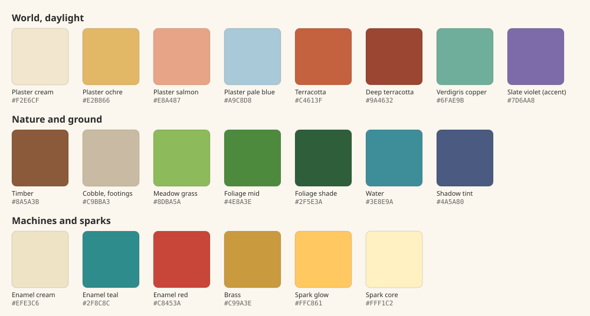

# Art direction brief: Sparks & Machines — 2026-10-26

**Status: direction chosen, not implemented.** The user settled the open decisions on 2026-10-26 ([list](README.md#decisions)). This brief guides new and reworked art for the [world concept](01-world-concept.md). It keeps the approved camera, the voxel-inspired 3D world, painted sprite characters and the art pipelines in `pipeline/README.md`. Everything here is for the **new, separate journey** ([scenario](05-scenario.md)): the existing journeys keep their approved art. The image prompts that put this brief into pictures are in [the art prompt pack](04-art-prompts.md).

## The look in one paragraph

A sunlit edge-of-town on a summer afternoon in a mid-century that never happened. Plaster cottages with big terracotta roofs sit among soft, chunky trees. Wires on wooden poles run from house to house. Chimney smoke leans in the breeze and cloud shadows slide across the lanes. Friendly enamel-and-brass machines go about their routines, each with a small warm spark glowing behind glass. At dusk the lamps come on one by one, and that is the player's work.

## Pillars

1. **Sunlit and lived-in.** Big warm light, soft shade, and objects that belong to someone's day. Lived-in does not mean cluttered.
2. **Machines with manners.** Automatons are friendly, sturdy and readable. You can tell what a machine does by looking at it.
3. **Magic is small and warm.** The spark glows behind glass. It never swirls, sparkles in the air or forms symbols.
4. **Motion over clutter.** The world feels alive because things move (smoke, wind, birds, wheels, routines), not because there are more props.
5. **Read it at a glance.** At gameplay scale, walkability, doors, interactable machines and machine state come before detail.

## References

Take the listed qualities. Never trace, paint over or feed these works into generators.

| Reference | Take | Leave |
|---|---|---|
| *Kiki's Delivery Service* (1989) | Mid-century European harbour town, plaster facades, terracotta and copper roofs, generous summer light, everyday independence | All characters, designs, the broom, the cat, the bakery, specific places and shots |
| *My Neighbor Totoro* (1988) | Countryside on the edge of a town: wooden power poles, a bus stop, overgrown gardens, big trees, humid green light | Forest spirits and any creature designs |
| *Castle in the Sky* (1986) | Robots that feel tender and old, moss on metal, a machine tending a garden | The robot designs themselves |
| Jaquet-Droz automata (1770s, Neuchâtel) | Real programmable automata. The Writer is set to write a chosen text with a wheel of cams. Brass, visible mechanism, care. | — |
| Jacquard loom (1804) | Instructions on punched cards: the visual idea for "loading a program" | — |
| Mid-century travel posters and enamel signs | Flat shapes, limited palettes, confident type, icons that read from far away | Brand names and logos |
| *Machinarium* (2009) | Robots with personality and a hand-made feel | Its rust, grime and melancholy |
| *Animal Crossing: New Horizons* | Readability at a small scale, chunky friendly forms, a tidy cozy layout | Its exact proportions and UI |

**Prompt rule for image generation:** describe qualities, never sources. Write "mid-century European harbour town, plaster facades, terracotta roofs, warm afternoon light, painterly." Don't write "in the style of" with a studio or film. Keep prompts and outputs under `art/source/` as the pipeline requires; generated concept images are references, not runtime assets.

## Era and technology

| Belongs | Does not belong |
|---|---|
| Bicycles, a tram or funicular, rare small round delivery vans | Highways, many cars, parking lots |
| Telephones, a switchboard, radios, gramophones | Screens, computers, phones you can carry |
| Wooden poles with wires, spark street lamps, enamel signs | Neon, LED strips, plastic |
| Post boxes, telegrams, typewriters, ticker tape | Holograms, sci-fi panels |
| Laundry lines, window boxes, awnings, chimneys | Concrete towers, glass office buildings |
| Automatons doing ordinary jobs | Weapons, military machines, anything menacing |
| One airship, rarely, overhead | Steampunk clichés: goggles, decorative gears, brown-and-brass everything |

Brass is an accent, not a palette. The world is cream, terracotta, green and sky, with brass where a machine needs a fitting.

## Places and architecture

**Kindle Hollow (outskirts).** Timber-and-plaster cottages on stone footings. They have steep roofs, deep-set white-framed windows and window boxes built into the facade. The old mill becomes the sparkworks: the water wheel stays, and a glass-roofed annex is added where spark jars glow. Wooden poles carry wires between houses, so connections are visible and lighting a house can light its wire. A tram halt with a little shelter stands at the end of the lane. Orchards and allotments fill the gaps.

**Rootward Square.** The town hall stays: its cream half-timbering, blue roof and clock tower already fit. The oak is removed. **The Rootwell** takes the centre of the square ([spec below](#the-rootwell)), and benches and spark lamps ring it.

**Haverlund harbour (future).** Tall, narrow plaster townhouses in ochre, salmon, cream and pale blue, with terracotta roofs and green copper spires. Steep lanes, stairs, market awnings, harbour cranes, a lighthouse. The terrain levels and stairs that already exist suit this hillside.

**The Rootworks (future).** The founders' buried network. Brick and stone vaults, iron pipes and cables that follow the roots, relay chambers with big valve wheels and switch panels, and tender automatons asleep under moss. Living roots thread through the masonry as if the vaults were built around them, which they were. It feels old, careful and quiet, never threatening.

**Building rules at camera scale**

- Roofs are the biggest readable shape. Exaggerate them.
- Every building's door faces a lane and is lit at dusk.
- Every chimney smokes when someone is home.
- Shops show what they do with a hanging sign whose icon reads without text.
- Paint small detail into textures. Model it only if it changes the silhouette (see [readability](#readability-rules)).

### The Rootwell

**User revision, 2026-10-29:** the square should be a denser city centre directly adjoining Spindle Lane, with larger attached buildings and a much bigger, eye-catching municipal power landmark. The earlier low 3×3 size below is historical rather than a current limit. Four [new square concepts](../../../art/source/world/sparks-square/v2-city-concepts/README.md) await selection.

The heart of the square, the first clue to the mystery and the one place on the surface where the roots can be glimpsed.

| Element | Spec |
|---|---|
| **Footprint and height** | Low and wide: about 3×3 cells, and lower than the town hall's eaves. It must never hide the square the way the oak's crown did. |
| **Base** | A round stone wellhead with a broad brass rim, wide enough to sit on. Steps on one side face the main approach. |
| **Dome** | A glass dome at the centre holds the largest spark on the surface. Through the glass, the top of a living root curls up from below. |
| **Dial** | One oversized brass pressure dial, about half a cell across, facing the main approach so its needle reads at gameplay scale. It sits low: the first visible clue. |
| **Valve wheels** | One wheel per branch of the network, each turned toward the lane it feeds. They are interactable later in the story. |
| **Lines** | Brass inlay strips run from the base under the cobbles toward each lane, showing where the spark goes. A live branch's strip has a faint warm sheen; a dim branch's doesn't. |
| **States** | Day: the dome glows softly and the needle is low. Dusk: lamps on the healthy branches light first. When the story repairs a branch, its strip, wheel and lamps brighten together. |

## Palette

These are starting values for concept work and retexturing. Final values are decided in-game, at gameplay scale and under the game's lighting.

**Daylight world**

| Use | Hex |
|---|---|
| Plaster, cream | `#F2E6CF` |
| Plaster, ochre | `#E2B866` |
| Plaster, salmon | `#E8A487` |
| Plaster, pale blue | `#A9C8D8` |
| Roof, terracotta | `#C4613F` |
| Roof, deep terracotta | `#9A4632` |
| Roof, verdigris copper | `#6FAE9B` |
| Roof, slate violet (rare accent; today's roof colour) | `#7D6AA8` |
| Timber | `#8A5A3B` |
| Cobble and footings | `#C9BBA3` |
| Meadow grass | `#8DBA5A` |
| Foliage, mid | `#4E8A3E` |
| Foliage, shade | `#2F5E3A` |
| Water, brook and harbour | `#3E8E9A` |
| Shadow tint (never black) | `#4A5A80` |

**Machines and magic**

| Use | Hex |
|---|---|
| Enamel cream | `#EFE3C6` |
| Enamel teal (matches the boy's shirt) | `#2F8C8C` |
| Enamel red | `#C8453A` |
| Brass fittings | `#C99A3E` |
| Spark, glow | `#FFC861` |
| Spark, core | `#FFF1C2` |

**Rules**

- Roofs shift from today's violet to terracotta and copper (decided 2026-10-26). Violet survives as a rare accent so the existing assets aren't wasted, and it gets retextured through the existing `pipeline/blender_retexture.py` path rather than rebuilt.
- Shadows are tinted toward cool blue-violet and never go to black.
- Saturation peaks in small places: doors, awnings, enamel and sparks. Large surfaces stay soft.
- Spark amber belongs only to sparks, lit windows and lamps. Nothing else uses it, so a glow always means "spark."

## Light and time of day

Time of day is the signature of the game, because lighting lamps at dusk is the first arc's work.

| Time | Key light | Shadows and mood | Glows |
|---|---|---|---|
| **Morning** (Village Morning) | Pale gold, low and soft | Long, cool, gentle haze | Off, or a few windows |
| **Afternoon** (default play) | Warm white, high | Short, soft, blue-tinted | Machines' spark windows only |
| **Golden hour** | Deep amber, low | Long violet-blue shadows | Windows start to glow |
| **Dusk** | Rose to violet sky bounce | Blue world | Lamps lead the image |
| **Night** | Cool moonlight | Deep navy | Warm lamps, windows, sparks |

- **Backdrop.** Replace the flat navy void around the map with a soft sky gradient by day, or sea haze where the map meets the harbour. Navy stays for night.
- **Cloud shadows.** Slow, soft shadow shapes drift across the ground. This is cheap and does a lot.
- **Shadows stay on.** Keep the current shadow quality; the performance decision of 2026-10-25 stands.
- **Underground (the Rootworks, future).** No sun. Warm dark brick and stone, lit by spark lamps on the pipes. Root light is the brightest thing in a chamber.

## Materials and voxel treatment

- **Keep:** chunky modular 3D, the fixed orthographic camera and the illustrated edges.
- **Soften:** larger, rounder blocks; bevels or painted edges on trims; fewer single-cube details. Trees keep clustered voxel crowns with bigger clumps, warmer greens and less noise. The retired Rootward oak's crown remains the model for clump size.
- **Plaster** is flat and painterly: slight colour variation, hand-painted wear at corners and footings.
- **Metal** on machines is enamel paint over sheet metal, with brass only at joints, rims and plates. It is cared for, not rusty.
- **Glass** holds sparks: a bright core, a soft halo, and a faint reflection of the sky by day.

## Characters

People stay **painted whole-body sprites** using the approved template, proportions, timing, four views and mirrored pairs (`pipeline/CHARACTERS.md`). Only wardrobe and colour change, through new skins for the new journey. The full cast, style rules and wardrobes are in [the characters document](06-characters.md).

**The apprentice (the approved boy).** Keep the face, hair, proportions, the teal-and-yellow signature and the boots. Change the cut (decided 2026-10-26):

| Today | New |
|---|---|
| Teal tunic with a belt cinched over it | Teal short-sleeved collared work shirt, sleeves rolled, tucked into brown trousers. The belt now holds the trousers. |
| Yellow neckerchief | Keep. It is already mid-century. |
| Brown trousers, boots | Keep; read as work boots |
| — | Optional: a canvas satchel worn across the body as part of the skin (hand-item slots are not implemented) |

This is a new skin, not a new character. Like any skin, it needs the full frame set and in-game review before it replaces the approved one.

**Residents.** Mid-century working clothes: Mira in a field jacket with a map satchel; Rowan in overalls and a cap; Bram in a carpenter's apron with a pencil behind his ear; Tessa in a sun hat with rolled sleeves and gloves; Nell in a cardigan with glasses on a chain. Their painted portraits keep their current faces and style, with warmer backgrounds.

**People never look like machines, and machines never look like people.** Automatons have wheels or stubby legs, round bodies and a spark window instead of a face.

## Automaton design language

Automatons are **3D models in the world-asset pipeline**, not painted sprites. They need visible parts that change over time, state lights and turning in four views. Their dialogue portraits, where they have them, are painted like the residents'.

| Element | Rule |
|---|---|
| **Body** | Rounded and slightly bottom-heavy so it reads as stable and friendly. Built from a small kit of shared parts. |
| **Paint** | Enamel cream, teal or red, with brass rims. Each machine's name is painted on its side like a delivery van. |
| **Spark window** | Every automaton has one round glass window: its heart and its face. It always shows the machine's state (below). |
| **Routine slot** | A visible card slot or cam drum. On Apply, a card slides in. This is the in-world picture of committing a program. |
| **Movement** | Mechanical, not floaty: ease in and out with a tiny overshoot, stepping on beats. Idle is a gentle tick and sway. |
| **Wear** | Lightly worn and cared for. A little moss on long-idle machines is welcome; rust and grime are not. |
| **Size classes** | Small (companion, about half a cell); medium (one cell, walks the grid by the player's rules); large (multi-cell, mostly fixed: mill, crane, clock). |

**Machine state is shown with motion and light together**, so it never depends on colour alone:

| State | Spark window | Body |
|---|---|---|
| Off | Dark glass | Still, slightly slumped |
| Idle, waiting | Slow soft amber pulse | Gentle tick |
| Previewing | Pale, translucent ghost of the machine | Ghost moves along the proposed route |
| Running | Bright steady amber | Working motion |
| Error | Quick orange flicker | A shudder, a small puff of steam, then a stop |
| Done | One bright blink | Settles back to idle |

## Magic, visually

- Sparks live behind glass: lamps, windows, jars, automatons. A spark outside glass is a rare story moment, such as a festival or the first time Hotaru wakes.
- **The roots are the one exception.** Inside living root-veins, amber light moves slowly, like a pulse. It is seen only in the Rootworks and glimpsed through the Rootwell's dome, never elsewhere on the surface. Unlike the retired oak's decorative gold seams, root light is rare, deep and always means the source.
- A spark is a soft amber core with a halo that drifts very slightly upward. It never swirls, trails, sparkles or forms symbols.
- No runes, sigils, crystals, auras, magic circles or purple glows. The current wisps, ward stones, crystal props and rune stone are retired (see the [audit](#existing-asset-audit)).
- Glow budget: by day, sparks are small accents. At dusk and night they lead the image.

## Liveliness budget

Motion is ordered cheapest first. Background motion never blocks or confuses walkable cells. Anything that occupies a cell follows the same rules as the player.

1. Chimney smoke that leans with one global wind direction
2. Cloud shadows drifting across the ground
3. Wind sway on trees, laundry, flags and awnings
4. Birds crossing in small flocks; gulls near water
5. Water shimmer, and the mill wheel turning
6. Windows lighting up one by one at dusk
7. Automatons on their routines, such as the lamplighter at dusk
8. A bicycle or the tram passing at the map edge
9. Rarely, the shadow of an airship sliding over the whole map

## Interface

Today's interface uses dark navy panels, gold borders and the Cinzel inscription face, which reads as a fantasy RPG. It moves to **paper and enamel** (decided 2026-10-26):

- **Panels:** warm paper cards with ink-dark text, enamel-sign buttons with rounded corners, stamp red and teal accents.
- **Jobs:** stamped job tickets pinned to a board, which can replace the quest tracker's look.
- **Print output:** a strip of ticker tape from the workshop's tape machine. Hotaru reads it through the slot under her spark window.
- **Field Notes:** a workshop notebook on graph paper. **Theme the frame, never the code.** The code editor stays high-contrast with IBM Plex Mono and current legibility.
- **In-world cues:** keep speech bubbles, use icons and `!`/`?` marks, restyled as small enamel badges. No floating action buttons.
- **Type:** keep IBM Plex Mono for code and Alegreya for reading. Replace Cinzel with a mid-century signage face under an open licence. This is a choice to make in a UI review.

## Readability rules

These rules come before any style rule above.

- Lanes are always lighter than grass. Walkable and blocked areas must read at a glance.
- Interactable machines carry exactly one bright accent: the spark window. Decoration does not glow.
- Details smaller than about an eighth of a cell disappear at gameplay scale. Paint them.
- Doors, routes and machine states must read in the default afternoon light, not only at dusk.
- Every change is reviewed in Godot at the actual camera scale before it is adopted (existing `pipeline/REVIEW.md` practice).

## Existing asset audit

Which existing assets the new journey can reuse. **Reuse never edits an adopted asset.** A rework is a new version or variant used only by the new journey (for example, a terracotta-roof finish or presentation variant), and the original stays as the existing journeys use it. "Retire" means the new journey doesn't use it.

| Keep (fits the era) | Rework | Retire |
|---|---|---|
| Cottage, mill-house, log cabins, hearth-house, lantern-loft, painted cottage | Roof palette from violet to terracotta and copper | Crystal Obelisk |
| Lamppost, square lamppost (they become spark lamps) | Brook mill becomes the sparkworks (adds a spark-jar annex) | Rune Standing Stone |
| Town hall, civic bench, garden fence | Rootward Square layout around the Rootwell | Little Shrine (or rework it into a post box or drinking fountain) |
| Bakery, smithy (becomes the machine shop), trees | Shard Lantern: the crystal becomes a spark lamp | The "Village & Magic" builder category (the new journey would offer "Sparks & Machines") |
| Furniture, workshop, market and garden libraries | Alchemy bench becomes a spark-tender's bench | Hotaru's fairy model and portrait (Village Morning keeps them; the new journey uses [the robot](03-robot-companion.md)) |
| Village bell, brass lever, water pump, weather vane, chest | The boy and five residents: new wardrobe skins and portraits | |
| Weaver's loom (a Jacquard tie-in) | UI theme (above), as a theme for the new journey | Rootward oak (the new journey's square has the Rootwell; the oak stays in Village Morning) |

**New assets this direction needs:** Hotaru the robot; the Rootwell; the lamplighter; wooden poles with wires; a tram halt; a post box; a job board; a bicycle; a laundry line; a workshop sign; sky backdrop and cloud shadows.

## Concept images to make next

The ordered list, with full prompts, references and output paths, is [the art prompt pack](04-art-prompts.md). In short: the style lock (key art, lighting key), then Hotaru, the apprentice and Nell, the opening places, the town and the Rootwell, the automatons, the rest of the cast, the interface and the future places.
