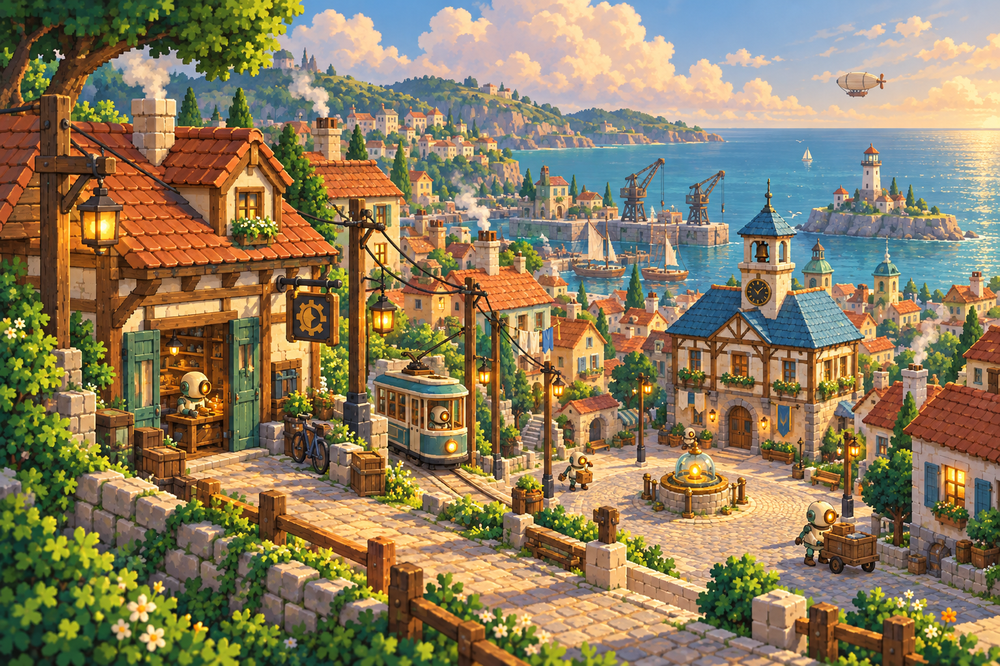
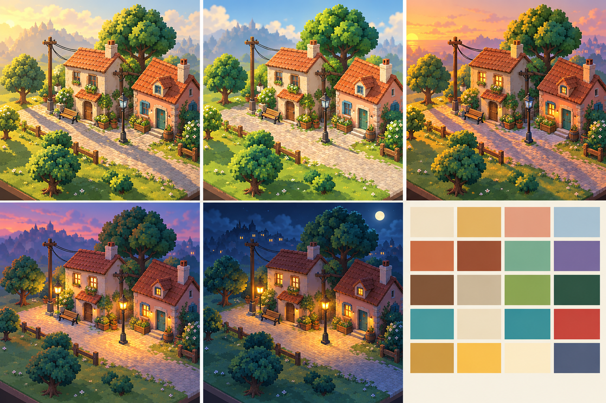
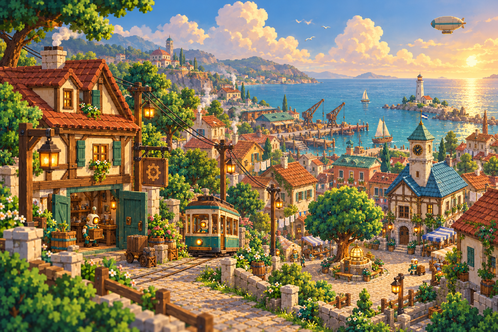
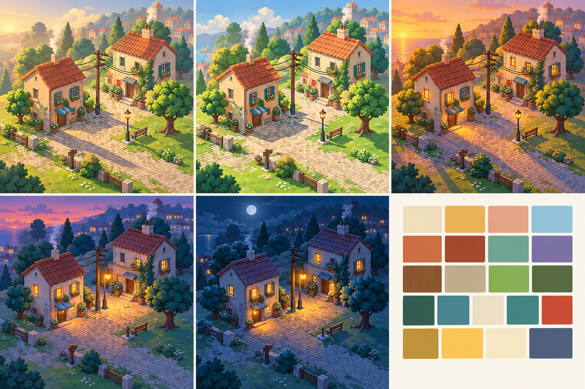

# Phase 1 — Haverlund style review

2026-10-26. **Second variants approved by the user:** “I agree, the second version of each seems better.” The alternates remain drafts. Generated with the built-in imagegen tool; its model identifier is not exposed. The original four images are 1536×1024 opaque PNGs. Exact prompts, ordered inputs, hashes and selection notes are in [the prompt record](../prompts.json).

## Current selection

The selected T1 now has a separate [wheel-base revision](T1-haverlund-key-art.wheels.png), carrying the user’s later rolling-robot direction into the working street automatons. The approved original below is preserved unchanged. T6 remains selected.

## Earlier approved pair

| T1 · Haverlund key art | T6 · Lighting key |
|---|---|
|  |  |

Both are the second generated variant. T1 makes the low Rootwell distinct from the wooded town edges and keeps the workshop, tram, town hall and harbour readable. T6 corrects the daylight lamp glow in the first lighting variant. Read its panels left to right: morning, afternoon, golden hour; dusk, night, palette.

The warm light, terracotta roofs, cream plaster, teal enamel and copper details establish the proposed direction. The town hall keeps its blue roof. Amber glows stay in lamps, windows and machines.

## Alternates

| T1 · First variant | T6 · First variant |
|---|---|
|  |  |

The first T1 is retained for its atmosphere, but its tree behind the wellhead gives the square too much of the earlier oak concept's silhouette. The first T6 has an attractive harbour backdrop, but incorrectly lights the street lamp in daylight.

## Limits and next step

- T1 is an establishing illustration, as requested; it does not use the gameplay camera.
- T6 approximates the fixed orthographic view. Main buildings and layout repeat closely, but small props and the rear lamp vary. It does not prove identical geometry or actual Godot lighting.
- Generated swatches are indicative. [The palette](../../palette.svg) and [art direction](../../02-art-direction.md) remain the exact colour references.
- Rootwell internals and robot anatomy need the later design sheets. These images are references, not production-ready assets.
- T6 was generated using the second T1 as a provisional reference; the user has now approved both second variants. Their PNGs are preserved unchanged.

The [prompt pack](../../04-art-prompts.md#ground-rules) says: “Stop at the end of each phase so the user can review it.” Phase 1 has passed that review. The user later delegated completion of the rest of the pack; all nine phases are now complete. See the [complete index](../INDEX.md).

All deliverables remain inside `docs/concept/v0.7/art/`, already excluded from Godot import by `docs/.gdignore`.

## Verification

All four files passed PNG decoding/integrity, 1536×1024 opaque RGB, file/input hashes, exact shared prompt blocks and draft-status checks. `scripts/test.sh` passed in full. The initial restricted test attempt could not create Godot's sandbox job directories; the authorized rerun passed. These concepts have been visually reviewed as illustrations; gameplay-scale Godot review belongs to later asset adoption.
