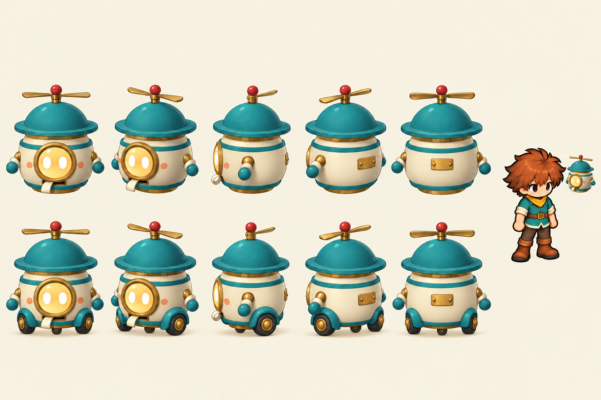
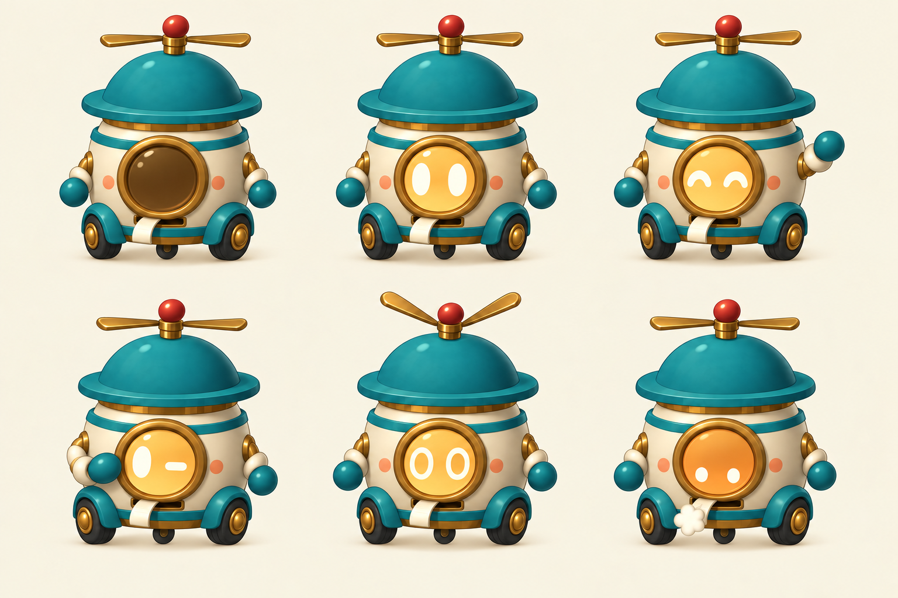
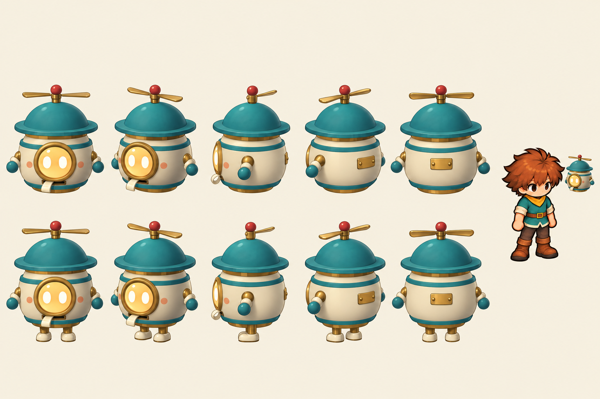
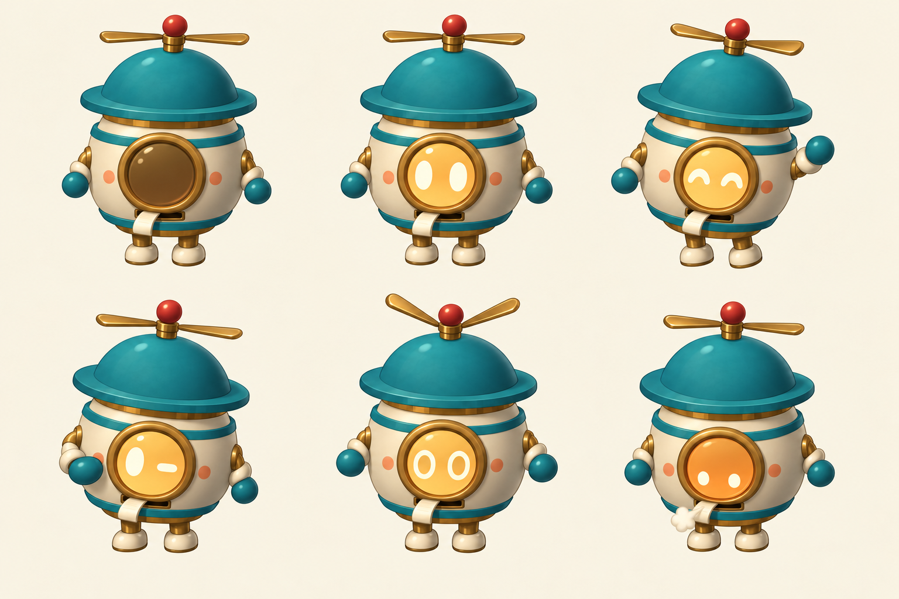
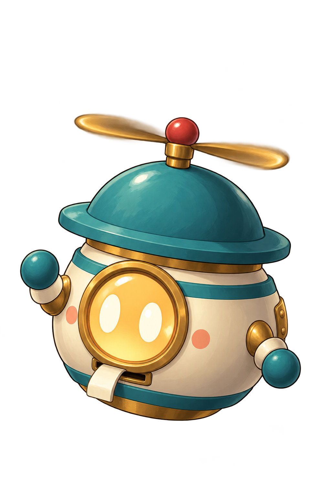
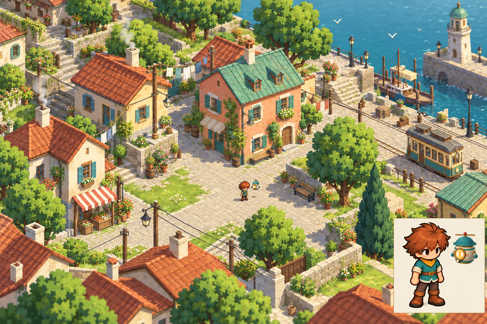
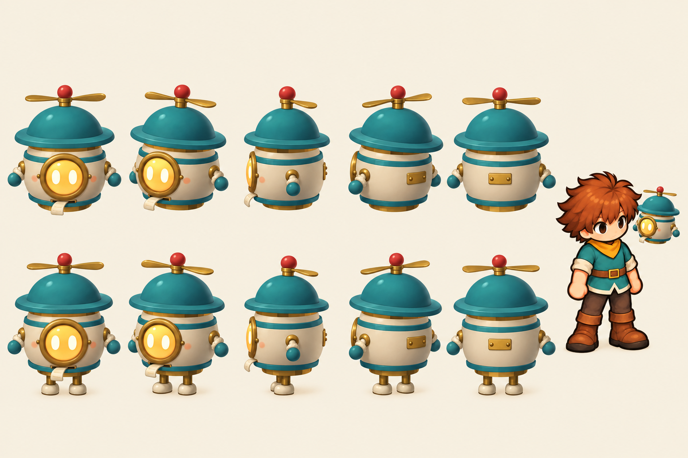
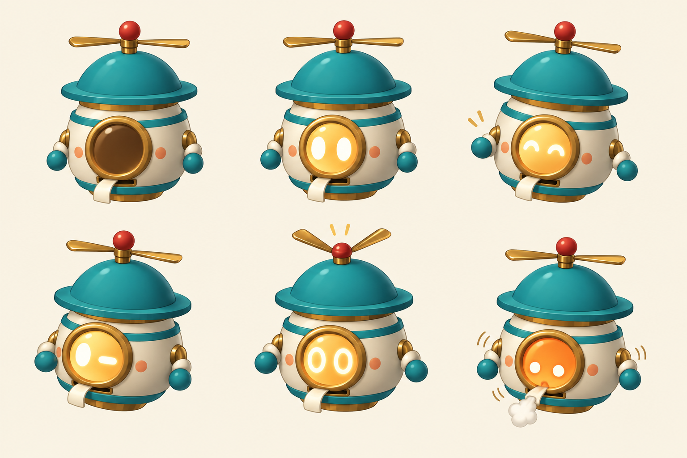
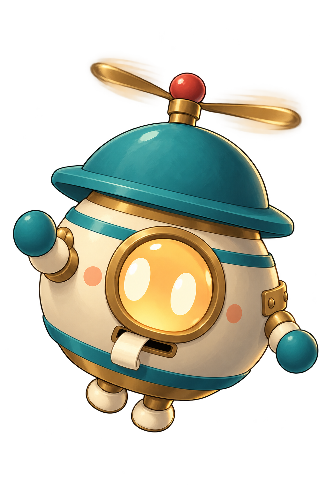
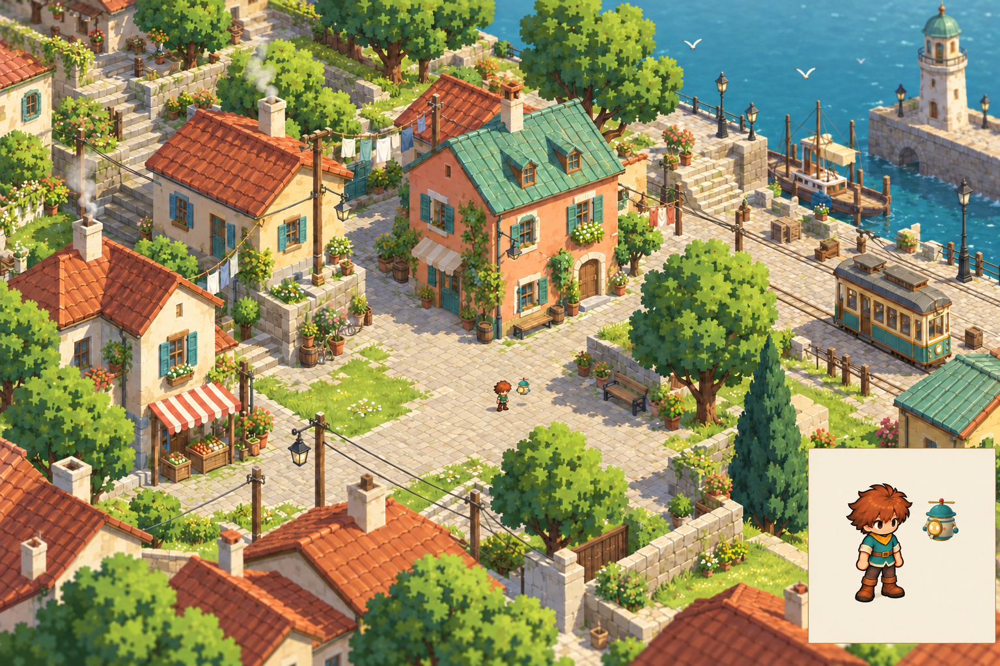

# Phase 2 — Hotaru review

2026-10-26. **The second generated versions of all four Hotaru images are approved.** The user said: “Love the second version of all of the hotaru sheets as well”. This selects the legged second expression sheet and the wider second world study alongside the previously chosen second turnaround and portrait. Built with the built-in imagegen tool; its model identifier is not exposed. Exact prompts, ordered references, hashes and approval records are in [prompts.json](../prompts.json).

## Current wheel-base revision

The user's later direction gives ground-going automatons rolling wheel bases. These selected revisions preserve Hotaru's approved floating shape and change her ground mode to small wheels tucked under the body. They supersede the earlier legged ground-mode drawings, which remain preserved below. See [current decisions](../DESIGN_DECISIONS.md).

| H1 · Floating and rolling turnaround | H2 · Wheeled expressions |
|---|---|
|  |  |

Both use the second wheel-revision take, selected under delegated judgment. The flying portrait and world-scale study remain useful references for her upper body and floating mode.

## Earlier approved set

| H1 · Turnaround, variant 2 | H2 · Expressions, variant 2 |
|---|---|
|  |  |

| H3 · Dialogue portrait, variant 2 | H4 · World study, variant 2 |
|---|---|
|  |  |

The approved design keeps the soft round body, oversized teal cap, brass-rimmed spark window, rosy enamel dots, red rotor knob, mitten hands and paper-tape reader. Floating and working modes share the same parts. The expressions use the window light rather than a human face; Off has dark glass and no eyes. The user chose the expression sheet with its legs unfolded, overriding the pack's floating-only request. The portrait keeps the legs retracted and uses the residents' painted finish. In the world study, the teal cap and warm window remain distinct from the nearby lamps.

## Alternates

| Turnaround, variant 1 | Expressions, variant 1 |
|---|---|
|  |  |

| Portrait, variant 1 | Later world refinement, variant 3 |
|---|---|
|  |  |

[World study, variant 1](H4-in-world.alt2.png) is a closer two-cottage composition with substantially larger characters. The [later floating-only expression refinement](H2-expressions.png) remains a draft alternative. The second expression attempt was initially set aside for unfolding the legs, then restored from its original generated file when the user selected all second versions. No approved PNG has been overwritten.

## Review limits

- H1 is an approved concept reference, not a finished 3D model. Shared parts, compact wheel mounts, the rotor pivot, window material and tape slot need deliberate modelling if adopted. The earlier folding-leg drawings are superseded.
- The H3 PNGs have genuine RGBA transparency. The generator preview displays colour in regions whose saved alpha is zero. The selected portrait's peak alpha is 254, and a few very low-alpha pixels extend beyond the main silhouette; edge cleanup and placement need a final production review.
- The approved H4 shows the main player roughly 60 pixels tall in a 1024-pixel-high image. The user preferred this wider-town composition over the later size correction. The camera and sizes remain approximate, and the inset exceeds the requested exact three-times magnification. This is a readability concept, not an exact camera or rendering proof.
- The world mockup retains the approved boy's current outfit as the prompt requests. His new work-clothes skin is Phase 3.
- Body details vary slightly between generated views. Colour hex values in the brief remain authoritative; the paintings are visual references.

The earlier set passed the user’s review; the wheel revisions use the later delegated judgment. All nine phases are now complete in the [full index](../INDEX.md).

All saved phase-2 images remain under `docs/concept/v0.7/art/2-hotaru/`, excluded from Godot import by `docs/.gdignore`. No production asset is selected from this folder.

## Verification

The original nine Hotaru files passed PNG decoding, expected dimensions, file/input hashes and exact shared prompt-block checks; the restored second expression sheet was also decoded and hash-recorded. Both portrait files passed RGBA, transparent-corner and alpha-range checks. Every saved PNG has a prompt record. The full project suite passed during Phase 1; it was not repeated for this image-and-document-only pass. No gameplay-scale Godot adoption has been performed.
