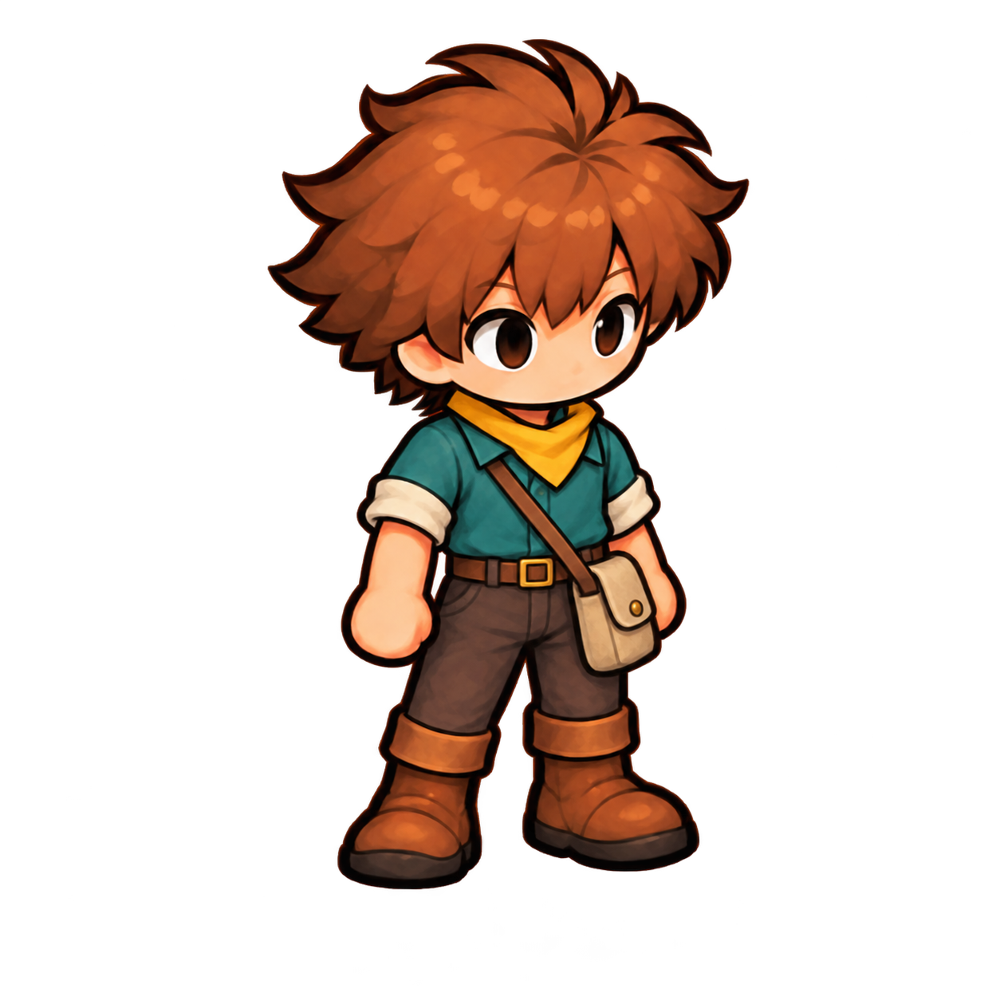
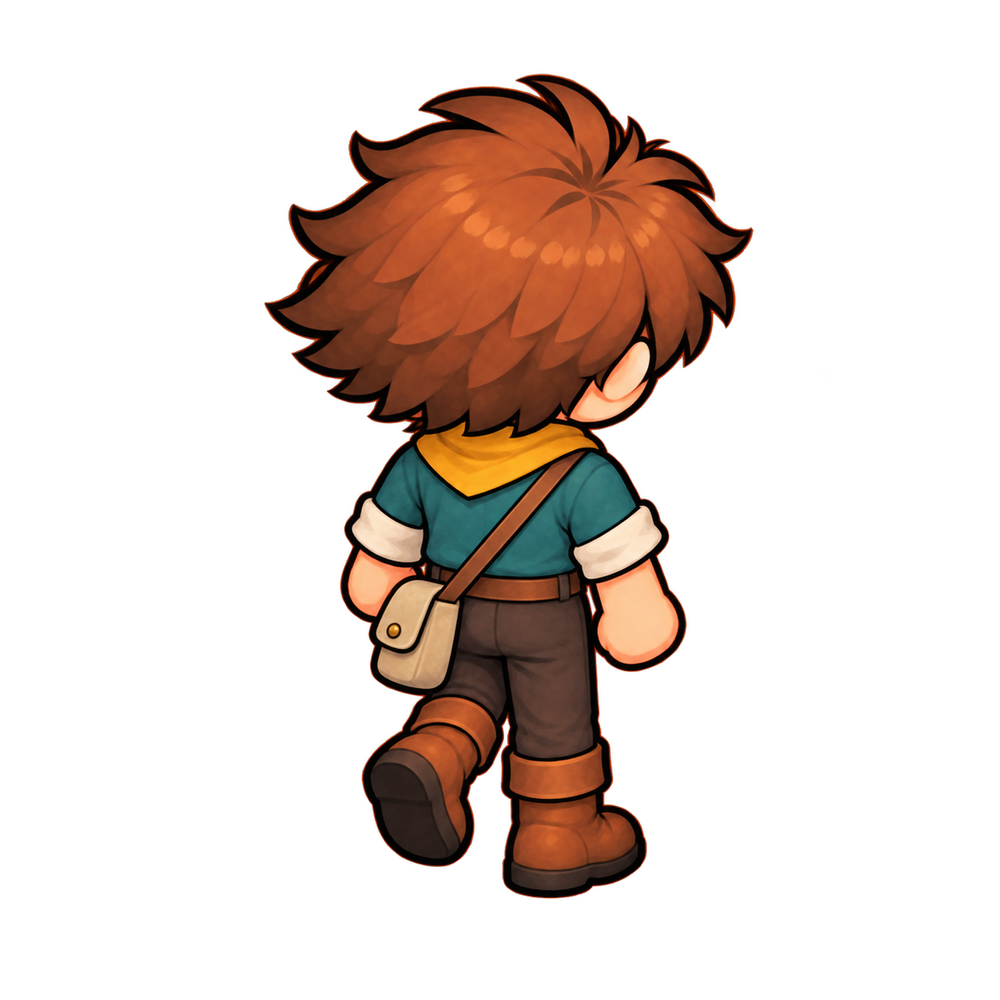
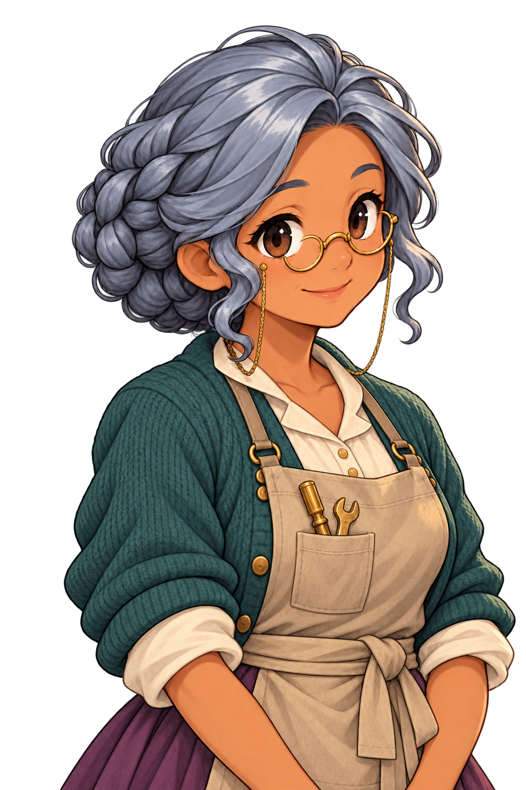
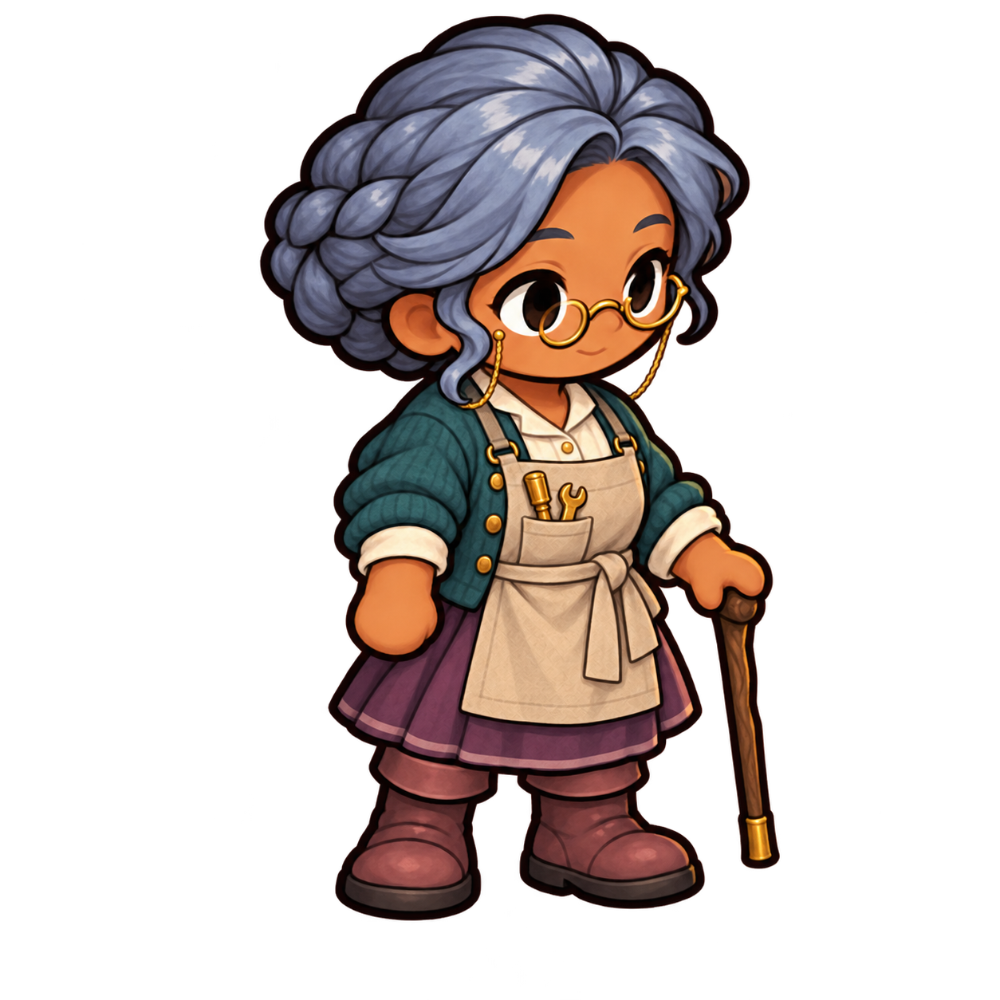
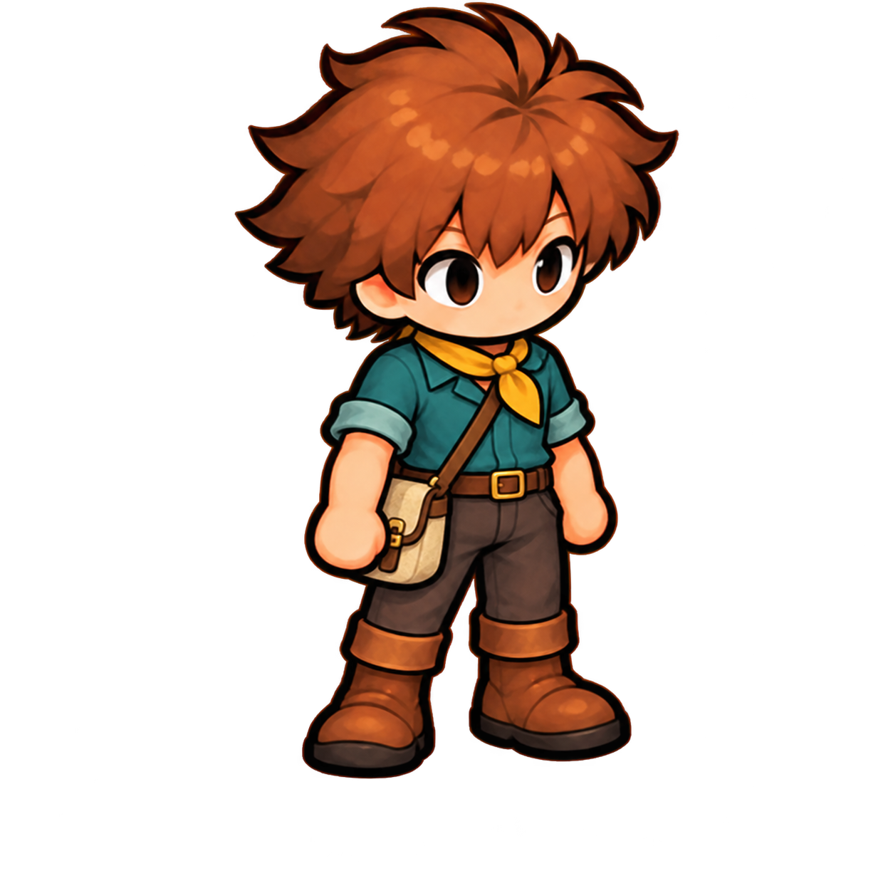
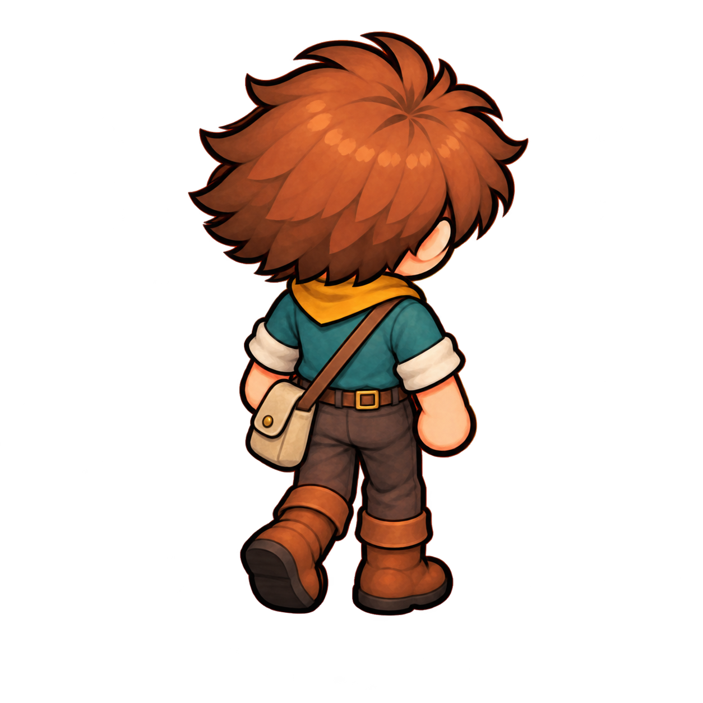
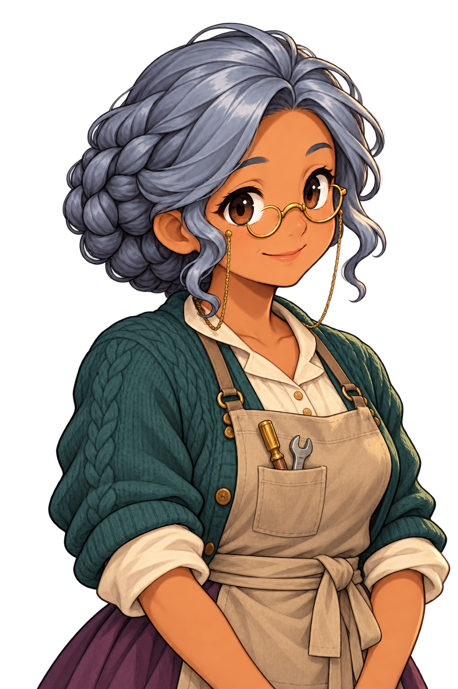
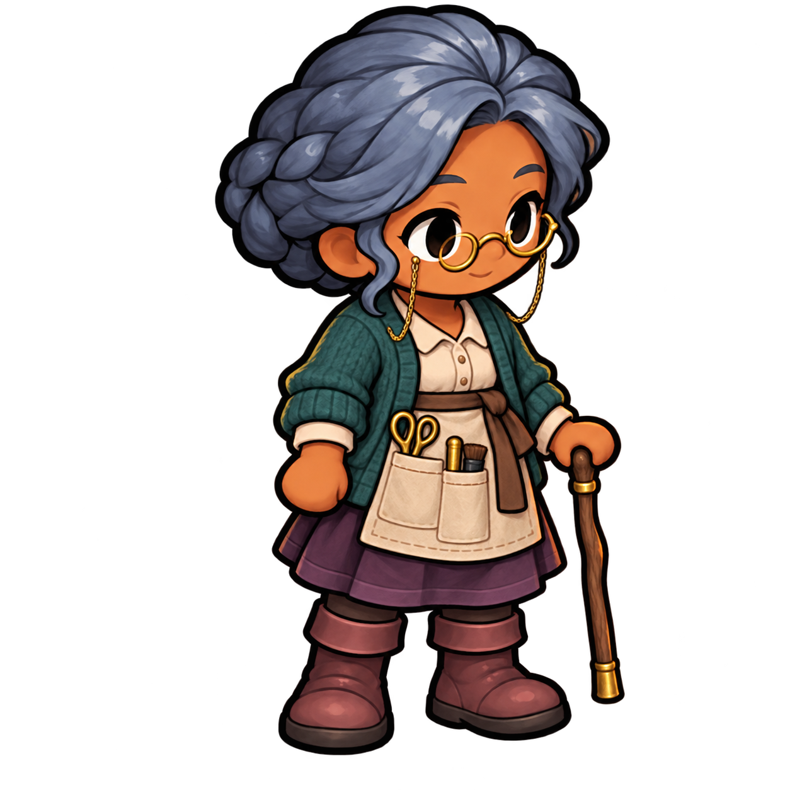

# Phase 3 — The apprentice and Nell

2026-10-26. **Second versions selected under delegated judgment.** The user authorized completing the rest of the pack without approval stops. Each view has two generated versions; the selected set below uses the second version of each. These are agent selections, not individual image approvals. Built with the built-in imagegen tool; its model identifier is not exposed. Exact prompts, ordered references, hashes and selections are recorded in [prompts.json](../prompts.json).

## Recommended set — second versions

| C1 · Apprentice, front SE | C1 · Apprentice, rear NE |
|---|---|
|  |  |

| C2a · Nell, portrait | C2b · Nell, sprite |
|---|---|
|  |  |

The apprentice keeps the familiar face, tousled orange hair, triangular yellow neckerchief and sturdy brown boots. The teal shirt now has a collar and a tucked waist; the belt holds the trousers, and a simple satchel carries the new work-clothes silhouette. The rear version keeps the belt buckle hidden on the front and carries the satchel strap across his back.

Nell keeps her braided silver hair, warm skin, round brass spectacles and friendly expression. The open cardigan, small-collared blouse, plum skirt and canvas bib apron establish her new role as an automaton-maker. The portrait and second sprite share the same two small brass tools; only the sprite carries the walking stick, as requested.

## Alternates — first versions

| Apprentice, front | Apprentice, rear |
|---|---|
|  |  |

| Nell, portrait | Nell, sprite |
|---|---|
|  |  |

The first front apprentice has tighter hair framing and a more detailed satchel. The first rear view puts a buckle on the back waist. Nell's first sprite uses a different apron and adds artist's tools; the second brings it into agreement with her portrait and the maker brief.

## Review limits

- These are single-view wardrobe references, not complete animation skins. The approved shared frame template and existing game art have not been replaced.
- C1's front uses the existing SE idle pose; the rear uses the top-left walking pose from the existing NE sheet, as the pack asks. The full sheet was supplied with an explicit top-left-only instruction; no generated crop was substituted for the source.
- The six square images came back at a native **1254×1254**, despite the prompt pack's 1024×1024 request. They are preserved without resampling. Nell's two portraits are **1024×1536**. The prompt record reports actual dimensions.
- All images have RGBA transparency. Very low-alpha specks remain outside some silhouettes; final alpha cleanup, margins, exact pose registration and small-scale Godot review belong to production adoption.
- The paintings preserve the characters' identity features and style by reference; they do not preserve every source pixel. A full new skin still needs every shared walk/idle/blink frame and the usual character-pipeline checks.

The selected concepts carry forward into Phase 4: the workshop loft, workshop floor, outside lane, workshop props and street props (`T7a`, `T7b`, `T7c`, `P3`, `P1`). The user's latest instruction supersedes the [prompt pack](../../04-art-prompts.md#ground-rules)'s approval stops; individual image statuses remain draft until directly approved.

All eight images remain under `docs/concept/v0.7/art/3-cast/`, excluded from Godot import by `docs/.gdignore`.

## Verification

All eight cast PNGs decoded successfully and passed actual-dimension, RGBA, alpha-range, file/input hash and exact shared prompt-block checks. Seven have fully clear corners; the selected apprentice front has alpha 1/255 at one corner, recorded for later edge cleanup. At this phase boundary, all 22 saved concept PNGs had prompt records, every review link resolves, and the six approved second variants retain their recorded image hashes. The full project suite passed in Phase 1 and was not repeated for this image-and-document-only pass. Production adoption and Godot review remain separate work.
