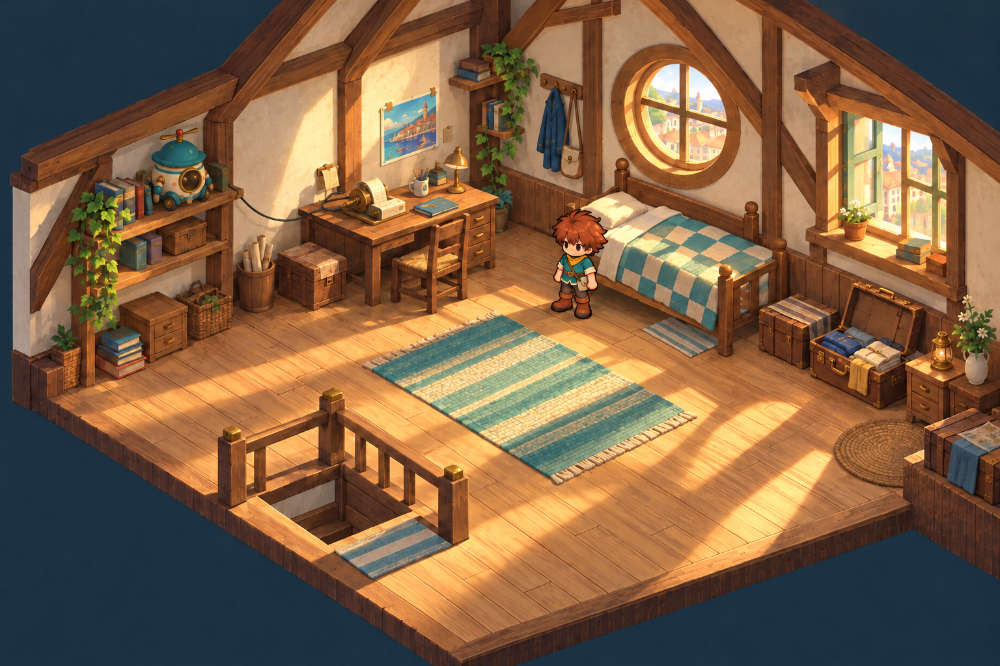
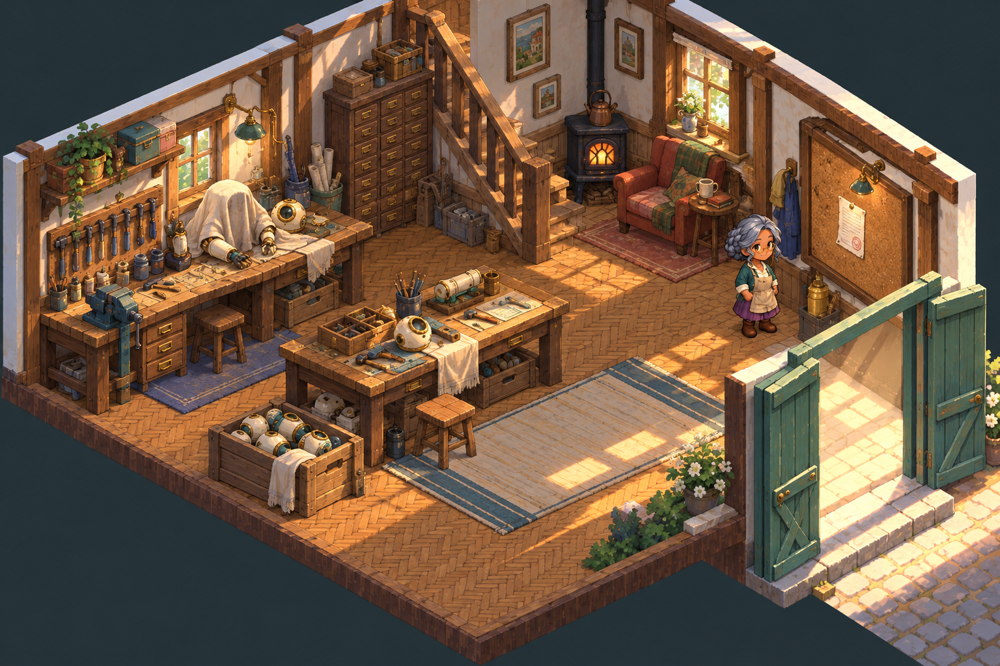
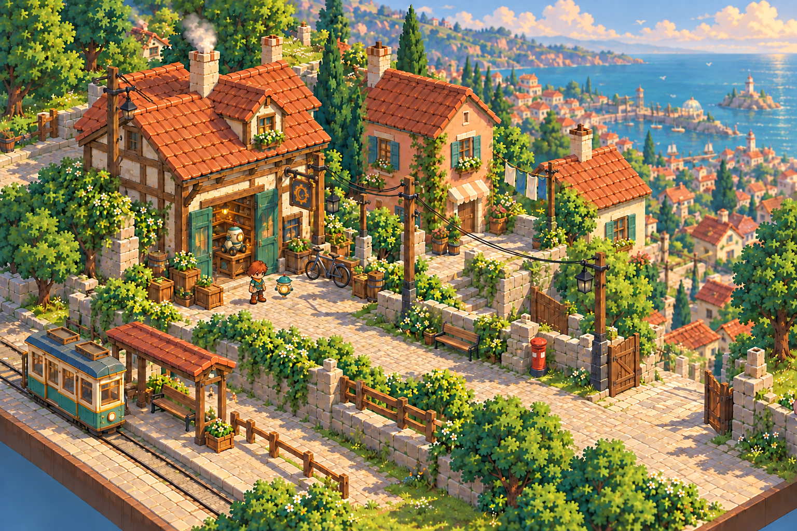
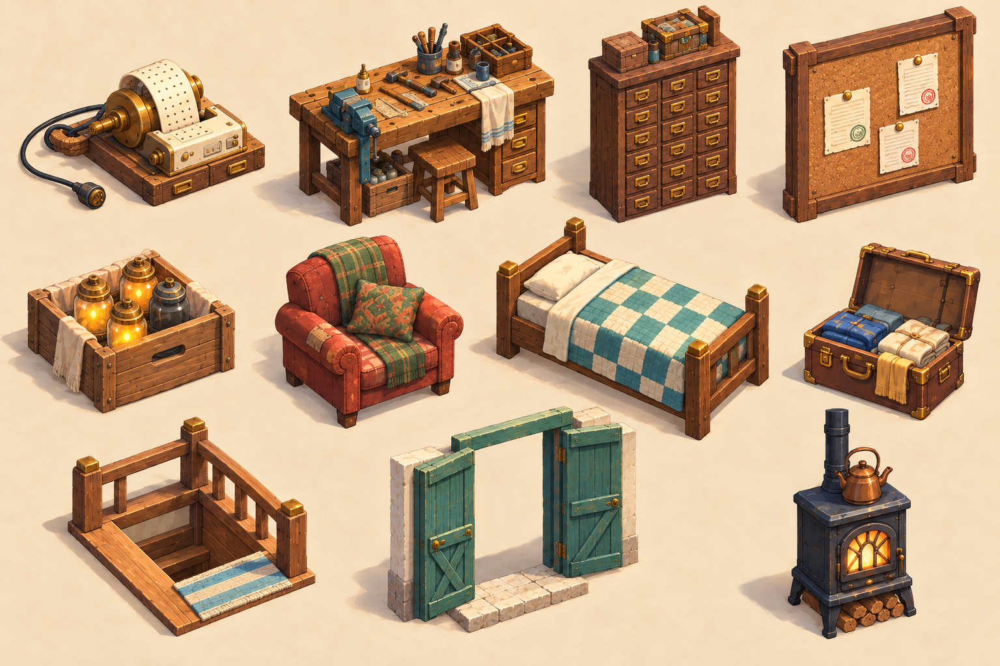
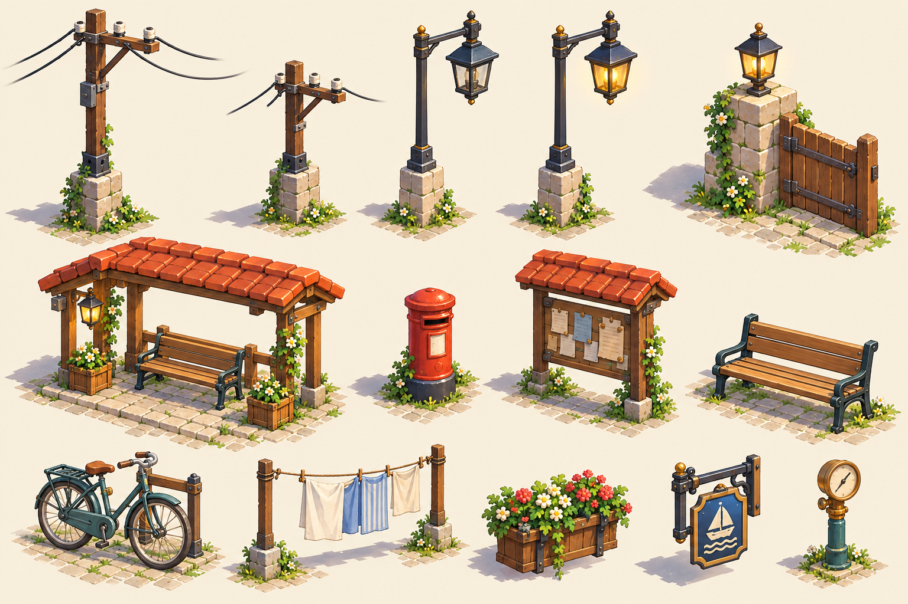

# Phase 4 — The workshop morning

Selected under the user's delegated judgment, 2026-10-26. Concept references only. [Exact prompts and provenance](../prompts.json).

| Loft · T7a | Workshop floor · T7b |
|---|---|
|  |  |

| Workshop props · P3 | Street props · P1 |
|---|---|
|  |  |

The second loft keeps Hotaru's window dark and the tape-machine cable visible. The second workshop keeps Nell small and the single job ticket distinct. The lane's third version corrects the gate lamp to its unlit starting state. P3 uses the second warm-paper sheet; P1 uses the first street-prop sheet for its calmer spacing and paired lamp states. Alternates sit beside each image as `.alt1.png`.

These paintings establish layout, mood and object families. They are not authored maps, exact camera proofs, collision layouts or production models. Tiny counts and printed marks on prop sheets remain illustrative. The source images, palettes and existing game remain unchanged.

The linked selections now include separate wheel-base revisions under the user’s later [rolling-robot direction](../DESIGN_DECISIONS.md). Earlier selected PNGs remain beside them unchanged.
