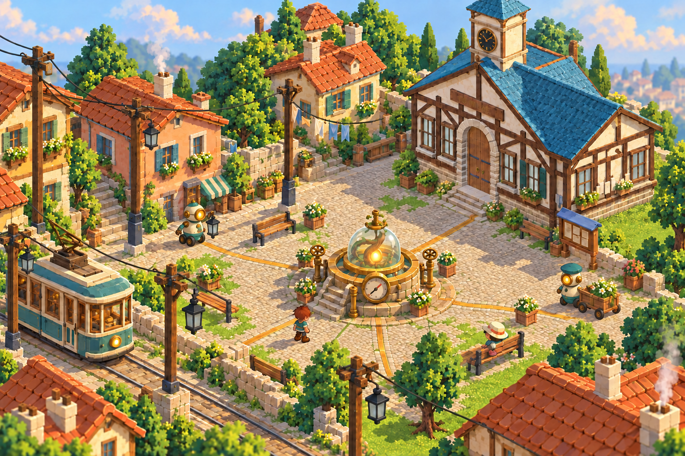
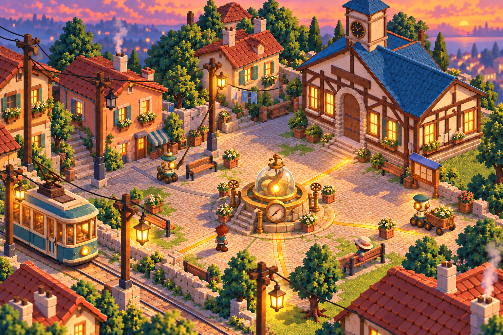
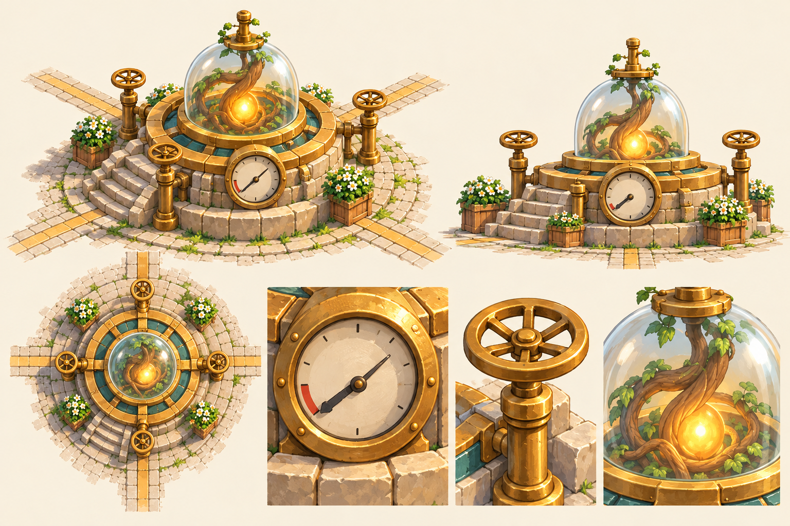
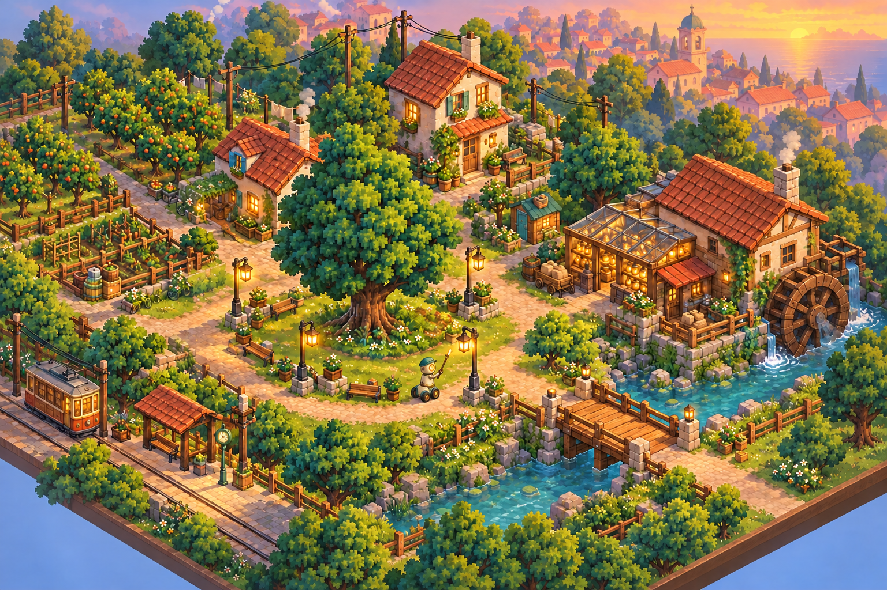
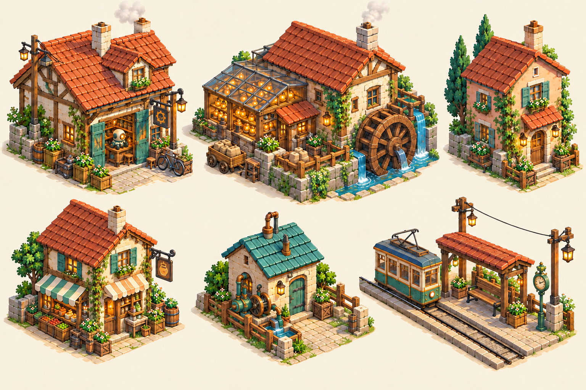

# Phase 5 — Haverlund and the Rootwell

Selected under delegated judgment, 2026-10-26. Concept references only. [Exact prompts and provenance](../prompts.json).

| Rootward Square by day · T3 | Rootward Square at dusk · T4 |
|---|---|
|  |  |

| The outskirts · T2 | Buildings · P2 |
|---|---|
|  |  |

The selected day view is a third, targeted lamp-state correction of the second square composition. T4 uses the second dusk pass, with a clear dim-branch clue. The second Rootwell sheet aligns four valve wheels with four outgoing inlays and makes the low-pressure part of the dial clear. The second outskirts and building variants give the mill annex, bridge and route more space. Alternates are retained as `.alt1.png`.

The diagrams establish design intent rather than exact geometry. Camera, scale, view-to-view detail, tiny props and light boundaries need deliberate modelling and a gameplay-scale review before adoption. The lamplighter in the town studies is provisional; the automaton sheets define its detailed design.

The linked selections now include separate wheel-base revisions under the user’s later [rolling-robot direction](../DESIGN_DECISIONS.md). Earlier selected PNGs remain beside them unchanged.
