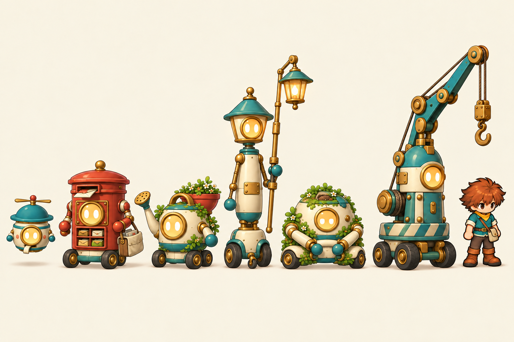
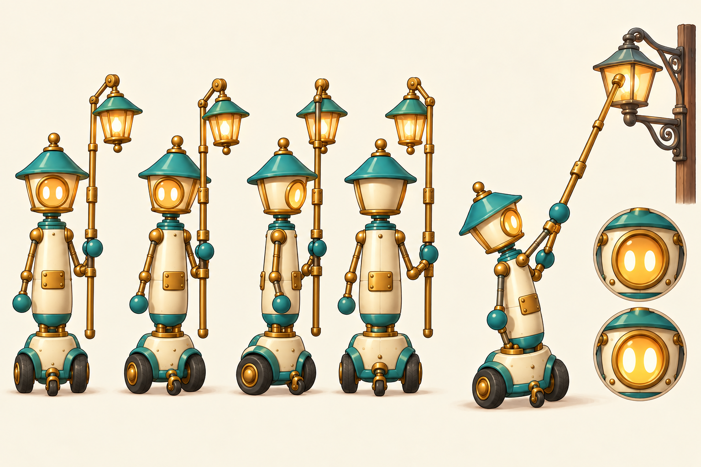
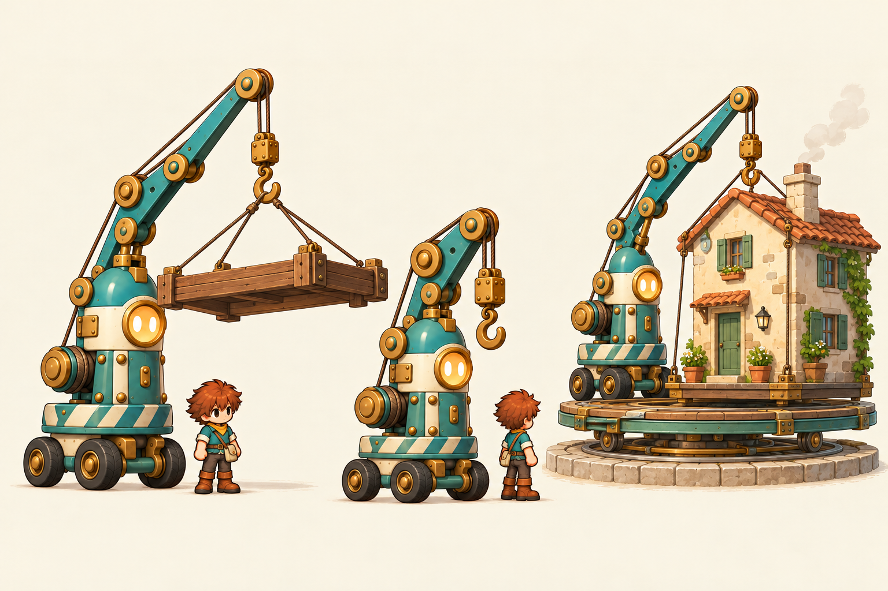
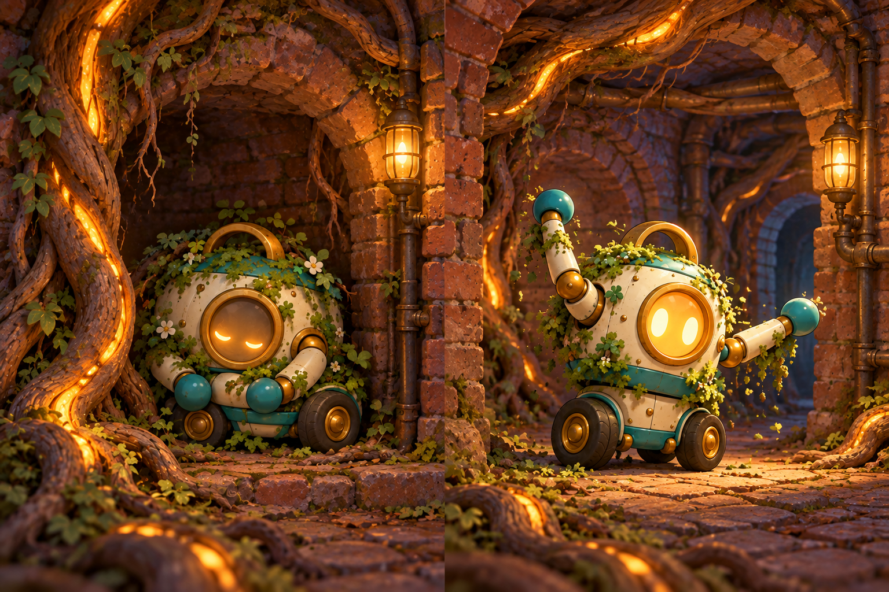

# Phase 6 — Machines with manners

Selected under delegated judgment, 2026-10-26. The user's later [wheel-base direction](../DESIGN_DECISIONS.md) is applied throughout. [Exact prompts and provenance](../prompts.json).

| Wick · A2 | Heron · A3 |
|---|---|
|  |  |

The second wheeled family take (generation 4) gives Wick a direct chassis mount, with no leg-like struts. Each machine keeps a different trade silhouette while sharing softened enamel, brass hubs and one spark window. The second Wick and Heron sheets carry that construction into action poses. The tender's third pass corrects an early exterior backdrop to the enclosed underground setting.

The `.alt1.png` files retain alternate treatments. `A1-family.alt2.png` is an earlier legged study kept only as the upper-body edit source, superseded by the user's rolling-base instruction.

These are modelling and mood references. Exact wheel axes, caster/suspension geometry, card slots, pivots, load scales, mechanical connections and animation states need deliberate source modelling and Godot review. No model, rig or runtime movement has been implemented by these paintings.
