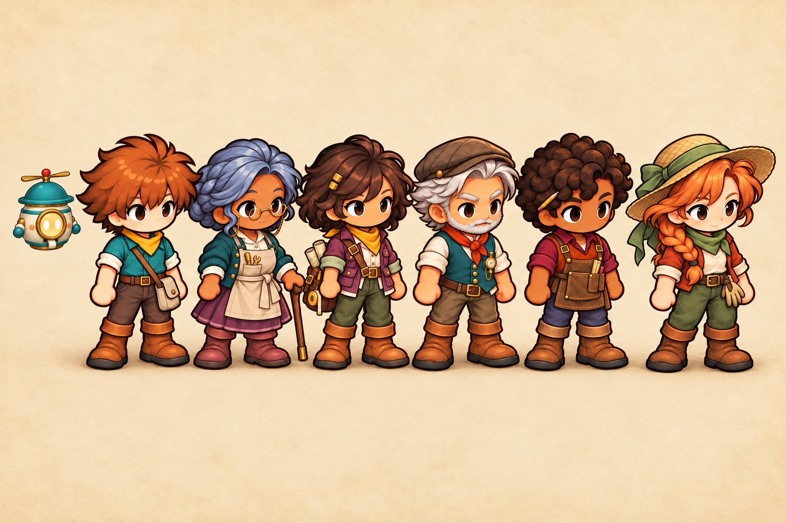

# Phase 7 — The village cast

Selected under the user's delegated judgment, 2026-10-26. [Exact prompts and provenance](../prompts.json). All four portrait and sprite pairs use the second generated variants.

The second final lineup brings the apprentice, Nell, Mira, Rowan, Bram and Tessa into one scale and lighting study. Hotaru floats beside the apprentice at about head size. A five-person intermediate study was needed because the image tool accepts at most five reference paths; the final passes added Tessa and Hotaru without dropping anyone.

| Character | Portrait | Sprite |
|---|---|---|
| Mira | [Field jacket, maps and tape](C3a-mira-portrait.png) | [Plum jacket and map satchel](C3b-mira-sprite.png) |
| Rowan | [Flat cap, scarf and brass gauge](C4a-rowan-portrait.png) | [Teal waistcoat and flat cap](C4b-rowan-sprite.png) |
| Bram | [Carpenter's apron, ruler and pencil](C5a-bram-portrait.png) | [Clear apron and tool silhouette](C5b-bram-sprite.png) |
| Tessa | [Straw hat, copper braid and garden gloves](C6a-tessa-portrait.png) | [Rust jacket and olive trousers](C6b-tessa-sprite.png) |

The sprite passes reference both the existing sprite and the selected new portrait so clothes remain consistent while keeping painted chibi proportions. The lineup is a consistency illustration; the individual images remain the detailed character references.

Portraits retain native 1024×1536 RGBA pixels. Sprite requests were 1024×1024, but the tool returned 1254×1254 RGBA; these are preserved without resampling. Rowan's selected portrait has low-alpha noise at its lower-right corner, and Tessa's has very faint corner noise. These need edge cleanup before runtime adoption. Two portrait alternates with solid figures touching a corner were discarded rather than kept as usable cutouts. Retained alternatives and the incomplete lineup study remain beside the selections.

These are static appearance concepts. No frame skin, animation, anchor, collision shape or runtime portrait has been replaced.
