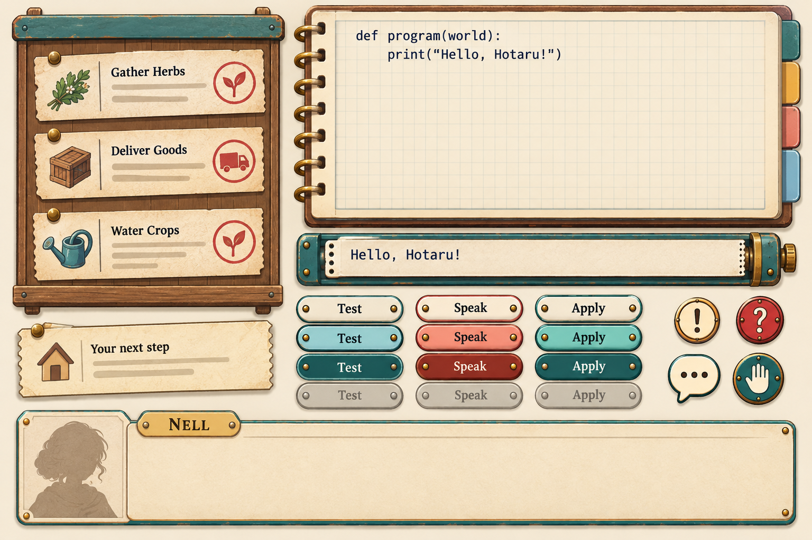

# Phase 8 — Paper and enamel

Selected under the user's delegated judgment, 2026-10-26. [Exact prompts and provenance](../prompts.json).



The second interface sheet gives the code area generous space, dark monospace lettering and a visually checked two-line example:

```python
def program(world):
    print("Hello, Hotaru!")
```

The output tape reads “Hello, Hotaru!”. Each Test, Speak and Apply column has four visible states: cream default, coloured hover, deep pressed and grey disabled. The board has three stamped tickets; a separate pinned objective, icon badges and dialogue frame complete the sheet. The portrait slot is a placeholder.


The selected journey card is also linked from [the complete index](../INDEX.md#phase-8--interface). Its second composition gives the loft window and tiny Hotaru a clear focal point, with calm sky and water on the left for later typeset title text. A separate wheel revision carries the current robot-base direction into the workshop bench detail.

Both are 1536×1024 opaque illustrations. Interface text, button behaviour, focus, contrast and scaling need native UI implementation and testing; generated pixels are a visual reference. The journey card contains no baked-in title. No existing game interface has changed.
