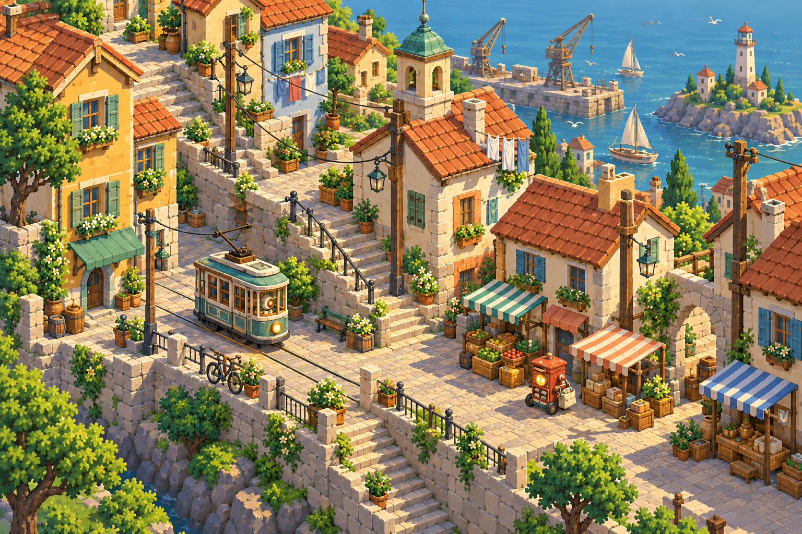
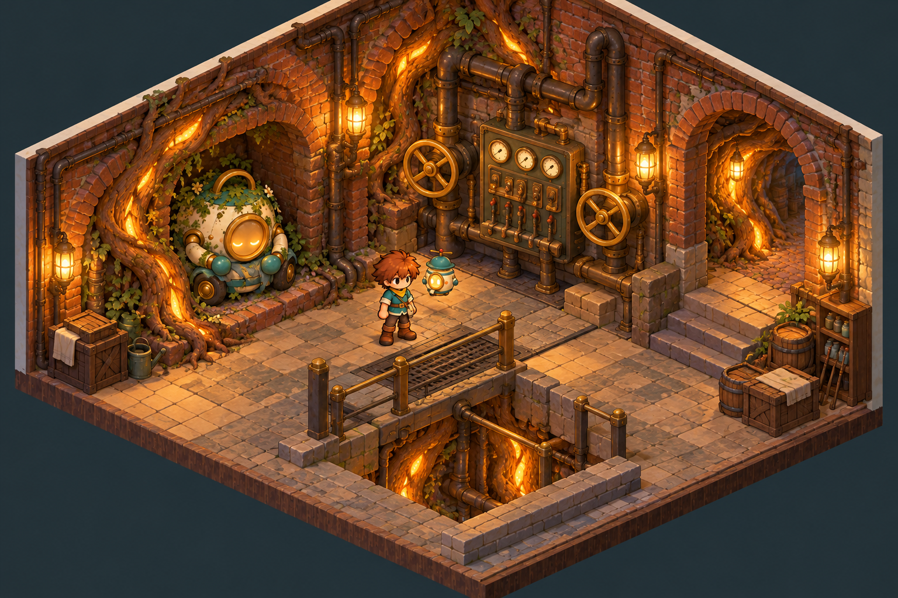
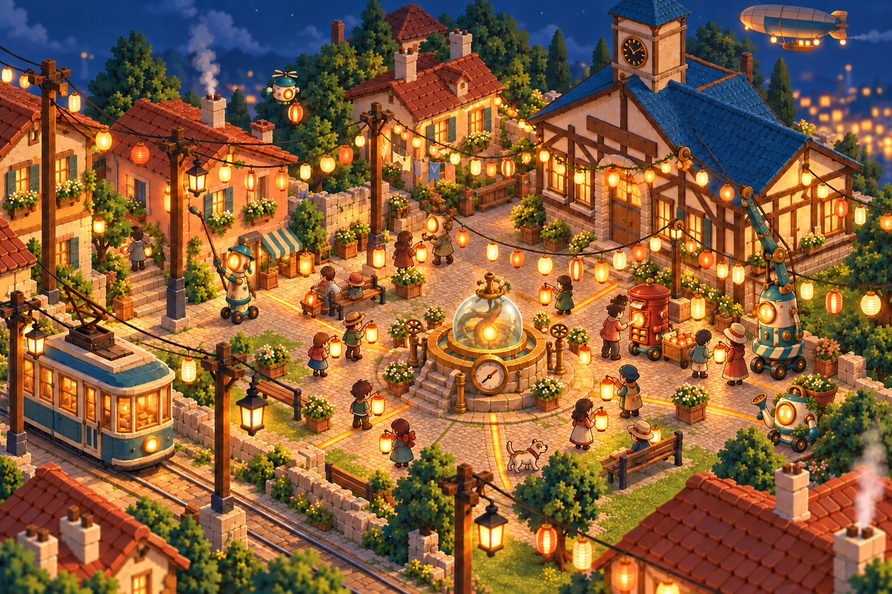

# Phase 9 — Beyond the first morning

Selected under the user's delegated judgment, 2026-10-26. [Exact prompts and provenance](../prompts.json).

The second harbour variant gives stairs and landings a clear route through the market. Fixed lanterns stay off in the afternoon; small machine spark windows glow. Pip's red post-box body sits on a compact rolling base.

The second Rootworks chamber feels like a working utility room: enclosed brick vaults, roots threading through masonry, pipes, gauges and two large valve wheels. A wheeled Sleeper dozes in its niche while the apprentice and a small floating Hotaru explore.

The festival uses the second composition plus a targeted lighting correction: all four Rootwell inlay branches glow, showing a healthy network. Wick works from a rolling base with a long pole, Heron hangs the garland, Pip distributes lanterns and Hotaru floats above. The airship stays small and friendly. This contrasts with the deliberately faulty upper-left branch in the separate dusk study.

All selections are 1536×1024 opaque PNGs. The first variants and pre-correction festival remain preserved beside them. These are future-place concepts, not implemented areas, exact navigation layouts or evidence of working game systems.
