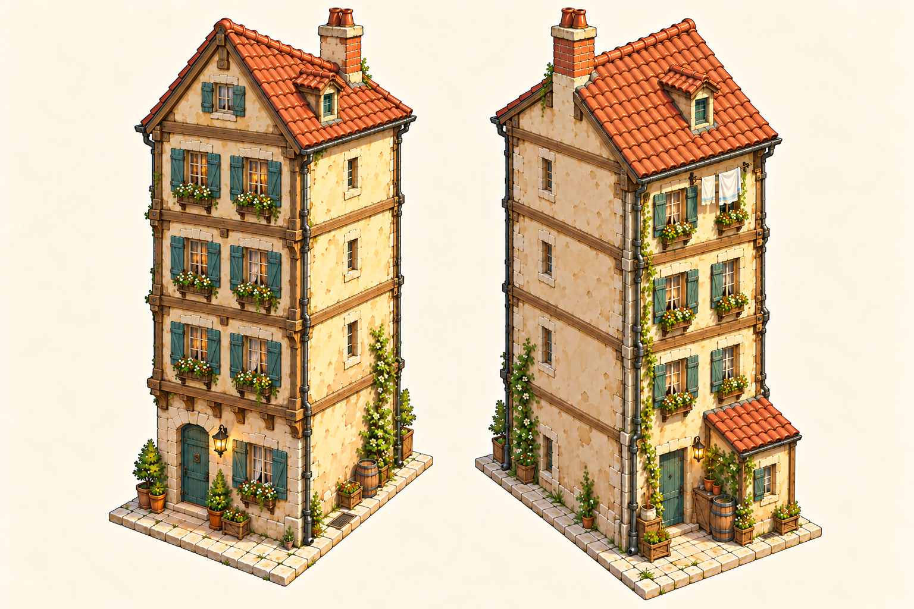
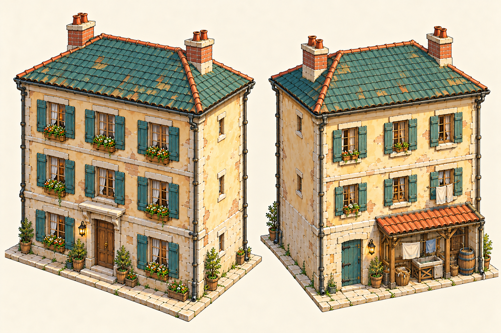
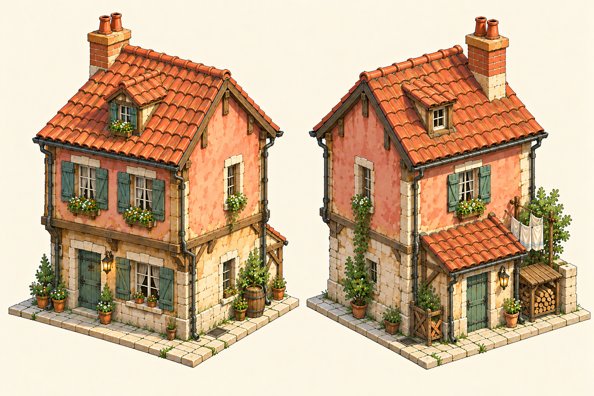
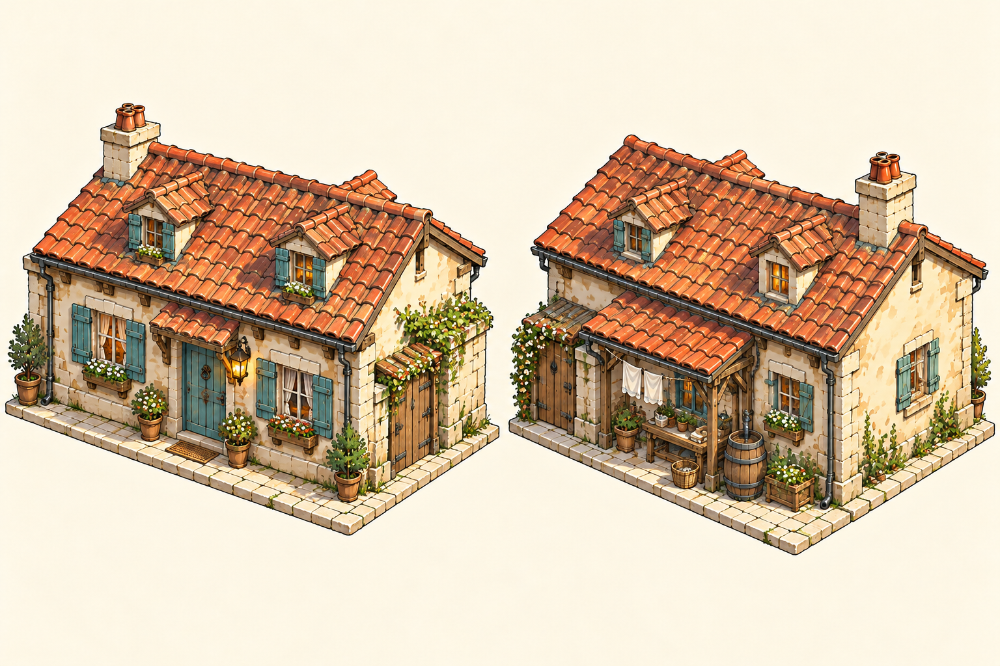
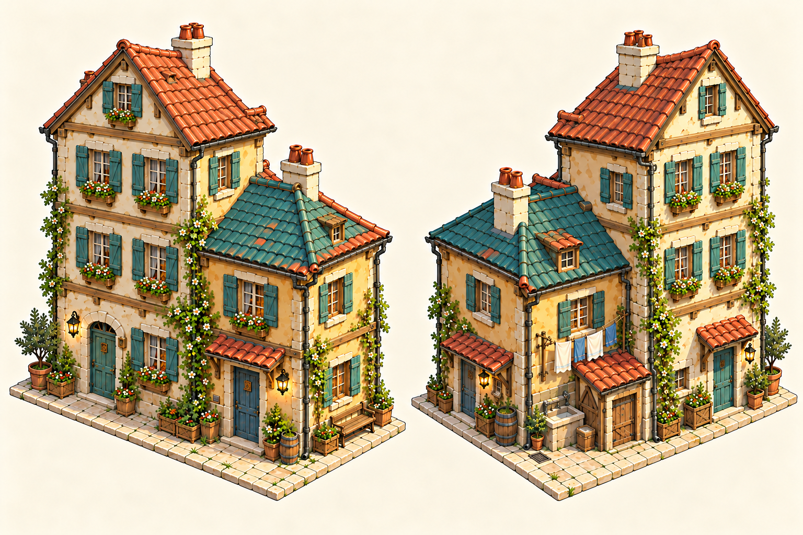

# Five background house concepts

Five residential assets to fill the streets, courtyards and roofscape beyond the playable area. They share the seaside town’s limestone, plaster, oak, shutters and clay roofs, with different heights and footprints. Each plate shows front/right and opposite rear/left views, so service walls and roof silhouettes are available alongside the street frontage.

The names are working labels. These are concept references. **All five are modelled** as standalone, reusable houses with per-placement variety, viewable in the title's Asset Showcase (Dev) and not yet placed anywhere: see the [modular house review](../../../pipeline/reviews/2026-10-29-modular-background-houses.md).

| Option | House | Size and storeys | Intended use |
| --- | --- | --- | --- |
| **D** | Lantern Row lodging house | Tall, narrow; four storeys plus attic | Thin gaps and taller roof accents behind a street |
| **E** | Saltwind apartment house | Broad; three storeys under a low hipped roof | Continuous residential blocks behind the square |
| **F** | Rosewash lane house | Compact; two storeys plus loft | Ordinary side streets between taller neighbours |
| **G** | Shingle Court cottage | Low and wide; one storey plus loft | Courtyards and lower roof gaps |
| **H** | Eaveside terrace pair | Joined three-storey and two-storey homes | Dense rows with a stepped roofline |

The plates fill their own canvases and are **not drawn to one shared scale**. Storey counts and the footprint descriptions in the source prompts establish the relative massing for modelling.

## D — Lantern Row lodging house

A steep gable, narrow window stacks and a single chimney give this house height without turning it into a tower. Relatively plain end walls let neighbouring houses stand close. The low rear pantry and washing beneath the eaves add habitation where the back is visible.

## E — Saltwind apartment house

A calmer horizontal shape: three window bays, a low teal hipped roof and two chimney stacks. It can form the middle of a residential block while its laundry alcove gives the back a useful domestic face.

## F — Rosewash lane house

Pale salmon plaster, a modest timber jetty and an off-centre dormer distinguish a smaller family home. Its pantry lean-to, kitchen door and wood store make the rear usable as an alley backdrop.

## G — Shingle Court cottage

A broad roof over one full storey keeps this dwelling below surrounding streets. Small dormers, a covered kitchen stoop and a gate suit enclosed courtyards and lower town roofs.

## H — Eaveside terrace pair

Two attached homes form one background cluster. Their different storey counts and terracotta/teal roof heights break up long rows while the shared wall and gutter junction keep them part of the same street. The taller home changes sides in the opposite view rather than repeating the street facade.

## Materials and source

The accompanying [house texture pack](house-textures.md) contains five surface families in three colours each, plus three suggested palette combinations. Native texture paintings have their [own source folder](../../../art/source/world/seaside-background-houses/v1/textures/README.md), and the normal art build supplies a dedicated game-size output folder.

All seven generated house plates, including the first D/H attempts, remain under [the versioned source folder](../../../art/source/world/seaside-background-houses/v1/README.md). D and H use a second pass that adds a full floor to the taller mass. The [exact prompts and input/output hashes](../../../art/source/world/seaside-background-houses/v1/prompts.json) record every attempt. Created with the built-in imagegen tool, using the approved square and earlier seaside plates for style.

These extend the [three earlier seaside building directions](seaside-buildings.md). Dimensions, exact matching elevations and adoption into the existing Blender/world pipeline remain a modelling step after review.
