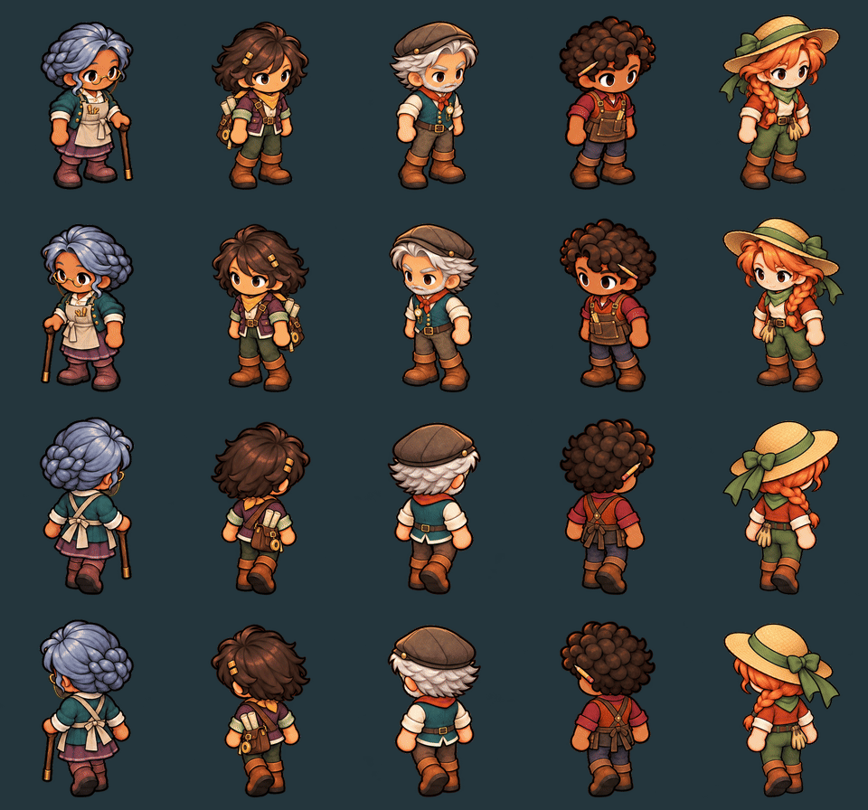
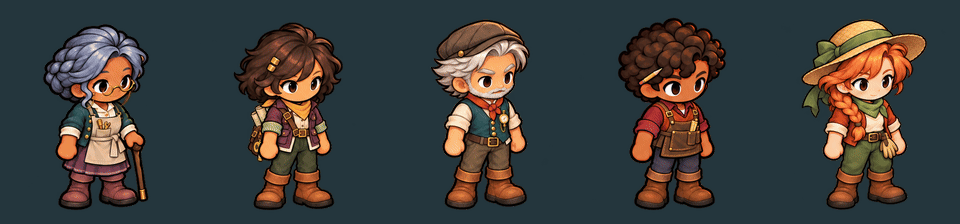
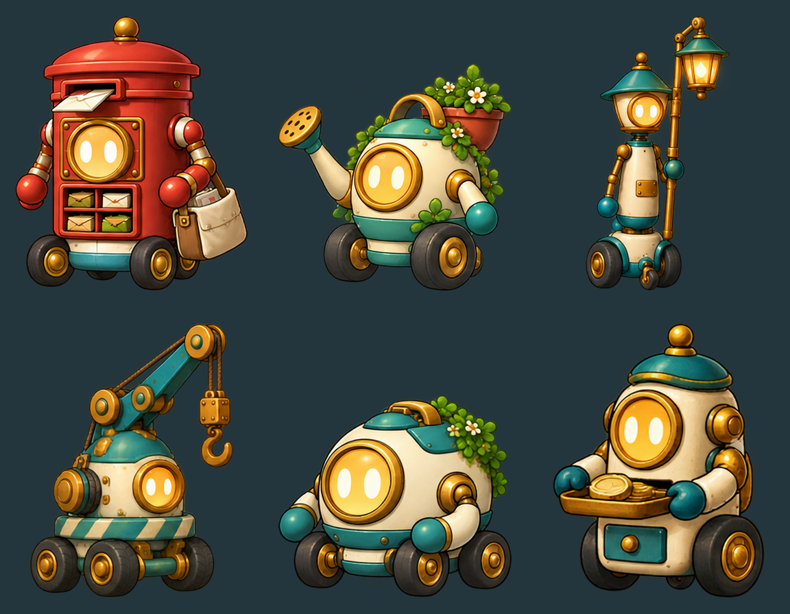
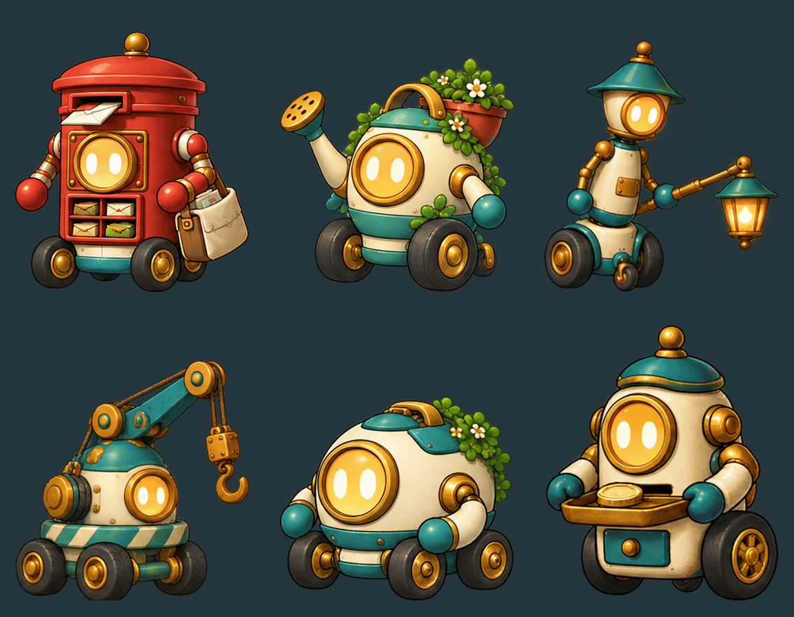

# v0.72 — Cast and rolling robots

Five new cast skins follow the selected v0.7 character designs and the approved boy’s shared sprite pipeline. Six wheeled robot concepts use the same warm outlines, enamel, brass and amber spark faces. The boy and Hotaru retain their approved artwork.

The six robots also have [refined native 3D models with blinks](robot-model-refinement.md), selected in the square and dev showcase. Pip's later approved model omits the bag shown in his original painting and keeps packages in his front compartments. The paintings and movement sheets below remain the original art references.

## Cast

Left to right: **Nell, Mira, Rowan, Bram, Tessa**. Rows in the animation are **SE, SW, NE, NW**. These previews come from the compiled atlases, using the shared walk timing.

| Character | Work and silhouette | Movement sheet | Painted front / rear sources |
| --- | --- | --- | --- |
| Nell | Automaton-maker; silver braid, spectacles, canvas apron, plum skirt and walking stick | [Four views](art/cast/nell-movement.png) | [SE](../../../art/source/characters/nell/sparks-v2/SE.png) · [NE](../../../art/source/characters/nell/sparks-v2/NE.png) |
| Mira | Surveyor; plum field jacket, ochre scarf and rolled maps | [Four views](art/cast/mira-movement.png) | [SE](../../../art/source/characters/mira/sparks-v2/SE.png) · [NE](../../../art/source/characters/mira/sparks-v2/NE.png) |
| Rowan | Sparkworks keeper; flat cap, silver beard and pocket pressure gauge | [Four views](art/cast/rowan-movement.png) | [SE](../../../art/source/characters/rowan/sparks-v2/SE.png) · [NE](../../../art/source/characters/rowan/sparks-v2/NE.png) |
| Bram | Carpenter; curls, pencil, rust vest and leather apron | [Four views](art/cast/bram-movement.png) | [SE](../../../art/source/characters/bram/sparks-v2/SE.png) · [NE](../../../art/source/characters/bram/sparks-v2/NE.png) |
| Tessa | Orchard keeper; straw hat, copper braid and gardening gloves | [Four views](art/cast/tessa-movement.png) | [SE](../../../art/source/characters/tessa/sparks-v2/SE.png) · [NE](../../../art/source/characters/tessa/sparks-v2/NE.png) |

Each movement sheet has four rows, SE/SW/NE/NW, with eight walk phases followed by neutral. The front rows also include a blink in the final column. SW and NW are exact per-cell mirrors, following the established template. The full-resolution packed atlases are registered as `sparks_nell`, `sparks_mira`, `sparks_rowan`, `sparks_bram` and `sparks_tessa` in the [character catalog](../../../pipeline/character-catalog.json).

### Full-body blinks

The enlarged face crops shown during authoring are eye-edit references. Finished blinks keep the full body, original alpha and every pixel outside the two eye patches. This preview shortens the wait between blinks for review; the game template retains its 6–7 second interval.

[Neutral still](art/cast/full-body-neutral.png) · [Blink still](art/cast/full-body-blink.png)

## Six rolling robot concepts

Reading order: **Pip, Trowel, Wick / Heron, Tender, Tally**. The lineup uses fitted preview sizes; it does not specify their relative world heights. All ground movement uses a wheelbase directly beneath the body.

| Robot | Shape and role | Sprite / movement concept sheet |
| --- | --- | --- |
| Pip | Red postal box on wheels; sorts letters into its satchel | [Turnaround, roll and work states](art/robots/pip-sheet.png) |
| Trowel | Rounded watering can; tends seedlings | [Turnaround, roll and work states](art/robots/trowel-sheet.png) |
| Wick | Slim lamplighter on a broad wheelbase; folds and raises its lighting pole | [Turnaround, roll and work states](art/robots/wick-sheet.png) |
| Heron | Compact four-wheel crane; lifts small crates with a real cable and hook | [Turnaround, roll and work states](art/robots/heron-sheet.png) |
| Tender | Low maintenance helper; inspects a valve with folding mitten arms | [Turnaround, roll and work states](art/robots/tender-sheet.png) |
| Tally | Small trading assistant; counting tray, till drawer and receipt slot | [Turnaround, roll and work states](art/robots/tally-sheet.png) |

Each concept sheet shows a four-view turnaround, four rolling keys, then off, idle and two work states. The generated row spacing varies, so the preview tool uses fitted crops and padding. These robot sheets establish designs and motion ideas; they are not registered runtime robot atlases. Their direction pairs, wheel rotation and work transitions still need production registration before gameplay use. Tally’s name and role are provisional.

## Source and review

Exact imagegen prompts, reference hashes and generated-output hashes accompany each source. The image tool did not expose a model identifier or seed. See the [cast source notes](../../../art/source/characters/sparks-v072.md), [robot source catalog](../../../art/source/robots/v0.72/catalog.json) and [pipeline review](../../../pipeline/reviews/2026-10-29-sparks-cast-and-robots.md).

The new human skins are compiled through `scripts/art.sh`, with the shared camera, anchors, scale, timing, idle and blink behavior. They remain hidden appearance entries for this art review; this pass adds no residents, quests or replacements to existing journeys.

Native Godot review: [1600×1000 directions](../../../evidence/sparks-cast/2026-10-29/1600x1000-directions.png) · [1280×720 full-body blinks](../../../evidence/sparks-cast/2026-10-29/1280x720-blink.png).
