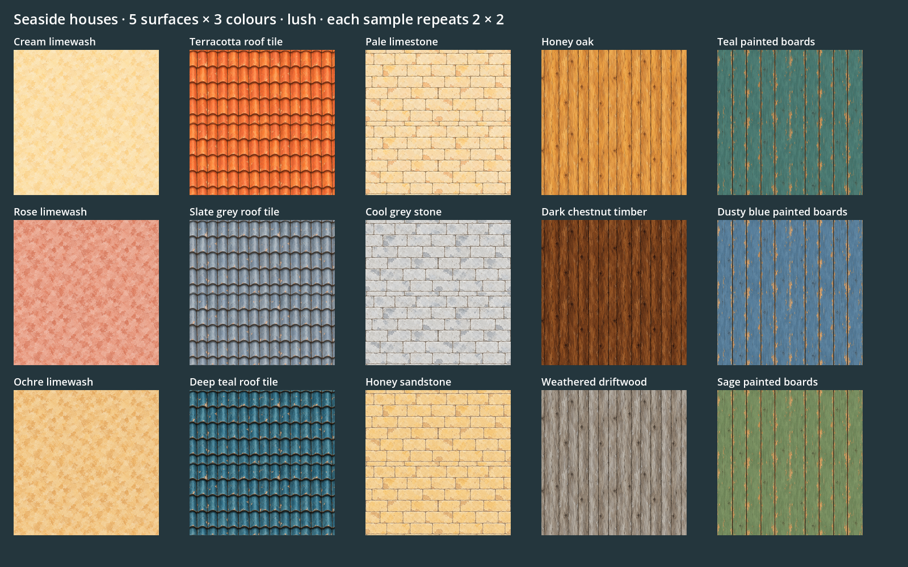

# Seaside house texture pack

Fifteen painted albedo maps: **five surface families, three colours each**. They accompany the [five background house concepts](background-houses.md) and use the same restrained coastal palette. Each colour variant was generated from its family’s first tile to retain the material pattern and wear.

Columns are plaster, roof tile, stone, timber and painted boards. Each column contains three independent colour choices. [Solid-style repeat review](../../../evidence/seaside-house-textures/2026-10-29/solid.png).

| Surface | Colour 1 | Colour 2 | Colour 3 |
| --- | --- | --- | --- |
| Plaster | [Cream](../../../art/source/world/seaside-background-houses/v1/textures/plaster/seaside_plaster_cream.png) | [Ochre](../../../art/source/world/seaside-background-houses/v1/textures/plaster/seaside_plaster_ochre.png) | [Rose](../../../art/source/world/seaside-background-houses/v1/textures/plaster/seaside_plaster_rose.png) |
| Roof tiles | [Terracotta](../../../art/source/world/seaside-background-houses/v1/textures/roof/seaside_roof_terracotta.png) | [Deep teal](../../../art/source/world/seaside-background-houses/v1/textures/roof/seaside_roof_teal.png) | [Slate grey](../../../art/source/world/seaside-background-houses/v1/textures/roof/seaside_roof_slate.png) |
| Masonry | [Pale limestone](../../../art/source/world/seaside-background-houses/v1/textures/stone/seaside_stone_limestone.png) | [Honey sandstone](../../../art/source/world/seaside-background-houses/v1/textures/stone/seaside_stone_honey.png) | [Cool grey](../../../art/source/world/seaside-background-houses/v1/textures/stone/seaside_stone_grey.png) |
| Timber | [Honey oak](../../../art/source/world/seaside-background-houses/v1/textures/timber/seaside_timber_oak.png) | [Dark chestnut](../../../art/source/world/seaside-background-houses/v1/textures/timber/seaside_timber_dark.png) | [Weathered driftwood](../../../art/source/world/seaside-background-houses/v1/textures/timber/seaside_timber_driftwood.png) |
| Painted boards | [Teal](../../../art/source/world/seaside-background-houses/v1/textures/shutter/seaside_shutter_teal.png) | [Sage](../../../art/source/world/seaside-background-houses/v1/textures/shutter/seaside_shutter_sage.png) | [Dusty blue](../../../art/source/world/seaside-background-houses/v1/textures/shutter/seaside_shutter_blue.png) |

All native paintings are opaque 1254×1254 PNGs. The slate-grey roof option keeps the same curved ceramic profile as the other colours. Timber and painted-board grain runs vertically; UV orientation should follow the beam, door or shutter when a model is authored.

## Folders and use

- [Native source pack and instructions](../../../art/source/world/seaside-background-houses/v1/textures/README.md): organised into `plaster/`, `roof/`, `stone/`, `timber/` and `shutter/`.
- [Material library and palette presets](../../../art/source/world/seaside-background-houses/v1/textures/library.json): texture ids, physical repeat widths, roughness and exact prompts.
- [Built output manifest](../../../assets/world/textures/seaside-houses/manifest.json): thirty 128×128 PNGs in the dedicated `assets/world/textures/seaside-houses/lush/` and `solid/` folders.

Use the native maps for detailed modelling/material authoring, or the built maps for the game’s existing texture styles. The maps contain base colour only, with suggested roughness values of 0.90–0.96 and metallic 0; there are no normal/displacement maps. Roof shape, stone edges and structural beams should still come from the model where they affect the silhouette.

`scripts/art.sh` builds the library through the existing texture builder. Native paintings remain untouched. Lush uses Lanczos to 128; solid uses 64 then nearest to 128. Opposite boundary pixels are paired, and the repeat boards above show the actual built maps tiled 2×2. This verifies the practical repeat at game scale; the native paintings are generated source references rather than mathematically identical edge motifs.

## Three suggested combinations

| Palette | Combination |
| --- | --- |
| **Warm lane** | Cream plaster, terracotta roof, pale limestone, honey oak, teal shutters |
| **Cool harbour** | Rose plaster, slate-grey roof, cool-grey masonry, driftwood, dusty-blue shutters |
| **Ochre court** | Ochre plaster, deep-teal roof, honey sandstone, dark timber, sage shutters |

The combinations are recorded in `library.json` and can be mixed. The pack is ready for authoring the new house models; these assets have not yet been added to the world or exposed as new finish-menu choices.

Exact prompts, references and hashes are preserved in [generation provenance](../../../art/source/world/seaside-background-houses/v1/textures/generation.json) and individual records beside each PNG. All image painting and colour edits used the built-in imagegen tool. See the [review](../../../pipeline/reviews/2026-10-29-background-houses-and-textures.md).
