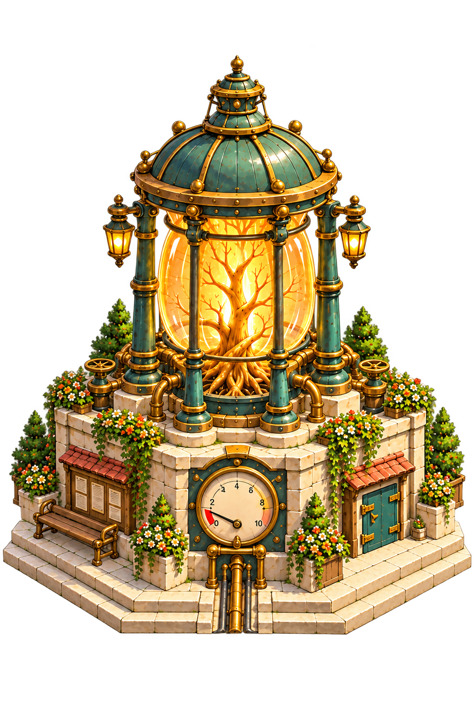
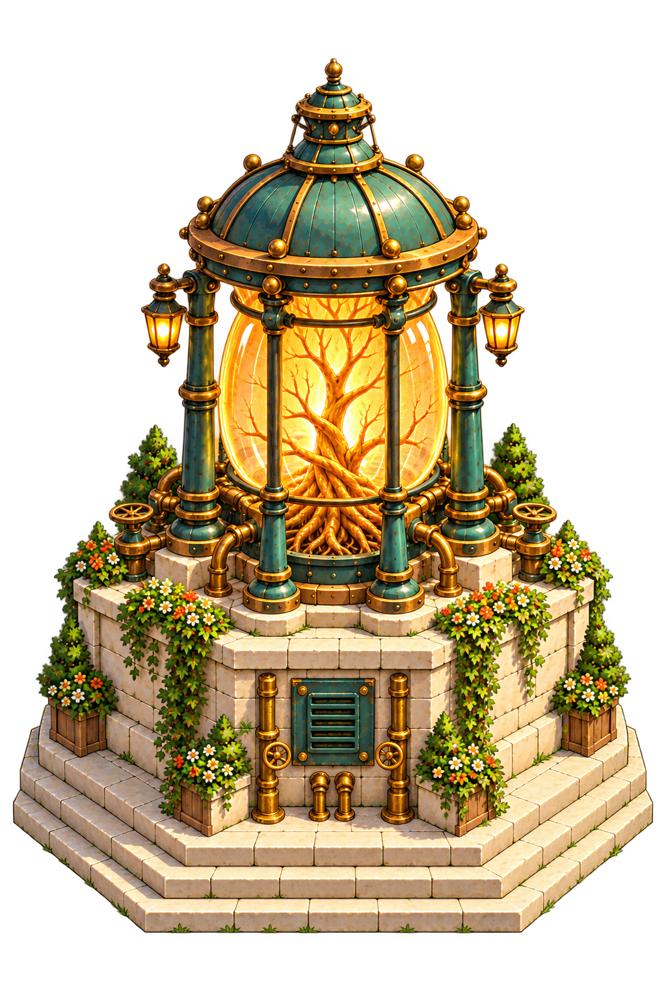

# The Rootwell — central power beacon

Approved concept direction, 2026-10-29. The user requested a closer concept of the square’s central power source, then clarified **no background, multiple views**, and asked to keep the work in **v0.72**.

These two full-size **1024×1536 transparent PNGs** are the main asset references. They retain a soft amber glow around the lit chamber. The [approved square painting](art/guildhall-square.png) establishes the landmark’s place in Haverlund.

## Front three-quarter

The public face: a large low-pressure gauge, notice board with a timber perch, and an adjacent teal maintenance door. The warm living root emerges through the well throat beneath bowed amber glass. Brass collars and glazing ribs tie it to the verdigris-copper crown; exposed valves and short connection stubs explain how the machine feeds the town.

## Opposite rear three-quarter

The service face: a recessed vented panel, copper risers, relief fittings and accessible valve wheels. The public gauge and notice board remain on the front. The rear is a complementary painting, rather than a flipped front image.

## Use as the asset brief

- Keep the tall lantern silhouette, ribbed copper crown, branching amber root, brass hardware and dressed octagonal limestone base.
- Separate the public instrument and notice-board faces from the rear service assembly. Keep door hinges, glass retainers, supports and pipe routes understandable.
- Retain the shallow steps, attached flower planters, restrained ivy and wear where hands and feet touch the structure.
- The dial measures pressure. Its single needle sits in the low range; final game lettering and tick marks should be authored cleanly for the intended camera size.
- Long brass routes under the square’s paving belong to the environment. The asset drawings end them as short connection stubs at the steps.

**Modelled 2026-10-29** as [`rootwell-beacon`](../../../art/source/world/rootwell/v1/README.md), viewable in Asset Showcase (Dev); see the [headpiece review](../../../pipeline/reviews/2026-10-29-rootwell-headpiece.md). The playable square keeps the older model until the square layout pass places the new one.

The square's current editable model remains [`square-beacon/v1/model.blend`](../../../art/source/world/square-beacon/v1/model.blend), selected by [`pipeline/world-catalog.json`](../../../pipeline/world-catalog.json). The playable placement, footprint and interactions remain in [`haverlund-square.json`](../../../content/areas/haverlund-square.json). This pass supplies the main art reference for a future deliberate source revision.

[Versioned images, exact prompts and provenance](../../../art/source/world/square-beacon/concept-v1/README.md) · [Review](../../../pipeline/reviews/2026-10-29-rootwell-asset-concept.md).
