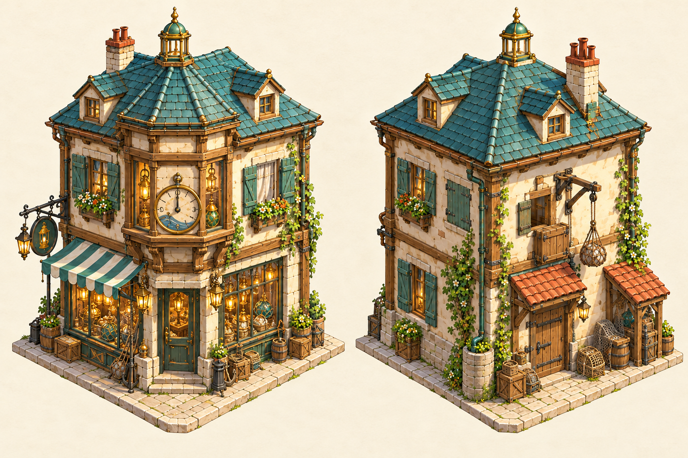
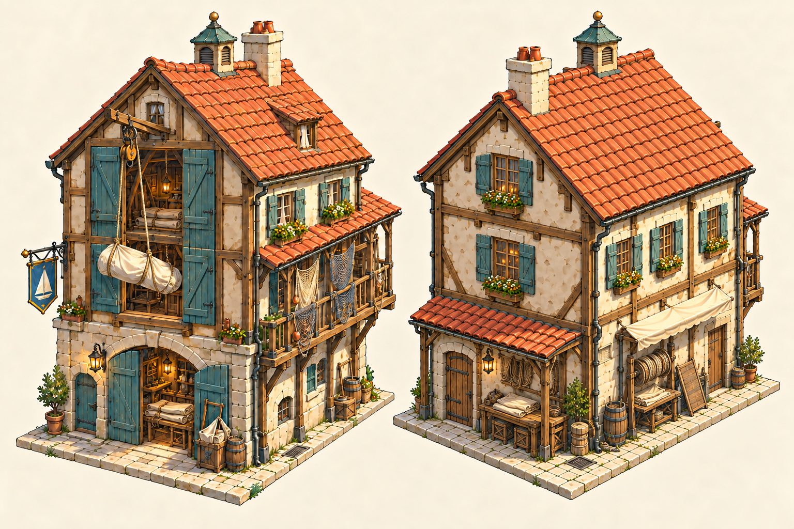
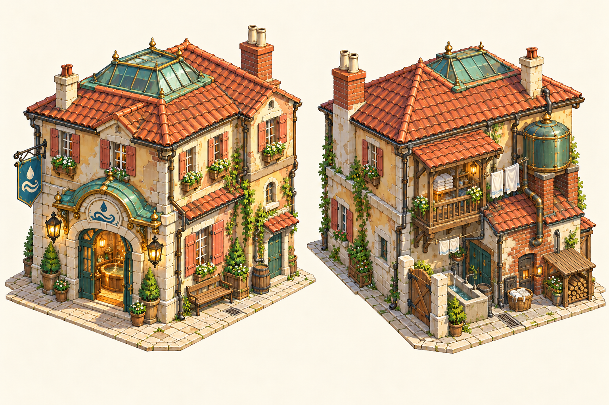

# Three seaside-town building directions

The follow-up [five background houses](background-houses.md) adds quieter residential sizes, with a separate [three-colour-per-surface texture pack](house-textures.md).

Three new building studies for the town around Guildhall Square and Spindle Lane. Each plate shows a complete street-facing view on the left and a complementary rear/service view on the right, using the game’s elevated orthographic camera direction. Roofs, foundations and practical working details remain visible.

These are choices for the next architectural direction, rather than replacements for the existing square buildings. Their names are working labels; the pictures use trade emblems rather than shop lettering.

| Option | Building | Distinctive feature | Character of the street |
| --- | --- | --- | --- |
| **A** | **Tideglass Chandlery** | Corner tide-clock bay, lantern windows, rear delivery hoist | A polished trading frontage with inhabited rooms above |
| **B** | **Gullstitch Sail Loft** | Tall loading shutters, sail hoist and a supported net-drying gallery | A busier working lane with strong timber and clay-tile forms |
| **C** | **Lowtide Baths & Washhouse** | Green-glass rooflight, sheltered washing yard and rear boiler/cistern | A useful community building with a quieter domestic frontage |

## A — Tideglass Chandlery

A narrow corner shop whose round tide dial and lantern-filled windows can be recognised from the game camera. The raised bay, teal roof and copper ridge lantern give it a distinct silhouette. Rope, glass floats and storm lamps supply the harbour trade; a tiled loading canopy and upper pulley hatch explain how stock reaches the back rooms.

## B — Gullstitch Sail Loft

The most openly workmanlike direction: wide loading doors below a tall sail loft, a usable hoist under the gable, and nets drying along a timber gallery. The corrected opposite view shows the rear gable and previously unseen long service wall, with rope reels and a mending bench under a canvas awning. The gallery remains on the far side rather than appearing on both long walls. Its long elevation would give a harbour approach a different rhythm from the square’s shop fronts.

## C — Lowtide Baths & Washhouse

A neighbourhood amenity with a glazed rooflight over the bathing rooms and occupied upper rooms. The welcome is on the street; the back explains the labour through linen shelves, a wash trough, wood store, boiler annex and supported water cistern. Copper, ochre plaster and faded coral shutters keep it close to the town’s existing materials.

## Source and scope

Generated with the built-in imagegen tool using the [approved square](art/guildhall-square.png) and [workshop lane](../v0.7/art/4-opening/T7c-workshop-lane.png) as style/material references. [Exact prompts and reference/output hashes](../../../art/source/world/seaside-building-concepts/v1/prompts.json) and [source notes](../../../art/source/world/seaside-building-concepts/v1/README.md) accompany the unchanged generated images under `art/source/world/seaside-building-concepts/v1/`. B uses the corrected `B-gullstitch-sail-loft-v2.png` plate; its first paired-angle attempt remains archived.

The two views establish design and service-side intent. Dimensions, precise camera calibration and any small view-to-view differences will be resolved in the selected design’s modelling pass. This pack adds no Blender masters, runtime assets, collisions or placements.
