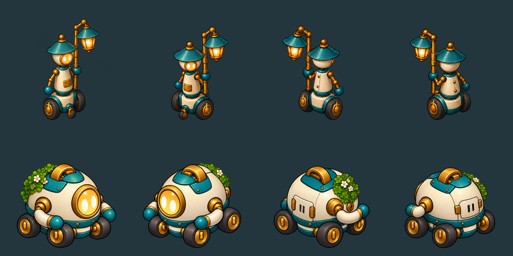
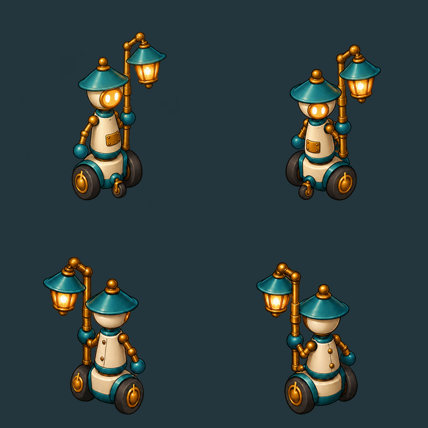
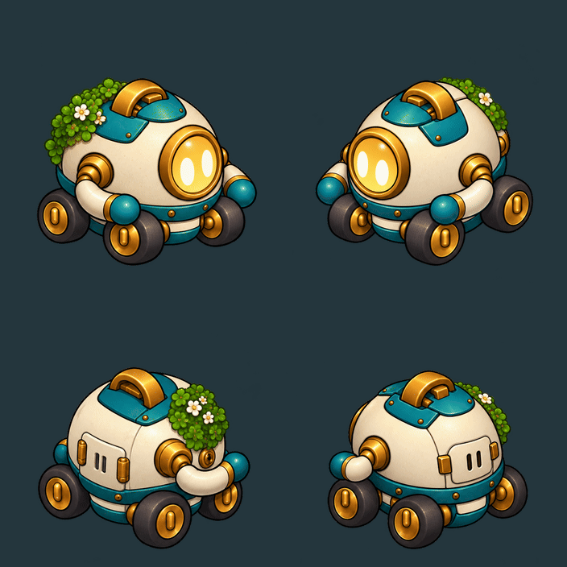

# Wick and Tender — detailed rolling movement

Four painted rolling keys per direction, for the game’s elevated orthographic view: **SE, SW, NE and NW**. Each robot has sixteen complete frames, including its wheels, fittings and carried item. The four directions are separately drawn; no left-facing view is produced by flipping a right-facing one.

Wick keeps the lamp pole in **his own left hand**. Tender’s moss and small service coupling remain on **his own rear-right side**. Their visibility changes as the robots turn, rather than moving onto the opposite side of the body.

The comparison above uses registered source pixels. Native review images below show the proposed sprite sizes beside the approved boy.

## Wick

The near and far arms are repainted for each view, preserving the left-hand grip, upright travel pole and left-side clamp. His cream rear head has no eyes; the front guide caster becomes hidden behind the drive axle in rear views. Brass hub marks, wheel tread and a little suspension/tool movement carry the cycle.

GIF arrangement: SE / SW across the top, NE / NW below. Preview timing is eight frames per second, with four keys per loop.

[Detailed movement sheet](art/wick-tender/wick-movement.png) · [Full-resolution 2816×2816 atlas](../../../art/source/robots/v0.72/wick/movement-v1/movement-atlas.png)

| Painted view | Four-key source sheet |
| --- | --- |
| SE — front-right | [Open source](../../../art/source/robots/v0.72/wick/movement-v1/SE-generated.png) |
| SW — front-left | [Open source](../../../art/source/robots/v0.72/wick/movement-v1/SW-generated.png) |
| NE — rear-right | [Open source](../../../art/source/robots/v0.72/wick/movement-v1/NE-generated.png) |
| NW — rear-left | [Open source](../../../art/source/robots/v0.72/wick/movement-v1/NW-generated.png) |

## Tender

Tender rolls on four wheels with both arms tucked. The right rear moss is fully visible from the right flank and partly hidden across the far roof edge from the left flank. The plain left shell, right-side coupling and rear service cover make the physical turn readable. Rear views show the service cover rather than another face.

[Detailed movement sheet](art/wick-tender/tender-movement.png) · [Full-resolution 2816×2816 atlas](../../../art/source/robots/v0.72/tender/movement-v1/movement-atlas.png)

| Painted view | Four-key source sheet |
| --- | --- |
| SE — front-right | [Open source](../../../art/source/robots/v0.72/tender/movement-v1/SE-generated.png) |
| SW — front-left | [Open source](../../../art/source/robots/v0.72/tender/movement-v1/SW-generated.png) |
| NE — rear-right | [Open source](../../../art/source/robots/v0.72/tender/movement-v1/NE-generated.png) |
| NW — rear-left | [Open source](../../../art/source/robots/v0.72/tender/movement-v1/NW-generated.png) |

## Camera and source review

The artwork uses the game’s roughly 31-degree elevated, diagonal orthographic camera. Native Godot playback shows all eight robot views beside the unchanged boy, at camera size 16 and a closer size 10. The review proposes 1.85 world units for Wick including his carried lantern and 0.95 for Tender; these are review sizes rather than changes to the placed models.

[1600×1000 gameplay scale](../../../evidence/sparks-robots/2026-10-29/1600x1000-directions.png) · [Closer view](../../../evidence/sparks-robots/2026-10-29/1600x1000-detail.png) · [1280×720 gameplay scale](../../../evidence/sparks-robots/2026-10-29/1280x720-directions.png)

The registered sheets have four columns of phases and four rows in SE/SW/NE/NW order, using 704-square cells and wheel origin `[352,660]`. Registration only translates the painted keys; it does not resample or mirror them. Exact imagegen prompts, references, edits and hashes accompany the [source notes](../../../art/source/robots/v0.72/movement.md).

These are sprite movement candidates for review. The existing square’s adopted 3D robot models and rounds remain in place; this pass does not change their renderer or implement work animations. Human characters retain their existing shared sprite pipeline. See the [review record](../../../pipeline/reviews/2026-10-29-wick-tender-and-seaside-buildings.md).

The parallel building study is available as [three seaside-town building directions](seaside-buildings.md).
