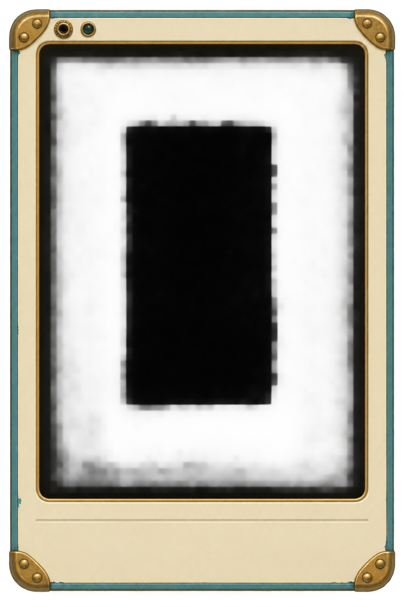

# v0.73 — Nell's field slate

[1024×1536 transparent PNG](art/nells-field-slate-frame.png) — a straight-on painted cream-enamel instrument frame with teal rim, brass screen bead, four riveted corner guards, top-left jack socket and unlit indicator, and a blank lower ledge.

Created with built-in imagegen from the user's brief. [Source images, exact prompts and generation record](../../../art/source/ui/nells-field-slate/v1/README.md) preserve the initial study, targeted edit and selected layout pass. The image here is an unchanged copy of the selected generated PNG.

This is a concept reference. Before runtime nine-slice use, the frame needs exact slice measurements and pixel cleanup: the generated black screen has slight RGB/alpha variation, and the border dimensions approximate the requested 72 px sides/top and 184 px bottom. The exterior is genuinely transparent; it has no baked checkerboard. No runtime interface or catalog selection changed.

**Adopted 2026-10-30 (user request).** The selected source is now the field slate's in-game frame. The authored PNG is unchanged; `scripts/art.sh` builds the runtime frame from it at `assets/ui/nells-field-slate/` (cropped to the casing, the screen filled with exact black, the transparent matte cleared, scaled to 50%), using the slice, window, jack and lamp measurements recorded in `pipeline/art-catalog.json` under `interface_frames`. See the [interface notes](../../../pipeline/UI.md#the-glass-and-the-ghost-sparks--machines).
