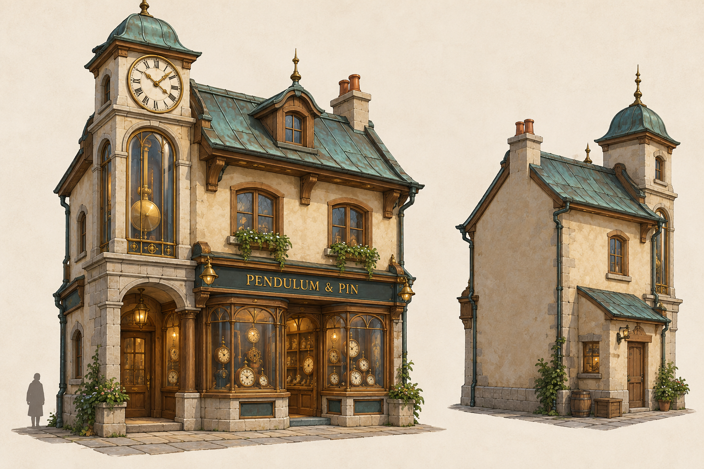
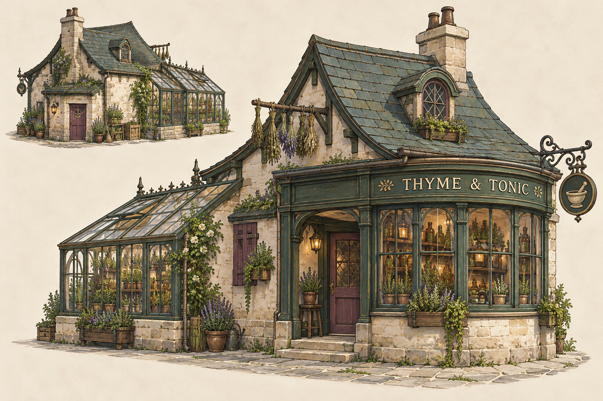
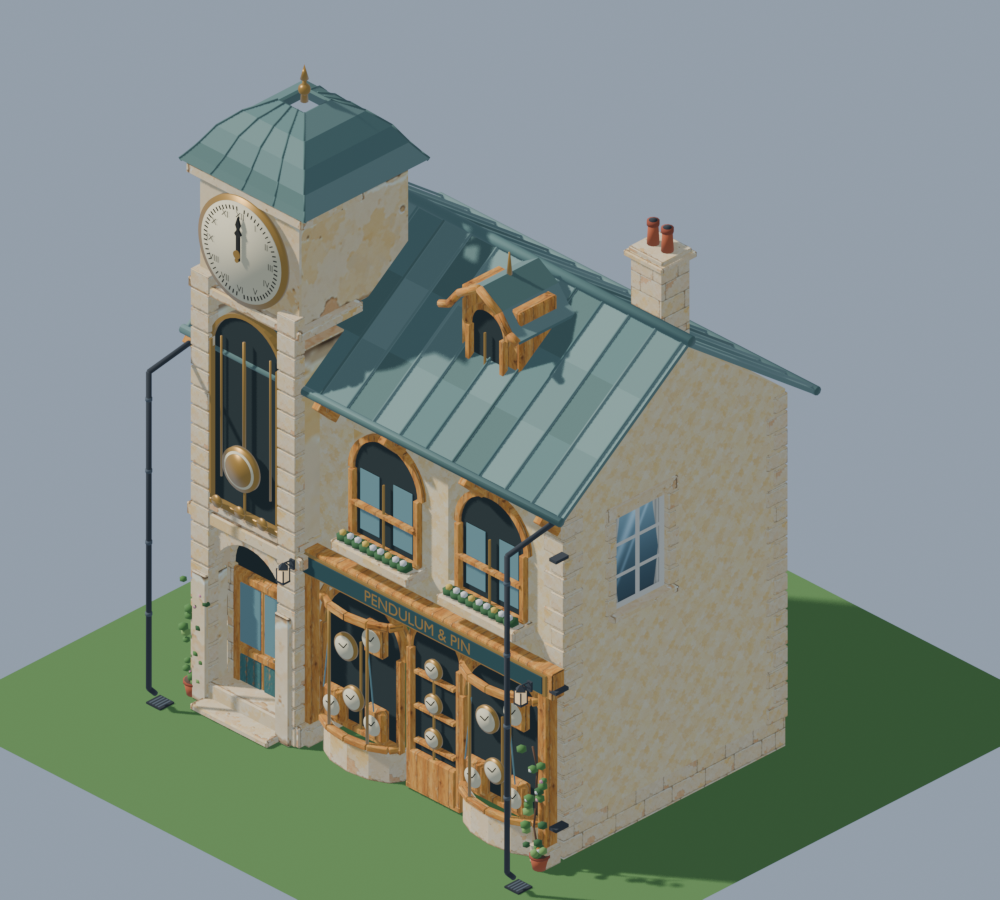
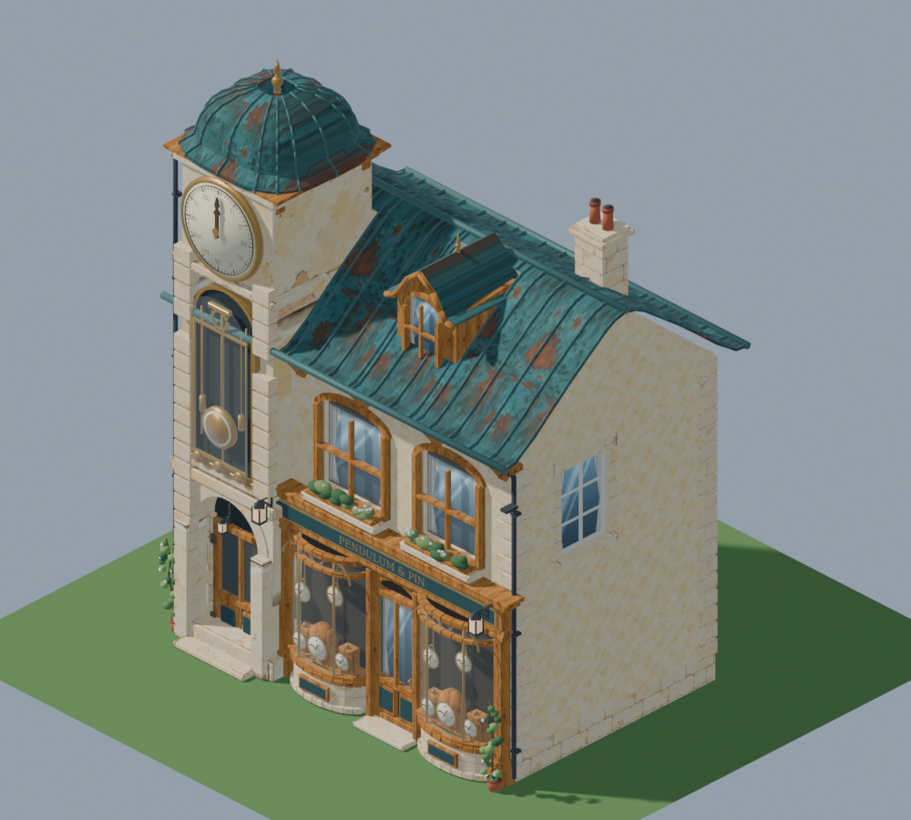

# Spindle Walk: original shop concepts

These are proposed architectural directions for the clockmaker and apothecary, generated with built-in imagegen after the user rejected the temporary reused shells. The user subsequently authorized the original clockmaker model: [v2 review](../../../pipeline/reviews/2026-11-03-original-clockmaker.md). The original apothecary was modeled and placed on 2026-11-05 ([review](../../../pipeline/reviews/2026-11-05-spindle-terrace-and-apothecary.md)); its interior remains later work. The playable strip/arrival and park layout is implemented separately.

## Pendulum & Pin

An offset clock turret and a tall pendulum bay give the shop a readable silhouette. The entrance is recessed under the tower; the broad ground-floor display faces the promenade. Copper roof details, pale stone and honey oak tie it to Haverlund without copying the other shop-houses.

## Thyme & Tonic

A lower building with a curved glazed frontage and herb glasshouse has a different massing from the clockmaker. A service door, drying rail and considered rear make it useful from more than one view.

[Exact final prompts](../../../art/source/world/spindle-strip/v1/concept-prompts.json) · [Provenance](../../../art/source/world/spindle-strip/v1/concept-provenance.json) · [Layout/source handoff](../../../art/source/world/spindle-strip/v1/README.md).

## Current clockmaker model

The first plot now uses the independently modeled clockmaker with a working recessed left entrance and shared-time clock hands. It keeps the concept's distinctive tower and pendulum bay; its cleared room remains ready for future interior design.

## Clockmaker refinement

Two additional source-edit passes address the concept mismatch and structural/material errors. The current model has the curved cap and dormer, fitted roof, glazed display bays with supported clocks, proper window openings and corrected rear service door. The working left entrance and cleared room remain.

[Refinement review](../../../pipeline/reviews/2026-11-03-clockmaker-refinement.md).
