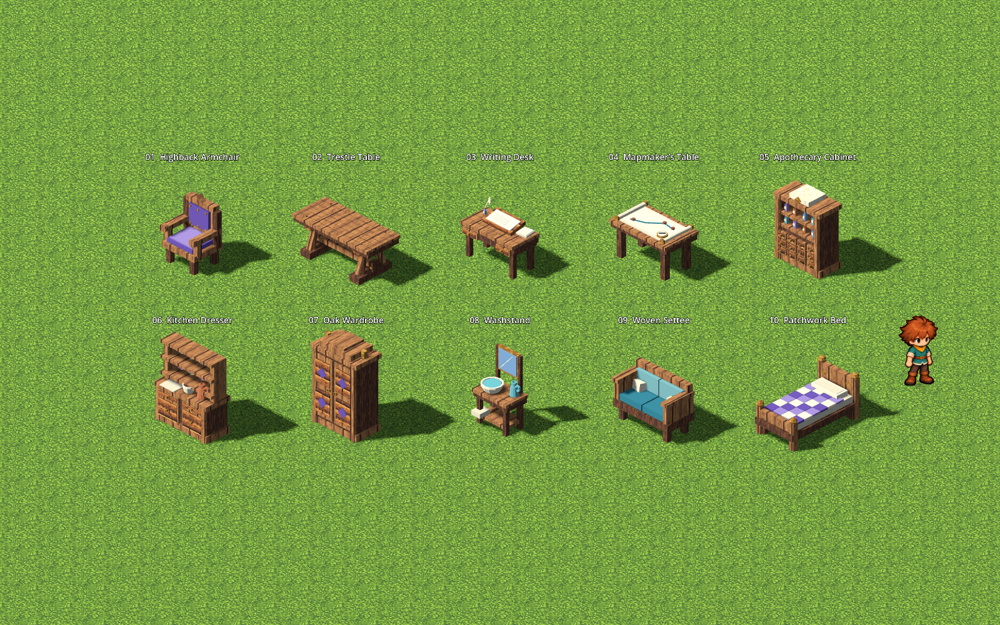
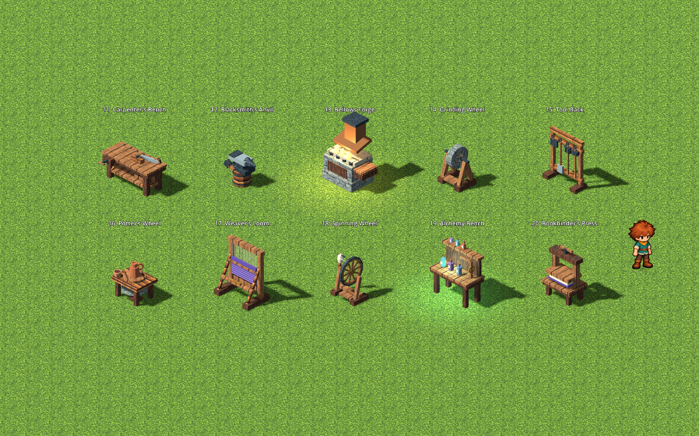
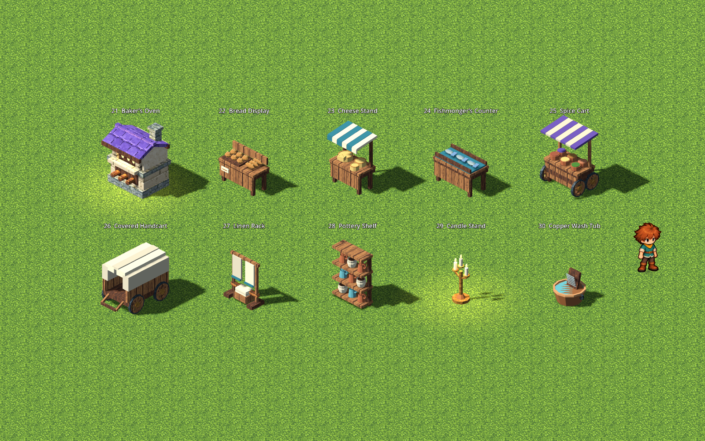
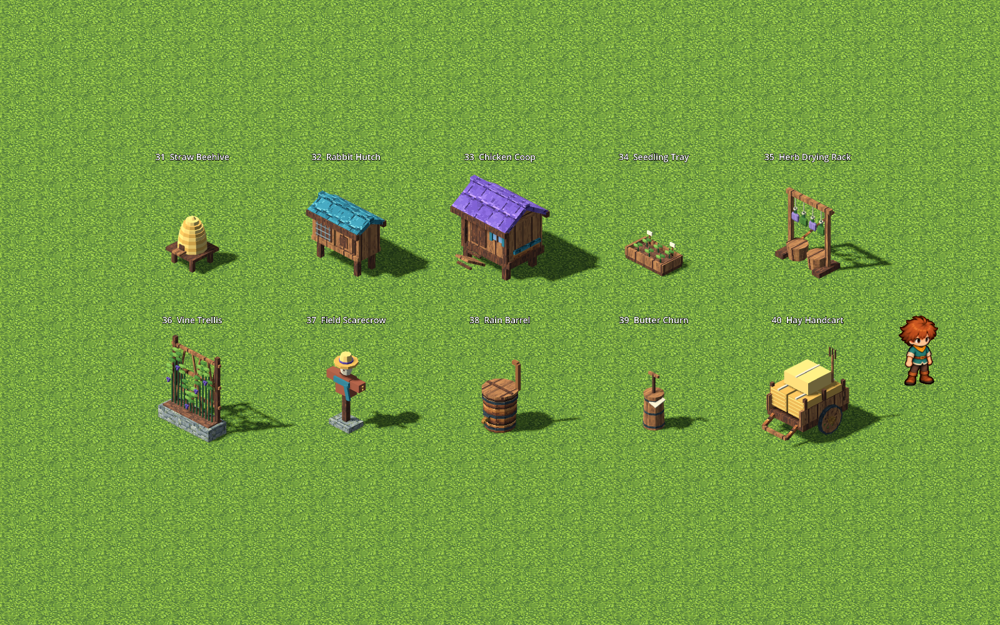
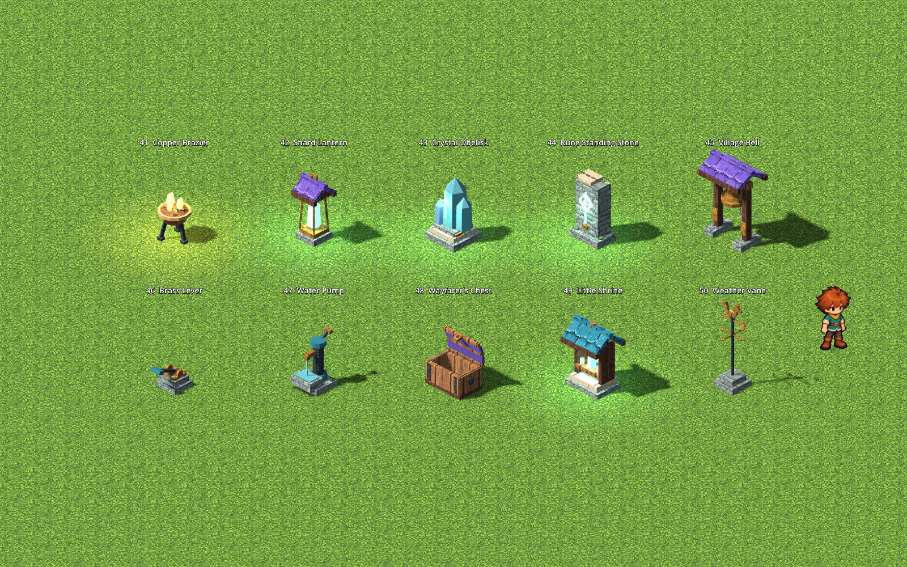

# Kindle Hollow builder library

The original handoff added fifty individually authored objects. After the asset deletion pass, 42 of those remain; the studio builder currently offers **72 entries**. This set follows Kindle Hollow’s painted timber, cream stone, violet/teal cloth and aged brass, with modest magical accents.

Press **B → Objects**, choose a category and a card, and place on open ground. Use **R** or the facing compass to rotate; Move, Delete, undo/redo and saved edits use the existing builder rules. Search covers every category. The category header scrolls separately from the model cards. These pieces are outdoor studio items; indoor furnishing and stacking are future features.

[Visual review and gameplay captures](reviews/2026-10-24-builder-library.md) · [Builder rules](BUILD.md) · [Python API](../docs/PROGRAMMING.md)

## The fifty objects

This historical list marks deleted models. Each retained row links its individual brief; the editable master is `art/source/world/<id>/v1/model.blend`. Footprints are width × depth in cells at the default facing and rotate with the item. Decorative handles, cloth and caps can overhang slightly. All retained models have blocking ground footprints, independent of activation.

### Furniture



| # | Object / individual brief | Footprint | Detail | Interaction |
|---|---|---|---|---|
| 01 | [Highback Armchair](../art/source/world/hollow-highback-armchair/v1/brief.md) | 1 × 0.9 | A carved oak chair with a plum cushion, scroll arms and brass studs. | Scenery |
| 02 | [Trestle Table](../art/source/world/hollow-trestle-table/v1/brief.md) | 2.2 × 1 | A broad plank table with splayed trestles and a pegged centre stretcher. | Scenery |
| 03 | [Writing Desk](../art/source/world/hollow-writing-desk/v1/brief.md) | 1.55 × 0.8 | A sloped writing desk with drawers, an ink pot, quill and folded letters. | Scenery |
| 04 | [Mapmaker’s Table](../art/source/world/hollow-mapmakers-table/v1/brief.md) | 1.65 × 1 | A brass-edged map table with rolled charts, compass and coloured route markers. | Scenery |
| 05 | [Apothecary Cabinet](../art/source/world/hollow-apothecary-cabinet/v1/brief.md) | 1.35 × 0.62 | Tiny labelled drawers, teal bottles and a cream carved pediment. | Scenery |
| 06 | [Kitchen Dresser](../art/source/world/hollow-kitchen-dresser/v1/brief.md) | 1.55 × 0.65 | A cottage sideboard with open plate shelves, cups and a linen runner. | Scenery |
| 07 | [Oak Wardrobe](../art/source/world/hollow-oak-wardrobe/v1/brief.md) | 1.3 × 0.7 | A tall panelled wardrobe with carved diamonds, violet inlay and brass pulls. | Scenery |
| 08 | [Washstand](../art/source/world/hollow-washstand/v1/brief.md) | 1 × 0.65 | A wash basin and jug beneath a small framed mirror on an oak stand. | Scenery |
| 09 | [Woven Settee](../art/source/world/hollow-woven-settee/v1/brief.md) | 1.6 × 0.8 | A two-seat timber settle with woven teal upholstery and cream pillows. | Scenery |
| 10 | [Patchwork Bed](../art/source/world/hollow-patchwork-bed/v1/brief.md) | 1.1 × 2 | A full-length cottage bed with turned posts and a violet-and-cream patchwork quilt. | Scenery |

### Workshop



| # | Object / individual brief | Footprint | Detail | Interaction |
|---|---|---|---|---|
| 11 | [Carpenter’s Bench](../art/source/world/hollow-carpenters-bench/v1/brief.md) | 1.9 × 0.85 | A substantial workbench with a screw vise, hand plane and saw. | Scenery |
| 12 | Blacksmith’s Anvil (deleted) | 1 × 0.65 | A faceted iron anvil, tapering horn and hammer on a banded oak stump. | Scenery |
| 13 | [Bellows Forge](../art/source/world/hollow-bellows-forge/v1/brief.md) | 1.7 × 1.05 | A stone fire bed, copper hood, side bellows and glowing coals. | Stoke / Bank |
| 14 | [Grinding Wheel](../art/source/world/hollow-grinding-wheel/v1/brief.md) | 1.1 × 0.75 | A pale stone wheel on a braced timber stand with treadle and water cup. | Start / Stop |
| 15 | [Tool Rack](../art/source/world/hollow-tool-rack/v1/brief.md) | 1.4 × 0.5 | A freestanding rack of axes, a spade, rakes and iron hooks. | Scenery |
| 16 | [Potter’s Wheel](../art/source/world/hollow-potters-wheel/v1/brief.md) | 1.1 × 0.9 | A clay pot on a turntable with a lower flywheel and a little water bowl. | Start / Stop |
| 17 | [Weaver’s Loom](../art/source/world/hollow-weavers-loom/v1/brief.md) | 1.5 × 1 | A framed hand loom with visible warp threads, violet cloth and a shuttle. | Scenery |
| 18 | [Spinning Wheel](../art/source/world/hollow-spinning-wheel/v1/brief.md) | 1.25 × 0.65 | An eight-spoked drive wheel, spindle, treadle and cream wool bundle. | Start / Stop |
| 19 | [Alchemy Bench](../art/source/world/hollow-alchemy-bench/v1/brief.md) | 1.55 × 0.8 | Copper piping, a flask cradle and three luminous coloured bottles. | Awaken / Dim |
| 20 | Bookbinder’s Press (deleted) | 1.15 × 0.8 | Twin screw uprights squeeze a brass-cornered book between timber platens. | Scenery |

### Market



| # | Object / individual brief | Footprint | Detail | Interaction |
|---|---|---|---|---|
| 21 | [Baker’s Oven](../art/source/world/hollow-bakers-oven/v1/brief.md) | 1.6 × 1.3 | A cream masonry oven with an arched mouth, violet cap and stacked firewood. | Light / Extinguish |
| 22 | [Bread Display](../art/source/world/hollow-bread-display/v1/brief.md) | 1.45 × 0.7 | A market counter piled with rounded loaves, baguettes and a linen basket. | Scenery |
| 23 | [Cheese Stand](../art/source/world/hollow-cheese-stand/v1/brief.md) | 1.25 × 0.7 | A striped canopy shades cheese wheels, a wedge and a small cutting board. | Scenery |
| 24 | [Fishmonger’s Counter](../art/source/world/hollow-fishmongers-counter/v1/brief.md) | 1.55 × 0.8 | Three silver fish rest on a teal counter with a bucket beneath. | Scenery |
| 25 | [Spice Cart](../art/source/world/hollow-spice-cart/v1/brief.md) | 1.5 × 0.85 | A wheeled cart with a violet awning and open jars of colourful spices. | Scenery |
| 26 | Covered Handcart (deleted) | 1.25 × 2 | A little timber wagon with curved cream cover, iron-rimmed wheels and a tow bar. | Scenery |
| 27 | [Linen Rack](../art/source/world/hollow-linen-rack/v1/brief.md) | 1.2 × 0.55 | Folded towels, hanging cream cloth and a basket on a cross-braced drying rack. | Scenery |
| 28 | [Pottery Shelf](../art/source/world/hollow-pottery-shelf/v1/brief.md) | 1.25 × 0.5 | Terracotta jars, teal glazed jugs and cream bowls on three open timber shelves. | Scenery |
| 29 | Candle Stand (deleted) | 0.65 × 0.65 | A brass three-branch candle stand with wax drips and warm flames. | Light / Extinguish |
| 30 | [Copper Wash Tub](../art/source/world/hollow-copper-wash-tub/v1/brief.md) | 1.1 × 0.75 | A hammered copper wash tub with side handles, pale water and a washboard. | Scenery |

### Garden



| # | Object / individual brief | Footprint | Detail | Interaction |
|---|---|---|---|---|
| 31 | [Straw Beehive](../art/source/world/hollow-straw-beehive/v1/brief.md) | 0.85 × 0.85 | A coiled straw skep on a timber stand with a little landing board. | Scenery |
| 32 | [Rabbit Hutch](../art/source/world/hollow-rabbit-hutch/v1/brief.md) | 1.4 × 0.7 | A raised hutch with wire-style slats, sleeping box, hay and a bowl; no live animal. | Scenery |
| 33 | Chicken Coop (deleted) | 1.6 × 1.3 | A violet-roofed coop with a ladder, nesting boxes and small shuttered windows. | Scenery |
| 34 | [Seedling Tray](../art/source/world/hollow-seedling-tray/v1/brief.md) | 1.1 × 0.6 | An orderly bed of six seedlings, plant labels and a watering jug. | Scenery |
| 35 | [Herb Drying Rack](../art/source/world/hollow-herb-drying-rack/v1/brief.md) | 1.3 × 0.65 | Tied bundles of sage and lavender hang from a braced rack above wicker baskets. | Scenery |
| 36 | [Vine Trellis](../art/source/world/hollow-vine-trellis/v1/brief.md) | 1.5 × 0.55 | A low stone planter supports a timber lattice and curling grape vines. | Scenery |
| 37 | Field Scarecrow (deleted) | 1 × 0.6 | A straw hat, russet coat and teal scarf on a forked timber field marker. | Scenery |
| 38 | [Rain Barrel](../art/source/world/hollow-rain-barrel/v1/brief.md) | 0.95 × 0.85 | A banded barrel with a copper downpipe, lid and brass garden tap. | Scenery |
| 39 | [Butter Churn](../art/source/world/hollow-butter-churn/v1/brief.md) | 0.65 × 0.65 | A tall stave churn with iron bands, a plunger and a small cream cloth. | Scenery |
| 40 | Hay Handcart (deleted) | 1.25 × 1.65 | A two-wheeled farm cart piled with bound golden hay and a wooden pitchfork. | Scenery |

### Village & Magic



| # | Object / individual brief | Footprint | Detail | Interaction |
|---|---|---|---|---|
| 41 | Copper Brazier (deleted) | 0.85 × 0.85 | An embossed copper bowl on three iron legs with split logs and amber fire. | Light / Extinguish |
| 42 | [Shard Lantern](../art/source/world/hollow-shard-lantern/v1/brief.md) | 0.75 × 0.75 | A teal crystal glows inside an open brass lantern under a violet cap. | Light / Dim |
| 43 | [Crystal Obelisk](../art/source/world/hollow-crystal-obelisk/v1/brief.md) | 1 × 1 | Three faceted turquoise crystals grow from a carved cream stone base. | Awaken / Dim |
| 44 | [Rune Standing Stone](../art/source/world/hollow-rune-standing-stone/v1/brief.md) | 0.95 × 0.65 | A weathered stone slab with a teal rune, brass inset and moss at its foot. | Awaken / Dim |
| 45 | [Village Bell](../art/source/world/hollow-village-bell/v1/brief.md) | 1.2 × 0.8 | A brass village bell and visible clapper hang in a violet-capped timber frame. | Ring / Silence |
| 46 | [Brass Lever](../art/source/world/hollow-brass-lever/v1/brief.md) | 0.65 × 0.65 | A chunky lever with a teal grip and brass dial on a stone plinth. | Pull / Reset |
| 47 | [Water Pump](../art/source/world/hollow-water-pump/v1/brief.md) | 0.85 × 0.8 | A green iron hand pump pours into a stone trough beneath a brass spout. | Start / Stop |
| 48 | [Wayfarer’s Chest](../art/source/world/hollow-wayfarers-chest/v1/brief.md) | 1.15 × 0.75 | An iron-strapped travel chest with an arched violet lid and brass clasp. | Open / Close |
| 49 | [Little Shrine](../art/source/world/hollow-little-shrine/v1/brief.md) | 1.1 × 0.8 | A little cream-and-timber shrine shelters a votive crystal beneath a teal roof. | Light / Dim |
| 50 | [Weather Vane](../art/source/world/hollow-weather-vane/v1/brief.md) | 0.7 × 0.7 | A brass sun-and-rooster vane above four compass arms on a stone foot. | Scenery |

## Sixteen working pieces

The forge, grinding wheel, potter’s wheel, spinning wheel, alchemy bench, baker’s oven, candle stand, copper brazier, shard lantern, crystal obelisk, rune standing stone, village bell, brass lever, water pump, wayfarer’s chest and little shrine expose a Boolean **active** state.

After placing one, leave build mode and use **F** beside it. The prompt names the action: Open/Close, Start/Stop, Light/Dim, Pull/Reset and so on. Pure rules require a known object within 2.2 cells, with a clear approach; walls and other props block reaching through. House and conversation prompts retain their priority.

Select a standing prop with **Move** to read its instance id and Code section. **Write code for it** inserts `prop = world.prop("prop-N")` into the notebook. Add `prop.set_active(True)` or `False`. `world.props` and `zone.props` list known interactive props; static decoration does not appear in that API. Named districts follow exploration; outside districts a prop is known only while nearby. Python can affect known objects remotely, like lamps. Run proposes, Apply commits, and Undo restores the prior active state. F actions invalidate an older preview.

Active state saves with each instance and survives moving, turning and Continue. Reset deactivates the pieces while keeping construction. Older saves without a `props` state map default to inactive. A chest lid opens, wheels spin, the bell swings, a lever tilts, the pump handle moves and emits droplets, and light pieces glow and illuminate nearby surfaces. Footprints remain fixed: opening a chest never makes its occupied cell walkable.

These interactions are scene mechanisms. Containers have no inventory, benches do not craft, the hutch/coop have no live animals, the pump does not simulate terrain water, and the bell has no audio. The lever can be read by a program, but no automatic wiring or scheduler is introduced.

## Editable sources and standard build

Every object owns:

- `art/source/world/<id>/v1/model.blend`: the authoritative, editable Blender master, with packed existing village textures.
- `brief.md` and `provenance.json`: purpose, scale, footprint, original design function and source hashes.
- `assets/world/<id>/model.glb` and `manifest.json`: audited runtime export with source/export hashes.
- A world-catalog definition and a studio prop card in `content/build/catalog.json`.

Open the existing master in Blender, edit deliberately, save, then run:

```sh
scripts/world-art.sh build hollow-water-pump
scripts/test.sh
```

The existing world-art build exports a candidate, audits it in Godot, verifies the source did not change, then promotes it. Normal rebuilding never runs the original author. Each instance uses the catalog’s explicit collision footprint; change that separately when a solid shape requires it. One metre is one cell, the ground pivot is centred, and the model’s front is Blender −Y / Godot +Z.

The [design kit](../art/source/world/village-library/v1/README.md) retains fifty distinct construction functions in five category files, the shared modelling/material helpers and the ordered design index. These are protected one-time authoring records; the individual `.blend` files take authority after creation. The apothecary cabinet’s later shelf and bottle edits are deliberately recorded beside its master with preserved earlier versions.

No new raster pack was needed. The models reuse packed `lush` timber, stone and brass pictures alongside a small shared set of cloth, copper, clay and leaf colors. Existing models, textures and character art were preserved. The library requires no Blender, network or authoring service at runtime.

## Rules and visual roles

`pipeline/world-catalog.json` declares `interaction: {kind, on, off}` for the working pieces. `core/area_def.gd` validates it, and `core/prop_interactions.gd` owns discovery and nearby manual-use checks. The only new program write is the existing typed command `{op: "set_field", entity_id: "prop-N", field: "active", value: true}`. The core validates a real Boolean and known target, rejects extra fields, and applies command batches atomically to a detached state. Invalid batches leave state and memory untouched. `sandbox/world_harness.py` exposes `Prop`; player programs still execute only in the bounded local WASI runner.

`art/prop_visual.gd` presents that committed state. Moving geometry is parented to an authored semantic **mechanism** pivot; **state_glow** and **state_flame** identify changing material roles. Keep these roles and meaningful pivots when editing. Changing materials are duplicated per instance. The player API contains ids and logical cells, with no renderer objects or paths.

## Review again

```sh
VOXEL_LAB_FRESH=1 scripts/play.sh --resolution 1600x1000 -s res://tools/builder_library_review.gd
VOXEL_LAB_FRESH=1 scripts/play.sh --resolution 1280x720 -s res://tools/builder_library_tour.gd
```

The art tool captures every model individually at zoom 13 and zoom 5 beside the approved boy, then five labelled groups at zoom 13. Add `-- <output-directory> gallery-only` to refresh just the groups. The game tour reviews the real shelves/search/details, all sixteen F actions, Python preview/Apply/Undo and saved Continue. Both use scratch state, and neither writes the shipped area. Temporary frames stay under `.cache/`; selected evidence travels with [the review](reviews/2026-10-24-builder-library.md).
