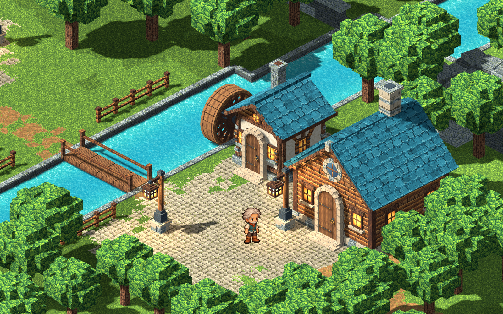

# Village buildings and mill polish

The 2026-10-24 building pass updates eight existing building masters and the lamppost, and adds **Hearth Bakery** and **Riverside Smithy**. The village now has 23 placed buildings and the builder has 98 entries (82 props). All ten building models share painted violet/teal roof pictures at a consistent world scale, oak framing and pale stone thresholds. Their roof silhouettes remain distinct.

The [2026-10-25 doorway follow-up](reviews/2026-10-25-steps-doors-and-cottage.md) adds separate hinged leaves, actual openings and matched tread metadata to these masters, repairs surface winding and the loft turret, and adds **Concept Cottage** to the house shelf (98 total builder entries, 23 existing village placements). The new cottage has original geometry and two imagegen-painted materials.

## Building index

| Asset | Update / identity |
| --- | --- |
| `cottage` | Replaced the small striped door with tall oak planks, a clear limestone arch, iron hinges, brass knocker and low steps. Repeating painted roof at the common scale. |
| `mill-house` | Same entrance improvements; teal roof. Its separate turning wheel now reaches water and the building. |
| `log-cabin` | Enlarged the oak entry and pale arch, separating them from the log walls; preserved the circular gable window and chimney. |
| `log-cabin-large` | Readable larger oak entry, hardware and threshold. Shared violet roof finish. |
| `log-cabin-large-teal` | Same entrance proportions and common teal roof treatment. |
| `hearth-house` | Preserved detailed porch/dormer, added threshold marker and painted the main, porch and dormer roofs consistently. |
| `lantern-loft` | Textured roof and turret, recentered the ground door/steps to the actual logical front approach. Preserved its balcony and two-storey identity. |
| `brook-mill` | Consistent painted main/hoist/monitor roofs; recentered the ground door while keeping the upper cargo door distinct. Its built-in wheel remains static decoration. |
| `hollow-bakery` | New cream/oak building with violet roof, brick oven mouth/flue, bread display/sign, warm side windows and a centered arched door. |
| `hollow-smithy` | New stone workshop with teal roof, open forge bay, anvil/tools, tall brick chimney, shape sign and centered arched door. |

The new shops appear at `[23,63]` in North Common and `[73,16]` in the east district, with short approaches joining existing streets. Both are in **B → Objects → Houses**, support placement/rotation/deletion, material finishes, undo and saves. They enter separate saved rooms through the existing cottage/workshop templates. Oven, forge, signs and shop displays are decorative; no trading/crafting systems or new quests are implied.

The [material controls](MATERIALS.md) now cover 91 assets. Original restores each updated imported material. Saved overrides still apply by the original semantic material names; added entrance oak/stone bindings participate too.

## Mill and lamps

Kindle Hollow's wheel is centered at `[46.05,24.6]`, in the river, with a 2.4-cell diameter and an axle reaching `[48.05,24.6]` inside the mill's west wall. The lower paddles dip below the water surface. Timber paddles, paired spokes, segmented rims, iron bands and a metal hub rotate; the axle and stone bearing stay fixed. The collision rectangle includes the axle so the player cannot walk through it. The original Rune Mill test area receives the same connection at its own scale.

Area wheel data keeps `id`, `at`, `size` and adds optional `axle_to`. Width/diameter must be positive and bounded; the axle runs east on the same y, at most four cells. Legacy wheel documents still load. `AreaDef` owns the resulting solid rectangle, `MechanismBuilder` draws the rotor/support, and `ClearingView` animates only the rotor. Water spray follows the wheel's new document position. No continuous hydrodynamic simulation is claimed.

The adopted lamppost gains a metal rain cap/plinth, brass cage and rivets, suspension ring, diagonal bracket, post collars and pedestal cap. Its separate **`lamp_glass`** mesh stays intact; the existing validated lamp state, halo and light pool still drive illumination.

## Source ownership and checks

Existing masters were edited directly, with `model.pre-building-polish.blend` retained beside each. `building-polish.json` records before/after hashes. [The source record](../art/source/world/building-polish/v1/README.md) explains the deliberate authoring scripts; they are not a new runtime or normal build path. Subsequent work edits the saved `.blend` and runs `scripts/world-art.sh build <id>`.

`tools/building_review.gd` captures every building and lamp from front/rear at gameplay zoom 13 beside the approved boy. `test/test_building_refresh.gd` checks backups, bounded wheel data/collision, rotated shop placement/finish history, actual builder cards, entry/exit, indoor Continue and materials, lamp illumination and stationary bearings beside a rotating wheel. An optional output directory captures that same real-game flow. Run the complete `scripts/test.sh` after editing.

See [review and evidence](reviews/2026-10-24-building-polish.md).
