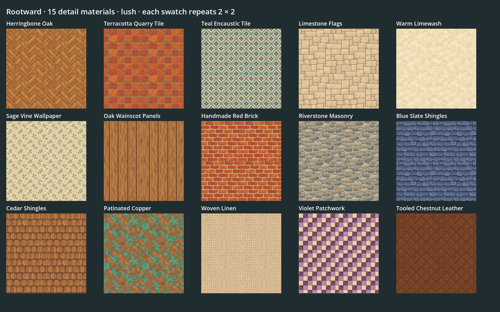

# Detail materials and saved finishes

Fifteen painted materials extend the village palette in both **lush** and **solid**. Per-part controls cover 90 building/prop assets, six room surfaces and four outdoor floor paints. Existing texture pictures, character art, camera and Blender masters are preserved.



## Game controls

- Outdoors: **B → Move → select a standing house or prop → Materials** in the right-hand details. Choose walls, roof, timber, masonry, metalwork or upholstery where supported. The turntable and world update together. **Original** restores the imported material for that part. Builder undo/redo and saves include finishes.
- Indoors: **B** or the hammer opens **Room materials**. Choose floor, walls, timber, hearth, textiles and rugs. **Original** restores that part's authored palette. Undo, Redo and Done are in the panel. Every house remembers its own finishes, including player-built homes and Continue indoors.
- Outdoors: **B → Land → Floors** offers parquet, terracotta, encaustic tile and limestone through the existing brush, Eraser, undo and saves. Paint changes appearance and does not create paths across water or rock.

Finish controls appear after placement on supported standing objects. Trees and lesson mechanisms have no finish controls. Indoor furniture placement, wall subdivision and room dimensions remain authored data.

## Library

Recipes live in `pipeline/texture-catalog.json`. Tile widths are world units. The same ids are available to procedural material builders and deliberate Blender material authoring.

| ID | Picture / use | Tile | Supported parts |
| --- | --- | --- | --- |
| `herringbone_oak` | Honey oak parquet | 1.5 | Floor, timber |
| `terracotta_tile` | Worn quarry tile | 1.5 | Floor, masonry |
| `encaustic_tile` | Cream/teal decorative tile | 1.5 | Floor, masonry |
| `limestone_flags` | Pale flagstone | 1.5 | Floor, walls, masonry |
| `limewash` | Warm cream plaster | 1.5 | Walls |
| `sage_wallpaper` | Small sage vines | 1.5 | Walls |
| `timber_panels` | Oak wainscot | 1.5 | Walls, timber |
| `red_brick` | Handmade red brick | 1 | Walls, masonry |
| `riverstone` | Rounded blue-gray stone | 1 | Walls, masonry |
| `slate_shingles` | Blue slate shingles | 1.2 | Roof |
| `cedar_shingles` | Amber cedar shakes | 1.2 | Roof |
| `copper_patina` | Oxidized copper | 1 | Roof, metalwork |
| `woven_linen` | Cream linen | 0.75 | Upholstery, room textiles/rugs |
| `violet_quilt` | Violet/cream patchwork | 1 | Upholstery, room textiles/rugs |
| `tooled_leather` | Chestnut leather | 0.75 | Upholstery, room textiles/rugs |

Copper uses roughness 0.68 / metallic 0.5; the rest use roughness 0.94 / metallic 0. Added detail comes from painted albedo and existing geometry; no new normal maps or displacement are supplied.

## Data and rendering

`world-catalog.json` declares `finish_slots: {role: [original_material_name, ...]}` using audited GLB material names. Each name belongs to one role. Glass, flame and state-glow are excluded to preserve interactions. An asset without suitable bindings keeps its original materials.

Area buildings/props accept optional `finishes: {role: material_id}`. Rooms accept `interior.materials` (authored palette) and `interior.finishes` (saved overrides). The supplied templates use cottage/parquet, workshop/limestone, loft/teal tile and mill/terracotta palettes.

```json
{"op":"finish","kind":"building","id":"home","slot":"roof","material":"slate_shingles"}
```

The saved edit's kind is `building`, `prop` or `room` (empty id for room). Empty material removes an override. `SurfaceFinishes` validates explicit choices, `AreaBuild` changes a document copy, and `BuildLedger` supplies history. Unsupported targets/parts/materials fail with an explanation. Cosmetic edits reuse walking rules and route caches. Finishing adds no Python API or engine references to player commands.

`FinishMaterials` applies instance surface overrides before `PropVisual` binds mechanisms. Local triplanar coordinates follow moving/turned models; imported materials remain shared safely. Light/dark variants retain a small value difference. Interiors use shared world-space recipes. Original rebuilds the model with its imported materials.

## Authoring and checks

The [v2-detail source](../art/source/world/textures/v2-detail/README.md) preserves native paintings, exact prompts, references and hashes. `pipeline/art-catalog.json` selects it; **`scripts/art.sh`** builds thirty 128×128 runtime pictures, a hash manifest and lossless mipmapped imports. No network or art tool is needed to play.

Add new ids through a versioned source, texture recipes, `SurfaceFinishes` choices and `WorldPalette` for procedural rendering. Ground paint also needs `ground: true` and an appended `GroundSkin.PICTURES` entry; preserve existing indices. For a new model, bind audited material names in its `finish_slots`, then review a second instance and its moving parts. Do not regenerate adopted Blender masters.

`test/test_finishes.gd` checks hashes, pixels, imports, bindings, capabilities, history and instance isolation. `test/test_material_flow.gd` drives actual dropdown signals, floor paints, active prop preservation, room undo and saved Continue. Run `scripts/test.sh` and inspect windowed views:

```sh
godot --path . --resolution 1600x1000 -s res://tools/detail_texture_board.gd -- .cache/detail-materials/boards
VOXEL_LAB_FRESH=1 godot --path . --resolution 1600x1000 -s res://test/test_material_flow.gd -- .cache/detail-materials/tour
```

See [the review](reviews/2026-10-24-detail-materials.md) for evidence and limits.
