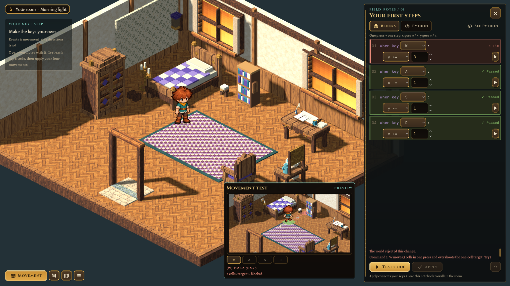
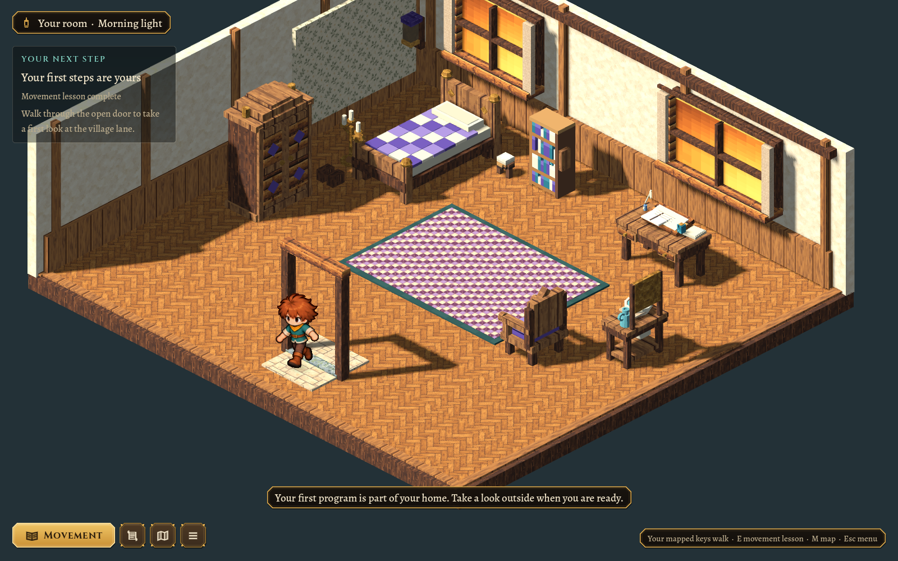

# Doorway boundaries and a separate test window — 2026-10-25

This revision follows the user's yellow-box placement reference (2048×1152, UI scale 0.8). The movement demonstration is now a separate foreground window over the lower-right part of the free world view, beside the notebook. It reserves no additional camera space. The taller scene makes the animated character and movement targets easier to read while leaving the notebook available for editing.

Each tested event now has a green fill/border and **Passed** badge when its movement succeeds. Incorrect events turn red with **Fix** or **Blocked**; other successful blocks remain green. Editing clears the old verdicts. Both blocks and handwritten Python still use the existing WASI proposal/test path, with Apply required to install validated bindings.

## Door and house corrections

The visible indoor frame now sits on the exit cell, rather than 0.65 cells in front of it. Its two jambs have shared plain-data footprints used by both the renderer and movement rules. The south cutaway is a boundary: the player cannot walk onto the extra strip beyond the doorway, slip through its posts or get stranded behind the frame. This applies to all five room templates, including the bespoke bedroom.

`GameSession` explicitly tracks the cosmetic doorway walk while input is gated. Ordinary physics no longer resets the actor to idle every frame during the transition; travel preserves the prior walking pose/phase until it reaches the opening. The approved character skin and animation template are unchanged.

The Concept Cottage's log walls extend beyond its previous logical collision box. Three catalog-owned collision rectangles now cover the low front/side/back wall envelope while leaving the narrow central entrance recess open. These shapes rotate and scale with the house. Its placement footprint, existing saved addresses and canonical doorstep stay stable; no Blender source or selected GLB was regenerated.

Legacy saves on the former indoor front strip or the cottage's newly blocked wall edge recover to reachable floor/the doorstep, preserving controls, memory and other progress. Malformed state and blocked terrain retain their normal validation.

## Verification

- `scripts/test.sh` passes with the new doorway boundary regression included.
- `test/test_doorway_boundaries.gd`: 224 checks across five rooms, matching visible/collision jambs, exit reachability, forbidden front-strip cells, all four cottage rotations at three scales, the reported wall bypass and legacy edge-save recovery.
- `test/test_morning.gd`: the actual doorway transition keeps the walk animation advancing under normal physics; a held keyboard direction cannot cross the cottage's front wall. It also checks detached-window bounds, unchanged camera reservation and green/red/pending event results, with the existing sandbox, Apply, practice, room travel and save-isolation flow.
- Gameplay review at 1600×1000, 2048×1152 with the reference's UI scale 0.8, and 1280×720 with enlarged UI. The foreground window stays in bounds and outside the notebook; the larger viewport and all Apply/Test controls remain accessible.

Sources: `ui/lesson_test_window.gd`, `ui/movement_lesson.gd`, `core/house_instances.gd`, `core/lab_world.gd`, `core/area_def.gd`, `art/interior_builder.gd`, `art/morning_room.gd`, `app/session.gd`, `app/game.gd` and the Concept Cottage entry in `pipeline/world-catalog.json`. [Current first-morning contract](../MORNING.md).
