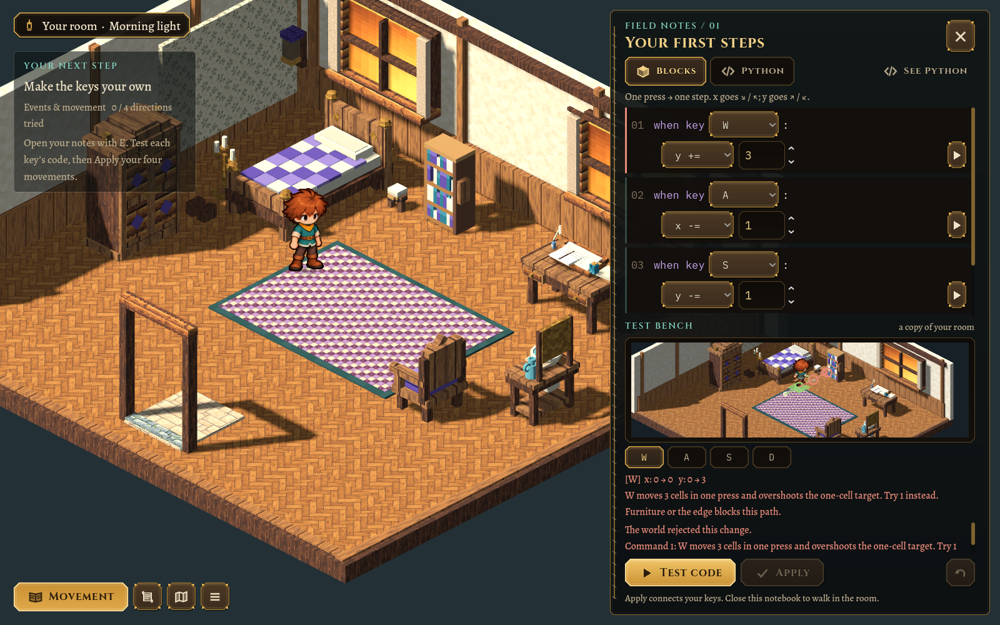
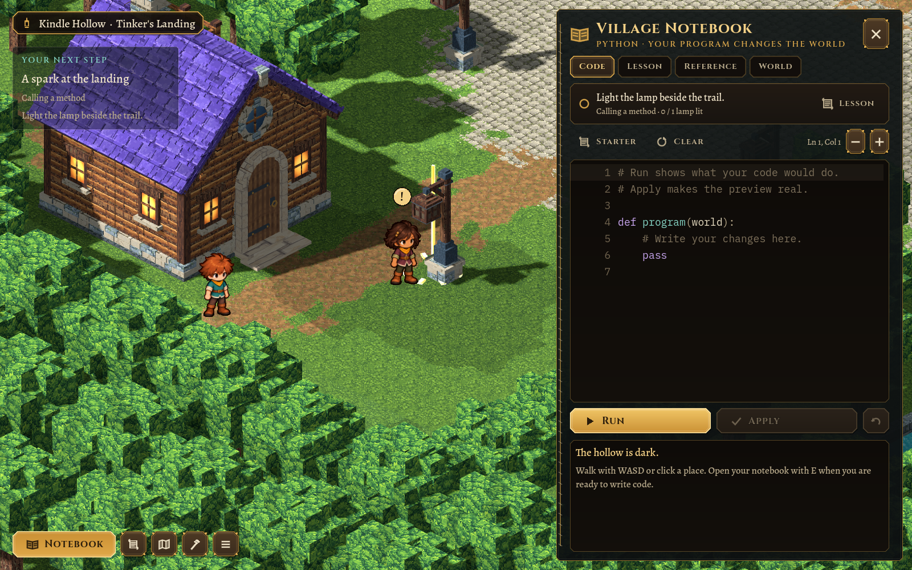

# Interactive side notebooks — 2026-10-25

The subsequent [doorway and detached-window revision](2026-10-25-doorway-and-test-window.md) moves the test scene out of this notebook layout into a larger foreground window and adds green/red block verdicts. The captures below record this earlier iteration.

The coding interface now shares a compact side notebook across both journeys. The stitched right-hand drawer leaves the environment visible and shifts the existing camera sideways. Quest progress, its next instruction and completion messages occupy a translucent panel on the left. The movement lesson no longer opens a centered modal or dims the room.

The guided blocks now look like numbered, indented event code: `when key W:`, followed by an editable `y += 1`. The amount can be 0–4; the axis/operator can change too. W begins as a one-step example and the other amounts start at zero. **See Python** exposes the real generated program, including zero initialization, arithmetic and `world.controls.bind_move(key, x, y)`.

**Test code** runs that program through the existing bounded WASI worker. It then feeds plain, bounded diagnostic traces into a separate viewport containing a copy of the current room and the approved animated boy. The mini-scene labels the first cell green and excess cells red. Zero stays still, an overshoot walks until a collision stops it, and a requested endpoint remains marked. Key buttons replay individual events; clicking the mini-scene gives it keyboard focus for physical-key tests. Syntax/runtime failures show the Python line, and invalid arithmetic highlights the event block and explains the error. Handwritten Python uses exactly the same execution, trace and animation path.

Test movement never mutates the real character, saved world or quest practice. Only validated, single-cell cardinal bindings can be applied; existing direction-based programs remain compatible. Changing code, an axis, a key or an amount clears the old proposal and demonstration. Both editor drafts, including arithmetic amounts, persist across Continue. The actual first quest still requires practising the installed bindings in the real room.

## Verification

- `scripts/test.sh` passes, covering the original world, art, sandbox, movement, house/save, builder/material and app checks as well as the expanded movement lesson.
- `test/test_morning.gd`: 84 headless checks; graphical runs add a physical-key mini-scene check (85). Tests cover real WASI arithmetic in both editors, zero/2/3/4 examples, atomic rejection, malformed and unbounded deltas, final valid rebinding, stale replay clearing, simulation isolation, drawer layout, persistence and actual movement after Apply.
- `test/test_area.gd` runs the first quest's arithmetic reference solution and starter in real Python/WASI.
- Visual review at 1600×1000 and 1280×720, including UI scale 1.25; Test and Apply stay visible while event/source content scrolls. Both journeys use the same notebook dock and left quest tracker.
- `tools/ui_tour.gd` includes the morning drawer, generated Python, oversized movement and handwritten Python test states; the established Kindle Hollow notebook is reviewed too.

The preview is a movement lesson test bench, not a freely draggable block language or a new runtime interpreter. All artwork, camera heading/elevation, saved journeys and game rules remain in their existing pipelines. [Ownership and reproduction](../MORNING.md).
