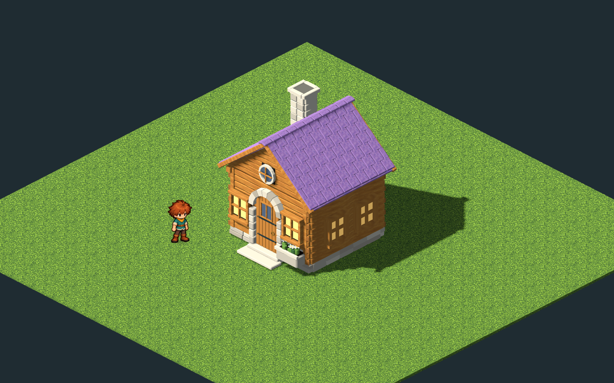

# Steps, house doors and Concept Cottage — 2026-10-25

The player now stands above the rendered house treads and four-step terrain stairs. Walking inward from a house’s integer doorstep opens its leaf, walks the boy through the aperture and fades to that house’s saved room. Walking south through the room’s exit frame returns to the same safe approach. Clicking a visible door or a building routes to its entrance and crosses it. Standing nearby, walking past, loading a room and returning outdoors do not trigger another transition. F remains for conversations and working props.

## Character and support

`art/walking_surface.gd` samples the actual four-tread terrain recipe, bridge decks, room floors/rugs and catalogued entrance treads. A short smooth lead-in lifts the feet before each riser; reverse travel follows the same support. House surfaces turn, translate and scale with the model, including the small workshop. Residents share the corrected support sampler.

The character’s depth plane stays vertical using a Y-fixed billboard. A parent projection correction preserves the approved picture’s on-screen proportions at the unchanged camera elevation. Artwork, frame regions, anchors, pose order, shared skin motion and idle timing are unchanged. Ordinary scenery still occludes the character, with the existing faint silhouette.

## Doors and larger buildings

`HouseInstances.crossing` validates the directed integer approach independently of rendering. `GameSession` handles walking/click routing; `Game` sequences travel and fades. The short movement into an opening is cosmetic between validated area states. Preview invalidation, stable house addresses, isolated room state, indoor Continue and exterior snapshots remain in the existing save format.

The ten existing building masters retain their prior versions as `model.pre-doorways.blend`. Each now has a separate `DoorHinge`, clear aperture, recessed vestibule and two centered treads. The catalog records `[front reach, back reach, width, top]` for each tread. Saved material identities stay canonical.

The Lantern Loft’s oriel moves together toward the front corner, its cap is shorter and its main roof stays continuous. Duplicate gable infill is removed. The larger houses have legible oak door leaves, straps and brass knockers. Surface normals were corrected where they faced inward. Final apertures use split existing faces, avoiding the closing planes and extruded fragments that Boolean operations produced on intersecting mesh batches. [The authoring record](../../art/source/world/doorways/v1/README.md) preserves the reviewed source history; normal rebuilds still use `scripts/world-art.sh build <id>`.

## Original concept cottage

Choose **B → Objects → Houses → Concept Cottage**. This new 3.8 × 3.4 metre building was modeled from scratch after the left-hand log cottage in the concept. Its individual glazed violet tiles, honey-oak courses, limestone arch, round gable window, hollow chimney, hinged board door and stone daisy planter are actual geometry. No previous building meshes were reused. The model supports ordinary placement, rotation, materials, undo/redo, saves and its own cottage interior. It is a shelf addition; Kindle Hollow’s existing 23 building placements are preserved (98 shelf entries, including 82 props).

The built-in imagegen tool supplied two new paintings: [violet glaze and its exact prompt](../../art/source/world/concept-cottage/v1/textures/prompt.txt), and [honey oak and its exact prompt](../../art/source/world/concept-cottage/v1/textures/oak-prompt.txt). Native pictures, hashes and tool provenance are beside the prompts. `pipeline/art-catalog.json` selects them; the existing texture packager runs through `scripts/art.sh`, producing opaque lush/solid variants. The saved Blender master packs its selected textures and the audited GLB works offline. [Source and workflow](../../art/source/world/concept-cottage/v1/README.md).

## Verification

- `scripts/art.sh`: selected pictures and all existing shared character skins built successfully.
- `scripts/world-art.sh build <id>`: all eleven house models exported through the existing source-preserving candidate audit.
- `test_walk_surfaces.gd`: all stair directions and both terrace levels, continuous tread support, rotated/scaled house approaches, texture provenance, upright projection, directed entry/exit and actual exported door apertures/bounds and straps/studs attached to the moving leaves.
- `test_house_flow.gd`: actual walk-triggered entry, hinged motion, exit, no bounce, concept-cottage placement and isolated saved rooms/Continue.
- `tools/door_input_review.gd`: injected keyboard entry/exit and an actual mouse click routing to and entering the house all succeeded.
- `tools/doorway_review.gd`: real-game approaches, open leaves, room transitions, the placed concept cottage and all four terrain-stair orientations at 1600×1000.
- `tools/building_review.gd`: all house models and lamp from front/rear at camera size 13, with the approved actor outside the footprint.

**`scripts/test.sh` passed in full.** The clean final run covers pure rules, area documents and quest solutions, real Python/WASI, house travel/saves, builder/materials, app flow, character skins, all world exports and authoring/handoff guards. The final doorway geometry/attachment regression also passed separately after the last leaf-hardware correction (3,453 checks). No required checks were skipped.

Selected final captures: [terrain treads](../../evidence/steps-doors/stairs.png), [house doorway](../../evidence/steps-doors/house-door-opening.png), [interior exit](../../evidence/steps-doors/room-door.png), [Lantern Loft](../../evidence/steps-doors/lantern-loft.png), [loft walk-in](../../evidence/steps-doors/loft-door-opening.png), [Hearth House](../../evidence/steps-doors/hearth-house.png), [Brook Mill](../../evidence/steps-doors/brook-mill.png), and [the concept cottage placed in the village](../../evidence/steps-doors/concept-in-village.png). All are Godot captures at the actual gameplay scale.
