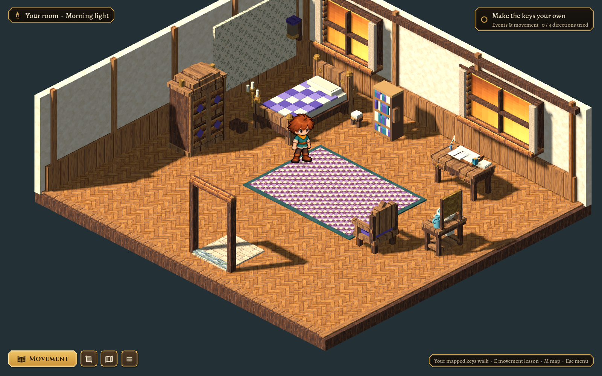
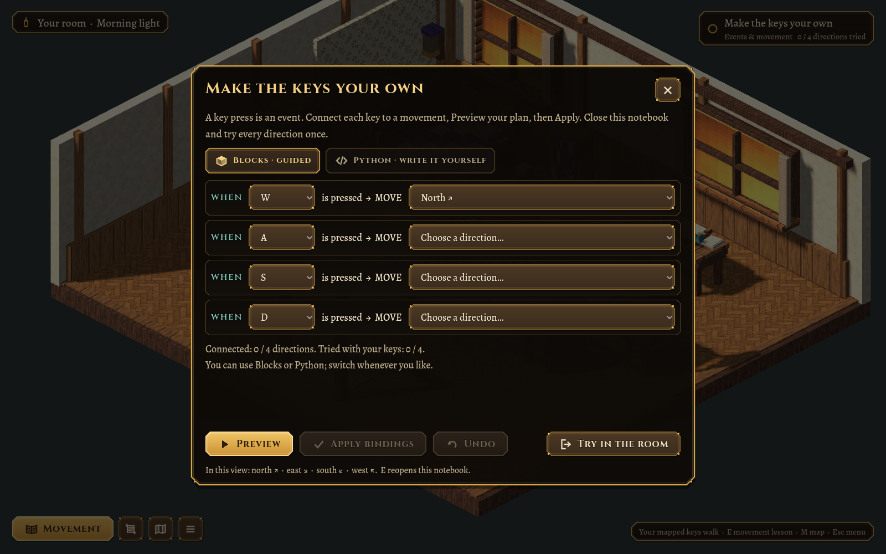
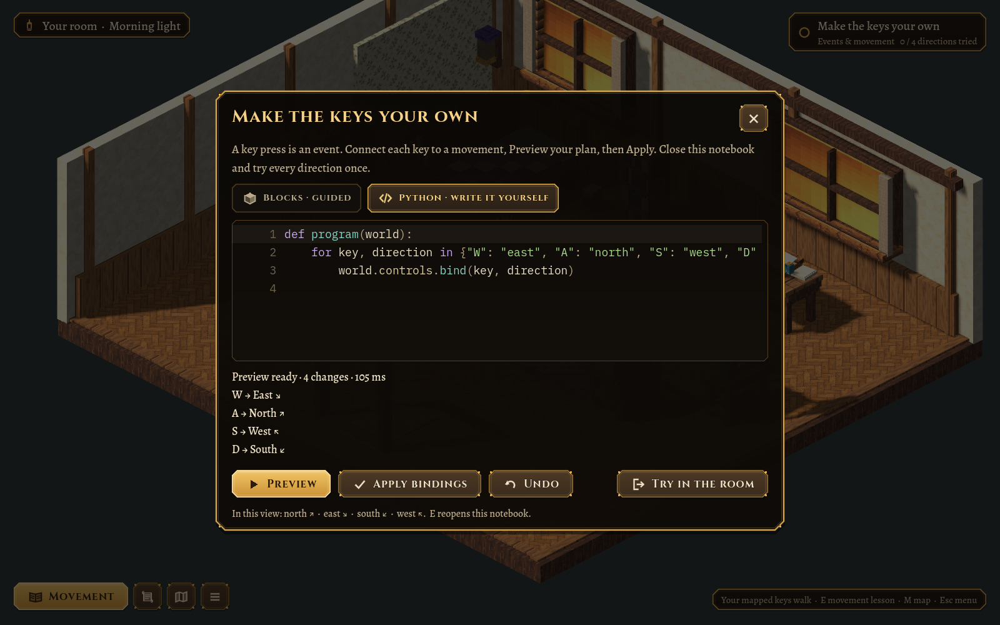

# Village Morning first slice — 2026-10-25

This records the initial interface. The [interactive notebook revision](2026-10-25-interactive-notebooks.md) replaces the centered lesson panel with shared side notebooks, code-like arithmetic blocks and a live movement test bench.

**New journey** now offers Kindle Hollow and Village Morning, each with its own Begin/Continue and saved progress. Kindle Hollow keeps its original map, input, notebook and legacy save filename. Starting Village Morning does not replace that save.

The new concept opens beside the bed in a bespoke 12×11 home. Its cutaway shell has two deeply framed curtained windows, a panelled skirt, a wallpaper bed alcove, bordered oak flooring and an open exit frame. Eight existing furniture models create a bedside nook, writing corner, books and washstand, with small notebook/ink/cloth details. The approved boy, frame skin and gameplay camera remain intact. Waking is currently a greeting and fade into this room; a sleep/wake sprite animation is deferred.

The first quest connects movement keys. Four ready-made event blocks let a learner choose keys and directions; a second tab accepts handwritten Python. Both run real source through the bounded WASI worker, produce an atomic proposal and need Apply to install bindings. Edits and mode switches invalidate stale previews. Undo restores the previous applied map. Both drafts persist independently.

Practice requires a successful bound-key step in each of four directions. Blocked attempts and click travel cannot bypass it. Completion opens the ordinary walk-through exit to a minimal 24×24 grass-and-cobble lane with one existing Concept Cottage. There are no residents, new building models or further quests. Controls and drafts follow the player across indoor/outdoor travel, while the bedroom keeps its own state and memory.

## Verification

- `scripts/test.sh` passed, including all original level, movement, house travel, builder/material, art and sandbox checks.
- `test/test_morning.gd`: 51 checks through the real picker, naming, greeting, both editors with real WASI, Preview/Apply/Undo, stale edits, malformed commands, movement practice, reset, room travel, draft/Continue persistence and independent journey saves.
- Windowed runs at 1600×1000 and 1280×720, plus 1280×720 at UI scale 1.25, completed the same flow. Graphical runs inject actual physical keyboard events with W east / A north / S west / D south and verify each resulting grid step.
- `test/test_area.gd` runs the new quest's reference solution through real Python/WASI and proves the starter alone does not finish the quest.
- All runs use isolated test saves. The unique bedroom, greeting, guided blocks, handwritten-code preview, picker and minimal exterior were inspected at gameplay scale. Long feedback scrolls inside the notebook.

See [the implementation contract and review commands](../MORNING.md). Freely draggable blocks, additional morning story beats, a full village, new residents and new building art remain future work to develop with the user.
