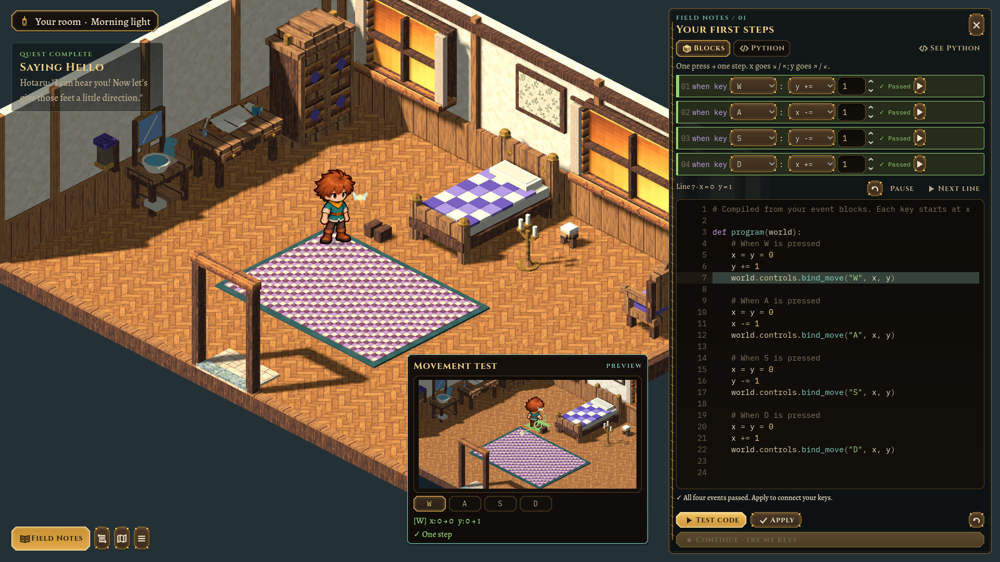
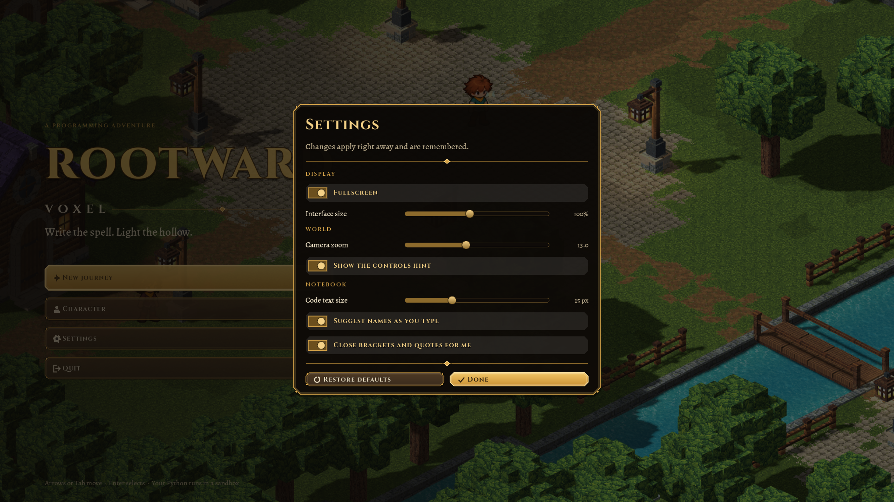
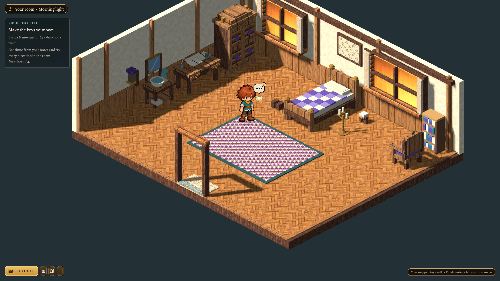
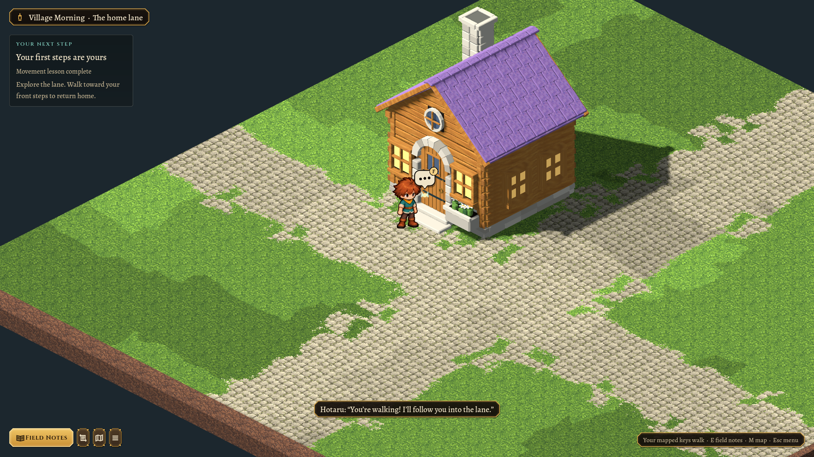
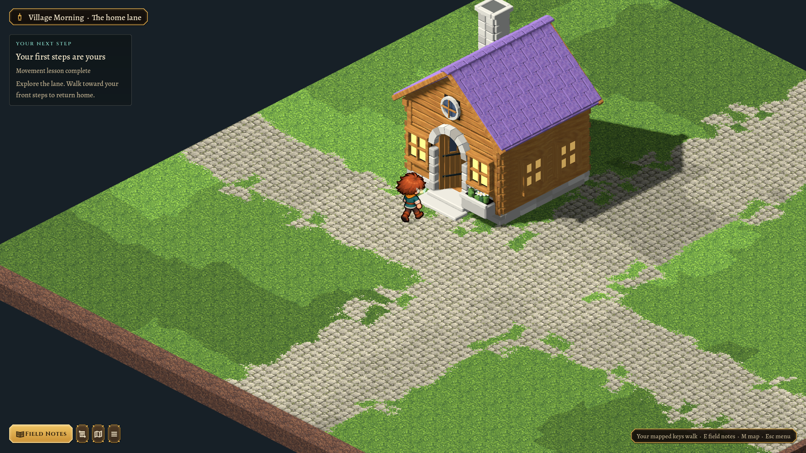

# Compact desktop lessons, a lived-in room and a safe landing — 2026-10-26

Subsequent [Rootward Square work](2026-10-26-rootward-square.md) moves activation to the inward door-frame attempt and removes the bedroom candle/boot blocks. The images below preserve this desktop-layout iteration.

The lesson drawer keeps its existing width while fitting substantially more content. Event blocks use compact code rows, smaller controls and tighter padding. During tests, the Python pane takes the remaining drawer height instead of leaving a large blank block area above a shallow code strip. The standard 1920×1080 review shows the complete 24-line movement program at once. Manual Python uses the main workspace; See Python shares the execution highlight without duplicating the code pane.

The shared interface kit has smaller buttons, icons, body text and padding. Kindle Hollow’s notebook, lessons and reference use the same compact styling. Code defaults to 15 px with tighter line spacing, and live text-size changes apply to both lesson editors and playback. Interface scale now ranges from 60–150%; code text ranges from 10–26 px independently.

The desktop canvas is based on 1920×1080. New profiles start full screen; existing profiles migrate once to the full-screen layout and change the former default 18 px code text to 15 px. Other explicit settings are retained. The layout version is saved, so subsequent full-screen/windowed choices persist. F11 still toggles full screen.

 Isolated `VOXEL_LAB_FRESH=1` reviews honor the requested window size; a review can explicitly enable full screen.

## Bedroom arrangement

The bed is centered on the solid wall between the windows, with clear floor beside and in front of it. The desk and old-style washstand share the side wall, away from the window frames. The wardrobe uses that wall’s rear section. The chair sits beside the bookcase as a reading corner, following the user’s clarification. A framed botanical print replaces the floating wallpaper patch and sits against the wall above the bed.

The rug and furniture positions live in `morning-bedroom.json` version 2. Small desk/washstand/bed details follow their parent furniture’s position, facing and scale. An older save whose player cell is now occupied by furniture resumes beside the bed, preserving memory, controls and quest progress. Tests check actual exported furniture bounds against the glass, the room’s reference movement solution and save recovery.

## Exterior doorway correction

The Concept Cottage’s catalog entrance declares `approach_cells: 1`. Its exterior landing moves from [7,11] to [7,10] in Village Morning. Exiting returns to that clear cell; the closed leaf and former threshold are solid to movement and routing. Saved characters on the old threshold recover to the landing without discarding progress.

Walking inward onto the landing opens the leaf during the final walking step. The animated player stops at the safe landing, and the fade switches to the saved interior. Starting from the landing itself opens and fades there. Click routes prefer an aligned final step when space permits. The builder’s reachability checks protect the same landing. Door clearance also accounts for model scale/rotation and grid rounding; already clear original approaches retain their positions.

No adopted model, human sprite or animation template was regenerated. Indoor floor ends remain aligned with the sill.

## Verification

Focused tests cover real WASI in both editors, code-pane capacity, room movement/reference solutions, furniture/window bounds, old saves, model door clearance across orientations and scales, closed-threshold collision, entry timing and advancing walk frames. `scripts/test.sh` passes in full. Focused checks include 839 doorway/room geometry and save checks, 140 area/reference-solution checks, 128 headless morning checks, 130 graphical morning checks (including code-pane capacity), 35 interface helper checks and 54 final house-travel checks including aligned click routing.

Reviewed in actual full screen at the display’s 2048×1152 size, at 1920×1080, and at 1280×720 with UI 1.25. The small window still shows at least twelve Python lines; the normal review shows the complete 24-line program. Settings and the Kindle Hollow Lesson/Code views were also reviewed in full screen after the shared styling change.

[Small-window lesson](../../evidence/compact-desktop/lesson-small.png) · [Kindle Hollow lesson](../../evidence/compact-desktop/kindle-lesson.png).
