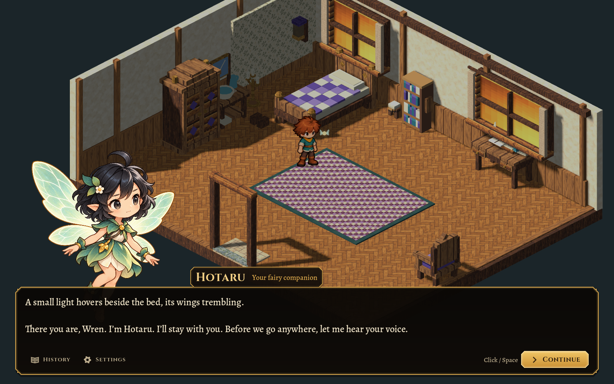
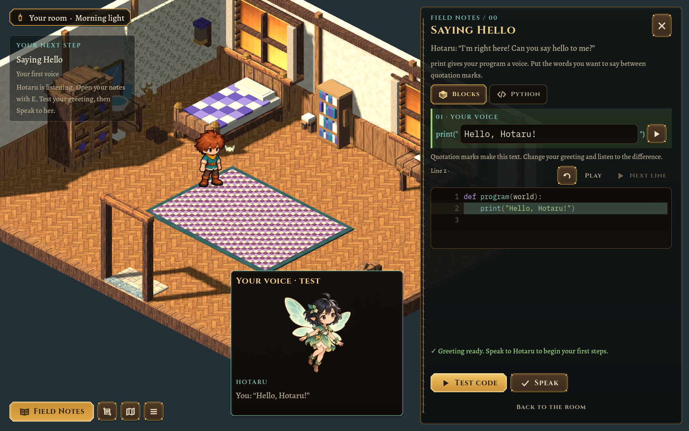
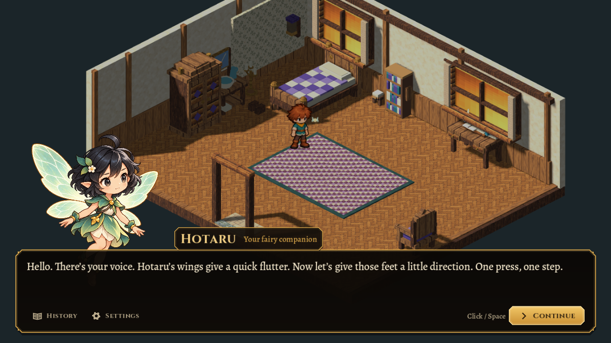
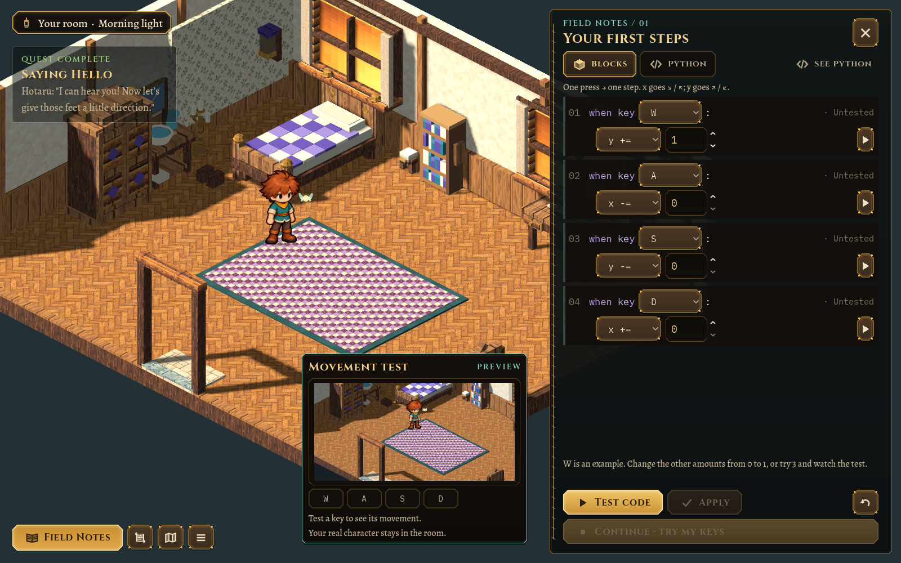

# A voice before choices — 2026-10-26

Village Morning’s opening now follows a guided tutorial path. Hotaru’s portrait and writing style remain, with a simpler dialogue footer: History, Settings and Continue. The player has no spoken reply/topic menu before learning to speak.

Continue advances Hotaru’s authored explanation. Its final page closes the conversation and automatically opens **Field Notes /00 — Saying Hello**. There is no separate Field Notes choice or topic selection.

Test still previews the program. **Speak** commits the same validated greeting. A successful greeting immediately starts Hotaru’s **First Steps** introduction; its final page automatically opens **Field Notes /01**.

 The greeting lesson no longer requires a second Continue action. Incorrect greetings remain in /00, and source edits still invalidate stale previews.

After the voice lesson, optional conversations can offer spoken replies. The ability to speak follows sticky quest completion: Undo may remove an utterance, but it does not remove what the player learned. The original level’s conversation choices, movement, notebook and saved progress remain available.

The portrait dialogue style is a visual/writing guideline. Guided explanations and optional conversations share presentation components while choosing their own interaction structure. The whole game does not need to behave like a visual novel menu.

## Ownership and validation

`content/companions/hotaru.json` authors the hello/movement introduction sequences. `app/hotaru_dialogue.gd` selects the guided opening before the player has a voice, and the movement introduction after success. `core/village_dialogue.gd` validates optional sequences of one to nine distinct authored greeting/topic ids, plus a bounded `on_finish` action (empty or `notebook`). Guided traversal never enters a reply menu or records a fabricated player response.

`ui/village_conversation.gd` presents guided pages with the smaller footer and requests the notebook when the sequence finishes. `ui/greeting_lesson.gd` requests the next introduction after committing a successful greeting; `app/game.gd` coordinates dialogue, notebook, input and saves. `core/companion_lesson.gd` preserves the learned voice through sticky quest completion.

No artwork or human animation settings changed. Test/Apply rules, both programming modes, per-section testing and execution replay remain in place.

## Verification

The pure companion tests cover guided pages without replies, honest history, automatic handoff metadata, invalid sequences/actions, post-learning choices, unchanged original-level navigation and learned voice after Undo. The actual game test advances the real Continue buttons through both introductions, verifies that Field Notes opens automatically, checks that an incomplete greeting stays in /00, and completes both editor paths, movement practice, travel and Continue saves. The existing resident dialogue suite covers optional topics, controls and persistence.

`scripts/test.sh` passes in full. Focused checks: 56 companion/dialogue/execution checks, 125 headless morning checks, 126 graphical checks in the final 2048×1152 / UI 0.8 run, and the existing 144 resident dialogue checks. The original sandbox, movement, house travel, builder, terrain, art and handoff suites also pass.

Gameplay review covers 1600×1000, 1280×720 with UI 1.25, and 2048×1152 with UI 0.8. The opening, greeting and movement handoffs stay readable and accessible. [Small-window opening](../../evidence/guided-tutorial/opening-compact.png).

Current contracts: [Morning](../MORNING.md), [Dialogue](../DIALOGUE.md), [UI](../UI.md). [Earlier portrait/art review](2026-10-26-hotaru-first-voice.md).
