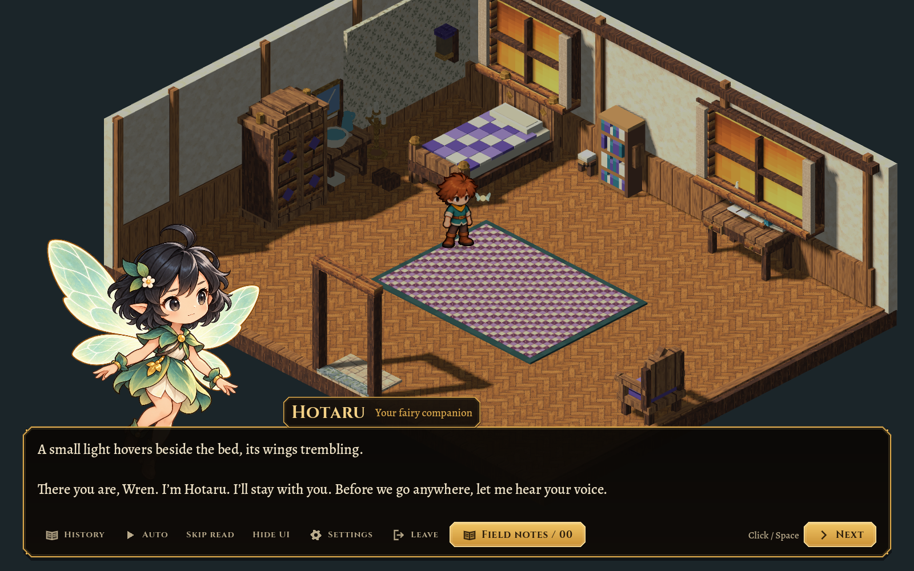
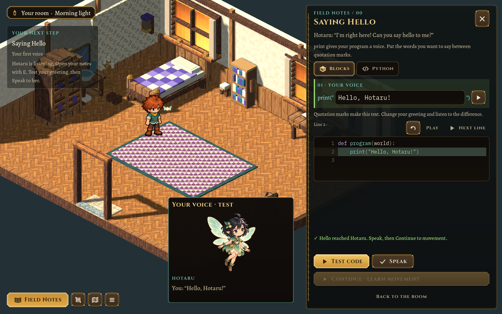
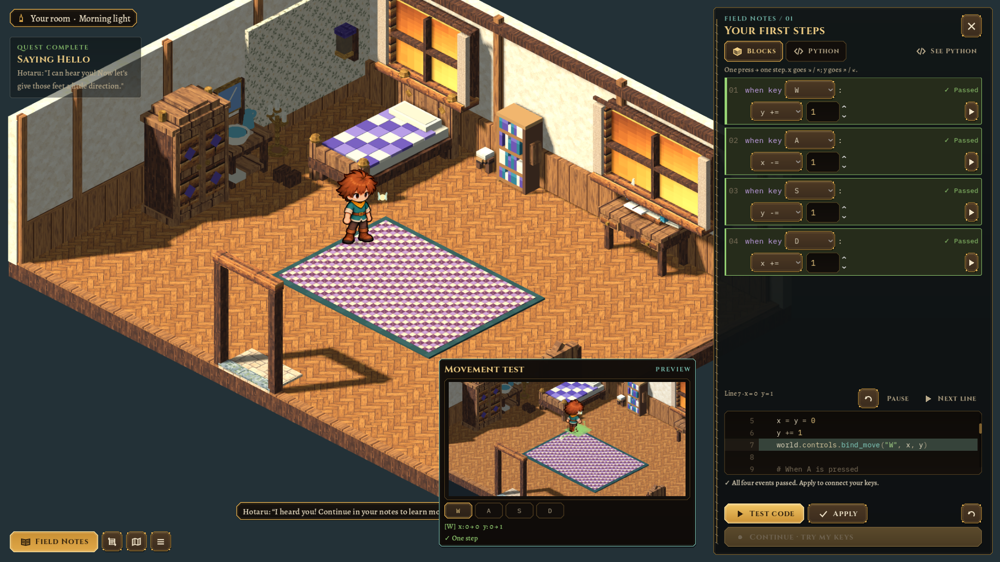
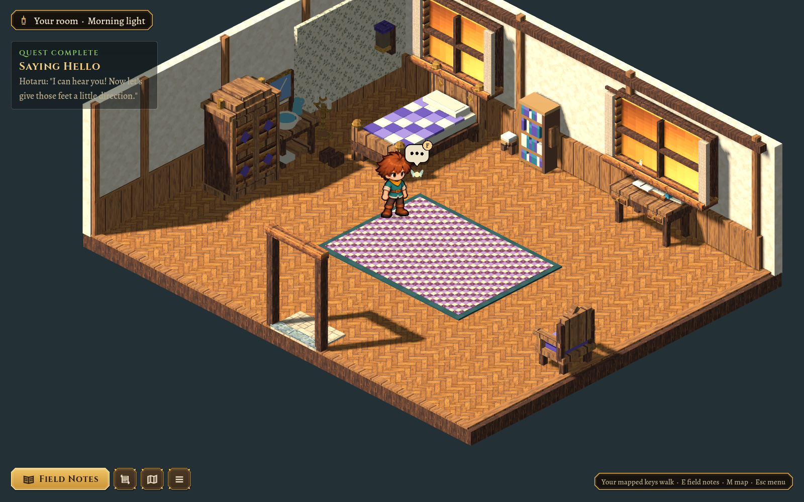

# Hotaru, a first voice and the door sill — 2026-10-26

The subsequent [guided tutorial revision](2026-10-26-guided-tutorial.md) replaces the opening reply menu and manual notebook/Continue handoffs described below. This record retains the portrait, room and execution-replay review.

Village Morning now begins with Hotaru rather than a greeting popup. In the world she is a tiny warm light with four independently hinged, fluttering wings and a smooth bobbing follow. Her dialogue portrait is a cute, black-haired fairy with a calm, attentive expression.

Hotaru uses the same `VillageConversation` / `VillageDialogue` scene and rules as the five residents: portrait, wide bottom dialogue box, progressive text, response choices, History, Auto, Skip read, Hide UI, Settings and optional code. F or the ordinary speech bubble reopens her dialogue; resident/working-object interactions retain priority. Read pages persist with the journey. This shared presentation is the game's character-conversation pattern.

## Two small lessons

**Field Notes /00 — Saying Hello** gives the player a voice through `print("Hello, Hotaru!")`. Blocks compile to real Python, and handwritten Python uses the same WASI runner. Test previews the words; **Speak** commits the same validated proposal. Saying hello with Hotaru's name enables **Continue · learn movement**, and Hotaru introduces /01 in the shared conversation scene.

**Field Notes /01 — Your first steps** keeps the arithmetic blocks and independent Python draft. Each block arrow runs just its section, even while other blocks remain unfinished; a section test cannot be applied. **Test code** validates the entire program. Both editors replay actual executed lines and small x/y/key/message values, with Replay, Pause and Next line. Generated Python appears below the blocks automatically, and the manual editor highlights its original source. A movement call triggers its corresponding mini-room demonstration when playback reaches that call, rather than on the first line. Green/red block verdicts remain, and edits clear stale results.

CPython records bounded evidence inside WASI; the engine never evaluates the source for playback. The first 96 events are retained, validated as plain metadata, and trimmed within the existing result-size budget. Skipped branches stay skipped; failed runs retain the path to the failing line. Playback cannot change the real world or award practice.

After Apply, **Continue · try my keys** returns to the actual room. **Finish · back to the room** is available after all four directions have been practised. Closing with X is no longer required. The existing atomic Preview → Apply and stale-preview rules remain in force.

## Room and travel

Exterior entry opens the hinged leaf and fades from the player's current validated approach cell. It does not slide the character into the closed door or solid house. Leaving similarly fades from the indoor sill. All five room templates' floor/base geometry ends at that sill; there is no spare flooring beyond it. The bedroom's desk, bookcase, wardrobe and washstand now sit at the walls, with their collision footprints and decorative details moved together.

Applied keys, practice, greeting/voice and the separate greeting/movement drafts survive house travel and Continue. Reset preserves learned progress. The original journey/save, approved boy, shared motion template and camera remain intact.

## Art and sources

The built-in `image_gen.imagegen` tool authored Hotaru's transparent portrait. Selected source: [v2 sprite](../../art/source/companions/hotaru/v2/sprite.png), [exact edit prompt](../../art/source/companions/hotaru/v2/prompt.txt), [provenance](../../art/source/companions/hotaru/v2/provenance.json). The earlier warm-haired version remains under v1 as superseded source.

`pipeline/art-catalog.json` selects the source. `scripts/art.sh` verifies source/prompt hashes, downsizes a compact [avatar](../../assets/companions/hotaru.png), copies the full [dialogue portrait](../../assets/companions/hotaru-portrait.png), and pins lossless alpha imports. The follower is small procedural geometry, separate from the detailed portrait and human frame-skin pipeline. No art service is a runtime dependency.

Additional captures: [incorrect arithmetic with executed values](../../evidence/hotaru-first-voice/incorrect.png), [small-window dialogue](../../evidence/hotaru-first-voice/dialogue-compact.png), [small-window blocks and execution pane](../../evidence/hotaru-first-voice/movement-compact.png).

The implementation contract and ownership map are in [MORNING.md](../MORNING.md); the global dialogue pattern is in [DIALOGUE.md](../DIALOGUE.md).

## Verification

`test/test_area.gd` includes real WASI reference solutions for greeting and movement. `test/test_companion.gd` checks speech validation, atomic rejection/undo, unchanged legacy print, source/portrait provenance, actual/skipped/error lines, bounded trace metadata and single-section execution. `test/test_morning.gd` covers both lessons/editors, Continue, the shared Hotaru conversation/history/read persistence, tiny orb/flutter, previews, independent drafts, real key practice, room travel and isolated saves. House-flow tests verify stationary exterior entry; doorway tests verify floor geometry at all five sills.

Gameplay-size review covers 1600×1000, the user's 2048×1152 / UI 0.8 reference, and 1280×720 with UI 1.25. Test/Apply/Continue, execution replay and the detached demonstration stay accessible. `scripts/test.sh` passed in full; `scripts/art.sh` passed with the selected v2 asset and prompt/source checks. The focused results are 140 area/quest checks, 38 companion/execution checks, 115 headless morning checks, 116 graphical morning checks at each reviewed size, 31 house-travel checks and 234 doorway-boundary checks. The existing 144 dialogue checks and all remaining sandbox, movement, terrain, builder, art and authoring/handoff checks also pass.
