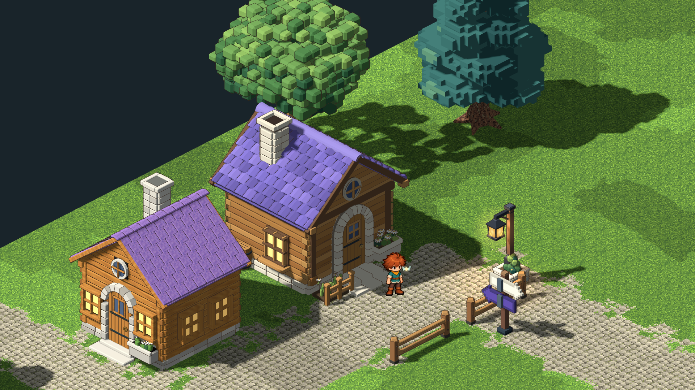
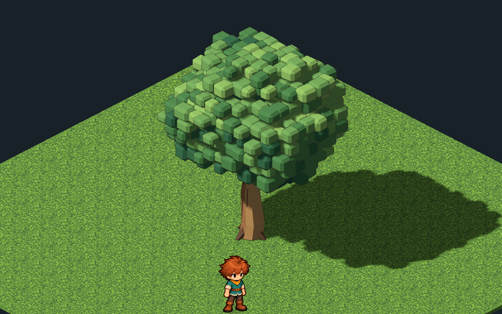
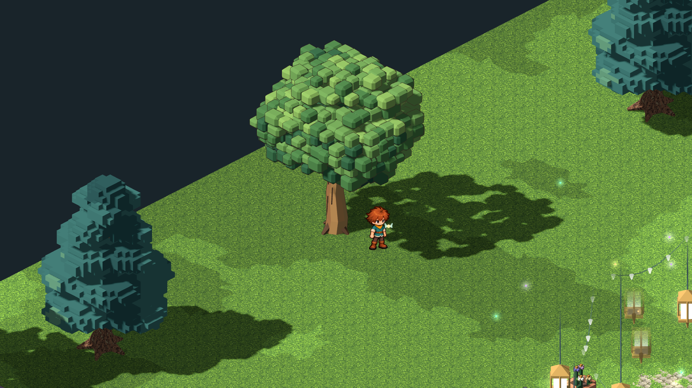
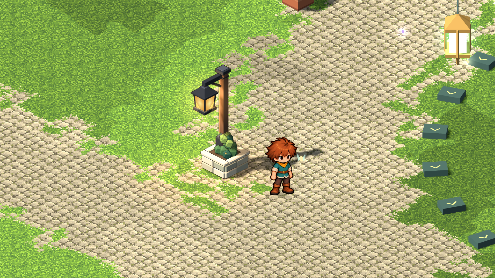

# Illustrated village study — 2026-10-26

The user requested the original concept’s warmer, slightly anime presentation,
especially its fine outlines. After seeing the square lamp, they asked for a
matching house, tree and fence. This pass supplies that first cohesive set.

The cottage behind the original home is Village Morning’s existing comparison
house, presented with a new Blender master. It retains the adopted reference
reconstruction’s overlapping rounded tiles, arch, chimney, windows, garden,
barrel and hinged door. Honey timber, individually varied matte violet shingles,
warm limestone and sparse drawn grain replace its noisy surface treatment. The
earlier reference-cottage and original home sources remain intact.

The oak has a bent warm trunk, forked boughs, small roots and a crown of irregular,
bevelled voxel leaf clumps in six deep greens. The first crown review exposed
large flat terraces; that source is preserved as `model.pass-01.blend`, and the
current master replaces the crown only. Root geometry retains the original oak’s
0.5 m logical radius. The broad oaks in Village Morning use this presentation;
cedars and the giant Rootward tree retain their existing models.

Two low garden fence spans use honey rails, chamfered posts, dark pins and
drawn grain. The opening at [14,20] remains walkable, while the fence strips
themselves block movement. The garden lamp at [13,23.5] joins the six square/hall
lamps. Hall flowerpots move clear of the new planter bases.

The lamp has a charcoal cage and sloping hood, quiet timber, painted amber panes,
cream limestone planter and small evergreen. Its separate `lamp_glass` mesh
retains the normal lamp metadata and halo/light anchors. Lit glass keeps the
authored gradient; Preview remains a translucent proposal marker, Apply lights
the committed model, and Undo restores its earlier state.

Fine sepia outlines use closed-corner rendering hulls, without rewriting original
surfaces or their materials. Each hull follows its own mesh, including hinged
leaves. It scales to the viewport, casts no shadow, and excludes light panes and
effects. No depth-buffer postprocess, renderer change or network service is
needed. The approved boy, camera heading, elevation and normal size 13 remain.

Source/runtime selection is explicit in `pipeline/world-catalog.json`.
`painted-cottage`, `painted-oak`, `painted-garden-fence` and `square-lamppost` have
separate adopted masters and audited exports. Area presentation aliases preserve
the comparison house’s stable id, entrance, collision and saved room; the same
selection is used for construction proposals. All three standalone assets are
also in the 101-entry studio shelf. Village Morning is version 5.

Builds used `scripts/world-art.sh build <id>`. The cottage exports 69,308
triangles, oak 20,760, fence 920 and lamp 2,536. The current art was reviewed in
Godot Compatibility at 1920×1080 and 1280×720. The village composition and oak
gameplay captures use normal camera size 13; isolated tree/lamp details use closer
review framing. The review focus is shifted to show the set; play keeps its usual
following camera.

The focused morning-village performance capture built in 899 ms and measured
168 fps at 1920×1080 on the integrated Radeon 680M, with 973 draw calls in that
view. This is a standing-scene measurement, not a whole-game minimum frame rate.

Verification covers explicit area selection, original source preservation,
unchanged door/root contracts, fence occupancy and opening, reachable doors,
studio placement/rotation, saved edits, Undo/Redo, actual door animation and
proposal-model parity. Lamp checks cover isolated Preview, Apply, Undo, authored
glass, halo anchors and returning to the earlier journey. An existing cottage
test was corrected to check walking-surface height plus its established foot
clearance instead of treating raw terrain height as the doorstep.

`scripts/test.sh` passed in full with no script errors: 33 lamp checks, 26 village
art checks, 114 comparison-cottage checks, 3,467 walking-surface/door checks,
1,116 finish checks, 517 world-art checks and 966 pipeline/handoff checks, along
with the existing rules, WASI, app, UI, animation and build suites. The graphical
village run passed all 26 checks at both reviewed resolutions. `git diff --check`
also passed. Test data/configuration were isolated under the project cache.

The grass/paving, cedars and other building surfaces still use the earlier art.
This is a matching first set for the user to review, with further world painting
still open.
