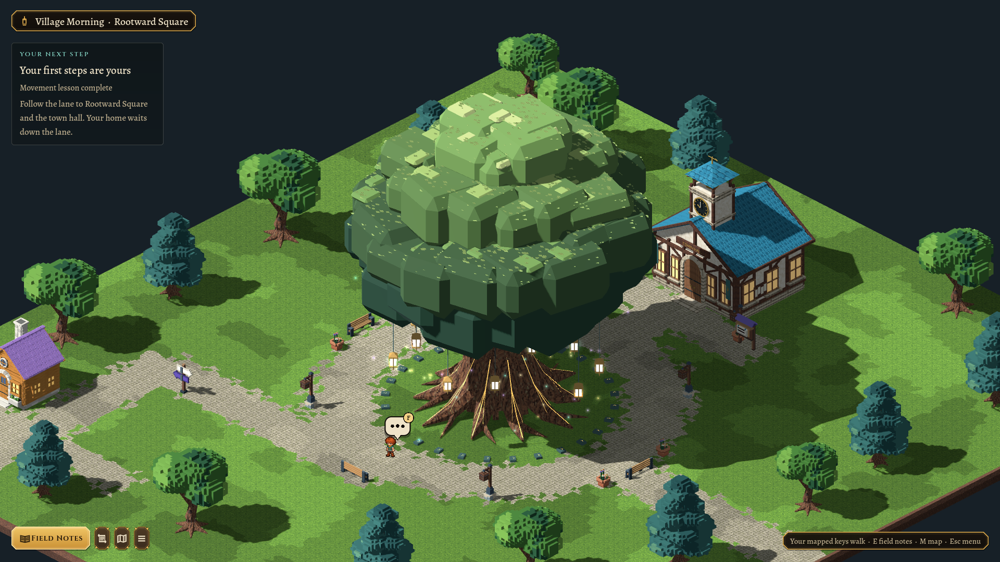
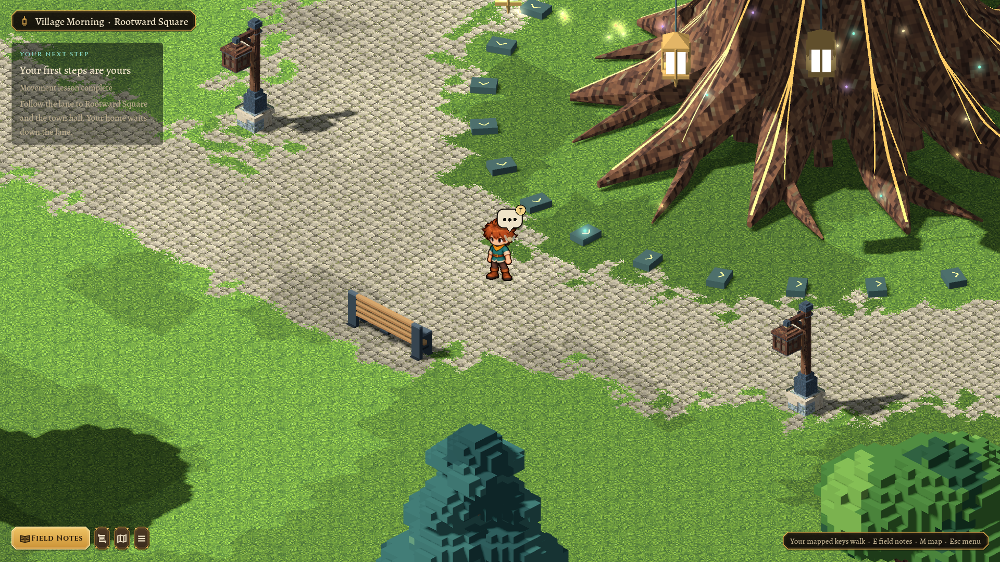
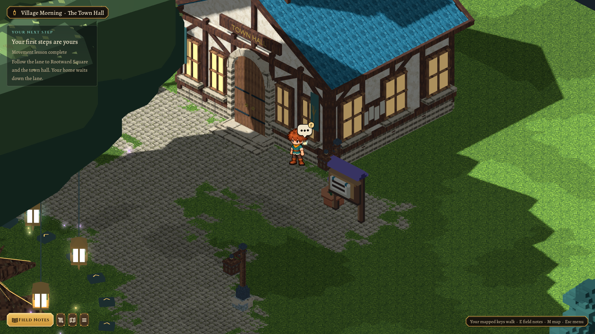
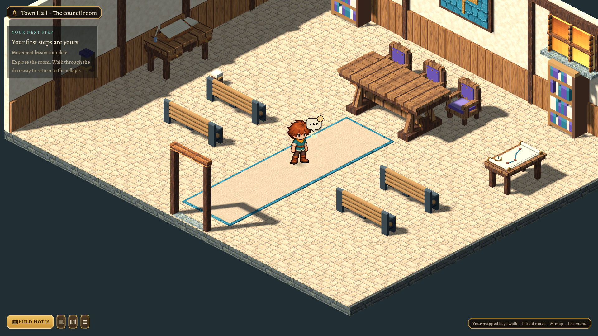
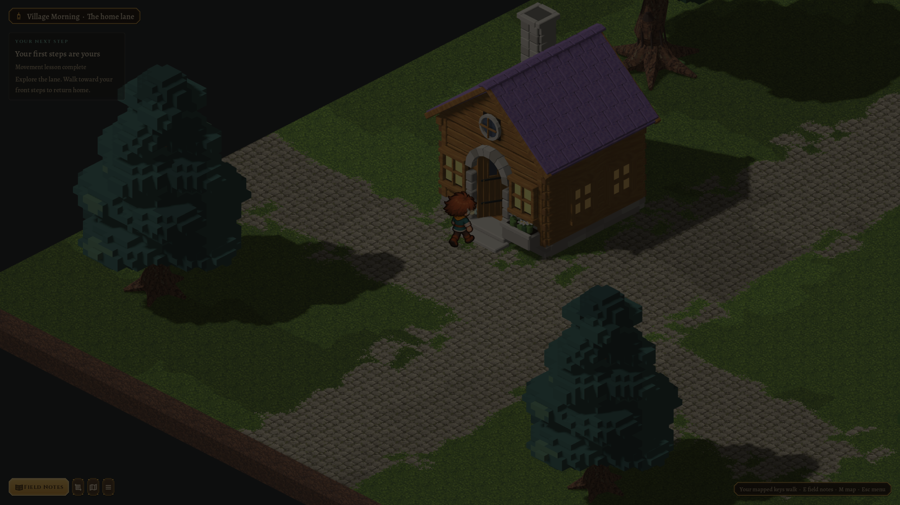
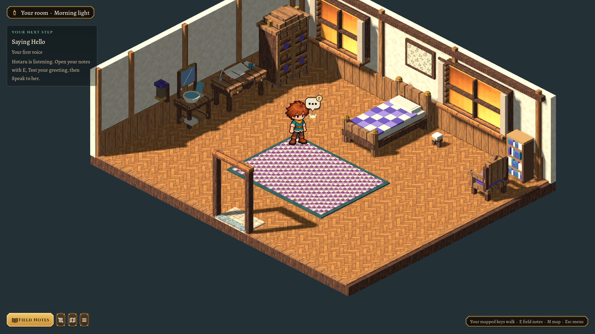

# Rootward Square — 2026-10-26

The subsequent [trunk cutaway](2026-10-26-rootward-trunk-cutaway.md) is the current gameplay view. The complete-crown images below preserve the first landmark review.

Village Morning expands from the initial lane into a 64×72 village foundation. The original cottage, home landing and tutorial remain in place. A lane leads to a broad loop around the namesake tree, with public seats, planters, lamps and future building plots; the town hall stands beyond its northern forecourt. Kindle Hollow is unchanged.

## Rootward

The user requested a much larger, more mystical tree after the first landmark pass. The adopted source now stands 23.85 m high and about 22 m across, compared with the 11.26 m town-hall tower and the 1.45 m painted boy. Ten buttress roots spread around the twisted fluted bole. Forked boughs support a tiered crown with small leaf facets.

Thirty suspended jewel lanterns, nine festoon garlands, luminous gold seams fitted to the actual root surfaces, a ring of old ward stones and 84 drifting wisps give it its enchanted character. Lantern glass is emissive; three instanced effect batches draw halos/motes and six shadowless local lights illuminate nearby wood. All anchors are editable in Blender. These effects have no collision, command or progression authority.

The whole-tree frame deliberately uses a wide review camera. The game retains its approved following camera and painted actor scale: standing beside Rootward shows the great roots and hanging lights, with much of the crown overhead.

The tree blocks an 8.6 m circle covering its trunk, roots and raised ward stones. Its much broader canopy is decorative. The route around the square stays clear. World placement and collision come from the area document/catalog, independently of rendering.

## Town hall

The new hall uses a limestone plinth, cream plaster, heavy half-timber joinery and staggered teal shingles. Its arched double oak doors have separate hinges, forged straps and brass pulls. Warm divided windows, civic banners, carved lettering, a wall-mounted noticeboard and the brass clock make its purpose readable. The clock was raised above the main roof ridge during review; an intersecting test cap was replaced by one clean hipped roof. The open belfry contains a bronze bell and a leaf weather vane.

Entering opens `morning-town-hall-room`, a saved council instance with tall windows, oak panelling, a framed tree seal, public benches, a clerk’s desk, council seats/table and archives. A central aisle connects the sill and council floor. Civic benches are widened copies of the existing park-bench master with their original human height retained; its source is untouched. The room retains learned controls/voice and has independent memory from the home and exterior.

## Door and bedroom follow-up

Approaching a door’s exterior landing is an ordinary step. The **next inward attempt toward the frame** opens the leaf and fades from the current safe space. Neither held walking nor click routing activates the door one tile early. Return travel still lands outside the closed leaf. Both hall leaves open away from the center.

The bedroom candle and the two small decorative boot blocks left of the bed are removed. The central bed, desk/washstand wall and chair/bookcase arrangement remain.

## Ownership and verification

New editable masters: `art/source/world/rootward-tree/v1/model.blend`, `morning-town-hall/v1/model.blend` and `morning-civic-bench/v1/model.blend`. Initial authorship and deliberate source revisions are recorded under `art/source/world/village-landmarks/v1/`; first versions are preserved beside the masters. Normal rebuilds use `scripts/world-art.sh build <id>`. Runtime GLBs have audited hashes and packed existing painted textures. No runtime Blender/network dependency or new bitmap pipeline was added.

`test/test_landmarks.gd` checks square, door and furnishing access, root collision, old-lane saves, independently opening hinges, rendering-only animation, and council/bedroom persistence through travel and Continue. `test/test_morning.gd`, house-flow and rotated/scaled doorway tests cover the revised activation boundary and the unchanged tutorial. `scripts/test.sh` passed in full, including 877 doorway boundary checks, 130 headless tutorial checks, 497 world-art checks and 942 pipeline/handoff checks. After the final ward-ring collision tightening, the focused landmark checks passed again: 57 headless and 58 graphical. The full-screen tutorial run passed 133 checks at 2048×1152 and 85% interface scale. Landmark frames were reviewed at 1920×1080, with normal gameplay camera size 13 and a clearly identified review-only wide view. `git diff --check` is clean.

No new NPCs, quests, tree interaction/climbing or town-hall services are included in this environment slice.
