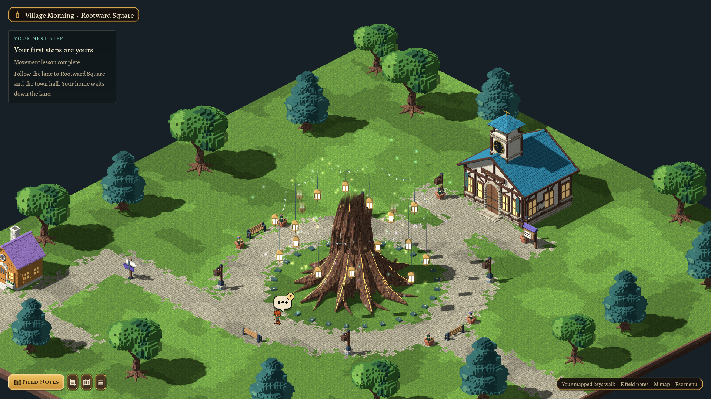
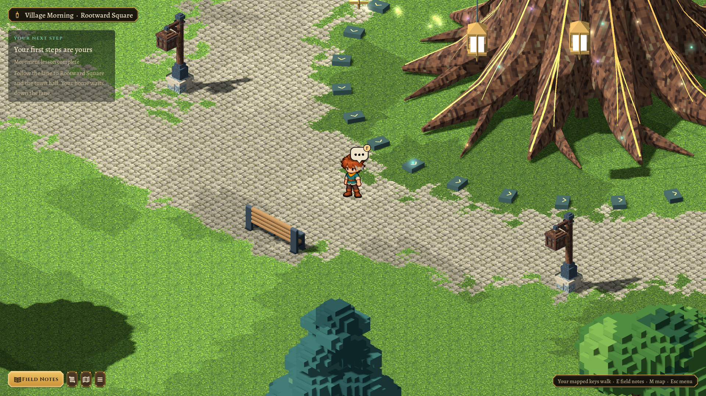
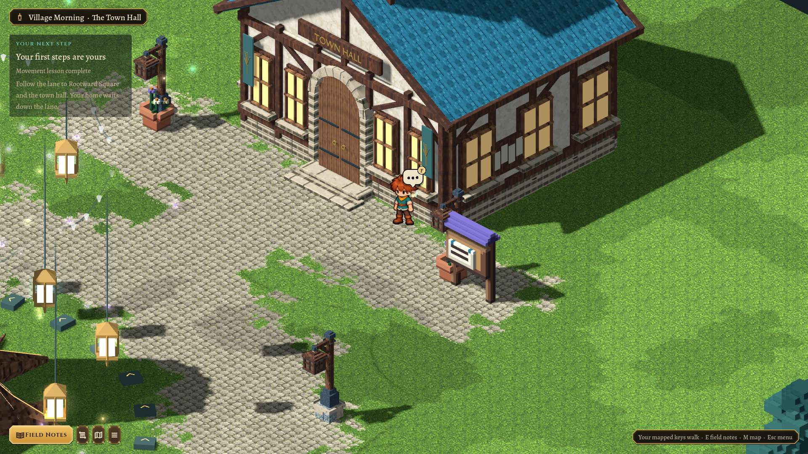

# Rootward trunk cutaway — 2026-10-26

The user accepted the giant tree but requested a trunk representation so its broad canopy would not obscure the village. Rootward now always uses a trunk cutaway during play, at every distance and zoom.

The complete adopted Blender source and audited GLB remain intact. `RootwardPresence` reads the imported `extras.part` roles and hides every `Crown` and `Boughs` mesh, including their large shadows. Roots, the bole, ward stones, lanterns and drifting lights remain. Upper trunk/chain surfaces fade smoothly from 8 to 10 m in authored tree coordinates, avoiding an exposed pointed tip. This works after placement, elevation and scale changes without depending on world coordinates or the player camera.

The view above uses the same review-only wide framing as the earlier landmark overview. At the unchanged gameplay camera, paths, seats and the town hall stay readable around the trunk.

The root bark and low details retain their original imported materials. A per-instance shader preserves painted albedo, colour, roughness, metallic and emission on meshes that reach into the cutaway. It uses a depth prepass and double-sided surfaces, preserving thin luminous seams. Only retained lower lanterns receive separate halos/local lights; upper hidden lights do not leave detached halos. Wisps remain decorative. Neither source materials nor other trees are modified.

No map, collision, quest, save or movement changes were needed. Rootward’s trunk, roots and raised ward ring still block the same 8.6 m radius. The complete model remains available in its adopted source/export for future art work.

Verification: `scripts/test.sh` passed in full, including 58 headless landmark checks, 130 tutorial checks, 877 doorway boundary checks, 497 world-art checks and 944 pipeline/handoff checks. The graphical landmark run passed 59 checks; shader compilation and reviewed frames were clean. The adopted source/export hashes are unchanged, and `git diff --check` passed. The graphical landmark run checks the retained roots, hidden exported crown/bough roles, lower-lantern anchors, moving wisps, root collision, doors and independent room persistence. These screenshots were reviewed at 1920×1080, with normal gameplay camera size 13 and an explicitly wider overview.
