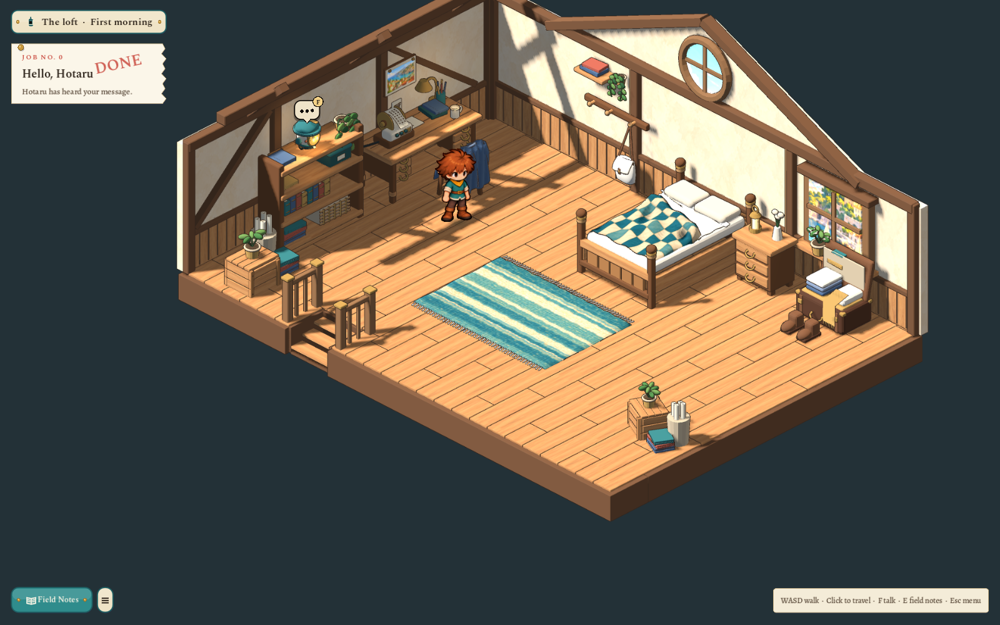
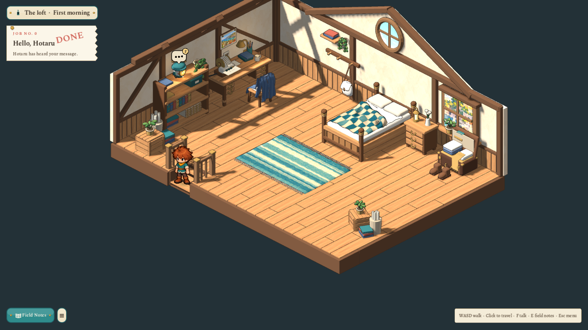

# Lived-in loft, a quiet week and descending stairs — 2026-10-27

The lodger is an ordinary newcomer with a bag and Nell’s address. Their previous home and reasons for coming are left open. Hotaru has spent much of the week dozing while Nell is out on calls. The desk printer rings her addressed-message bell; sending a greeting gets her attention. There is no long shutdown, miraculous repair or reward for accomplishing one. The active opening note, journal, three replies and related v0.7 story references use this premise.

The bed has a quilt pushed back diagonally and bunched into folds, exposed creased linen, and unevenly placed, indented pillows. The fabric fits above the frame. The blue coat is removed from the pegs and draped across the chair back and seat, with loose sleeves. The lower canvas satchel has a curved flap, weighted body and two straight strap legs carrying its weight from the peg. Shelf, books and plant remain intact. The chair’s collision footprint is adjusted in the area document to contain the draped clothing.

These are deliberate edits of the adopted bed, chair and wall-life masters. Their preceding versions are preserved as `model.pre-lived-in.blend`. [The source pack](../../art/source/world/sparks-loft/v1/README.md) records both edits and the linen finish. Each model uses the normal world-art export/audit. An unchanged bed rebuild preserves source, runtime bytes and audit exactly. Painted inputs, the approved boy and camera heading/elevation are preserved.

The loft’s three visible tread tops are −0.44, −0.29 and −0.14, relative to the floor. `interior.stairwell` owns their footprint, orientation and height profile. The area parser validates bounded, ascending heights. `WalkingSurface` replaces the old exit-mat lift inside the hatch with those tread heights and smooth riser approaches. The actual moving player node therefore descends during an ordinary session step and climbs on the return; this is not a change to the sprite artwork. Clicking a lowered tread also picks its physical position, while the floor beside the opening keeps its own target.

The workshop door remains a locked boundary of this first room. The character can walk down the visible flight, receive one refusal and return upstairs. A downstairs map or room transition has not been added.

The final focused test covers 69 checks: the revised note and ordinary greeting, real WASI execution and ghost speech, explicit commit, saved introduction, furniture routes, smooth tread support above the visible surfaces, the exported shell’s three matching tread tops, actual player descent/ascent, stair click targets, and forty identical refusals leaving one message. Gameplay review uses 1600×1000 and 1280×720 captures. The full project suite and current source/texture hashes are recorded in the source pack’s validation file.
