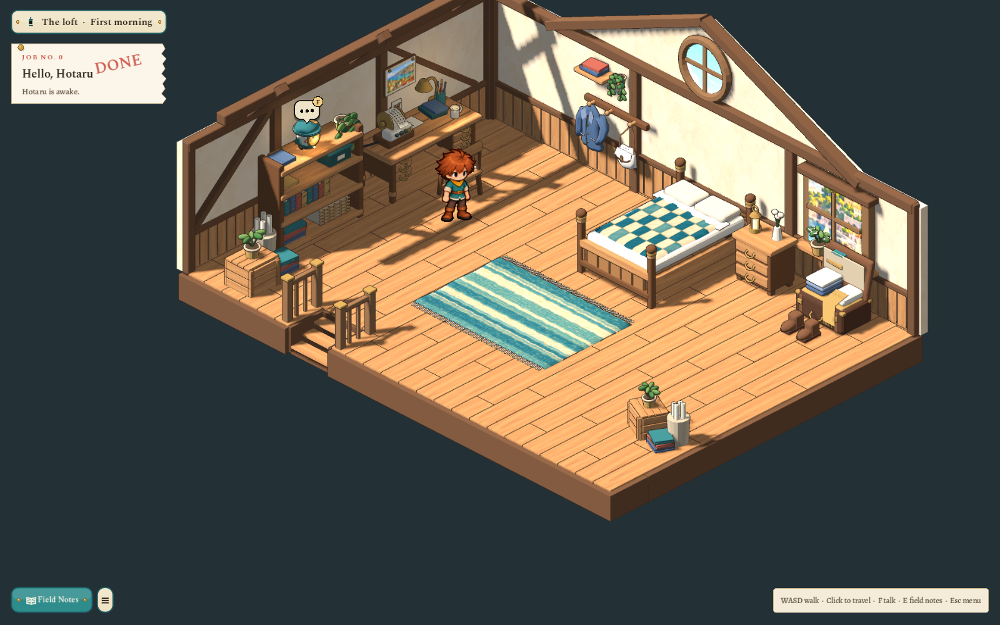
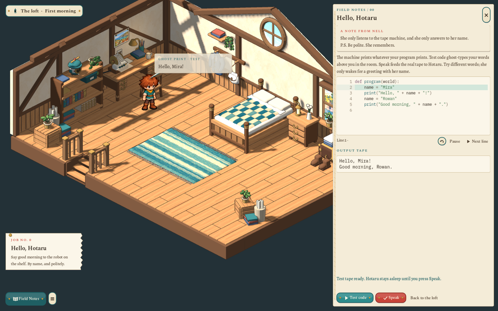
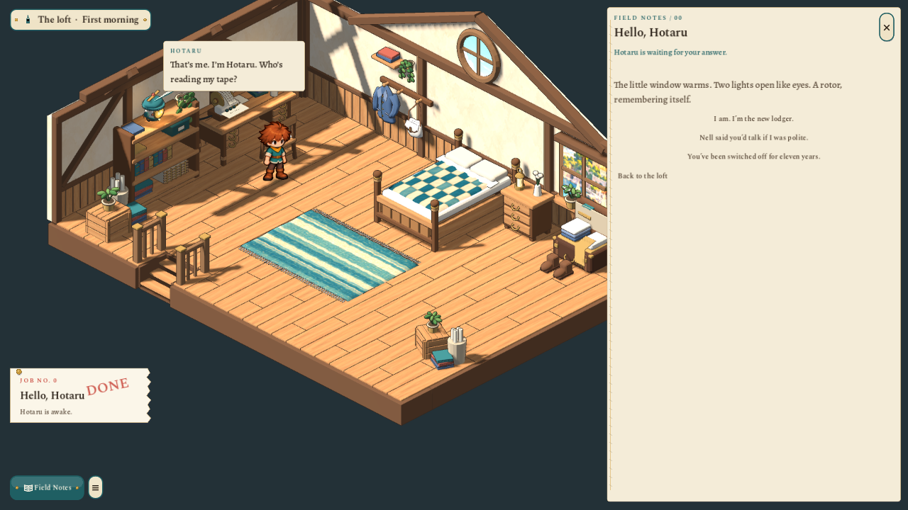

# Annotated loft corrections and live speech — 2026-10-27

This revises the [furnished loft](2026-10-27-sparks-loft-furnished-and-first-code.md) after the marked gameplay review.

The two moving-in crates now have consistent slatted walls, corner uprights, lid boards and nail heads around the whole box. The quilt is tucked around a raised mattress above the footboard and inside the posts. The hanging coat has sloped shoulders, uneven weighted folds, loose bent sleeves, lapels, pockets and a collar loop; the satchel has a rounded canvas gusset, a folded flap and a broad leather strap. The round and lower windows sample a shared harbour panorama at its proper aspect, with one horizon. The high porthole sees sky rather than a miniature duplicate of the entire landscape.

The desk and reader are against the west wall, with their chair, cable and collision adjusted in the area document. New players start beside the desk. Existing saved positions remain authoritative unless blocked. The approved boy and camera heading/elevation are preserved.

Every changed master was opened and deliberately edited, with a `model.pre-marked-review.blend` copy preserving its earlier form. The [source pack](../../art/source/world/sparks-loft/v1/README.md) records the edits and hashes. All five changed assets use the ordinary world-art export/audit. The revised bed also passes an unchanged-source rebuild with identical runtime bytes and audit.

Test code now types the actual validated `say` commands returned by CPython/WASI into a ghost bubble above the player. It preserves custom words, punctuation, line breaks and multiple print calls in order. Other names print without waking Hotaru. Replay starts the same output again. Editing, a new test and closing the page cancel obsolete previews; syntax errors do not create speech. Speak remains the explicit commit of the tested proposal.

The first successful Speak starts the waking conversation from the [dialogue draft](../../docs/concept/v0.7/07-dialogue.md). Player speech leads into Hotaru reading her name and asking who is reading her tape. Continue reveals a line, then advances it; the question stays above her until answered. Three authored replies each lead to their corresponding answer. The scene ends with a clear return to the same editable page and an invitation to experiment. The completed-job ticket then says the first page is saved and suggests another tape while waiting for Nell. Read progress saves separately from program state, so reopening a finished introduction does not replay it. Closing an unfinished one offers the opening question again on reopening.

The speech cards use readable screen-sized text anchored to the actual speaker and clamped to the unobscured part of the window. Both the wrong-name ghost and Hotaru’s conversation are reviewed at 1600×1000 and 1280×720. Shared repeated-error coalescing remains in place.

Verification: the focused journey test passes 56 checks, including progressive typing, exact wrong-name output, multiple prints, replay, source invalidation, explicit commit, all three reply options, the return to editing, cancellation, saves, furniture routes and forty stair refusals producing one message. The full `scripts/test.sh` suite passed with no script errors or failed checks: world art 577, pipeline/handoff links 1032 and ground art 121. Final focused runs at both window sizes also verify the saved introduction is restored without repeating. The source/output hashes, unchanged paintings, preserved masters and evidence are recorded in the source pack’s validation file.

This completes the revised first greeting and its introductory conversation. The later rotor/basket scene, following, movement lesson and downstairs remain proposed.
