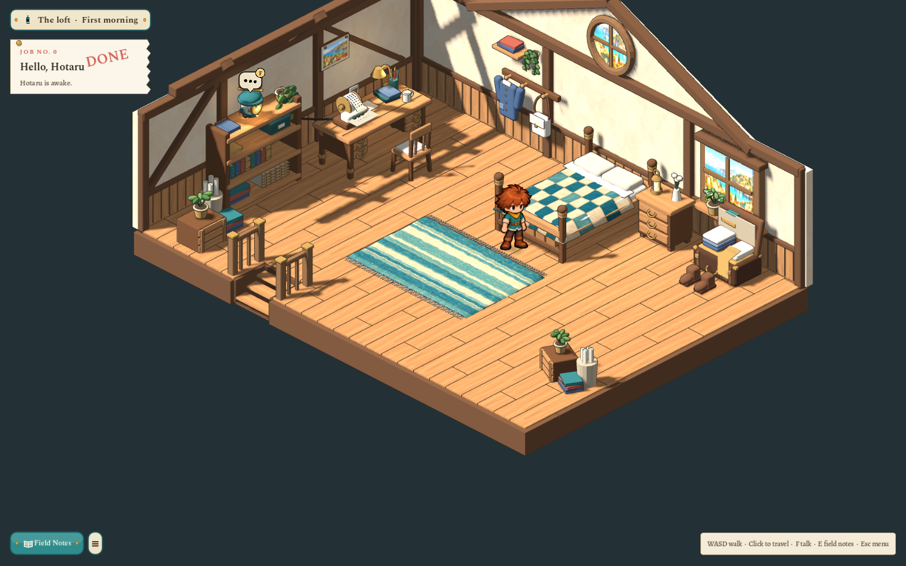
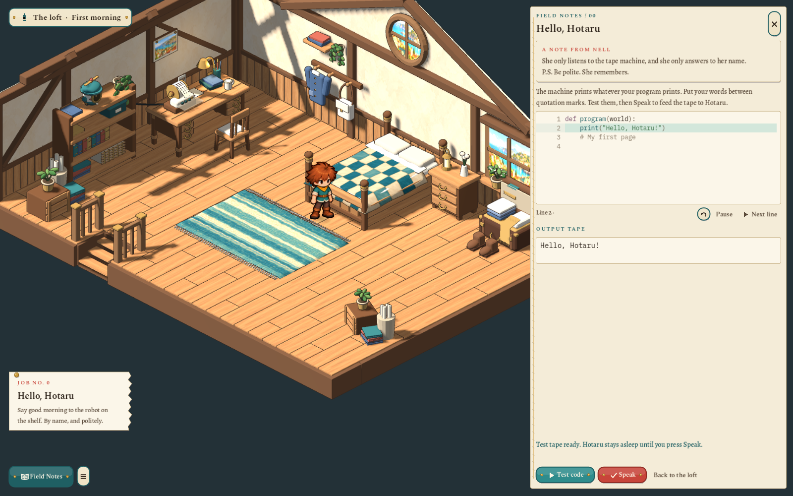
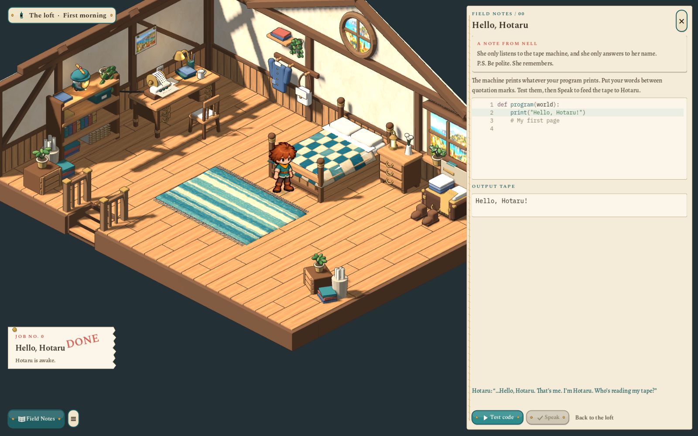
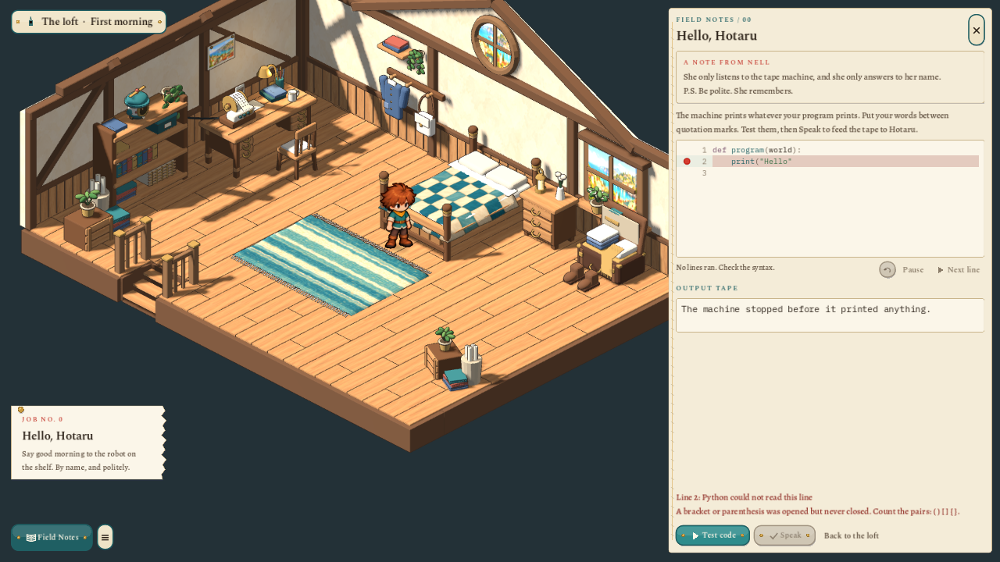
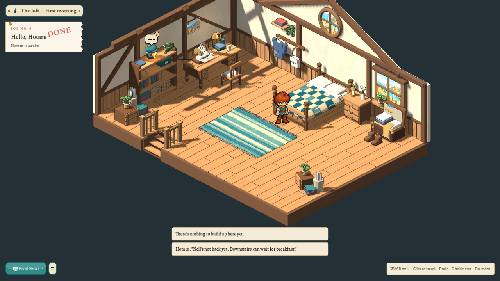

# Sparks loft: furnished room, first code and quiet feedback — 2026-10-27

The [step 1a review](2026-10-27-sparks-loft-step-a.md) left an empty shell and a guarded notebook button. This pass furnishes that room after the selected [T7a illustration](../../docs/concept/v0.7/art/4-opening/T7a-workshop-loft.wheels.png), and makes the first greeting playable.

## The room

Fourteen new editable Blender assets provide the quilted bed, writing desk, chair, filled bookcase, unpacked leather case and boots, bedside cabinet and lantern, coats and satchel, rag rug, moving-in crates and books, window flowers, harbour postcard, tape reader, dormant rolling Hotaru and connecting cable. Fifteen area-owned placements include a second turned/scaled belongings cluster. The rug is walkable; bed, desk, chair, shelving and luggage use matching collision rectangles from the area document.

The existing shell was deliberately refined with its original master preserved. Its floor has real staggered plank joints and an open stairwell; painted harbour views replace orange window plates, and cream plaster and vertical wainscot seams soften the walls. New native paintings provide oak, plaster, quilt, rag rug and the harbour view. The initial yellow oak remains as an alternate; gameplay review selected the calmer second oak. Fine sepia outlines use the established rendering treatment. The approved boy and camera heading/elevation remain intact.

[The source pack](../../art/source/world/sparks-loft/v1/README.md) lists every master, its measured bounds, authoring records and [exact imagegen prompts](../../art/source/world/sparks-loft/v1/prompts.json). The saved `.blend` files are authority. All GLBs use `scripts/world-art.sh build <id>` and the ordinary source/output/material audit; no authoring service runs during play.

## Field Notes /00

Nell’s opening note now opens `WorkshopJournal`. E, J, the ticket and Field Notes return to the same saved page. While it is open, the job ticket moves lower so it cannot hide Hotaru on small screens. The paper drawer uses dark Python text on cream, the real `CodeEditor`, and execution evidence returned by the existing worker-thread WASI runner.

| Test before Speak | Committed greeting |
|---|---|
|  |  |

Test code produces a provisional desk tape and a readable output panel. It does not wake Hotaru or complete the job. Speak commits the same validated proposal. A greeting without her name prints and gets a useful hint; a polite greeting including her name lights her window, opens her spark eyes, turns her rotor and completes `say-hello`. Her first response follows the proposed waking script. This is the first response only, not the complete later conversation or movement lesson.

Editing clears the tape proposal and disables Speak. The action also checks the current editor contents synchronously, so an edit followed immediately by Speak cannot commit stale code before TextEdit’s deferred signal. The code draft and committed awake state survive Continue. Saves from the earlier empty loft recover a now-obstructed player to the spawn while preserving memory and greeting progress. No player source executes on host Python or inside the engine.

## Errors and repeated feedback

Python errors replace the journal’s current result and mark the failing line. Shared HUD feedback now renews an existing identical message rather than adding another panel; at most three distinct messages stay visible. Holding against the closed stairs therefore keeps one refusal. The integration test sends forty repeated doorway refusals and checks there is exactly one matching panel.

The completed paper ticket is held briefly before the next objective replaces it. Its stamp has its own overlay layer, avoiding the container-layout overlap seen during review. Unparented hidden paper-HUD controls were also brought into their owner’s lifecycle, removing the isolated test’s exit leaks.

## Verification

The focused journey test passes 44 checks, including real WASI syntax errors, a nameless greeting, preview-only tape, stale-edit refusal, explicit Speak, quest completion, saved draft/awake state, furniture routes, repeated stair feedback and isolation from the existing journeys. Gameplay captures are reviewed at 1600×1000 and 1280×720. Asset source/output hashes, native painted inputs and rebuild evidence are recorded in the source pack.

`scripts/test.sh` passed in full. The final run has no script errors or failed checks; the world-art suite passes 577 checks, and the pipeline/link guard passes 1029 checks. The initial restricted run could not create temporary WASI job folders; the authorized rerun completed. Two paper surfaces found without UVs were corrected in their saved masters and rebuilt before the final clean suite.

## Current boundary

The furnished first room and first greeting are implemented. Downstairs travel, robot following, the complete waking dialogue and /01 movement lesson remain later steps. These are real editable 3D assets and working UI, with deliberate readable approximations of the painted reference rather than a claim of identical image pixels. The other journeys retain their content and artwork; the shared repeated-feedback fix intentionally applies to both HUD styles. No commit or release was created.
