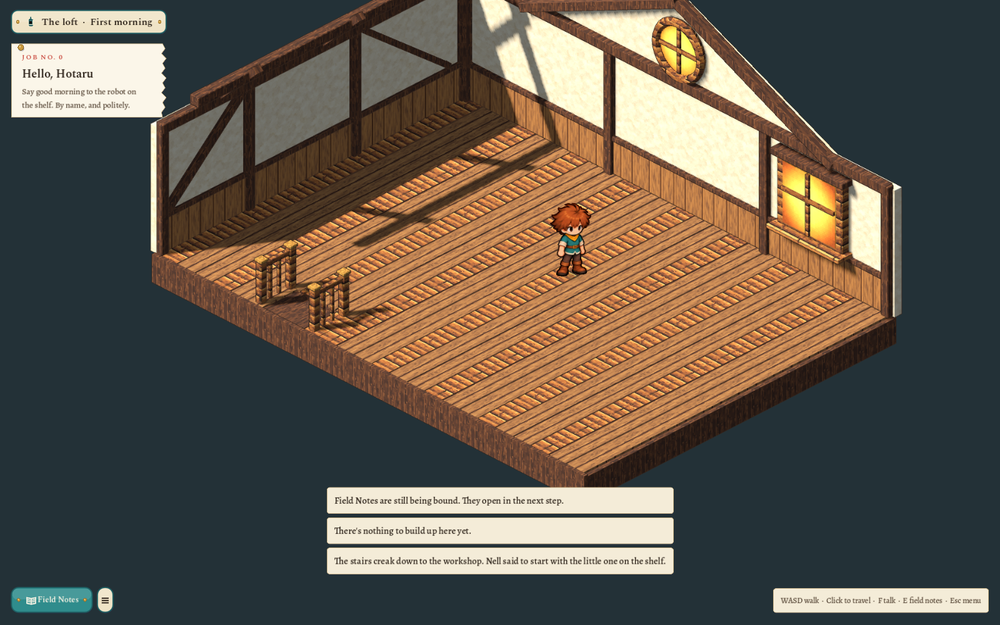
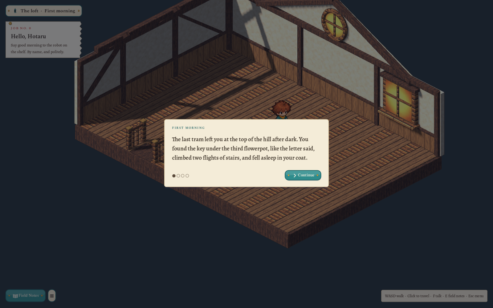
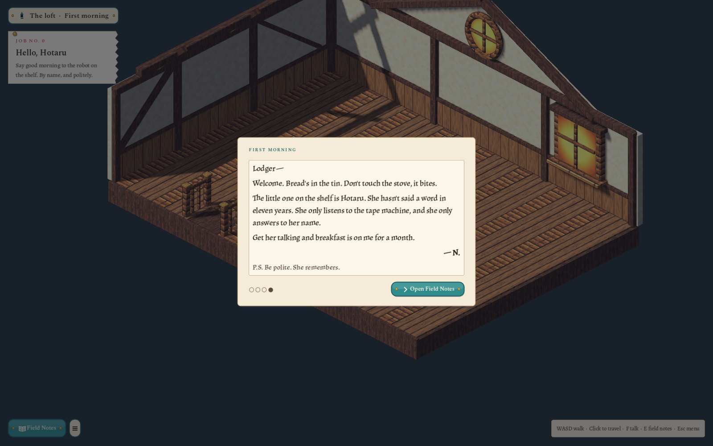
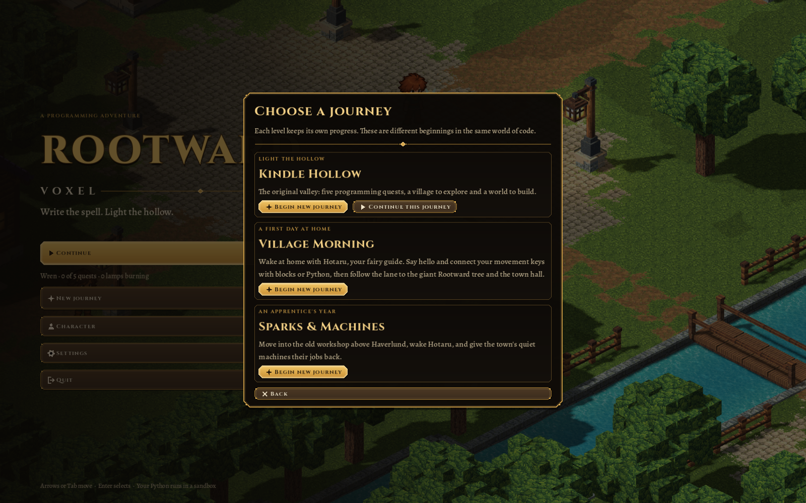

# Sparks & Machines, step 1a: the journey, the loft shell and paper basics — 2026-10-27

The first increment of the third journey ([plan](../../docs/concept/v0.7/05-scenario.md), concept art in `docs/concept/v0.7/art/`). Kindle Hollow and Village Morning are unchanged; every shared hook defaults to their existing behaviour.

**What exists now**

- **The journey.** `sparks-and-machines` is appended to `content/levels/catalog.json` with optional fields `look`, `companion`, `journal`, `story`, `build` and `character`. It starts in the loft itself (`area: workshop-loft`, no opening house) and saves to its own file.
- **The loft.** `content/areas/workshop-loft.json`: 12×10, `voice_lesson` (the hello lesson without the movement-key lesson, so walking uses the normal controls), exit and stair hatch at `[3, 1]`, and two blocking furniture entries for the hatch rails. Its first quest `say-hello` is "Hello, Hotaru" in the new notebook voice.
- **The shell.** New Blender model `loft-shell` (`art/source/world/loft-shell/v1/`), after the T7a concept: a thick plank floor with the stair hatch and brass-capped newel posts, timber-framed plaster with two braces and roof rafters, a gable with the round porthole, and the dormer window. Painted pictures are baked with `retexture`; outlines are on. The room uses its own zoom (`interior.zoom` 12.5).
- **Paper and enamel.** `PaperPal`, `PaperBox`, `PaperTheme` (same variation names as `UITheme`, plus `ButtonStamp`), `PaperHud` (location plate, pinned `JobTicket`, enamel Field Notes and menu buttons) and `OpeningCard` (Scene 1 prose and Nell's note in a slanted Alegreya). Only this journey creates them; the title, level select, pause and settings stay in the default theme.
- **Room stage.** `RoomStage.for_area` gives the loft a `WorkshopLoftStage` that replaces the fairy. Hotaru, the tape machine and the Field Notes journal arrive in steps 1b and 1c. Until then the Field Notes button says they are "still being bound".

| Opening | Nell's note | Journey select |
|---|---|---|
|  |  |  |

**Shared hooks (each defaults to today):** `AreaDef.voice_lesson`; the companion snapshot and speech rule accept it; `InteriorBuilder.build(…, place)`; `ClearingView.stage`, `companion_present()`, `companion_anchor()`; `Game._apply_level_spec`, `_ensure_hud`, `_indoors()`, per-room `interior.zoom`, the stairs line, the build refusal and the journal guard; character-screen caption and blurb from the level entry.

**Checks:** `test/test_sparks.gd` (27 checks) covers the catalog order, the loft document, the rules, the opening, the HUD, the missing fairy, build refusal, the stairs, separate saves (Kindle Hollow's file byte-identical) and the title restoring the default HUD. `test/test_morning.gd` now expects three journeys.

**Found while reviewing:** after rebuilding a GLB, run an editor import before capturing screenshots; the game loads Godot's imported copy, and a stale import showed a removed ceiling plate as a pale strip along the floor edge.
