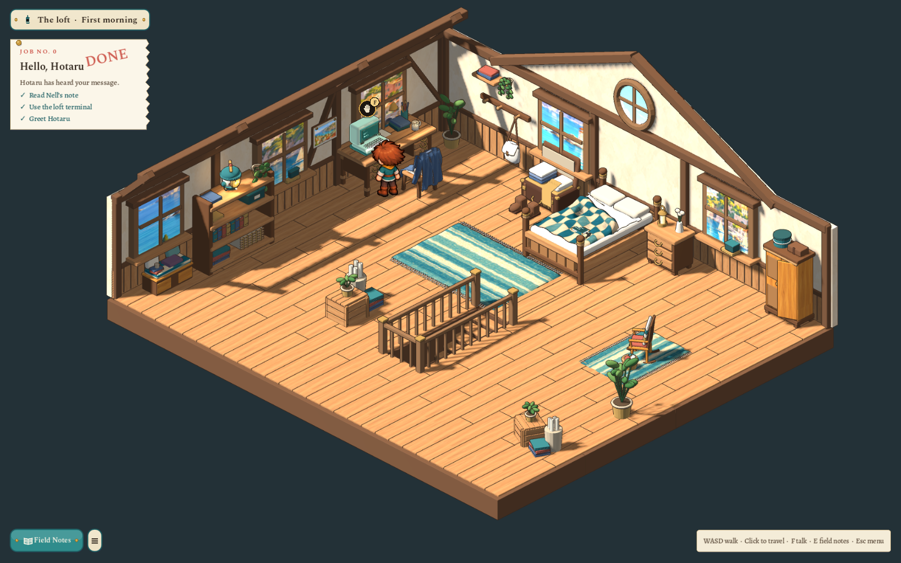
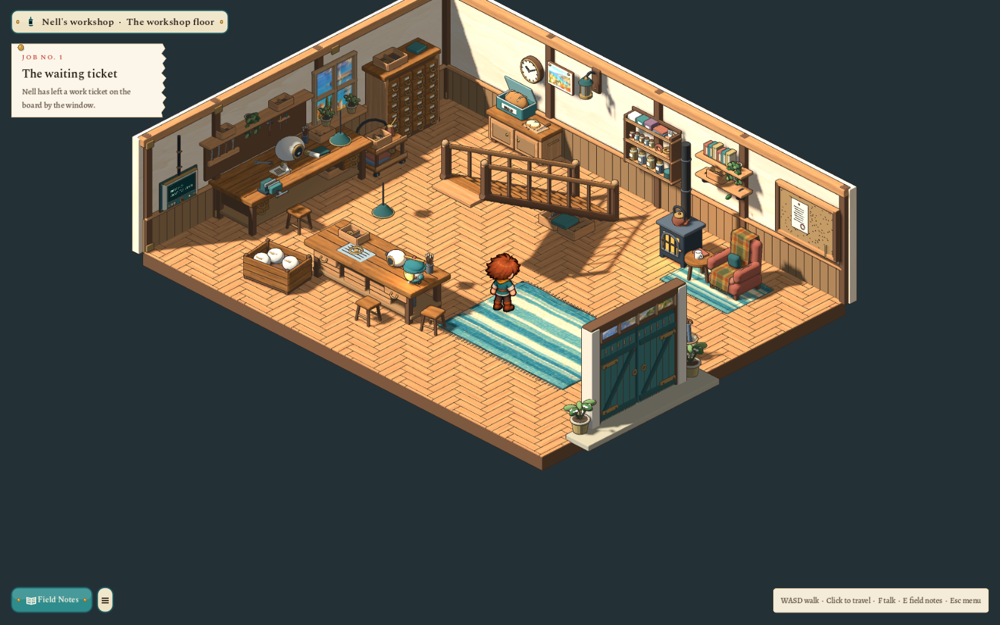

# The loft and the stairs, matched to the lane — 2026-10-28

After the second Spindle Lane pass the outside of Nell's workshop was a two-storey building: a workshop floor with the street doors a third of the way along, and the loft as a jettied upper floor with three windows over the street, a round window in the yard gable and two windows beside it. The rooms inside did not match it. The user asked for them to be rearranged: flip the staircase, bring it up in the middle of the loft, grow the loft for it, furnish the new space, and give the loft the windows seen from outside. The trees on the lane were also detailed.

## Decided with the user

| Question | Answer |
|---|---|
| The flip | The loft is seen from the yard side, the opposite corner from the street; the workshop floor keeps its view with the doors at the front right. Climbing the stairs turns the view round. |
| Loft size | 14×12, the workshop floor's footprint. |
| The workshop's north wall | It is the party wall with Nell's house, so its window would look into her rooms: shelves instead. |

## The loft (version 9)

- **Walls and windows.** Its back-left wall is the street wall: three windows, at the places the lane's loft windows are. Its back-right wall is the yard gable: the round window, centred, between two windows. These are the adopted shell's own pieces, moved and widened, and the new windows are copies of its tall window with their own crops of the painted harbour.
- **The stairwell.** A railed opening in the middle of the floor, open at its north end where you step off, its ten treads stepping down toward the front. The area's `stairwell` rect and its ten tread heights describe the whole opening, so the walking height, the clicks on treads and the drawn treads agree. You arrive on the third tread down, facing north, as before.
- **Furniture.** The bed under the round window, the desk under the street window by the corner, the bookshelf with Hotaru between two windows, the coat pegs, the unpacked case under the new gable window, the bedside cabinet. The new space has a window seat under the front street window (books, a mug, a folded blanket), a wardrobe with one door ajar and a scarf caught in it, a rocking chair with a striped throw and a knitting basket on its own rug, and two tall potted plants. The arrival crates stand by the stairwell.
- Old saves whose position is now inside furniture move to the spawn by the bed and keep everything else.

## The workshop floor (version 10)

- **The staircase** is the same adopted model, placed turned 180° in its own footprint. Its foot is now by the north wall beside the stove; it climbs south to the middle of the room, and its storage trays sit under the new high end. `stair_flights` climbs `S`.
- **A rule for every flight:** it is boarded and left only at its foot (`RoomLinks.stair_edge`), so the high end can't be stepped onto from the floor beneath it, and nobody walks off its top except up into the loft.
- **The party wall.** A deliberate edit of the adopted shell (`sparks-workshop/v1/party_wall_revision.py`, the previous master kept as `model.pre-party-wall.blend`) removes the north window, its sill and its pot. A new `workshop-jar-shelf` hangs there: big jars of screws, springs and washers, small jars of colour, a coil of copper wire, a gear, labelled boxes, manuals and an enamel hand. The room's main light now comes from the west window.

## On the lane

The workshop front's loft windows were moved to where the loft's are (three over the street, two in the gable either side of the round window). The blossom tree has a flared trunk in the project's bark picture, boughs that fork into twigs, a lumpier crown lit lighter on top, blossom in clusters and petals on the ground; the cypress has a bark trunk and layered, feathery tufts.

## Records

- `art/source/world/sparks-loft/v1/flipped_loft_revision.py`: the loft shell edit (previous master `model.pre-flip.blend`, note `flip-revision.json`).
- `art/source/world/sparks-loft/v1/flipped_loft_props.py`: `loft-wardrobe`, `loft-window-seat`, `loft-rocking-chair`, `loft-floor-plant`.
- `art/source/world/sparks-workshop/v1/party_wall_revision.py` and `jar_shelf.py`.
- The lane's records are in `art/source/world/sparks-lane/v1/` (windows in `author_buildings.py`, trees in `author_props.py`, the borrowed bark in `lane_kit.py`).

## Checks

`test_sparks.gd` (259), `test_workshop.gd` (78), `test_workshop_quests.gd` (82), `test_zone_terminals.gd` (78) and `test_lane.gd` (146) cover the new sizes and positions, the stairwell's railings and drop, leaving the top tread only forward, the furnished new space, all ten drawn treads against the area's profile, clicks on the visible treads in both rooms, the flight boarded only at its foot, the descent to the north wall and the climb back, and the arrival on the loft's top tread. Captures are the tests' own, at 1600×1000 and 1280×720, in `evidence/sparks-workshop/`.

Follow-up: the [2026-10-29 stair and square review](2026-10-29-stairs-and-square.md) records the agent’s native keyboard/mouse play-through, the current floor version 11 and the trolley by the drawers. The user's own play-through remains welcome.
