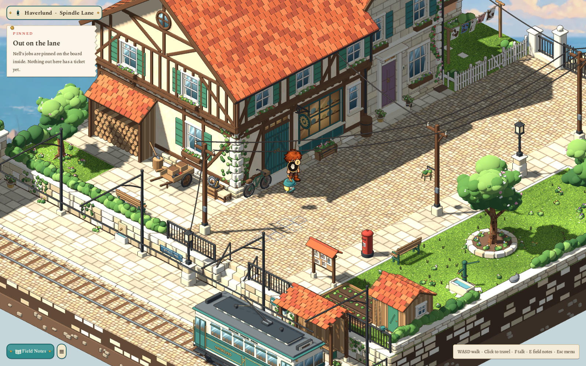
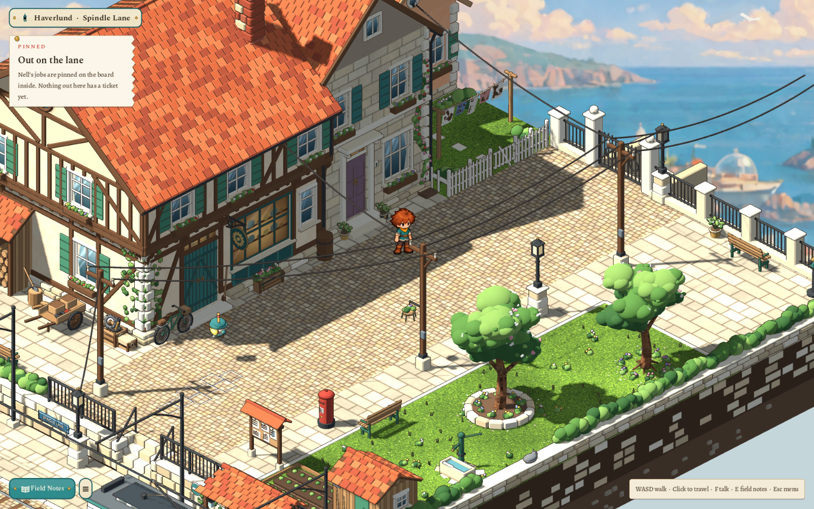
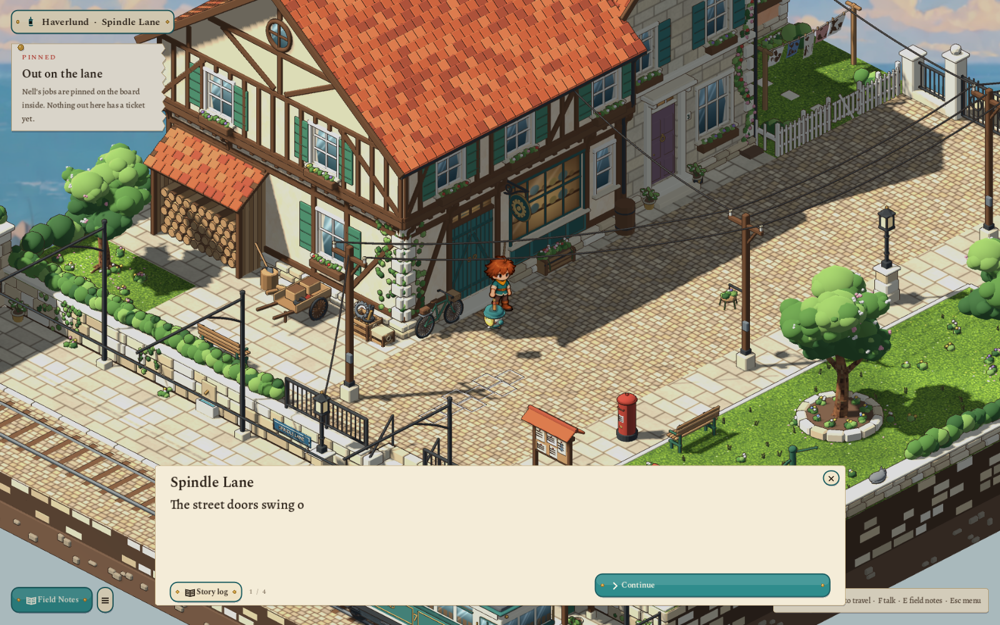
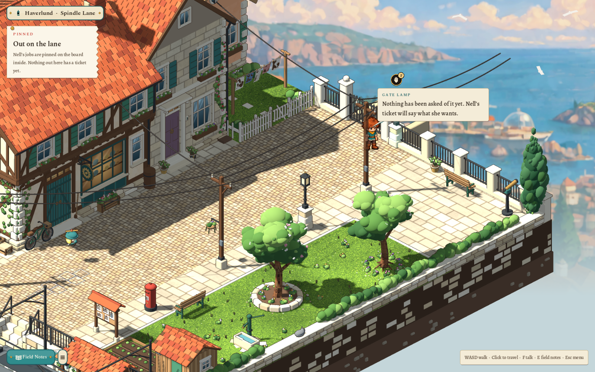
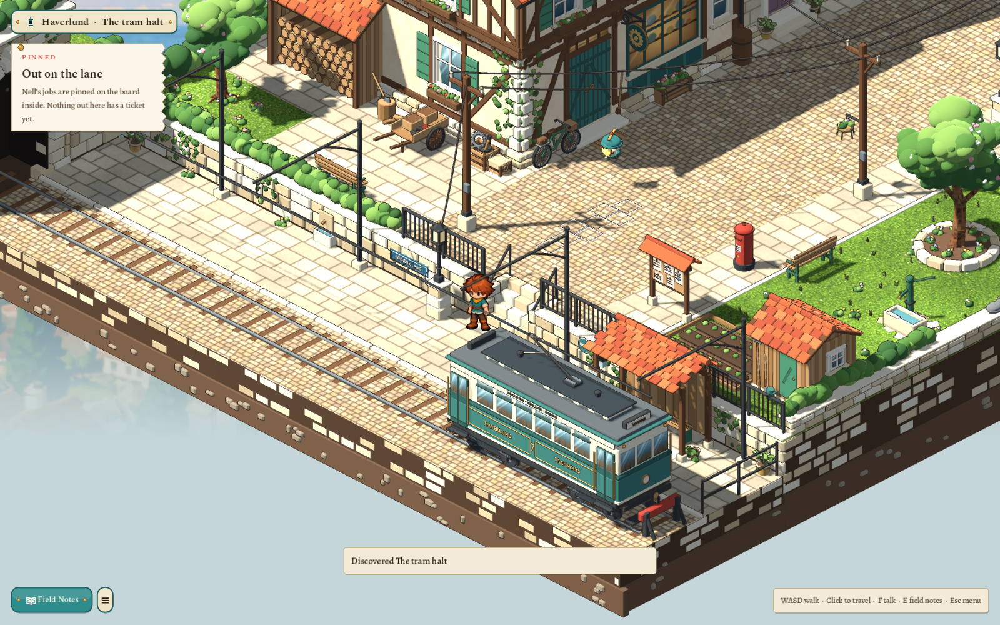
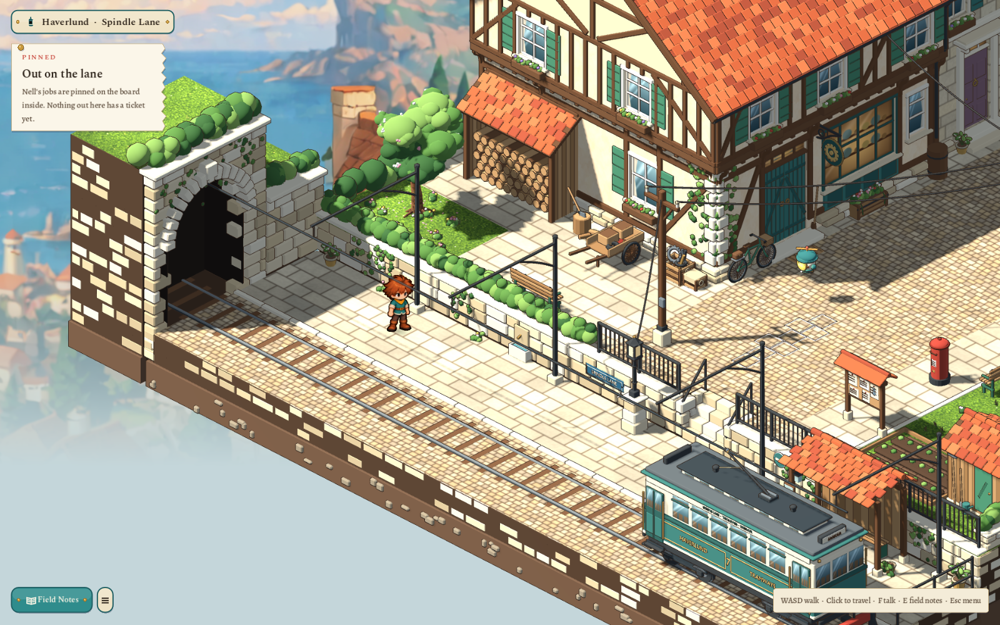

# Spindle Lane — 2026-10-28

Sparks & Machines now goes outside. The workshop's green street doors open onto **Spindle Lane**, a cobbled terrace at the top of Haverlund, after the selected [T7c workshop lane](../../docs/concept/v0.7/art/4-opening/T7c-workshop-lane.wheels.png) and the [P1 street props](../../docs/concept/v0.7/art/4-opening/P1-street-props.png). It follows the same room-by-room approach as the loft and the workshop: one scene, a little bigger than the screen, with a painted town behind it instead of one large map. It is open whenever the workshop is; a story lock can come later.

## Second pass, after the first play-through

The user liked the direction and marked what did not make sense. This pass keeps the concept and the art and changes those things:

| Note | Now |
|---|---|
| The workshop outside should match the rooms inside: a loft, not a cottage with an attic; inside, the wall beside the doors is short, outside it had a whole window | The front was rebuilt from the rooms. The street doors sit a third of the way along from the south corner, as they do on the workshop floor, with only a short stretch of wall and the corner quoins beside them. The house runs on to the north with the shop window and a narrow window. The loft is a jettied, half-timbered upper floor under a ridge that runs north–south like the loft's, with its round window in the south gable over the yard. |
| Extend the house the other way; there is no second house; the landlady should live next door | The lane grew from 22×20 to 24×28. The workshop runs further north, and **Nell's house**, a narrow dressed-stone house with a plum door, teal shutters and lavender in the window boxes, stands against its north wall before Bram's cottage. |
| The windows glitch | The glass was a flat face in the same plane as the plaster, so the two flickered against each other. Walls are now slabs with real openings: each window's glass is its own pane set inside the wall, carrying a painted picture (sky and drawn curtains for homes, a warm room of shelves for the shop, seat backs for the tram), and the illustrated edges leave it clear. |
| The top window has no texture | The old dormer is gone; the loft's windows and its oculus have the painted glass. |
| The dormer, the woodshed's ends, the axe, the crate by the doors | The woodshed has boarded ends and neat log rows; the axe is sunk in its block; the crate by the doors became a scrap crate in the yard, out of the doorway. |
| The SPINDLE LANE sign belongs near the tram | It is an enamel plate on the wall at the foot of the halt steps, where you arrive, with a chalk arrow pointing up. |
| The notice board's roof was upside down | Its two slopes now fall away from a ridge. |
| The bench on the green and the trough | The bench sits at the green's edge facing the lane; the trough is a hollow stone basin with water in it. |
| Grass is a flat green | The green, the yard and Bram's garden use the project's lush grass (Kindle Hollow's ground picture), laid out over eight cells without repeating, with tufts and wildflowers. |
| The tram stops short, is too small for its tunnel, and is rudimentary | The halt is two rows wider. Tram No. 7 is a 6.2-long double-ended car on two sprung trucks: panelled teal and cream with gold lining, HAVERLUND TRAMWAYS, windows with drop-lights, a clerestory, destination boxes, folding doors, headlamp and trolley pole. It comes out of a taller arch in a solid hillside, runs under an overhead wire on scrolled posts, and waits at the shelter by the buffer stop at the end of the line. |

## The place

A 24×28 terrace in two levels. The upper lane runs from the tram steps in the south to an iron gate at the top of the town steps in the north. Three houses face it from the west: Nell's workshop, her house and Bram's salmon cottage behind his white fence. Opposite are a pavement with the post box, a notice board and a street lamp, three telegraph poles, a small green with two blossom trees, a bench and a pump, an allotment and shed, and, at the rail, a bench and a coin telescope looking over the harbour. A level below, the hill tram's last stop has a tiled shelter, a framed timetable and a buffer stop, and the track comes out of a round-arched cutting.

Lived-in details are things people left, not signs: chalk squares on the cobbles, a coir mat, a broom, milk bottles and the paper on Bram's step, washing on his line, a handcart and a scrap crate in the yard, Nell's bicycle, pots and window boxes, a hanging basket on a pole, a lost glove on the post box, and Pepper, the grey cat from the notice board, asleep on the east wall.

Fifteen places answer F with a short observed line: the workshop sign, the shop window, the bicycle, Nell's door, the notice board, the post box, the fence, the gate, the bench at the rail, the telescope, the handcart, the tram timetable, the spout in the wall, the street sign and the cat. The gate lamp is a real lamp fixture wired from the north pole. Standing beside it with the tablet opens its code; without a job it says that nothing has been asked of it yet, which is where Job 1 will start.

## Hotaru outside

An awake Hotaru waits beside the street doors. The first time out she has a four-page scene, narrated as *Spindle Lane* and ending *Back to the lane*: four days since she was last outside, Bram's third coat of paint, and where the steps go (212 of them; the number is also chalked on the top step). After that, F beside her gets one of four remarks about the street, and the pinned note says the jobs are on the board inside. The lines follow [the dialogue rules](../../docs/concept/v0.7/07-dialogue.md).

## The painted distance

The lane is an outdoor room, so it gets its own daylight and a painted harbour on the camera's far plane. The painting drifts a little against the following camera (parallax 0.22) and fades into sea haze toward its foot, so the terrace floats over the drop instead of over a second town. It is a **starter backdrop**, made in the local ComfyUI from the T7c concept's own harbour view: a composite, one img2img pass to unify it, sea painted over a repeated dome and lighthouse, and a lighter second pass ([prompts and hashes](../../art/source/world/sparks-lane/v1/backdrop/prompts.json)). Its hidden centre still has two cottages from the concept, behind the lane.

## Street life

Presentation only, positioned by the area document's `interior.life`: smoke from the three chimneys leaning with one breeze, the five cloths on Bram's line swaying, three gulls wheeling over the harbour, and the tram's round trip. The tram comes up out of the cutting in eleven seconds, waits at the shelter for fifteen and goes back down once every ninety, fading into the cutting's shade as it passes the portal; between trips it is gone. The track is never walkable.

## How it is built

- **Document.** `content/areas/haverlund-lane.json` (version 2), a room-style area with `interior.style: workshop-lane`. Levels 0 and 1 and two four-tread flights are ordinary `levels` and `stairs`, so the sprite climbs on the existing walking surface. 49 blocking rectangles keep every walkable cell reachable from the doors, and the cells behind the houses and in the alley are closed; the reachability map is checked in the test.
- **Doors.** The workshop's street doors have the reciprocal link `street` (floor version 9, arriving at the lane's (10, 12)) and no longer say they are latched. The journey's `room_areas` lists the lane third; position and program memory stay per room, the slate and the greeting travel, and Continue can resume outside.
- **Room blocks.** `interior.outdoor` (sun, ambient light, haze colour, backdrop and parallax) and `interior.life` (smoke, sway, the tram with an optional `travel` time, gulls), both validated by `AreaDef` and documented in [the area playbook](../AREAS.md). `ClearingView` applies the daylight and resets the sun when the next room has none; `OutdoorBackdrop` and `art/backdrop_haze.gdshader` draw the painting; `WorkshopLaneStage` reuses the indoor robot and speech presenter and adds the street's motion.
- **Reach.** A lamp that names a `stand` cell keeps to it even in a zone without a screen. Lamps with neither keep their older rule, so Kindle Hollow and Village Morning are unchanged.
- **Story.** Scenes may name a `narrator` and `finish_label`, and the scene and banter checks see jobs finished in any room of the journey, so a room with no jobs can still play its arrival scene.
- **Art.** Twenty Blender masters in [the lane source pack](../../art/source/world/sparks-lane/v1/README.md), regenerated from their records for this pass before adoption. Walls are slabs with real openings (`lane_kit.wall`), glass is one painted pane per window, the dressed stone of Nell's house is a painted ashlar, and the grass is the project's lush grass. Foliage is soft clumps rather than facets, roofs are individually tiled clay, and the illustrated edges are on for everything except the two trees and the glass.

## Reviewed

Native captures at the actual camera scale (zoom 16) through the real door-to-lane flow, in `evidence/sparks-workshop/spindle-lane/`:

| View | 1600×1000 | 1280×720 |
|---|---|---|
| Arriving outside the doors | [Arrival](../../evidence/sparks-workshop/spindle-lane/1600/01-arrival.png) | [Arrival](../../evidence/sparks-workshop/spindle-lane/1280/01-arrival.png) |
| Hotaru's first-visit scene | [Scene](../../evidence/sparks-workshop/spindle-lane/1600/01b-arrival-scene.png) | [Scene](../../evidence/sparks-workshop/spindle-lane/1280/01b-arrival-scene.png) |
| A remark beside the door | [Remark](../../evidence/sparks-workshop/spindle-lane/1600/01c-hotaru-remark.png) | [Remark](../../evidence/sparks-workshop/spindle-lane/1280/01c-hotaru-remark.png) |
| The gate lamp, beside the gate | [Gate](../../evidence/sparks-workshop/spindle-lane/1600/02-gate.png) | [Gate](../../evidence/sparks-workshop/spindle-lane/1280/02-gate.png) |
| The tram halt | [Halt](../../evidence/sparks-workshop/spindle-lane/1600/03-halt.png) | [Halt](../../evidence/sparks-workshop/spindle-lane/1280/03-halt.png) |
| The three houses | [Houses](../../evidence/sparks-workshop/spindle-lane/1600/04-houses.png) | [Houses](../../evidence/sparks-workshop/spindle-lane/1280/04-houses.png) |
| The cutting | [Cutting](../../evidence/sparks-workshop/spindle-lane/1600/05-cutting.png) | [Cutting](../../evidence/sparks-workshop/spindle-lane/1280/05-cutting.png) |

Not reviewed by hand: the user's own play-through of this second pass.

After this pass, the [loft and stairs review](2026-10-28-loft-and-stairs.md) rearranged the rooms inside to match this front, moved the front's loft windows to where the loft's are, and detailed the two trees.

Checks: `test/test_lane.gd` (146 checks) covers the document, reach, links in both directions, refusals of malformed outdoor and life blocks (including a tram whose trip outlasts its period), the adopted art, painted glass with no outline over it in all three houses, the borrowed grass, the real step through the doors and back, three smoking chimneys and Nell's house in its place, the tram stopping along the shelter short of the buffer, the arrival scene and remarks, the gate lamp's reach, its no-job answer and that it lights its lantern, inspections including Nell's door, the street sign and the shop window, the halt steps, saving and Continue on the lane, and that no daylight or backdrop is left behind indoors.

Not built: the gate lamp's job (Job 1) and the hook at the gate, Nell's return, the inside of Nell's house, the steps into town, residents and automatons, free following, cloud shadows, and a story lock on the lane.
