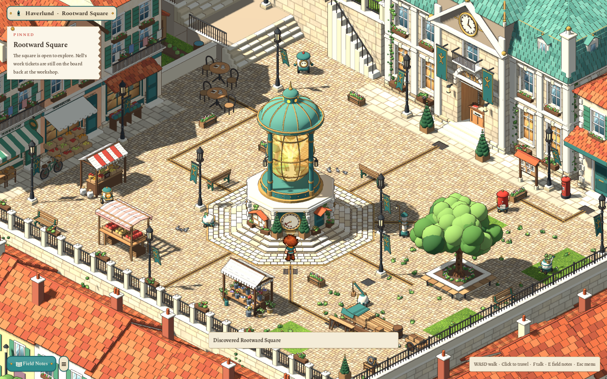
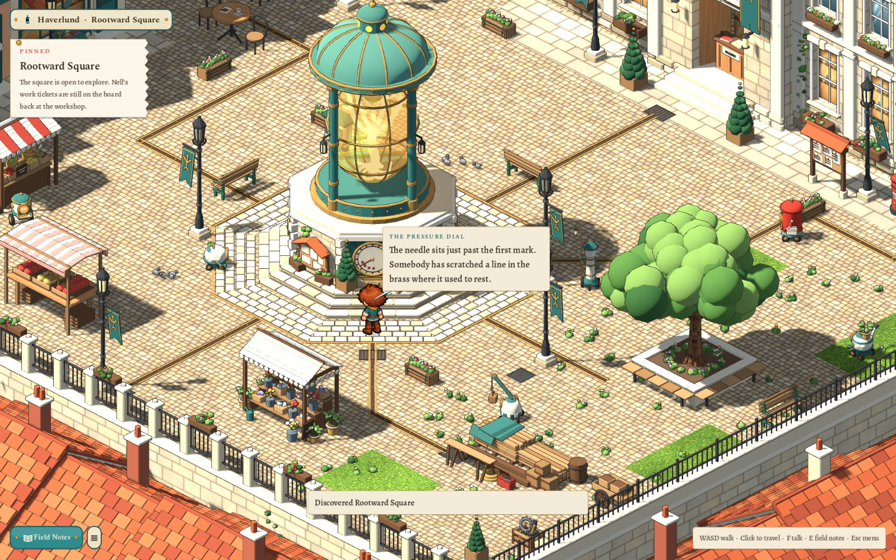
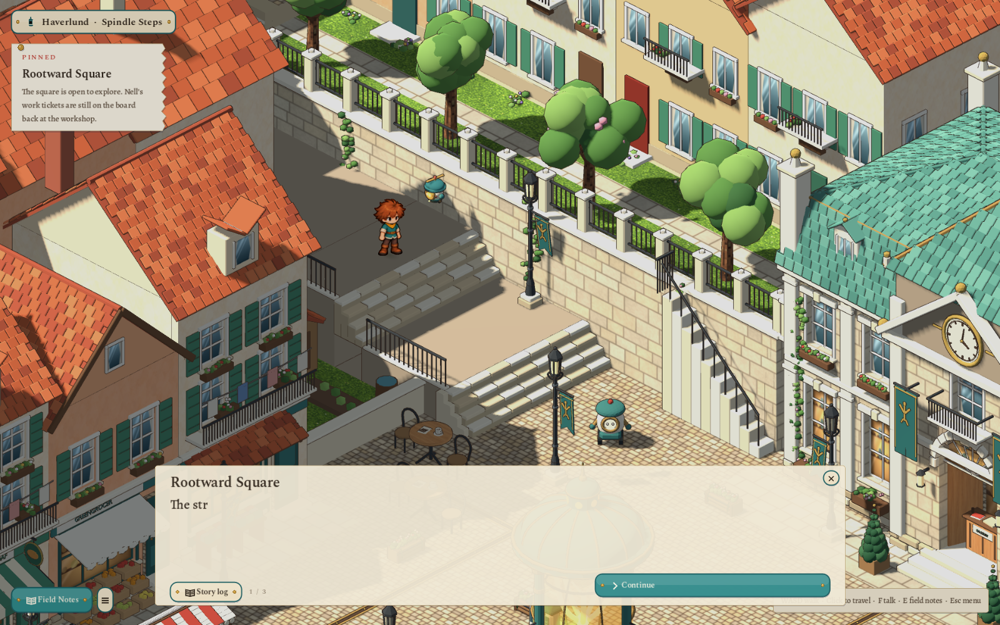

# Guildhall Square, rebuilt from the concept — 2026-10-29

The first playable square stood on its own slab of rock above a haze, and you entered it from the wrong side: you left Spindle Lane walking north through the gate, then arrived at the square's north-east corner and walked back south. The user asked for the square to be redone after the selected [Guildhall Square concept](../../docs/concept/v0.72/art/guildhall-square.png): joined into the town on every side rather than floating, continuing downhill from the lane, and as detailed as possible.

## Where it sits

Spindle Lane is the top of the hill, and its harbour views look east over the drop. The square is below it. In the concept, the uphill street leaves the square at the upper left, which is west for this camera. Now the lane's iron gate opens onto the **head of that street**: a broad stepped street at the square's west edge, two levels up. You walk east, down two flights, into the square, and the street visibly keeps climbing behind you toward the lane. Walking west off the head of the street returns you to the same gate.

The street runs along the square's north-west, between the guild hall and the shops, as it does in the concept. A first layout put it directly behind the shops. There, the Finch & Sons house stood between the camera and the street and hid it, so the street was moved five rows north. A café corner and the shops' walled back garden now sit in front of it. Both are low, so the street and the arrival stay in view.

## No floating edge

The square is a terrace on the hillside. The walkable area is 36×32, and the town continues past every edge in the same Blender set:

- **South and east (nearest the camera):** a balustrade with flower boxes, and a low wall with an iron railing over the yard. A dressed retaining wall drops from both to a lower street. That street is lined with houses whose roofs come up to the square's edge, and a second row steps further down. The bottom of the screen is always rooftops, never a cut edge or haze.
- **West, uphill:** taller houses climb behind the shops. The street goes on up past a landing, turns north out of view, and keeps its lamps.
- **North:** a garden terrace stands behind its retaining wall, with a railing, trees, flower beds and four houses facing the square. Steps climb the wall to a chained gate. Behind the guild hall and the post office, more houses drop toward the harbour, which shows above the far roofs.

At gameplay zoom, the four corners where the camera stops show no gap; the captures below cover the arrival and the main views. `test_square.gd` checks that the set reaches more than 12 units past every side and below the balustrades.

## What is in it

| Concept | In the square |
|---|---|
| The amber power beacon at the centre | `square-beacon`, about 8.5 m to its gold finial. It has three octagonal limestone steps and a dressed stone drum. The big low-reading dial faces the camera, with brass pipes running into the paving below it. A notice board under a tiled hood and a small teal maintenance door sit on the faces either side. There are valve wheels, flower boxes and two clipped cones. Teal columns with brass bands, carrying two lanterns, hold an amber glass bell. Inside it a glowing root forks into limbs round a warm heart. A ribbed copper dome, a little glazed lantern and a finial top it off. Pale setts ring the beacon, and brass channels run out to the hall, the street, the post office, the market and the yard. |
| The cream guild hall with a copper roof | `square-guildhall`. Cream dressed stone sits over a dark plinth, with pilasters, a string course and a dentilled cornice. A central tower carries a pediment clock and a steep copper roof with gold finials. The wings have a copper mansard with dormers and stone pinnacles. The arched entrance has open doors, a radiating fanlight and the public counter just inside (bell, ledger, ENQUIRIES). Teal banners with the town's sprout mark hang either side. There are lanterns, flower boxes, ivy, three doorstep treads and two clipped evergreens. |
| The post office to the right | `square-post-office`, with a tiled canopy lettered POST OFFICE, a red envelope sign, a parcel counter outside, a corner balcony and a hipped clay roof. The post box and the guild notice board stand beside it. |
| Shops, awnings and stalls on the left | `square-west-terrace`: Morning Loaf (striped awning, bread racks, round loaf sign), the greengrocer (crates of fruit) and Finch & Sons (tiled canopy, books in trays). Balconies, shutters, flower boxes and washing are above. In front stand a striped fruit stall, the first square's produce stall and a bicycle. |
| A flower stall at the bottom | `square-flower-stall`: stepped shelves of buckets and crates of flowers under a canvas roof. |
| The open apron for future building | Paving with grass coming up between the setts. `square-tree-planter` is a shade tree in a stone planter with seats. `square-timber-store` has planks on bearers, beams, crates, a barrel, rope, a tarpaulin, sawhorses and a toolbox. A handcart and crates stand nearby. |
| Iron lamps with banners | `square-banner-lamp` (×11). Each banner is its own cloth and moves in the breeze. Three are the programmable fittings. |
| Wheeled robots | Six new robots after the v0.72 sheets. **Pip** (the post), **Trowel** (the planters) and the first square's postal worker do their rounds. **Heron** lifts a crate at the timber store, **Tender** watches a valve, **Tally** holds a tray of change at the fruit stall, and **Wick** waits by a lamp. |

The café corner reuses the first square's café tables. Benches, planters, the post box, the notice board, the handcart, the bicycle and the crates are the lane's adopted props.

## Robots on their rounds

`interior.life.robots` lists a placed robot, a path of points, a speed and a pause. `WorkshopLaneStage` rolls each robot along its path, turns it to face where it is going and turns its wheels, which are separate nodes. It waits at the ends of its round and waits while the apprentice stands in its way. This is presentation only: robots never block a cell or decide where anyone may walk. `AreaDef` refuses a malformed round. The test checks that every round keeps at least 0.3 from every blocking footprint.

## Arrival, inspections and the screen

Hotaru waits at the head of the street. Her first-visit scene now reads, in three pages: *The street drops its last few steps into the square. Awnings down one side, and the smell of bread.* / *That's the beacon in the middle. Nell stops there on the way back. Every time. I've counted.* / *Under the glass a root glows the colour of strong tea. The needle on its dial sits low.*

Twenty-four places answer F with an observed line, among them the dial, the beacon's notices and door, the hall's counter and clock, the post office, the shops, the stalls, the plane tree, both views over the rails, the street steps, the terrace gate and the four working robots. The robots speak in the automatons' telegram voice from [the dialogue rules](../../docs/concept/v0.7/07-dialogue.md). The service screen now stands by the beacon. It keeps the same slate, physical-range and scratch-page rules and reaches the same three lamps: the beacon's west and east lamps and the hall lamp.

## Reviewed

The views below are from Godot 4.7.2 (Compatibility renderer), rendered through the real lane-to-square travel in `test_square.gd`. The normal camera size is 16; the beacon detail uses 10 and the overview 24. The game held 60–77 fps at 1600×1000 on this machine's integrated Radeon 680M, with 727–1,778 draw calls depending on the view.

| View | 1600×1000 | 1280×720 |
|---|---|---|
| The lane gate | [Gate](../../evidence/sparks-square/1600/01-open-gate.png) | [Gate](../../evidence/sparks-square/1280/01-open-gate.png) |
| Arriving at the head of the street | [Arrival](../../evidence/sparks-square/1600/02-street-arrival.png) | [Arrival](../../evidence/sparks-square/1280/02-street-arrival.png) |
| The street, Hotaru beside you | [Street](../../evidence/sparks-square/1600/02b-street-top.png) | [Street](../../evidence/sparks-square/1280/02b-street-top.png) |
| Going down the steps | [Steps](../../evidence/sparks-square/1600/03-descending-steps.png) | [Steps](../../evidence/sparks-square/1280/03-descending-steps.png) |
| The beacon's dial | [Dial](../../evidence/sparks-square/1600/04-beacon.png) | [Dial](../../evidence/sparks-square/1280/04-beacon.png) |
| The beacon close up | [Detail](../../evidence/sparks-square/1600/04b-beacon-detail.png) | [Detail](../../evidence/sparks-square/1280/04b-beacon-detail.png) |
| The shops | [Shops](../../evidence/sparks-square/1600/05-shops.png) | [Shops](../../evidence/sparks-square/1280/05-shops.png) |
| The flower stall and the south rail | [Market](../../evidence/sparks-square/1600/06-market.png) | [Market](../../evidence/sparks-square/1280/06-market.png) |
| The guild hall | [Hall](../../evidence/sparks-square/1600/07-guild-hall.png) | [Hall](../../evidence/sparks-square/1280/07-guild-hall.png) |
| The yard | [Yard](../../evidence/sparks-square/1600/07b-yard.png) | [Yard](../../evidence/sparks-square/1280/07b-yard.png) |
| A lighting proposal at the screen | [Test](../../evidence/sparks-square/1600/08-screen-preview.png) | [Test](../../evidence/sparks-square/1280/08-screen-preview.png) |
| Overview | [Overview](../../evidence/sparks-square/1600/10-overview.png) | [Overview](../../evidence/sparks-square/1280/10-overview.png) |

The user has not played it yet. The captures and checks are agent-driven.

## How it is built

- **Document:** `content/areas/haverlund-square.json` version 2, 36×32. The street rows are y 21–25: level 2 at x 0–1, a flight at x 2, level 1 at x 3–5, a flight at x 6, and the square at level 0. There are 53 blocking rectangles and 45 placed assets. The first square's document is kept at `content/areas/archive/haverlund-square-v1.json`. Spindle Lane's `town-steps` link now arrives at (1,23), facing east.
- **Art:** 16 new Blender masters, authored by `art/source/world/sparks-square/v2/` ([source pack](../../art/source/world/sparks-square/v2/README.md)) with the lane pack's palette, painted surfaces and fine outlines. Of the first square's masters, the service pedestal, café table, produce stall and postal worker are still placed. The set, Rootwell, town hall and three shopfronts are kept with the status `retained_previous_concept`.
- **Code:** `AreaDef._life_error` validates `life.robots`, and `WorkshopLaneStage._roll` moves the robots. Nothing else changed in the engine, and the other journeys are untouched.

## Checks

`test/test_square.gd` (118 checks) covers:

- **Document and links:** the document, the reciprocal links and the west, two-levels-up arrival.
- **Reach:** every walkable cell, the closed alleys and back garden, and every inspection, lamp stand and the screen.
- **Movement:** both flights descending continuously east, and the real steps down.
- **Robots:** the rounds keeping clear of every footprint, malformed rounds refused, Pip moving on turning wheels, and a robot waiting for the apprentice.
- **Surroundings:** the set's extent past every edge.
- **Screen:** its tablet and range rules, WASI preview and Apply, Continue and the scratch page.
- **Return:** the walk back to the same lane gate with lane memory restored.
- **Models:** all 20 models placed in the square load.

`test_lane.gd` (146) still passes.

## Not built

The guild hall, post office and shops are still exteriors. There are no residents in the square yet, though the v0.72 cast sprites exist. Heron, Tender, Tally and Wick stand at their work but do not animate it. The beacon's valves and dial do not respond. There are no quests or economy here. The tram's own destination is not built.
