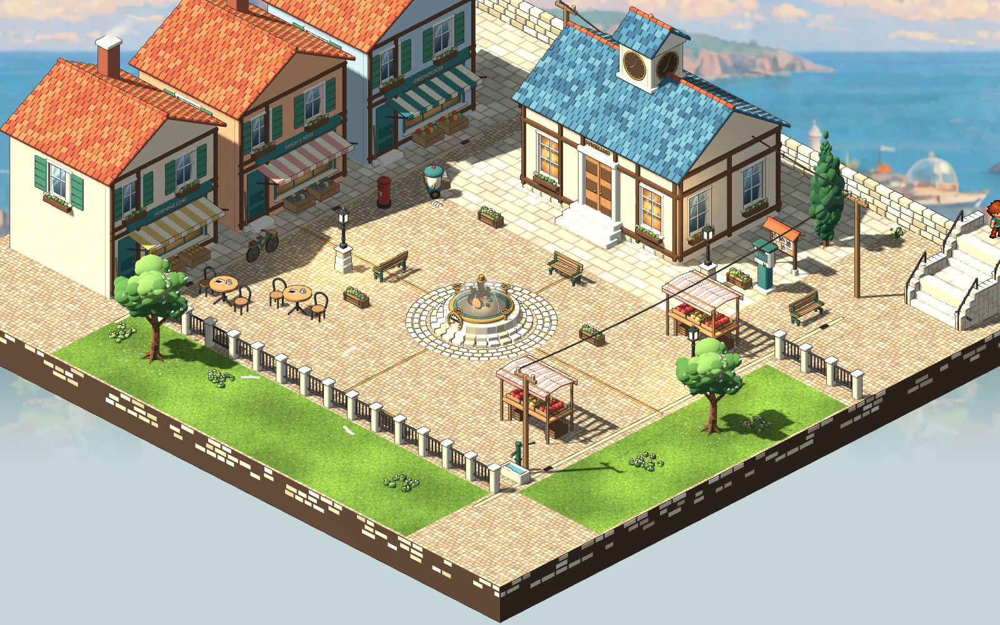

# Rootward Square and the stair follow-up — 2026-10-29

> **Superseded later the same day.** The square was rebuilt after the selected Guildhall Square concept: see the [Guildhall Square review](2026-10-29-guildhall-square.md). This first square's document is kept at `content/areas/archive/haverlund-square-v1.json`, and its Blender masters are kept as `retained_previous_concept`. The square captures in `evidence/sparks-square/1600` and `1280` now show the rebuilt square. The first square's main views were rendered again from its archived document into `evidence/sparks-square/first-pass/1600/`, and the links below point there; the first pass's 1280×720 and play-through-only frames (the descent, the detail view, the screen) were not kept.

The next Sparks & Machines area is the square down the hill from Spindle Lane. The tram keeps its separate future route. This pass builds an explorable place before adding quests that need it.

## The workshop follow-up

The full baseline `scripts/test.sh` passed before extending the town. The agent reviewed the current loft-to-workshop arrival, descent, return and trolley at native gameplay size. Arriving partway down the workshop flight reads as the continuation of the loft’s descent; the tread support keeps the feet planted. The trolley beside the parts drawers belongs with that working corner and keeps the route open. Both placements are retained. The workshop document is version 11, the loft version 9.

- [Arrival partway down](../../evidence/sparks-workshop/2026-10-28-followup/01-upper-landing.png)
- [The workshop and trolley corner](../../evidence/sparks-workshop/2026-10-28-followup/02-workshop.png)
- [The return ascent](../../evidence/sparks-workshop/2026-10-28-followup/04-stair-ascent.png)

A separate `tools/sparks_stair_review.gd` uses keyboard and mouse events and the normal physics clock to revisit the stairs and drawers, without manually advancing the session. It passed in both directions, including the mouse route to the drawers. Input events use the viewport’s local coordinates so UI scaling does not transform them twice. [Keyboard arrival](../../evidence/sparks-workshop/2026-10-29-input-playthrough/01-real-keyboard-arrival.png), [at the foot](../../evidence/sparks-workshop/2026-10-29-input-playthrough/02-real-keyboard-stair-foot.png), [beside the trolley](../../evidence/sparks-workshop/2026-10-29-input-playthrough/03-trolley-by-drawers.png), [back upstairs](../../evidence/sparks-workshop/2026-10-29-input-playthrough/04-real-keyboard-return.png).

## The square

`content/areas/haverlund-square.json` version 1, 32×30, is the fourth area in this journey’s `room_areas`. Spindle Lane version 3 opens the existing iron gate: walking north from (12,26) enters the square at (29,29); the reciprocal uphill link returns to that gate. The last part of the town route has two visible four-tread flights, a landing and stone cheeks that follow the rise. This represents the arrival from the longer walk; it does not simulate 212 individual stairs. Neither the tram track nor the car gains a square link.

The selected T3 square and T5 Rootwell guide the forms. The centre is low: circular limestone steps, brass rim, teal collar, transparent glass bell, a curling root and amber heart, an oversized low-reading pressure dial and four valve wheels with spindles. Brass strips leave it through the cobbles. A blue-roofed clock hall faces Morning Loaf, Finch & Sons and the greengrocer. Their panes sit in real wall openings. Produce stalls have supported striped cloth roofs, crates and hanging scales; café tables have chairs, a hollow cup, tea, a saucer and a marked newspaper. A wheeled postal worker waits with its packets. Benches, flower boxes, a handcart, a bicycle, a post box, public notices, a drinking trough and a planted harbour edge fill the walking routes.

Three chimneys smoke, gulls wheel and the existing painted harbour remains beyond the rail. Hotaru waits near the foot of the steps, with a brief saved arrival scene and remarks. Fourteen short inspections describe the place without assigning a new job. The town hall and shops are exterior scenery; their inspections do not imply an enterable room.

## Screen and saved exploration

The square’s enamel pedestal has the same screen/socket language as the workshop. It requires Nell’s slate, a first physical connection and standing at its approach to reach its three lamp fittings. Visiting or remembering a link does not grant remote control. A connected place with no work ticket now opens a separate saved scratch page instead of a dead “Go downstairs” button. That page uses the real WASI runner, screen status and the usual Test → Apply boundary; it cannot award a nonexistent quest. Leaving invalidates the proposal. Area memory and lamps remain local, while the slate, greeting and notebook drafts travel.

## Art sources and corrections

Ten new native Blender masters are registered in the world catalog and art source pack. Their [source pack](../../art/source/world/sparks-square/v1/README.md) lists the makers, shared painted surfaces and protected edit records. All runtime exports use `scripts/world-art.sh build <id>`, with successful mesh/UV audits and unchanged-source verification. Existing lane props and approved character art are preserved. The gate is a deliberate backed-up edit of the lane set.

The first native wide view exposed gables facing across their roofs. A deliberate source edit aligns the four buildings’ gables with the roof ridges. Further review replaces over-high plain stair cheeks with coursed rising stone, and warms the Rootwell heart while giving its glass fine clear highlights and a readable silhouette. Previous masters and hashes remain alongside the edited files.

## Native review

Godot 4.7.2, Compatibility renderer, 1600×1000 and 1280×720. Normal square camera size 16; the extra detail frame uses 10, and the overview uses the viewer’s maximum size of 24. The approved boy and shared walking template are unchanged.

| View | 1600×1000 | 1280×720 |
|---|---|---|
| The opened gate | [Gate](../../evidence/sparks-square/1600/01-open-gate.png) | [Gate](../../evidence/sparks-square/1280/01-open-gate.png) |
| Hill arrival | [Arrival](../../evidence/sparks-square/first-pass/1600/02-hill-arrival.png) | not kept |
| Descending the approach | not kept | not kept |
| The Rootwell | [Dial](../../evidence/sparks-square/first-pass/1600/04-rootwell.png) | not kept |
| The shops | [Shops](../../evidence/sparks-square/first-pass/1600/05-shops.png) | not kept |
| Market | [Market](../../evidence/sparks-square/first-pass/1600/06-market.png) | not kept |
| Clock hall | [Hall](../../evidence/sparks-square/first-pass/1600/07-town-hall.png) | not kept |
| Live lighting proposal at the screen | not kept | not kept |

These are native rendered, agent-driven reviews, not a human play-test. Software llvmpipe was used for captures, so their frame rates do not establish hardware performance. The whole-square overview is deliberately wider than gameplay.

## Checks and remaining work

The new square suite checks the entire traversable graph for stranded cells, reachable inspections and fittings, both downhill stair profiles, both travel directions, slate/range enforcement, direct-command rejection, actual WASI preview/Apply, separate area memory, the saved scratch page, arrival read tracking and Continue. It also instantiates all ten selected runtime models. The existing lane suite still passes 146 checks.

Focused checks and native runs: square 80, lane 146, workshop quests 82; keyboard/mouse stair play-through passed. All ten initial authorship record hashes match their preserved records, every Blender export was audited, and `git diff --check` passed. **The complete `scripts/test.sh` passed after integration** (exit 0, `.cache/2026-10-29-full-complete.log`), including 80 square checks, 821 world-art checks, 1,262 active-pipeline/handoff checks, protected-source guards and the ground-art handoff. Logs remain under `.cache/`; source assets and selected screenshots are durable.

Deferred deliberately: new square quests and teaching pages, Nell’s return, town-hall/shop interiors, postal routes and other walking inhabitants, working Rootwell valves/dial, and tram boarding with its separate destination. The market stalls share one produce model in this first place pass. The square is a reviewable first implementation, not a claim that these story systems exist.
