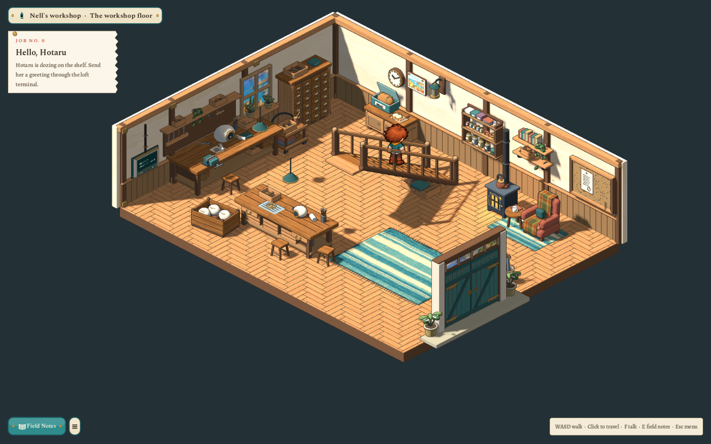

# The workshop floor, rearranged round the stairs — 2026-10-29

After the stairs were turned round (2026-10-28) the user found the downstairs awkward: the only way off the foot of the stairs was along the wall behind the stove and armchair, the space under the high end of the flight was walled off by its railings, and a box sat on the floor beneath it "in the middle of the way". They asked for the furniture to be moved so the stairs can be left on both sides and walked under where there is headroom.

## The workshop floor (version 11)

- **Both sides of the foot.** The stove, tea table, armchair, its rug and the book shelf moved about a cell east (the tea table now sits between the stove and the chair); the bread cupboard, clock and harbour picture moved west. Stepping off the foot at (6,11) leads into the room by the cupboard or by the stove.
- **Under the stairs.** The railings' collision now covers only the low part of the flight (rows 8–10). Rows 6–7 under the high end are floor: you can walk straight under the stairs, or along either side beneath the railings.
- **The walkable flight is shorter.** `stair_flights` describes the eight treads up to (6,8), where the `upstairs` link is; the drawn staircase keeps all thirteen. A cell can only be one thing, so the cells under the high end are floor and the traveller coming down from the loft arrives partway down the stairs at (6,8) (the loft's `downstairs` arrival and the spawn moved with it). The loft arrives on its third tread down in the same way.
- **The trays.** The two parts trays and the teal lidded box were part of the staircase model, under its high end. A deliberate edit (`art/source/world/sparks-workshop/v1/stair_trays_revision.py`; the previous master is kept as `workshop-staircase/v1/model.pre-stair-trays.blend`, note `stair-trays-revision.json`) slides only those pieces 2.7 m back under the low treads, where nobody can stand.
- **The stair lantern** hangs beside the foot of the stairs now; its place to stand is (5,11) and the job's floor marker moved with it. The jar shelf is just east of the foot, clear of the stove pipe.
- **The service trolley** is tucked against the west wall between the repair bench and the parts drawers.
- Old saves standing where the trolley now is move to the spawn and keep everything else.

## Checks

`test_workshop.gd` (73) covers the headroom cells, the railings blocking where they come down low, a straight walk under the stairs, stepping off the foot on both sides, the floor height beneath the high end, the shorter flight's treads and clicks, the arrival at (6,8) and the climb back. `test_workshop_quests.gd` (82) and `test_zone_terminals.gd` (78) use the lantern's new place to stand; the lantern stays unobstructed by the stair geometry while its fixture preview is tested. Captures are the tests' own at 1600×1000.

Not reviewed by hand: the user's own play-through. Open choices for the user: whether arriving partway down the stairs feels right, and where the trolley should live.
