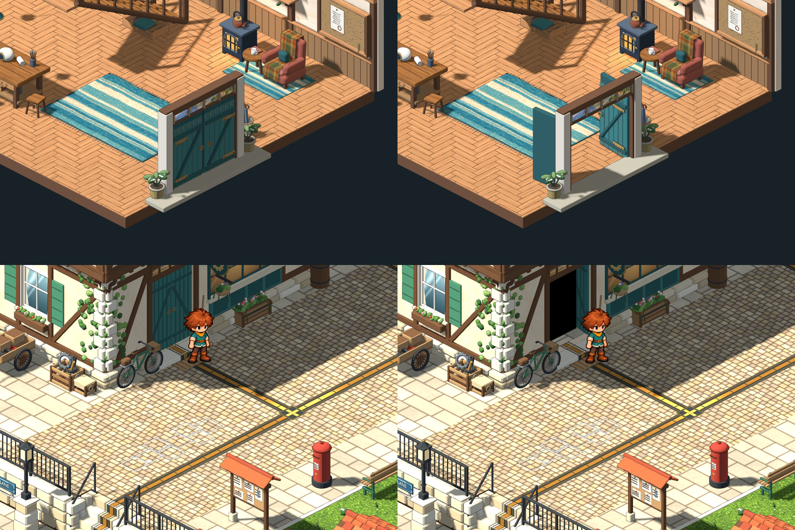
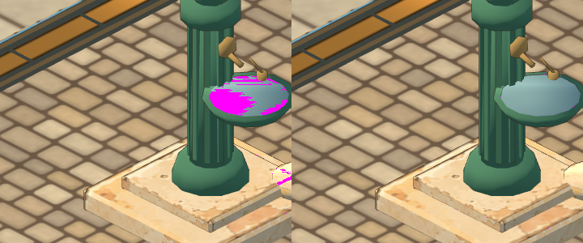
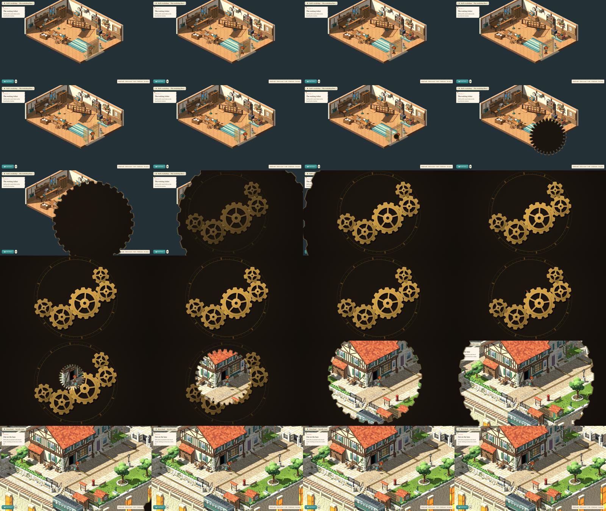

# Doorways, scene changes and flicker — 2026-10-30

After playing the workshop and the square the user asked for:

- **A random picture in the workshop's street doorway** to go, and the inside of the doorway, seen from the lane, to be black rather than another strange picture.
- **Scene changes that walk:** the apprentice floated through the transition area and should walk through it, as seamlessly as possible.
- **Flicker:** some buildings and the new drinking fountain's water were flickering.
- **A transition screen:** a short loading screen in the spirit of the one in the separate Rootward project, with clockwork and gears where that one has runes.

## Result

- **Doorways:** both door models had a `doorway_beyond` picture quad behind their leaves. The workshop's (`workshop-shop-doors`, a harbour view hung in mid-air) is removed. The lane's (`lane-workshop`, a painted shop) is now pure black through a new `doorway_dark` material. Only that quad changed; the transom glass above the inside doors keeps its harbour view. The edit is `art/source/world/square-hub/v1/doorway_dark_revision.py`, with `model.pre-doorway-dark.blend` beside each source.
- **The clockwork veil:** `ui/gear_veil.gd` and `ui/gear_veil.gdshader` replace the plain fade for every scene change (stairs, doors, houses, new game, back to the title). A brass edge in the shape of a gear grows out of the apprentice (or the doorway) until nothing else shows. A train of five meshed gears, an engraved dial of minute ticks and a dark workshop floor turn while the next scene is built behind it. The same edge then opens a hole where the apprentice arrives. Closing takes 0.55 s, the veil stays closed at least 0.55 s and opening takes 0.7 s; the closed veil holds the 60 fps cap on the laptop's integrated AMD GPU. It is original to this project and does not depend on the Rootward project, which was read only for the idea of a sweeping veil with a motif turning on it.
- **Walking through:**
  - The doors begin to swing, then the apprentice walks into the doorway at walking pace for 0.16 s before the veil starts to grow out of it. The veil swallows the apprentice before the floor ends, so there is no more walking out over the void past the room's edge.
  - In the next scene the veil opens on the arrival cell and the apprentice walks out of the open doors (dark, for the lane's), or up the steps, straight on to the cell the link leaves them on. Earlier the arrival walk was fixed at 1.6 cells and stopped, then took further steps once the screen was clear. The doors close behind.
  - Every cell of the walk is real: arrival starts 0.9 cell behind the arrival cell, inside the map, and the walk onward is decided before the room is built.
- **Flicker:**
  - *How it was found:* an orthographic camera slid along its view axis changes no pixel except where two surfaces share a depth, so the square was rendered on a grid with the camera moved 4 cm and 2 cm along it (animation filtered out by rendering the unmoved camera twice) and the differences saved. Hiding one mesh at a time showed which ones fought. `tools/depth_fight_probe.gd` keeps both steps (`scan` an area, `hide` the meshes of one placement) for the next report of flicker.
  - *The fountain:* the water in the basin was a disc in exactly the plane of the bowl's top, inside one mesh. The two discs of water are now lifted 6 mm and 4 mm, and the small trough's top disc 4 mm off the step it stands on.
  - *The buildings:* the seaside kit laid stone, timber, shutter and paint layers in the plane of the wall behind them. The café's shop front, under its awning, was the visible case. Wherever two triangles of different materials face the same way in one plane, overlap and face the camera at some placement turn, the upper layer is lifted 4 mm per layer along its own normal (shutter above timber above paint above stone above plaster). Eleven models were revised: `town-fountain`, the café, bookshop, bakery, post office and greengrocer, and the five seaside houses. `alt_*` parts (per-placement alternatives, of which one shows) are left alone. The edit is `coplanar_revision.py`; it starts from `model.pre-coplanar.blend`, so it can be tuned and rerun.
  - *Before and after:* the fountain's fighting pixels fell from 1757 to 11 and the garden fountain's from 2593 to 15; the café's from 265 to 7. What remains in the probe is animation (the gold power strips, banners and festoon lights). The camera-facing overlap of the shops fell from about 6 m² each to under 0.25 m².

## How it looks

Captured at an eighth of real speed (`Engine.time_scale`), the whole workshop-to-lane change reads left to right, top to bottom: the doors open, the apprentice walks into them, the gear edge grows out of the doorway, the gears turn, the hole opens on the dark doorway of the workshop in the lane, the apprentice walks out and the lane appears.

## Checks

- `scripts/test.sh` passes, including the new `test/test_coplanar.gd` (the eleven models stay free of coplanar overlap) and the veil checks in `test/test_ui.gd`.
- Reviewed in Godot at gameplay scale: `tools/gear_veil_review.gd` (the veil at fixed points of its sweep), `tools/transition_review.gd` (the real scene changes) and `tools/depth_fight_probe.gd` (the flicker, before and after).

## Open

- The inside doors still fade to a ghost when the apprentice is near them (`WorkshopFloorStage`), so the leaves swinging open are only half seen. That is the earlier see-through rule; a clearer swing would change it.
- Only the flicker the probe could find was fixed. Small slivers of overlap remain in the seaside houses (under 0.6 m² each, where tiny details touch); if a particular building still shimmers on the user's GPU, name it and it can be probed alone.
- `ROOTWARD_GPU=nvidia` was not used for this review; all frames are from the default AMD GPU.

## Follow-up: the gears must keep turning

The user found the gears stopped too soon and asked for constant, calmer motion. The cause was not the animation: a new place is built in one go on the main thread (about 3 s for Spindle Lane and 5 s for the square on a first visit; 3 s on later ones), and nothing is drawn while it works, so the veil froze mid-turn. `BuildPump` now lets the builders ask the veil to redraw itself between pieces (roughly 30 to 45 draws a second during a build, the world underneath switched off), the gears follow the clock instead of the frame time, they appear earlier and stay later in the sweep, and the whole veil is a little slower (0.55 / ≥ 0.55 / 0.7 s). Frames saved from inside a build show the gears turned a little further each time. Open: the build itself is slow (a second visit to the square still takes 3 s, mostly in placing about 170 models); speeding it up would be its own piece of work.
