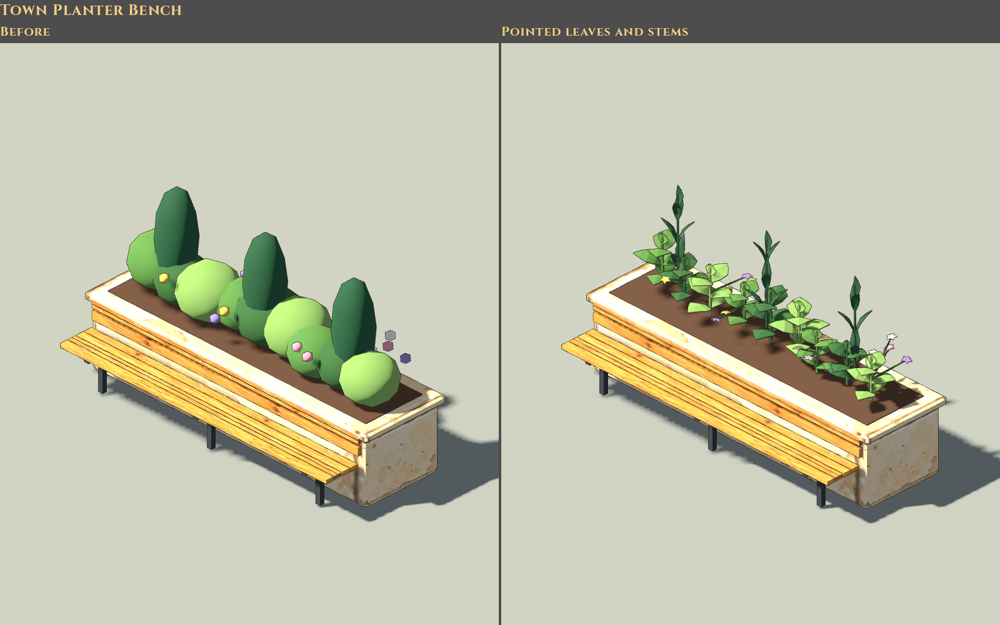
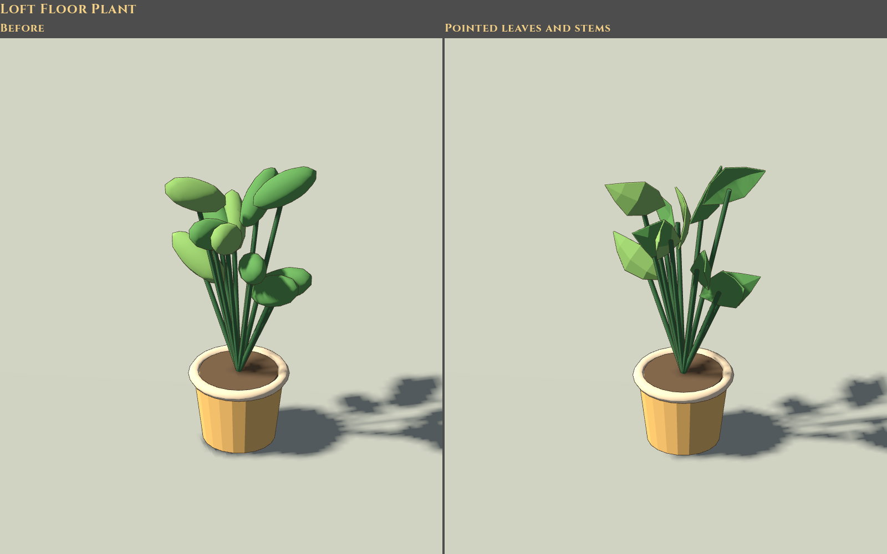
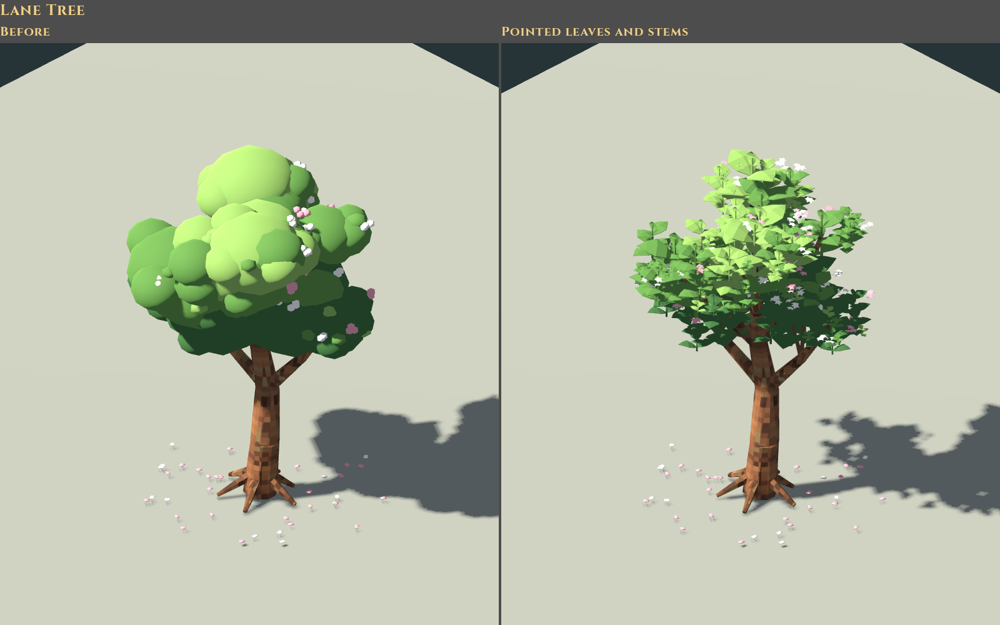
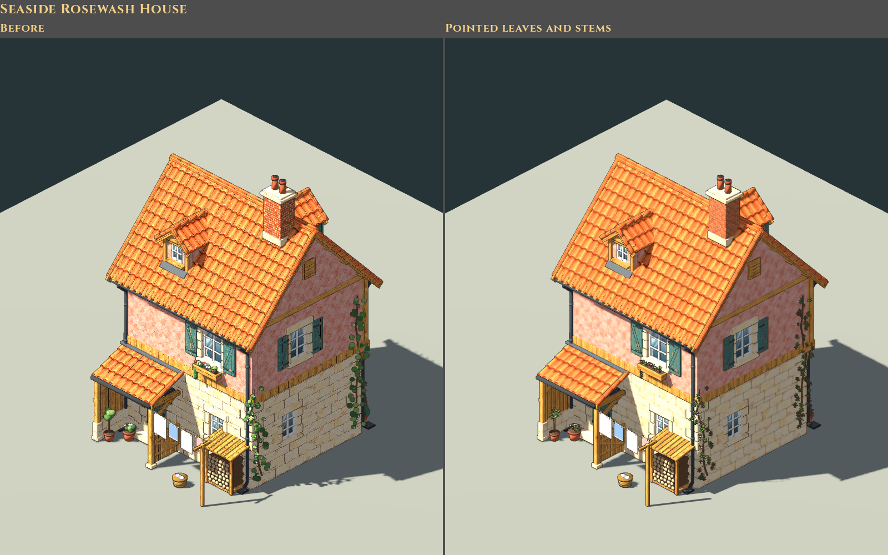

# Sparks & Machines plant style — 2026-10-30

The user requested recognisable, simple plants instead of the repeated oval/bubble foliage. Thirty-five existing Blender masters now use tapered leaves with a slight fold and raised midrib, small branching sprigs, pointed evergreen foliage and five-petal flowers. The change covers the loft and workshop plants, Spindle Lane's trees/green/window boxes, square planters and Rootwell planting, civic/shop frontages and the five modular seaside houses.

The existing pots, furniture, architecture, trunks, supports and mechanical parts retain their authored geometry and materials. Every master has its original `model.pre-plant-style.blend`, a per-source `plant-style.json` and a normal audited runtime build. The [source pack](../../art/source/world/plant-style/v1/README.md) lists all 35 models and the deliberate edit; it does not regenerate any model from its old initial authoring recipe. Fruit/vegetable displays and market-stall tomatoes retain their original shapes despite sharing palette colours with foliage. The boy, camera, area documents, gameplay rules and save data were not edited.

The street planter's first review showed the old flower heads floating beyond the shrub clumps. Twelve fine stems now connect these blooms to the new leafy branches. The shared house palettes retain both their original four-row and five-row layouts, existing packed images and swatch UVs.

The models were reviewed in Godot 4.7.2 using the normal Compatibility renderer on the AMD Radeon 680M. `tools/plant_style_review.gd` captures matched front/rear comparisons for nine representative models, applies the same house variants to both sides, and uses the approved camera heading/elevation. Actual area views were reviewed at camera size 13 and 1600×1000 for the loft, workshop, lane and square, plus 1280×720 for the square. Both loft plant instances remain distinct placements with the existing scales/turns.

[Loft](../../evidence/plant-style-2026-10-30/loft.png) · [Workshop](../../evidence/plant-style-2026-10-30/workshop.png) · [Lane](../../evidence/plant-style-2026-10-30/lane.png) · [Square](../../evidence/plant-style-2026-10-30/square.png) · [Square at 720p](../../evidence/plant-style-2026-10-30/square-720.png)

The user explicitly chose to keep the current geometry and raise the test budgets for now, pending their own in-game review. No simplification was applied. `test/test_house_variants.gd` and `test/test_rootwell.gd` retain explicit ceilings with approximately 10% headroom:

| Model | Previous triangles | Revised triangles | New test ceiling |
| --- | ---: | ---: | ---: |
| Rosewash | 36,126 | 145,686 | 160,000 |
| Saltwind | 48,610 | 157,462 | 175,000 |
| Lantern Row | 43,406 | 184,814 | 205,000 |
| Shingle Court | 33,992 | 129,584 | 145,000 |
| Eaveside pair | 64,712 | 250,964 | 280,000 |
| Rootwell landmark | 123,801 | 354,525 | 390,000 |

This is a real increase in outdoor geometry. Single scene captures reported 167 fps in both rooms, 127 fps in the lane, 159 fps in the square at 1600×1000 and 169 fps in the square at 1280×720. These are short captures on the local GPU, not a performance regression comparison or a replacement for the user's play session.

Checks:

- Normal `scripts/world-art.sh build <id>` passed for all 35 revised models, including a second export of the floor plant and the bench's reviewed stem refinement.
- Blender `plant-style/v1/verify.py` passed against all 35 preserved originals after the final model edit: 486 untouched objects, 123 edited foliage mesh groups, protected original faces, parentage, transforms, authored properties, material values and packed texture hashes. [Recorded audit](../../art/source/world/plant-style/v1/validation.json).
- All checks in `scripts/test.sh` passed, completed in sections after the budget updates. The first run stopped at the former house limits. The second passed everything through the 307 house-variant checks, then stopped at the Rootwell's separate former 140k cap. After adjusting that cap, the exact unchanged remainder of the script was resumed from `test_rootwell.gd` and exited 0. This included 35 Rootwell, 11 coplanar-surface, 933 world-art, 11 source-protection, 1,442 active-pipeline and 121 ground-art checks, plus the request workflow's 11 Python tests. Logs: `.cache/plant-style/tests-final.log` and `tests-remainder.log`; the resumed commands were checked against the original script. The house checks also passed independently with the final limits.

Delivery: candidate art for the user's in-game review, through grouped update `20261030T011223-8d5180d8`. Acceptance remains with the user in the dev menu.
