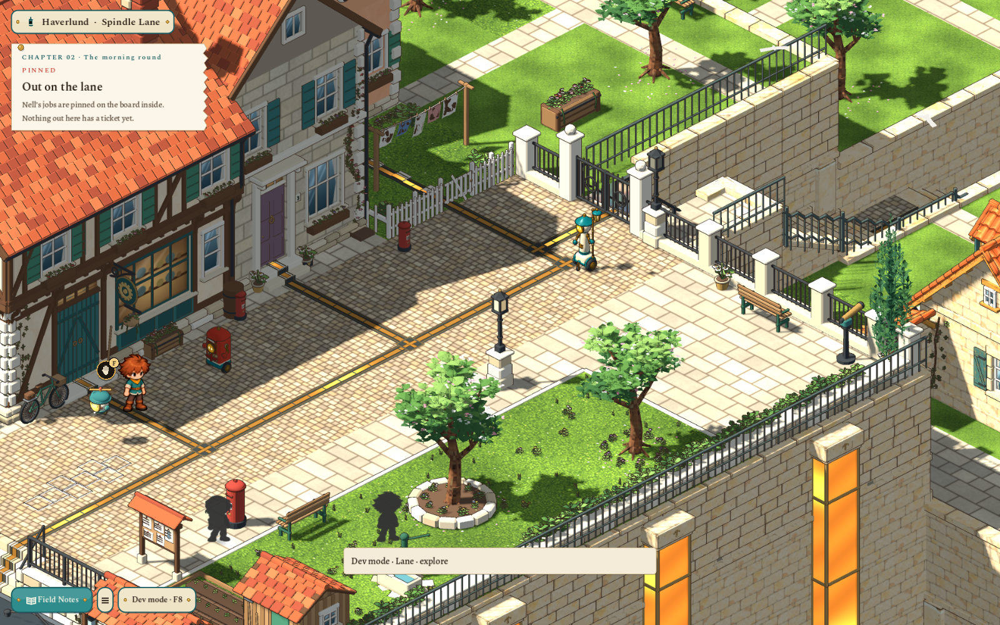
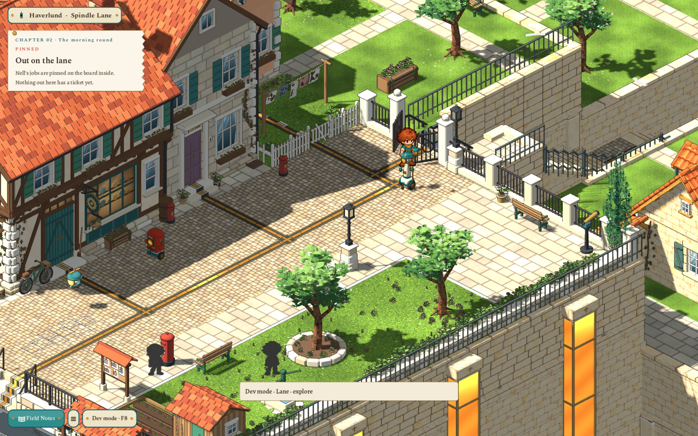
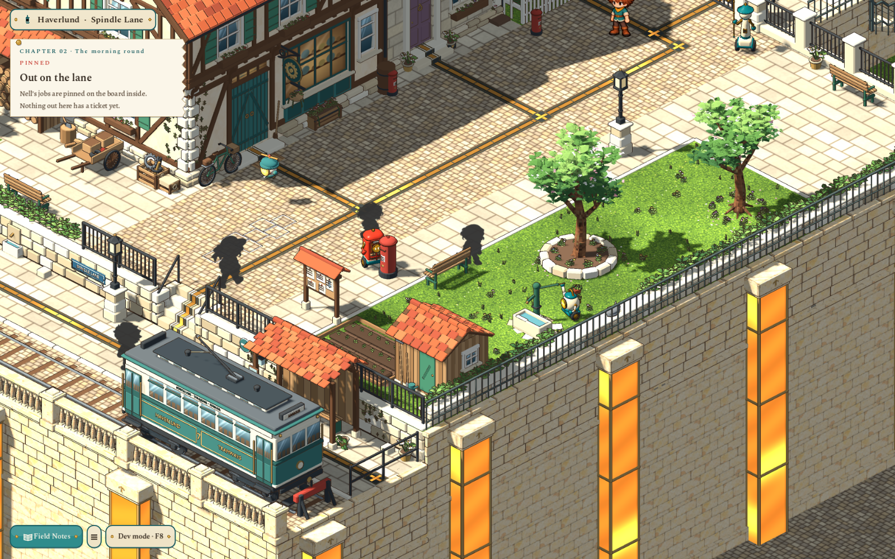
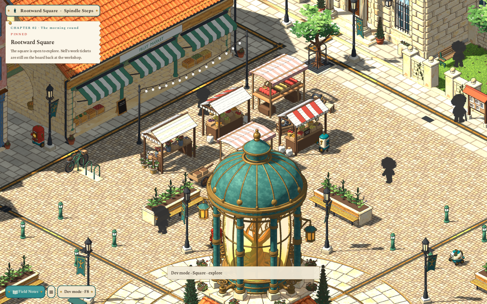
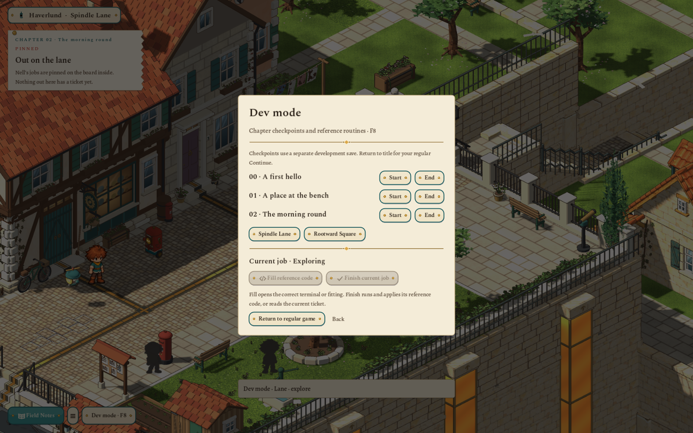
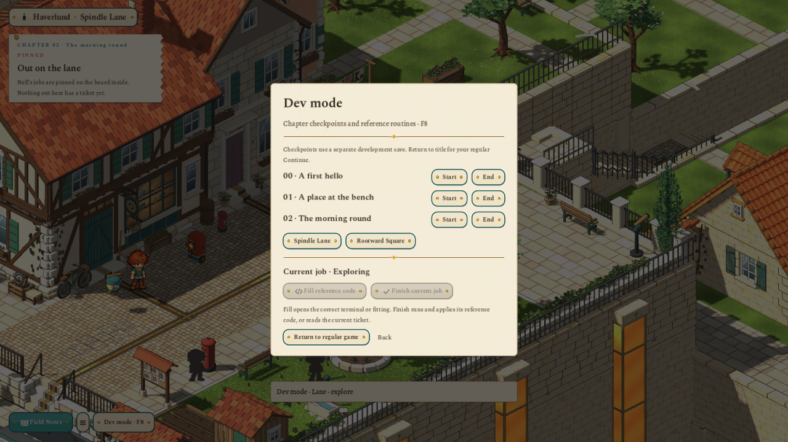
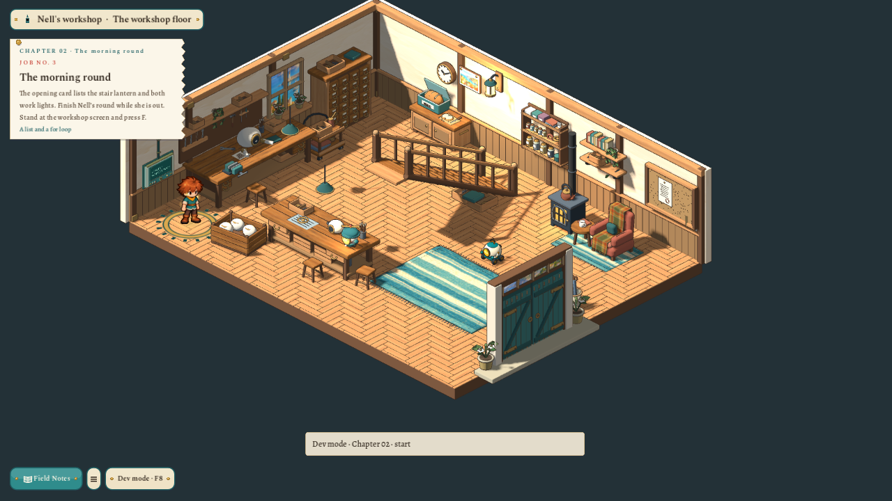
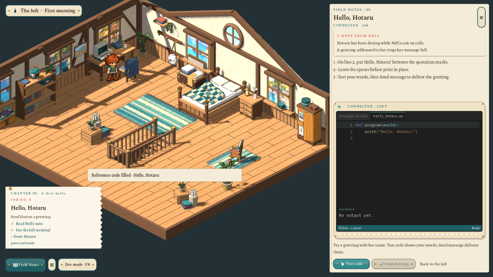

# Spindle Lane, purposeful errands and chapter tools — 2026-11-02

The marked lane gate now has intact, correctly registered leaves which open as the player takes the stairs. Both sides of the descent have handrails. The surrounding town has fewer houses and coherent gardens. Anonymous people use varied existing silhouettes, and outdoor inhabitants travel faster between actual work/errand destinations. A wider pin supplies chapter context; development controls make the existing questline easy to revisit one chapter at a time.

## Visible result

## Sources and behavior

- **Gate:** an earlier per-vertex opening edit had stretched the meeting stiles and latch across the opening. The adopted lane master recovers whole intact components from its preserved `model.pre-square-gate.blend`, with two new `door_leaf*` hinge pivots and opposite 88° swing metadata. The existing `town-steps` link selects `doors: shell`. Ordinary travel opens it downhill, opens it for the return, then closes it behind the player.
- **Stairs and surroundings:** the two adopted lane masters retain `model.pre-lane-believability.blend` backups and source hashes. New handrails follow the original treads, and guard rails protect visible garden/terrace drops. Existing background top faces are divided with UV interpolation into connected streets, yards and garden parcels. Thirteen background house placements are removed, leaving eighteen; orchards, planting, a garden shed, barrel and bench occupy the new space. House masters are retained. [Source-edit record](../../art/source/world/lane-believability/v1/README.md).
- **Anonymous appearances:** thirteen charcoal profiles use eleven complete existing painted atlases from both villager casts and the boy. Three child profiles use smaller presentation scales. The normal art build preserves all source alpha, gait, anchors, poses and idle metadata. Cosmetic shuffle bags supply varied appearances per visit and new tram groups; deterministic movement remains independent. Named Nell stays absent. [Source selection](../../art/source/characters/phantoms/v3/README.md).
- **Errands:** `villagers.route` still owns standing cells; the parallel `errands` list supplies a placed target, known activity and 1–15-second work/rest stop. Pure rules validate the data, navigate ordinary passages, reserve occupancy, record arrival and facing, and continue in order. Postal robots visit collection/delivery boxes and the post office. Wick visits lamps; Trowel visits water and planting; Heron visits supplies; Tender checks the Rootwell and planters; Tally visits stalls. People read notices, shop, rest, play and visit fountains. Ten outdoor robots travel at 1.5–1.9 cells/second; anonymous residents use brisk varied speeds. The indoor workshop robot retains its earlier route.
- **Pinned card:** width increases from 300 to 380 logical pixels. Chapter number/title, job number and programming concept appear alongside the wrapped objective and steps. Chapters live in the journey story data. Jumping clears a stale completion stamp and feedback. The card fits its final wrapped height; while code is open it clears the bottom buttons and feedback sits above it. A comparison of every old/new outdoor walkable cell confirms that the added post boxes remove no previous standing cells, preserving valid saved positions.
- **Dev mode:** **Dev · F8** or **F8** opens starts/ends of implemented Chapters 00–02, lane/square jumps, Fill reference code and Finish current job. Fixtures/reference code live in `content/development/sparks-checkpoints.json`. Fill connects the real fitting/terminal; Finish executes reference Python through the worker-thread WASI, validated proposal and Apply, or reads the current ticket through the ordinary inspection. The first dev action saves regular progress and switches to a separate `.dev` slot. Return to regular game or the title restores ordinary Continue. Tools require a debug build and the `rootward/development/tools_enabled` project flag.

## Verification

- Both masters exported and audited with `scripts/world-art.sh build`; final audits include explicit UVs on the new untextured handrails, with no script errors.
- `scripts/art.sh`: approved art/idle 100 checks and shared skins 111 checks passed. The boy and original source paintings are unchanged.
- `test/test_town_life.gd`: 2,392 checks passed, including legal routes, stationary work at actual targets, at least two destinations per outdoor inhabitant within 90 seconds, deterministic separation, all appearance pools, original alpha/timing and four tram services.
- `test/test_lane.gd`: 163 checks passed, including two closed-at-rest gate leaves, opening/closing and both sets of handrails.
- `test/test_development.gd`: **58 checks passed**, including checkpoint/state validation, byte-identical ordinary saves, reference-code WASI/Apply, the wider pin, actual chapter Start/End button signals and Return to regular game.
- Native `tools/reviews/lane_polish_review.gd` passed at **1600×1000** and **1280×720**: actual downward input opens the gate, both directions travel correctly, the gate closes behind the return, and chapter controls/cards remain visible. Selected captures above come from those runs with isolated progress.
- The final full **`scripts/test.sh` completed successfully**, including the app, WASI, UI, movement, art, world models, asset workflow and source guards. Documentation/handoff links passed 1,490 checks and ground art 121. Focused final lane/errand/dev tests also passed after the last clearance/layout refinements. `git diff --check` is clean.

## Scope

These are local, deterministic errands with destination-facing pauses. Parcel inventories, physical tool-use animations, daily schedules and cross-area crowd persistence are still future work. Ambient lamplighting checks do not change quest lamp state. The background gardens remain scenery outside the playable map. Only existing quest chapters are offered; new story/questline work follows separately, one quest at a time, starting with Chapter 00. The approved camera, boy, original character art, authored house masters and regular saves are preserved. No commit or publication was made. The two model updates are delivered to **Finished** for user acceptance. The queue automatically supersedes the earlier multi-asset foliage receipt because it also contained the lane set; its other authored models and delivery history are retained.
