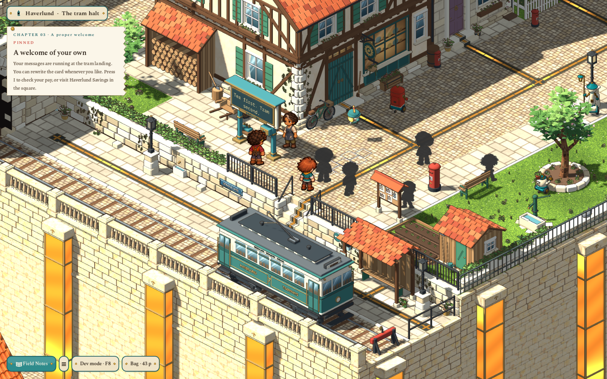
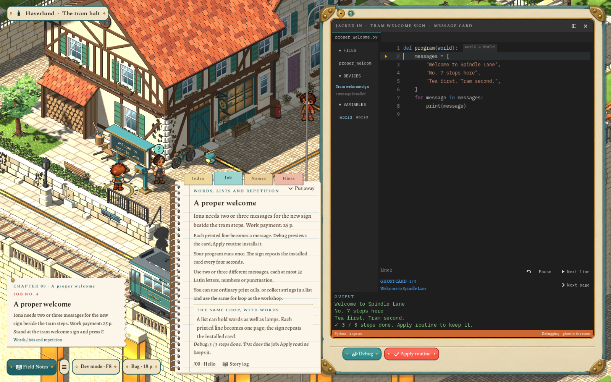
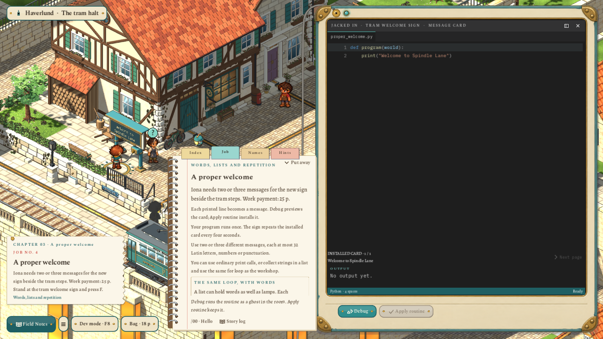
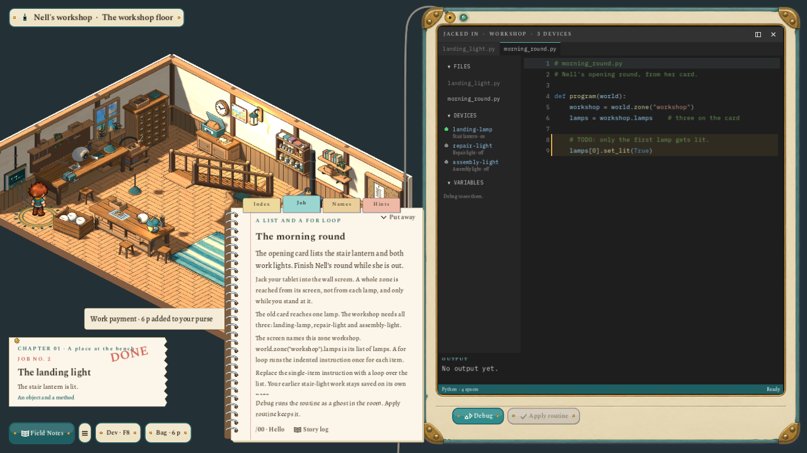

# Tram-stop arrangement and one programming workspace

2026-11-02. Follow-up to the user's annotated tram-stop screenshot. The prior [quest/property delivery](2026-11-02-welcome-quest-and-property.md) remains historical; this pass changes the active layout and replaces its separate sign editor.

## Result

The welcome sign now stands on the upper pedestrian paving, west of the tram steps. Its face clears both the parked car and the shelter. Braum and Iona's waiting positions follow it, leaving the stair mouth and old notice board clear. The existing platform lamp moves west; a matching lamp guards the east end beyond the shelter. Wick's round now stops to check both, as well as the gate and pavement lamps.

All code jobs now use `JobsJournal`: the field slate, clipped Field Notes, job/index/names/hints pages, file tabs, device states, variables, Dark+ editor, line replay, output, Debug and Apply routine. The former `DisplayEditor` modal is removed. The sign supplies its own bounded output context and a small card/page readout within this shared workspace. The job book's destination button walks to and connects the sign; Field Notes beside the accepted sign reopens the same page. Existing sign text, source, payment receipts and property remain saved.

The slate is about 15% wider than its previous default at the reference canvas. Its sidebar starts at 196 logical pixels and can be dragged between 128 and 360, or hidden with the header control / **Ctrl+B** while typing. Files, Devices and Variables have individual foldable headings. Sidebar width, visibility and folded sections follow jobs and rooms for the play session. The notes retain their clipped position and Put away behavior. Code owns the extra width; long sidebar captions clip with tooltips.

The Debug icon uses distinct outline bug/play shapes with a gap between them. Debug clears stale execution marks before running. Editing a completed job now restores Debug/Apply, instead of leaving their buttons hidden behind the completion state. Both sign and lamp jobs share these fixes.

## Ownership and compatibility

- All placement, collisions, lamp approaches, story stops and Wick's errands remain in `content/areas/haverlund-lane.json`. The sign stands at `[9,7]`, height 1, with coding approach `[9,6]`; Braum waits at `[10,6]`, Iona at `[10,8]`.
- The platform lamp instances stand at `[6,3.7]` and `[22.3,3.6]`, on the lower platform. Both use the existing adopted `lane-lamp` mesh and separate `lamp_glass`. Two area-owned fixture states make their physical fittings available to future jobs. Ambient checking does not complete a quest or change player lamp state.
- Existing saved lamp dictionaries gain the new keys through normalization. A saved player position now covered by a moved sign post relocates safely while preserving the custom card and Python memory. Sign approaches join the existing reserved terminal/lamp cells so ambient errands leave the connection usable.
- No adopted mesh, painted character, shared animation setting or approved camera was changed. Model request fingerprints remain unchanged; this pass rearranges area instances and reuses their audited outputs. No new image generation, runtime dependency, commit or publication.

## Verification

Focused checks pass: final sign/property flow **43**, lane **170**, workshop story **91**, display rules **29**, and ambient town life **2,420**. The lane checks include safe restoration of old saves and Wick reaching both ends of the waiting area. The sign flow exercises the actual job-book destination, common debugger, drag/collapse controls, Ctrl+B with editor focus, invalid proposals, repeated Apply, banking, disk saves and Reset.

The full **`scripts/test.sh` completed with exit 0**, including app/WASI, both archived journeys, UI, transitions, build/movement, source guards, world art (**937 checks**), asset workflow, documentation (**1,528 checks**) and ground art (**121 checks**).

Native sign reviews pass **43 checks** at both **1600×1000** and **1280×720**. The ordinary workshop tour also completes at both sizes, including Debug, replay, variables, completion and notes put away. Captures above use the normal gameplay camera scale. Review routing follows the actual job-book path through accepted movement steps so desktop focus changes cannot cancel its automation. `git diff --check` is clean.
