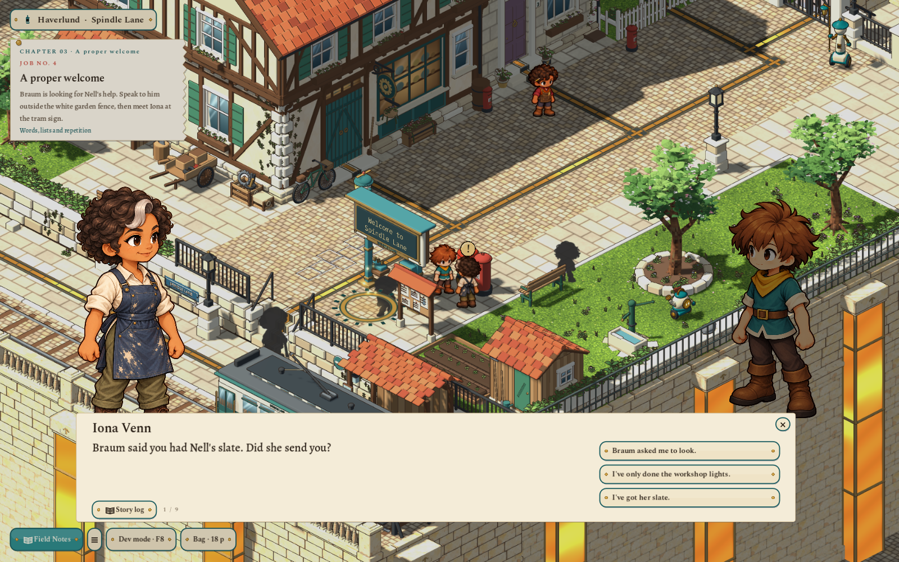
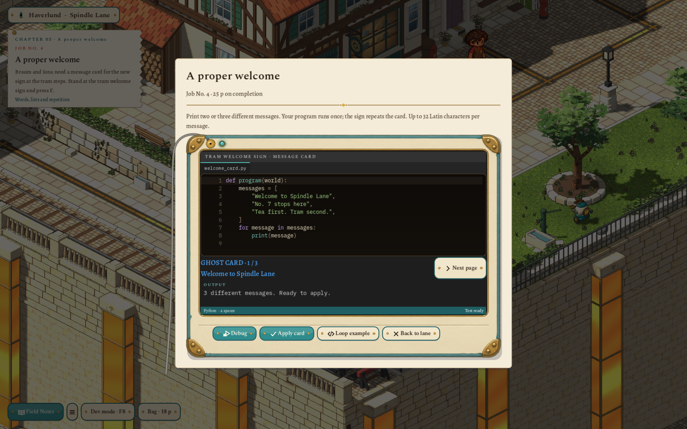
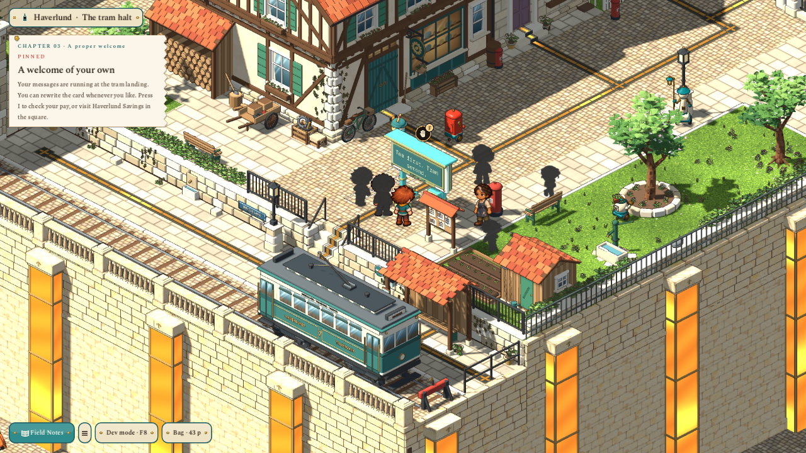
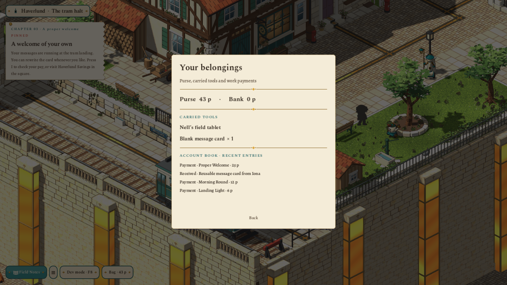
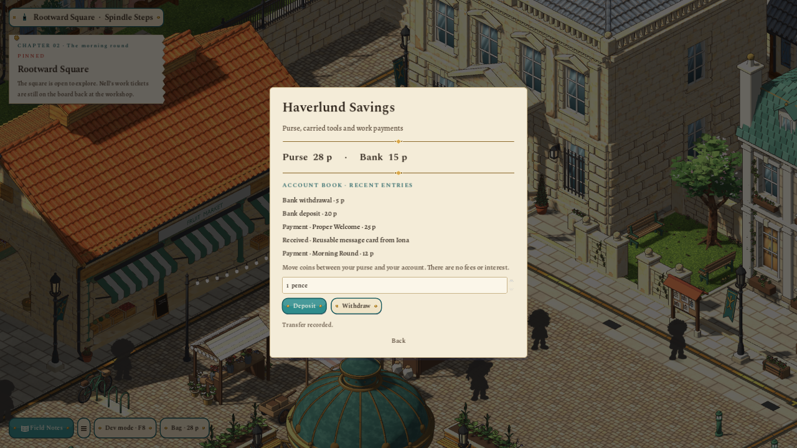

# A proper welcome — Chapter 03 and property foundations

2026-11-02. First playable pass for user review. Continues the existing workshop morning round; the Chapter 00–01 storyboard rewrite remains a separate editorial draft. No commit or publication.

## Play this slice

Finish the three workshop lights, then go outside. Braum leaves his white-fenced garden, opens its gate and walks down the lane. F starts his introduction. Meet Iona beside the tram landing, finish her commission conversation, then stand at the sign's socket and press F. Several `print` calls or a finite list/`for` loop both work. Debug previews a card; Apply installs it. Two or three different messages earn **25 p** once. The sign cycles the saved card every four seconds after the slate is put away.

**I / Bag** opens the purse, bank balance, carried slate, reusable message card and account history. **F** at the existing Haverlund Savings street counter in Rootward Square opens deposits/withdrawals. Earlier light jobs now pay 6 p and 12 p; completed old saves receive each once. F8 offers Chapter 03 Start/End, Fill reference code and Finish current job through real WASI/core validation. Development saves remain separate from regular Continue.

## Implementation and art

- The area owns the sign, two small post collisions, approach `[15,7]`, Iona's work spot and Braum's spawn/meeting/landing cells. The sign stands at `[15,8]`, height 1, clear of tram tracks, stair treads and the existing notice board. Its live text is warm fixed-advance lettering, two rows of sixteen cells. A nearby full-card preview supports the world lettering.
- `DisplayCards` validates known target, accepted commission, visited zone, carried slate, range and one–three nonblank messages of at most 32 printable ASCII/Latin-1 characters. Two distinct messages complete the real world goal. The sandbox captures normal print formatting into one replacement command only in the sign editor's explicit snapshot context. One valid starter page remains incomplete. The program runs once; no sleep, perpetual Python loop or runtime service is involved.
- Debug/Apply uses the existing worker-thread runner and atomic proposals. Editing, closing, moving and travel invalidate previews. Custom pages and the independent draft save. Rewriting, Undo and Reset cannot farm wages. The sign remains editable after completion; conversations can be revisited after interruption without replaying a finished introduction.
- Braum uses the existing `sparks_bram` gait and a new full-body portrait. Iona has a distinct shared-frame `iona` skin, SE/NE originals, exact mirrored pairs, registered cells and blink source. Both portrait bodies face the speaking partner. Named human replies and story-log labels retain the actual speaker and substitute the player's chosen name.
- The garden's existing fence geometry was extracted into a real hinge in its adopted lane master, retaining a pre-edit backup and hashes. Its `door_group` extra scopes it independently of the two town-step leaves. Braum's path follows ordinary core passages, animates his gait, reserves occupied cells and pauses for dialogue/editor panels.
- The new saved Blender sign master includes cream enamel, brass bezel, teal posts/weather hood, rivets, dark glass, physical stop-name plate, service socket and painter's tool rest. `SignFace` and `SlateSocket` anchors supply the text/cord attachments. The normal world build exported/audited **33 meshes / 6,976 triangles**. The updated lane set audited **45 meshes / 358,956 triangles**.
- `PlayerAccounts` owns bounded integer balances, known stock, exact-once receipt IDs, recent history and atomic purchase/material rules for future puzzles. The active journey ledger replaces cached room copies during travel. Player Python has no property-writing API yet. [Full property contract](../PROPERTY.md).

Original boy/cast art, shared motion settings, camera and house masters are retained. Asset authoring uses the established art/world builds. New raster work used built-in `image_gen.imagegen`; no generation or authoring tool is needed to play. [Iona sources/prompts](../../art/source/characters/iona/README.md) · [Portraits/prompts/provenance](../../art/source/portraits/sparks/v3/README.md) · [Saved sign master and source edits](../../art/source/world/tram-welcome-sign/v1/README.md).

## Verification

- `test/test_accounts.gd`: **22 checks**, including invalid/fractional/nonfinite amounts, insufficient funds/stock, caps, one-time receipts, atomic purchases and JSON restoration.
- `test/test_display_cards.gd`: **29 checks**, including malformed authored staging, empty/oversized/unsupported cards, wrong targets/range, whole-batch rejection, real finite Python loops, print formatting, normal Hotaru output, saved cards and Undo.
- `test/test_area.gd`: **160 checks**; the new reference solution runs through CPython/WASI and completes the real goal, while the unchanged starter does not. Garden and landing routes use real passages.
- `test/test_development.gd`: **69 checks**, including Chapter 03, real sign completion, wages and byte-identical preservation of regular progress.
- `test/test_lane.gd`: **166 checks**; both travel leaves and the independent garden hinge open/close correctly, with reachable approaches and preserved rails.
- `scripts/art.sh`: approved art/idle **100 checks**, shared skins **111 checks**. Both selected world outputs have current normal audit manifests.
- The native `tools/welcome_review.gd` tour exercises the same real quest, editor, payment, bag, bank, room return and restore at **1600×1000** and **1280×720**, using isolated scratch saves. Captures include the maximum 32-character, two-row layout. Visual checks corrected an initial tram-side approach and hidden slate controls before these review captures.
- The final full **`scripts/test.sh` completed with exit 0**, including app, WASI, movement, build/terrain, both archived journeys, UI, transitions, characters, world art (**937 checks**), authoring guards, asset workflow, documentation links (**1,526 checks**) and ground art (**121 checks**).
- Final native runs at **1600×1000** and **1280×720** each passed **32 checks**, including visible Debug/Apply, invalid-card preview clearing, the independent garden hinge, finished human replies, F at the actual bank, cross-room accounts, real disk-save restoration, one-time wages and Reset. The native review uses scratch paths and cleans its saves. A final HUD refresh correction is covered by both native tours and `test/test_ui.gd` (**65 checks**); the Bag amount now updates immediately after a transfer. `git diff --check` is clean.

## Boundaries and next step

This adds one outdoor job and property foundations. Shops, house purchases/interior costs, passive income, interest, trading, inventory item paintings, the later `if` lamp ticket and city-supply puzzle are not implemented. Recurring character histories remain a writer's guide, with only the immediate relationships exposed in these conversations. The next quest can reinforce reading state/`if` at Braum's lamp, then connect individual faults to the shared power-source story.

The sign and garden model requests are delivered through the local Finished queue for user acceptance after the final audit. Further review changes should edit the saved sources and use the normal pipelines.
